# English for Banking & Finance — International Edition
*Professional Student’s Book · Level B1 · Operator & Practitioner tracks*
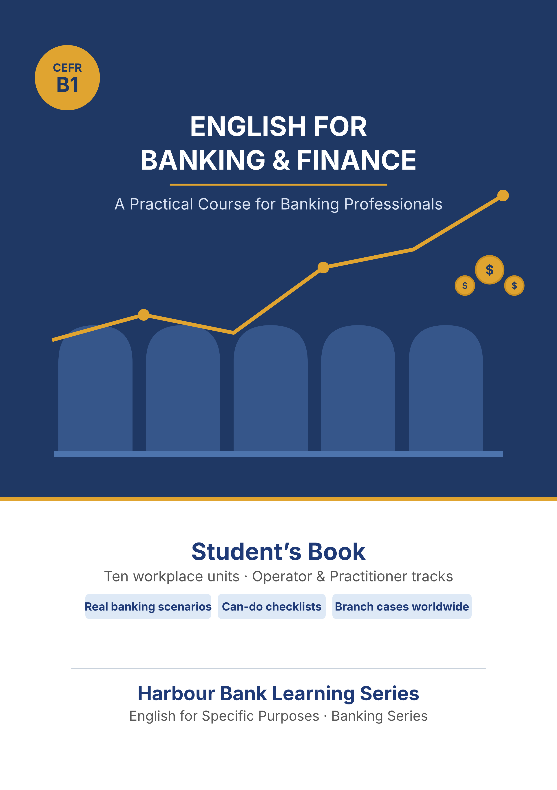


# English for Banking & Finance
*Professional Student’s Book*
*Level B1 · Operator & Practitioner tracks*
*International Edition · Student edition*

## How to use this book
Every unit has a Warm-Up and ten Parts. Parts 1–6 are the Operator track (lower B1) for staff in their first months. Parts 7–10 are the Practitioner track for staff with a few years’ experience. Both tracks use B1 English — the Practitioner parts add harder decisions and leadership tasks, not harder language. A beginner class can use Parts 1–6 only; a mixed or experienced class adds Parts 7–10.

For a flipped classroom: learners do the ‘Pre-class input’ parts at home (Vocabulary, Grammar, Listening, Reading), then do the ‘in-class output’ parts together (Speaking, Writing, and the Practitioner parts). Every listening script is printed in the unit, so learners can prepare at home even without audio.

Scaffolding: every writing task gives you a model, a plan, useful words, and a check. Every speaking task gives you a model and role cards. Every grammar point has a clear box and a ‘Watch out!’ for common mistakes.

This edition is set in an international bank. Harbour Bank has its head office in Rotterdam and branches in Nairobi, Istanbul, São Paulo, Manila and Warsaw, and it works with partner banks elsewhere. Harbour Bank, its staff, its customers and all its figures are invented for practice; the banking itself — IBAN and BIC, correspondent banking, know-your-customer checks, exchange rates and spreads, letters of credit — is true and general. Part 9 of every unit is a Branch Case Study, and you are asked throughout to compare what you read with banking where you live.


# Unit 1 · Getting Started in Finance
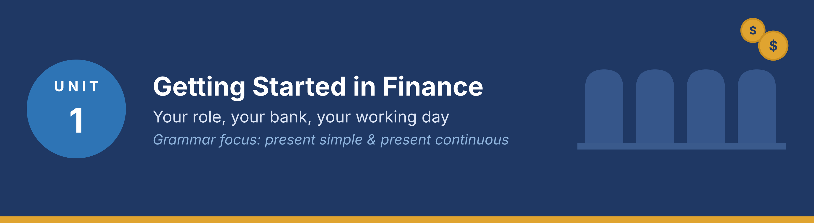

*In this unit you learn to introduce yourself and your job, talk about your daily tasks and your current work, understand short workplace conversations, and write a short introduction. Grammar focus: present simple and present continuous.*

## Part · · Warm-Up
*In-class starter · speak before you read*


### W-A  Roles and Services (brainstorm)
*With a partner, list job titles and services you find in a bank.*

> **Model — read this first**
> Job titles: teller, loan officer, branch manager. Services: savings accounts, money transfers, loans.

- Job titles you know: ____
- Services you know: ____


### W-B  Banking where you live (discussion)
*Talk about banking where you live. Useful frame: “In my city there are ___ banks, such as ___.”*

- What kinds of banks are there in your country?
- Do you or your family use any banking services? Which ones?


### W-C  My Banking Experience (pairs)
*Share a recent visit to a bank (in person or online).*

> **Model — read this first**
> Last week I visited my bank to pay a bill. A teller helped me, and it was a good experience.

- Was it a good or bad experience? Why?
- What was the job title of the person who helped you?


## Part 1 · Vocabulary
*Pre-class input*


### 1A  Match the roles to the definitions
*Match each banking role (1–7) to the correct definition (a–h). One definition is extra.*

**Example: 0. Vault → g)**


| Column A | Column B |
|---|---|
| 1. Teller ____ | **a)** A senior person who manages the branch. |
| 2. Branch manager ____ | **b)** A staff member who handles deposits and withdrawals. |
| 3. Loan officer ____ | **c)** A person who helps customers open or manage services. |
| 4. Customer service rep ____ | **d)** A machine used for cash withdrawals. |
| 5. Security officer ____ | **e)** A person who checks loan applications. |
| 6. ATM ____ | **f)** A person in charge of safety and security. |
| 7. Account ____ | **g)** A place where money is kept for a customer. |
|  | **h)** A written report of all your transactions (extra). |

*Pronunciation — word stress. Say these words. Mark the strong part: TEL·ler, man·A·ger, of·FI·cer, cus·TO·mer.*


### 1B  Vocabulary in context (gap-fill)
*Complete the sentences with the correct word.*

**Word bank:** account | interest | teller | branch | ATM | loan | customer | deposit | withdraw

**Example: 0. I went to the bank to open a savings account.**

1. I opened a new ______________________ at the bank last week.
2. The ______________________ helped me deposit my salary.
3. Our local ______________________ is closed on Sundays.
4. You can ______________________ cash at any time using the ATM.
5. The bank offers 3% ______________________ on savings.
6. I applied for a small business ______________________ to start my shop.
7. A ______________________ service rep helped me reset my online password.
8. Please ______________________ your salary at the counter or the machine.
9. I use the ______________________ near my home to take out cash.


### 1C  Word partners (collocations)
*Match the verb to the noun to make a common banking phrase (one noun is extra).*


| Column A | Column B |
|---|---|
| 1. open / close ____ | **a)** a loan |
| 2. apply for ____ | **b)** an account |
| 3. withdraw ____ | **c)** a password |
| 4. make ____ | **d)** cash |
| 5. reset ____ | **e)** a deposit |
|  | **f)** a branch (extra) |

*Now complete the sentences with a phrase from above.*

1. I want to ______________________ at this bank. I have my ID.
2. You can ______________________ at the ATM at any time.
3. She went online to ______________________ because she forgot it.


### 1D  Front office or back office?
*Put each role in the correct group. Front office = works with customers. Back office = works behind the scenes.*

Roles: teller, IT support, loan officer, risk analyst, customer service rep, compliance officer.

- Front office (with customers): ____
- Back office (behind the scenes): ____

> **Model — read this first**
> Front office: teller, loan officer, customer service rep. Back office: IT support, risk analyst, compliance officer.


### 1E  Write with the words (40–60 words)
*Write a short paragraph about a bank you know. Use at least five words from Part 1.*

> **Model — read this first**
> My local branch is small but friendly. The tellers are polite, and the customer service rep always helps me. I have a savings account there, and I use the ATM near my home. Last year I took a small loan.

**Check before you finish**
- ☐ Did you use five Part-1 words?
- ☐ Is it 40–60 words?
- ☐ Are your sentences short and clear?

> ✎ *Write your response here.*

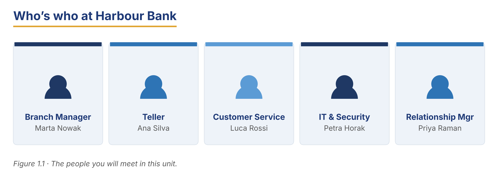


## Part 2 · Grammar — Present Simple vs Present Continuous
*Pre-class input*


### 2A  Notice the grammar
*Read the short dialogue. Underline the verbs. Which show a routine, and which show something happening now?*

```
Luca: Hi, I’m Luca. I work in customer service.
Mei: Nice to meet you. I’m training in the loan office this week.
Luca: What do you usually do there?
Mei: I usually help with forms, but now I’m learning to approve small loans.
```

1. work — routine or now? ____
2. am training — routine or now? ____
3. do / help — routine or now? ____
4. am learning — routine or now? ____


### Grammar Focus

|  | Form | Use | Example |
|---|---|---|---|
| Present simple | I/you work; he works | routines, facts | I work at the bank every day. |
| Present continuous | am/is/are + ‑ing | now, this week (temporary) | I am training this week. |

> **Remember:** usually, every day, always → present simple. now, this week, at the moment → present continuous.

> **⚠ Watch out!**
> ✗ He work here. → ✓ He works here. (add ‑s for he/she/it)
> ✗ I working now. → ✓ I am working now. (don’t drop am/is/are)


### 2B  Controlled practice (choose the tense)
*Write the correct form of the verb in brackets.*

**Word bank:** am meeting | are discussing | is checking | offers | arrives | opens

**Example: 0. She ____ (work) here every day. → works.**

1. The branch manager ______________________ (check) the daily reports at the moment.
2. He usually ______________________ (arrive) at 8:30.
3. I ______________________ (meet) a new client now.
4. Our bank ______________________ (offer) digital banking services.
5. They ______________________ (discuss) loan terms at the moment.
6. The branch ______________________ (open) at nine o’clock every day.


### 2C  Error correction
*Find and correct the mistake in each sentence (present simple or continuous).*

**Example: 0. He work here. → He works here.**

1. She work in the loan office.
2. Right now I check the daily reports.
3. They is opening a new branch this month.
4. He usually is arriving at 8:30.
5. We are have a team meeting every Monday.

> ✎ *Write your response here.*


### 2D  Write about your day
*Write three sentences about your job: two routines (present simple) and one thing you are doing now (present continuous).*

> **Model — read this first**
> I usually open the branch at nine. I serve customers all morning. This week, I am training a new colleague.

> ✎ *Write your response here.*


### 2E  Freer practice (speaking)
*In pairs, ask and answer. Use both tenses.*

> **Model — read this first**
> “I usually serve customers at the counter, but right now I am helping with the audit.”

- What do you do at your job?
- What are you working on now?
- Do you usually deal with customers?

*Tip: You will use these two tenses again in the reading in Part 5 (5A and 5B). Look for them there.*

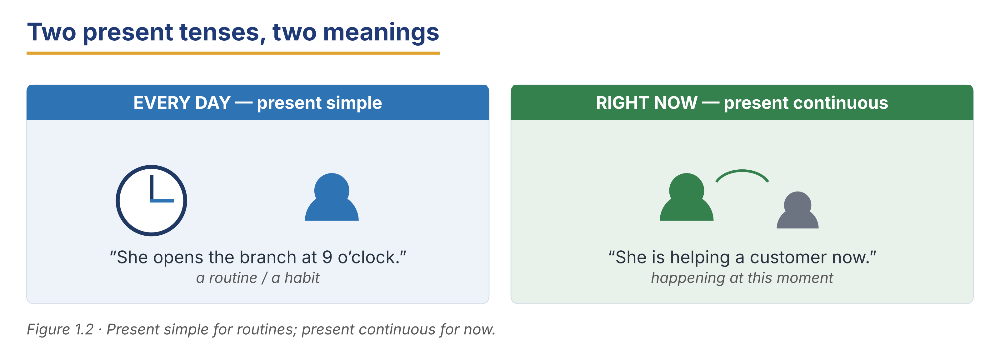


## Part 3 · Listening
*Pre-class input · scripts printed below*


### 3A  Before you listen (predict)
*You will hear new staff talking on their first days. What might a new teller say to a manager?*

> **Model — read this first**
> “I think the new teller will talk about the counter system and her first day.”


### 3B  Dialogue 1 — Meeting the manager
**🔊 Audio 1.1** (optional) — or read the script below.

```
Mr Diallo: Good morning. You must be Ana, our new teller.
Ana: Yes, sir. It’s great to join the Warsaw branch.
Mr Diallo: Welcome. Are you familiar with our teller system?
Ana: I’ve used a similar one in training.
Mr Diallo: Good. Accuracy and service are the most important things here.
```

*Read and decide: True, False, or Not Given.*

**Example: 0. Ana is a new teller. → True.**

1. Ana used the exact same system before.
2. Mr Diallo thinks speed matters most.
3. Ana worked at another branch before.

*Useful language: You must be… · Are you familiar with…? · I’ve used a similar one.*


### 3C  Dialogue 2 — The IT support visit
**🔊 Audio 1.2** (optional) — or read the script below.

```
Mei: Hi. Are you the new IT support person?
Petra: Yes, I’m Petra. I’m installing the new firewall. It helps with security.
Mei: Great. Our systems were slow last week.
Petra: I’ll look into that. I’m also setting up the online terminals today. They will be faster.
```

*Read and decide: True, False, or Not Given.*

1. Petra is installing a firewall to improve security.
2. The terminals are broken and cannot be used.
3. The new setup should make the system faster.


### 3D  A day in the life (longer listening)
**🔊 Audio 1.3** (optional) — or read the script below.

```
Marta: Hello, my name is Marta, and I’m the branch manager here in Warsaw. My days are always busy. I usually arrive at 8 a.m. and check the team’s schedule. Then I open my email and read the messages from head office in Rotterdam. I spend most of my day supporting my staff and making sure everything runs well. I also meet important clients to discuss their needs. But this week is different. I’m not meeting many clients, because I’m training three new tellers. We are reviewing our procedures together, and I am watching them at the counter. It is a very focused week, but I enjoy it.
```

*Read and decide: True, False, or Not Given.*

1. Marta usually arrives at 9 a.m.
2. She spends most of a normal day supporting her staff.
3. She is meeting more clients than usual this week.
4. She is training three new tellers this week.
5. She has been the manager for five years.


### 3E  Who is doing what now?
*Look back at the three listenings. Match each person to what they are doing at the moment (present continuous). One option is extra.*


| Column A | Column B |
|---|---|
| 1. Ana ____ | **a)** is installing a firewall and setting up terminals |
| 2. Petra ____ | **b)** is training three new tellers |
| 3. Marta ____ | **c)** is starting her first day and learning the system |
|  | **d)** is closing the branch for the day (extra) |

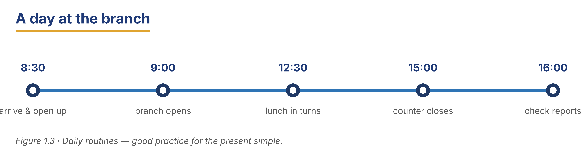


## Part 4 · Speaking
*In-class output*


### 4A  Professional self-introduction
*Introduce yourself: name, role, routine duties, and your current task.*

> **Model — read this first**
> “Hello. My name is Diego. I’m a loan officer at Harbour Bank. I usually check loan applications. Right now, I’m reviewing a housing loan.”

*Useful language: My name is… · I’m a… at… · I usually… · Right now, I’m…*

*Role cards — choose a profile and introduce yourself:*

**Card A:** Luca — Customer Service — usually answers questions — now learning the new app.

**Card B:** Johanna — Risk Analyst — usually checks reports — now training a colleague.

**Card C:** Grace — Teller — usually serves customers — now helping with the audit.


### 4B  Role play — professional exchange (pairs)
> **Model — read this first**
> A: Hello, I’m Ana. I work as a teller. What do you do?
> B: Nice to meet you, Ana. I’m Diego, a loan officer.
> A: What are you working on these days?
> B: Right now, I’m training on the new software.

**Card A:** you are a teller; you are helping with the audit this week.

**Card B:** you are a loan officer; you are training on new software.


### 4C  Find the information (pairwork info-gap)
*Student A and Student B have different cards. Ask questions to complete a table about each person.*

**Card A — you know:** Priya: relationship manager; usually checks applications; now training on new software. Ask B about Kofi.

**Card B — you know:** Kofi: teller; usually serves customers; now helping with the audit. Ask A about Priya.

*Useful language: What does he/she do? · What does he/she usually do? · What is he/she doing now?*


### 4D  The networking event (mingle)
*Stand up and introduce yourself to three classmates. Remember one thing each person is doing now.*

*Stretch: after each talk, report back — “Diego is a loan officer. He is training this week.”*


### 4E  Small talk at work (functional phrases)
*Match the small-talk phrase to the right moment (one is extra).*


| Column A | Column B |
|---|---|
| 1. “How’s your first week going?” ____ | **a)** meeting a colleague for the first time |
| 2. “Can I help you with anything?” ____ | **b)** asking a new colleague how they feel |
| 3. “Nice to meet you.” ____ | **c)** offering help |
| 4. “Have a good weekend.” ____ | **d)** ending the week politely |
|  | **e)** apologising for a mistake (extra) |

*In pairs, practise a 30-second small-talk chat with a new colleague. Use two phrases above.*


## Part 5 · Reading
*Pre-class input*


### 5A  Welcome to Harbour Bank
*Read the company profile. Notice the present simple (facts) and present continuous (current plans).*

> **Harbour Bank — Company Profile** — *About 200 words*
>
> Harbour Bank is an international bank for people and small businesses. Its head office is in Rotterdam, and it has branches in Nairobi, Istanbul, São Paulo, Manila and Warsaw. In other countries it works with partner banks. The bank helps individuals and small businesses manage their money safely, at home and across borders. Its services include savings accounts, current accounts, personal and business loans, currency exchange, international transfers, and digital banking. The customer service team gives fast, polite help in several languages. When a client wants to open an account or apply for a loan, the staff are ready to assist. Harbour Bank also supports local economies. Its microfinance programme gives small loans to low-income business owners in every country where the bank works. These loans help them grow their businesses. Right now, the bank is investing in new mobile and online tools. It is building easier and safer ways to send money between countries. The goal is simple: modern, reliable banking for every customer, wherever they are.

*Answer the questions.*

**Example: 0. Where is Harbour Bank’s head office? → In Rotterdam.**

1. What financial products does the bank offer?
2. Who are the bank’s main customers?
3. What is the purpose of the microfinance programme?
4. What is the bank doing now to improve its services?
5. In how many cities does the bank have branches?
6. Name one thing the customer service team does.

*Vocabulary in context — match the word to its meaning (one is extra).*


| Column A | Column B |
|---|---|
| 1. SME ____ | **a)** small and medium enterprises |
| 2. digital banking ____ | **b)** online and mobile banking services |
| 3. microfinance ____ | **c)** small loans for low-income business owners |
| 4. branch ____ | **d)** a local office of the bank |
| 5. entrepreneur ____ | **e)** a person who starts a business |
|  | **f)** money paid on savings (extra) |


### 5B  Grammar in context (from 5A)
*Look back at the Harbour Bank text. Find and write two present-simple verbs and two present-continuous verbs.*

1. Present-simple verbs: ____ , ____
2. Present-continuous verbs: ____ , ____

*Now complete these sentences about the bank.*

1. Harbour Bank ______________________ (have) branches in five cities.
2. Right now, the bank ______________________ (invest) in new online tools.


### 5C  Meet a team member
*Read the short profile. What does Priya do every day, and what is she doing this week?*

> **Priya Raman — Relationship Manager** — *About 130 words*
>
> Meet Priya Raman, a relationship manager at the Manila branch of Harbour Bank. Priya works in a busy department where things change every day. Her main job is to understand the needs of business clients and to suggest the right services. Many of her clients buy or sell abroad, so she also works with the transfers team in Rotterdam. She works with the loan and risk teams too, so clients get fast, correct answers. This week, Priya is training two new colleagues and is updating the bank’s client-service guide. She enjoys her work because she meets many different people.

1. Where does Priya work, and what is her job?
2. What is Priya’s main job with business clients?
3. What two things is Priya doing this week?


### 5D  Discussion — compare banks
*In pairs, compare Harbour Bank with a bank you know.*

*Useful frame: “My bank offers ___, which is similar to / different from Harbour Bank.”*

- Does your bank offer similar services?
- What is the benefit of a bank that helps both people and businesses?

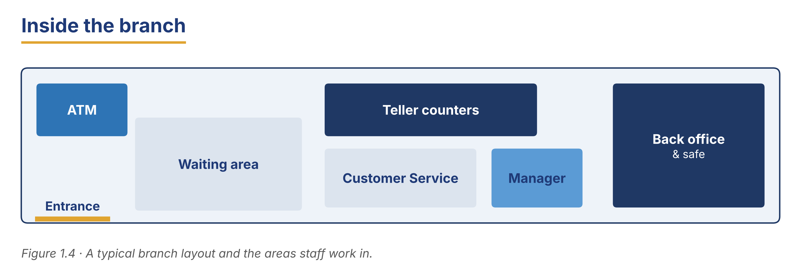


## Part 6 · Writing
*In-class / homework output*


### 6A  The parts of a professional email
*Match the part of an email to the example (one is extra).*


| Column A | Column B |
|---|---|
| 1. Subject line ____ | **a)** Introduction — New Loan Officer |
| 2. Salutation ____ | **b)** Dear Mr Diallo, |
| 3. Opening ____ | **c)** I am writing to introduce myself. |
| 4. Body ____ | **d)** I usually manage SME accounts, and now I am learning retail. |
| 5. Sign-off ____ | **e)** Best regards, Diego |
|  | **f)** Please find my report attached (extra). |


### 6B  Guided writing — complete the email
*Complete the email with the words: currently, joined, usually, meeting, name.*

**Word bank:** currently | joined | usually | meeting | name

1. Subject: Introduction — New Analyst. Dear Team, my ______________________ is Johanna Berg.
2. I ______________________ the Risk department last Monday.
3. In my role, I ______________________ check credit limits and prepare reports.
4. ______________________, I am helping the senior manager with the annual audit.
5. I look forward to ______________________ all of you soon.


### 6C  Write your own introduction email (50–70 words)
*Write a short email to your new manager. Use one present-simple and one present-continuous sentence.*

> **Model — read this first**
> Subject: Introduction — New Teller
> Dear Ms Nowak, My name is Ana Silva. I am a new teller at the Warsaw branch. I usually help customers with deposits and withdrawals. This week, I am learning the new counter system. I look forward to working with the team. Best regards, Ana

*Plan (fill in, then write): Subject: Introduction — ___ · Dear ___, · My name is ___. I am a ___ at ___. · I usually ___. · This week, I am ___. · I look forward to ___. · Best regards, ___*

*Phrase bank: My name is… · I am a… at… · I usually… · This week, I am… · I look forward to… · Best regards*

**Check before you finish**
- ☐ A subject line?
- ☐ One present-simple and one present-continuous sentence?
- ☐ A polite close?
- ☐ 50–70 words?

> ✎ *Write your response here.*


### 6D  Write a short profile of a colleague (40–60 words)
*Use the notes to write a short professional profile.*

**Notes — Elif Demir:** Compliance Officer at Meridian Bank; usually checks that the bank follows the rules in every country it works in; now reviewing customer data; works with the Legal team.

> **Model — read this first**
> Elif Demir is a compliance officer at Meridian Bank. She usually checks that the bank follows the rules in every country it works in. At the moment, she is reviewing customer data to improve security. She works closely with the Legal team.

*Frame: ___ is a ___ at ___. He/She usually ___. At the moment, he/she is ___. He/She works with ___.*

**Check before you finish**
- ☐ Present simple for routine tasks?
- ☐ Present continuous for the current task?
- ☐ 40–60 words?

> ✎ *Write your response here.*


### 6E  Peer check
*Swap your email from 6C with a partner. Use the checklist to give one piece of positive feedback and one suggestion.*

*Checklist: subject line? · two tenses? · polite close? · 50–70 words?*

> **Model — read this first**
> “Good subject line and a polite close. Next time, try to add one sentence about what you are doing this week.”


### 6F  Improve the email (editing)
*This short email has three small mistakes (grammar and politeness). Find them, then rewrite the email correctly.*

Subject: hello

hi, I am Petra. I working in IT. I fix computers. bye.

**Check before you finish**
- ☐ a clear subject line
- ☐ correct present continuous (‘I am working’)
- ☐ a polite greeting and close

> ✎ *Write your response here.*


## Part 7 · Management File — Welcoming a New Colleague
*Practitioner track (optional for beginners) · experienced staff*


### 7A  Manager’s phrase bank
*Match the onboarding phrase to its purpose (one is extra).*


| Column A | Column B |
|---|---|
| 1. “Welcome aboard.” ____ | **a)** offering a tour of the branch |
| 2. “Let me show you around.” ____ | **b)** greeting a new employee |
| 3. “If you’re unsure, just ask.” ____ | **c)** giving a buddy for support |
| 4. “I’ll pair you with Grace.” ____ | **d)** inviting questions |
|  | **e)** ending a meeting politely (extra) |


### 7B  Listening — Day one for a new colleague
**🔊 Audio 1.4** (optional) — or read the script below.

```
Marta: Welcome aboard, Ana. Let me show you around the branch.
Ana: Thank you. Where do I start?
Marta: First, you shadow a teller today. Watch how she serves customers.
Ana: And after that?
Marta: Tomorrow you try the counter system with support. If you’re unsure, just ask. I’ll pair you with Grace for your first week.
Ana: That sounds good. Thank you, Ms Nowak.
```

*Answer the questions.*

**Example: 0. Who is the new colleague? → Ana.**

1. What does Ana do on her first day?
2. When does she try the counter system?
3. Who supports Ana in her first week?


### 7C  Controlled practice — the induction checklist
*Complete the checklist for a new teller. Use the present simple.*

**Word bank:** shadows | meets | reads | signs | learns

1. On day one, the new teller ______________________ an experienced colleague.
2. He or she ______________________ the branch safety rules.
3. The new teller ______________________ the team and the manager.
4. He or she ______________________ the staff handbook.
5. By the end of week one, the new teller ______________________ the counter system.


### 7D  Role play — welcome a new hire
*You are a supervisor. Welcome a new team member. Explain three routine duties and one current project.*

> **Model — read this first**
> “Welcome aboard. In this team, we usually open accounts and answer customer questions. This month, we are moving to a new system, so we are all learning together.”

**Card A (supervisor):** greet · explain three routine duties · mention one current project · offer help.

**Card B (new hire):** ask two questions about the job.

*Stretch: the new hire is nervous — reassure them politely.*


### 7E  Writing — a team-member bio for the noticeboard (60–80 words)
*Write a short, friendly bio to introduce a new colleague to the branch.*

> **Model — read this first**
> Please welcome Ana Silva, our new teller at the Warsaw branch. Ana joined us this week from our training programme in São Paulo. She usually helps customers with deposits and withdrawals. At the moment, she is learning our counter system and shadowing the team. Ana is friendly and hard-working. Please say hello and make her feel welcome.

*Plan: Please welcome ___, our new ___. He/She joined us ___. He/She usually ___. At the moment, he/she is ___. Please ___.*

*Phrase bank: Please welcome… · joined us this week · usually… · at the moment… · make him/her feel welcome*

**Check before you finish**
- ☐ Name and role?
- ☐ One present-simple and one present-continuous sentence?
- ☐ A friendly, welcoming tone?
- ☐ 60–80 words?

> ✎ *Write your response here.*


## Part 8 · Global Case Study — Onboarding at a Global Bank
*Practitioner track · read then discuss*

*Before you read: how long should a good “first week” be at a bank? What should a new person learn first?*

> **A Two-Week Start** — *About 210 words · a made-up example based on real practice*
>
> A large international bank gives every new employee a two-week induction, and it uses the same programme in every country where it works. In the first week, new staff do not work at the counter alone. Instead, they shadow an experienced colleague and watch how the work is done. Each new person also gets a “buddy”. A buddy is a friendly colleague who answers small questions and helps the new person feel welcome. New staff say the buddy system makes the first days much easier.
> In the second week, new staff take short online lessons about safety, service, and the bank’s rules. Because the bank works in several countries, they also learn which rules are the same everywhere and which ones are local. Nobody works alone until they are ready. New employees are on “probation” for three months. During this time, the manager gives regular feedback. The bank says this careful start is worth the time: staff who feel supported learn faster and give better service.

**Glossary help**
- **shadow** — watch and follow an experienced colleague to learn
- **buddy** — a friendly colleague who helps a new person
- **induction** — the training period at the start of a job
- **probation** — the first months, when your work is checked


### 8A  Comprehension
**Example: 0. How long is the induction? → Two weeks.**

1. What do new staff do in the first week?
2. How does a buddy help?
3. What happens during probation?
4. Why does the bank think a careful start is worth the time?


### 8B  Vocabulary in context
*Match the word to its meaning (one is extra).*


| Column A | Column B |
|---|---|
| 1. shadow ____ | **a)** the training period at the start of a job |
| 2. buddy ____ | **b)** watch and learn from a colleague |
| 3. induction ____ | **c)** a helpful colleague for a new person |
| 4. probation ____ | **d)** the first months, when work is checked |
|  | **e)** a written warning (extra) |


### 8C  Discussion
*Frames: “This is similar to a bank in my country because ___.” “This is different because ___.”*

- Would a two-week start work in your bank? Why / why not?
- What is one idea here you would use?


### 8D  Your view (short write, 30–40 words)
*Which idea from the global case would help new staff most in your bank, and why?*

> ✎ *Write your response here.*


## Part 9 · Branch Case Study — Nairobi in Focus: A New Branch Opens
*Practitioner track · read then decide*

*Before you read: when a new branch opens, what problems can the manager have on day one?*

> **Opening Day in Nairobi** — *About 170 words*
>
> Harbour Bank is opening a new branch in Nairobi. The branch manager, Amina Yusuf, arrives early. The branch is clean and ready, but the team is very new. Two of the three tellers started only last week, and they are still learning the counter system. By nine o’clock, there is already a small queue outside. Many customers want to open their first account, and several want to receive money from family abroad. One older customer looks worried and asks a lot of questions. The new tellers work slowly and carefully, but the queue is growing. Amina wants two things at once: fast service and correct work. She knows that new tellers make mistakes when they hurry. She also knows that customers do not like waiting. She has one experienced teller, Grace Otieno, and two learners on the counter. She must decide how to organise the morning.


### 9A  Comprehension
**Example: 0. Where is the new branch? → In Nairobi.**

1. Why do the new tellers work slowly?
2. What two things does Amina want at the same time?
3. Who is the one experienced teller?


### 9B  Decision task
*What should Amina do first? Write 40–60 words. Use the frame and the phrase bank.*

> **Model — read this first**
> I think Amina should put Grace on the busiest window, because she is fast and correct. The two new tellers can serve simple customers with support. Also, Amina can help the worried customer herself. This keeps service polite and reduces mistakes.

*Frame: I think Amina should ___, because ___. Also, ___.*

*Phrase bank: put ___ on the busiest window · serve simple customers first · give support to the new tellers · help the worried customer*

> ✎ *Write your response here.*


## Part 10 · Review & Can-Do
*Homework / self-study*


### 10A  Spiral review
*Complete the sentences. Use the correct tense (present simple or continuous) or the correct word.*

**Example: 0. She ____ (work) here every day. → works.**

1. A ______________________ handles deposits and withdrawals. (role)
2. The manager usually ______________________ (arrive) early.
3. Right now, I ______________________ (learn) the counter system.
4. A loan officer ______________________ (check) loan applications. (routine)
5. This week, we ______________________ (train) two new colleagues.
6. A ______________________ is a machine for cash withdrawals. (word)
7. You can ______________________ for a loan at the counter. (verb + preposition)
8. At the moment, the bank ______________________ (invest) in new online tools.


### 10B  Can-Do checklist
**Can-Do checklist — tick what you can do now**
- ☐ I can introduce myself and my job.
- ☐ I can describe my routine duties (present simple).
- ☐ I can say what I am doing now (present continuous).
- ☐ I can understand a short first-day conversation.
- ☐ I can write a short introduction email.


### 10C  Unit glossary
**Glossary help**
- **teller** — staff member who handles deposits and withdrawals
- **branch manager** — senior person who manages a branch
- **loan officer** — person who checks loan applications
- **customer service rep** — person who helps customers with services
- **account** — where a customer’s money is kept
- **ATM** — machine for cash withdrawals
- **SME** — small and medium enterprise
- **microfinance** — small loans for low-income business owners
- **induction** — the training period at the start of a job
- **shadow** — watch and learn from a colleague


# Unit 2 · Customer Service and Communication
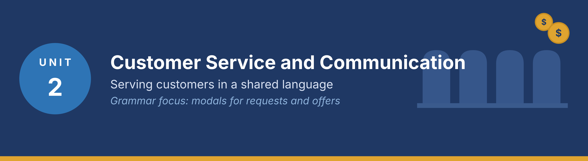

*In this unit you learn polite customer-service language, how to make requests and offers, how to handle common situations, and how to write short service emails. Grammar focus: modals for requests and offers (can, could, may).*

## Part · · Warm-Up
*In-class starter · speak before you read*


### W-A  Good and bad service (discussion)
*In small groups, talk about customer service you have received.*

> **Model — read this first**
> “The teller smiled, used my name, and explained each step. It was very good service.”

- Think of good service you received at a bank or shop. What did the person do well?
- Think of poor service. What went wrong?
- What are three things a good bank employee should always do?


### W-B  Good vs bad service (mini role-play)
*In pairs, act out two short scenes (30 seconds each): the same question, first with bad service, then with good service.*

Question: “Where do I deposit this cheque?”

*Tip: In the good scene, use a greeting, a polite modal (Could / May), and an offer of help.*


## Part 1 · Vocabulary
*Pre-class input*


### 1A  Match the phrase to the situation
*Match each polite phrase (1–6) to the situation where a banker uses it (a–g). One is extra.*

**Example: 0. “Have a nice day!” → f) (ending the conversation politely)**


| Column A | Column B |
|---|---|
| 1. “How can I help you today?” ____ | **a)** greeting a new customer |
| 2. “May I see your ID, please?” ____ | **b)** verifying the customer’s identity |
| 3. “You’ll need to fill out this form.” ____ | **c)** explaining the next step |
| 4. “Would you like a receipt?” ____ | **d)** offering the customer a choice |
| 5. “Could you confirm your address?” ____ | **e)** checking that information is correct |
| 6. “I’m sorry, that service is not available.” ____ | **f)** ending the conversation politely |
|  | **g)** asking the customer to wait (extra) |

*Pronunciation — word stress. Say these words: as·SIST, con·FIRM, VE·ri·fy, in·QUI·ry.*


### 1B  Sort the phrases by function
*Put each phrase from 1A into the correct group.*

- Offering help: ____
- Requesting information: ____
- Explaining a step: ____

> **Model — read this first**
> Offering help: “How can I help you today?”, “Would you like a receipt?”
> Requesting information: “May I see your ID?”, “Could you confirm your address?”
> Explaining a step: “You’ll need to fill out this form.”


### 1C  Complete the bank dialogue
*Complete the dialogue with the correct word.*

**Word bank:** account | ID | form | assist | procedure | confirm | transaction | verify

**Example: 0. Welcome to our bank. How can I assist you today?**

1. Customer: I’d like to open a new ______________________, please.
2. Banker: Certainly. First, may I see your ______________________? I need it to verify your identity.
3. Banker: Thank you. I just need to ______________________ your details.
4. Banker: The ______________________ is simple. Please complete this application ______________________.
5. Banker: Would you like to make your first ______________________, such as a deposit, today?


### 1D  Make it polite (rewrite)
*These sentences are too direct. Rewrite each one to be polite and professional.*

**Example: 0. “Give me your ID.” → “Could I see your ID, please?”**

1. “Sign it now.”
2. “Wait.”
3. “What do you want?”
4. “I need your phone number.”
5. “You’re wrong. That’s not the rule.”

> ✎ *Write your response here.*


### 1E  Key customer-service terms
*Match the term to its meaning (one is extra).*


| Column A | Column B |
|---|---|
| 1. client / customer ____ | **a)** a person who uses the bank’s services |
| 2. transaction ____ | **b)** an action like a deposit, withdrawal or transfer |
| 3. inquiry ____ | **c)** a question asking for information |
| 4. procedure ____ | **d)** the official series of steps to do something |
| 5. to verify ____ | **e)** to check that something is true |
| 6. to authorise ____ | **f)** to give official permission |
|  | **g)** a written complaint (extra) |


### 1F  Write with the words (40–60 words)
*Describe a good customer-service moment at a bank. Use at least five words from Part 1.*

> **Model — read this first**
> Yesterday a customer had an inquiry about a transaction. The teller was polite and asked to verify her ID. She explained the procedure clearly and helped her open a new account. The customer left happy.

**Check before you finish**
- ☐ Five Part-1 words?
- ☐ 40–60 words?
- ☐ Short, clear sentences?

> ✎ *Write your response here.*

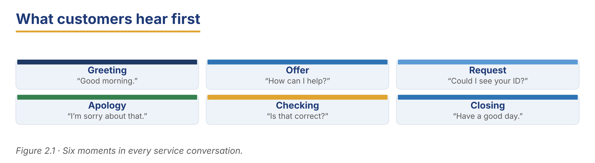


## Part 2 · Grammar — Modals for Requests and Offers (can / could / may)
*Pre-class input*


### 2A  Notice the grammar
*Read the short dialogue. Underline can, could and may. Who is more polite?*

```
Banker: Good morning. How can I help you?
Customer: Could you check my balance, please?
Banker: Of course. May I see your card?
Customer: Here you are.
```

1. can — which speaker? ____
2. could — more or less polite than can? ____
3. may — formal or informal? ____


### Grammar Focus

| Modal | Use | Example |
|---|---|---|
| can | informal offer or request | Can I help you? |
| could | polite request | Could you sign here, please? |
| may | formal offer / permission | May I see your ID? |

> **Remember:** could and may are more polite than can. Use them with customers.

> **⚠ Watch out!**
> ✗ Can I to help you? → ✓ Can I help you? (no ‘to’ after a modal)
> ✗ May you sign here? → ✓ Could you sign here? (for a request to the customer, use could)


### 2B  Controlled practice (choose the modal)
*Choose the best modal: can, could, or may. Sometimes more than one is possible.*

**Word bank:** can | could | may

**Example: 0. (formal greeting) Good morning. How may I help you?**

1. (very formal, senior client) Good morning, sir. How ______________________ I help you?
2. (standard polite request) ______________________ I see some identification, please?
3. (friendly offer) ______________________ I get you a copy of that receipt?
4. (asking permission for a sensitive question) ______________________ I ask the reason for the transfer?
5. (a polite instruction) ______________________ you please fill out this deposit slip?


### 2C  Error correction
*Find and correct the mistake in each sentence.*

**Example: 0. Can I to help you? → Can I help you?**

1. You must to fill this form.
2. May you please sign here?
3. Could I seeing your ID?
4. Can you helps me, please?
5. I could to check that for you.

> ✎ *Write your response here.*


### 2D  Make the command polite
*Change each direct command into a polite request with can, could, or may.*

**Example: 0. “Sign here.” → “Could you sign here, please?”**

1. “Show me your card.”
2. “Type your PIN.”
3. “Come back tomorrow.”

> ✎ *Write your response here.*


### 2E  Freer practice (speaking)
*In pairs, write and act a short dialogue (4–6 lines) between a banker and a customer. Use at least three polite modals.*

> **Model — read this first**
> Banker: How may I help you? — Customer: Could I open an account? — Banker: Certainly. May I see your ID?

*Tip: You will see these modals again in the reading in Part 5 (5A and 5B). Look for them there.*

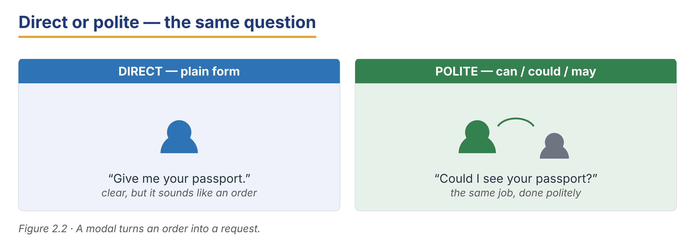


## Part 3 · Listening
*Pre-class input · scripts printed below*


### 3A  Before you listen (predict)
*What problems do customers often bring to a bank? What polite phrases might a banker use?*

> **Model — read this first**
> “A customer might lose a card, forget a PIN, or want to open an account.”


### 3B  Two short conversations — match the purpose
**🔊 Audio 2.1** (optional) — or read the script below.

```
Conversation 1
Customer: Hi. I think I lost my debit card. I’m worried someone might use it.
Banker: I’m sorry to hear that. I can freeze the card right now. May I have your account number?
```

```
Conversation 2
Customer: Good morning. I’d like to open a savings account.
Banker: Certainly. I can help you with that. Could I see your ID and proof of address, please?
```

*Match each conversation to its purpose (one is extra).*

1. Conversation 1: ____
2. Conversation 2: ____

a) opening an account   b) reporting a lost card   c) resetting a PIN (extra)

*Useful language: I’m sorry to hear that. · I can… right now. · Could I see…?*


### 3C  Two more conversations — True or False
**🔊 Audio 2.2** (optional) — or read the script below.

```
Conversation 3
Customer: Hello, I need to apply for a small personal loan.
Banker: No problem. You’ll need to speak with a loan officer. Could you take a seat? Someone will be with you shortly.
```

```
Conversation 4
Customer: Excuse me, I can’t remember the PIN for my card. Can you reset it?
Banker: For security, you’ll need to show your ID. Then we can issue a new PIN. Could you go to window 3, please?
```

*Decide: True or False.*

1. In Conversation 3, the banker helps with the loan immediately.
2. In Conversation 3, the customer must wait for a loan officer.
3. In Conversation 4, the customer needs to show ID.
4. In Conversation 4, the customer stays at the same window.


### 3D  A customer inquiry about online banking (longer)
**🔊 Audio 2.3** (optional) — or read the script below.

```
Banker: Good afternoon, madam. How may I help you?
Mrs Oyelaran: Good afternoon. I have a current account here, but I don’t have online banking. Can I register for it?
Banker: Of course. It’s a great service, and you can use it from any country.
Banker: Could you show me your ID and your bank card, please?
Mrs Oyelaran: Here you are.
Banker: Thank you. I’ll set up your account now. We will send a security code to your phone. Please enter it to finish.
Mrs Oyelaran: That sounds easy. Thank you very much.
```

*Answer the questions.*

**Example: 0. What does Mrs Oyelaran want to do? → Register for online banking.**

1. What two documents does the banker ask for?
2. What does the bank send to Mrs Oyelaran’s phone?
3. How does Mrs Oyelaran feel about the service?


### 3E  Useful phrases from the conversations
*Match each phrase from the listenings to its purpose (one is extra).*


| Column A | Column B |
|---|---|
| 1. “I’m sorry to hear that.” ____ | **a)** showing sympathy |
| 2. “I can freeze the card right now.” ____ | **b)** offering quick action |
| 3. “Could you take a seat?” ____ | **c)** asking the customer to wait |
| 4. “Could you go to window 3?” ____ | **d)** directing the customer politely |
|  | **e)** ending the call (extra) |

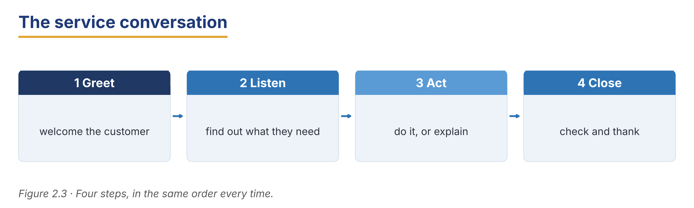


## Part 4 · Speaking
*In-class output*


### 4A  Functional language — offers and requests
*Match the function to a phrase (one is extra).*


| Column A | Column B |
|---|---|
| 1. Offer help ____ | **a)** “Could you tell me your account number?” |
| 2. Ask for information ____ | **b)** “How can I help you?” |
| 3. Ask the customer to wait ____ | **c)** “Could you wait one moment, please?” |
| 4. Apologise ____ | **d)** “I’m sorry for the wait.” |
|  | **e)** “Have a good weekend.” (extra) |


### 4B  Bank simulation (pairwork)
*Run a short service dialogue, then swap roles.*

> **Model — read this first**
> A: Good morning. How may I help you? — B: I’d like to open a savings account. — A: Certainly. Could I see your ID, please? — B: Here you are. — A: Thank you. May I confirm your address?

**Card A (banker):** greet · ask for ID · confirm address · offer a first deposit.

**Card B (customer):** you want to open an account; you have your ID; your address is in Warsaw.


### 4C  Handle a difficult situation
*A customer is upset because they waited a long time. Stay calm and polite. Use the steps.*

> **Model — read this first**
> “I’m very sorry for the wait. Thank you for your patience. How can I help you now? Let me sort this out for you quickly.”

*Steps: 1) apologise · 2) thank them · 3) offer help · 4) act.*

*Stretch: the customer is still angry — stay calm and offer one clear next step.*


### 4D  Find the information (pairwork info-gap)
*Student A is a banker; Student B is a customer with a problem. Ask polite questions to solve it.*

**Card A (banker):** you can freeze cards, reset PINs, and open accounts. Ask what the customer needs.

**Card B (customer):** you lost your card this morning; you want it frozen; your account number is 4471.

*Useful language: How can I help? · Could you give me…? · May I have your account number?*


### 4E  Closing the conversation politely
*Match the closing phrase to the situation (one is extra).*


| Column A | Column B |
|---|---|
| 1. “Is there anything else I can help with?” ____ | **a)** checking the customer has no more needs |
| 2. “Thank you for your patience.” ____ | **b)** thanking a customer who waited |
| 3. “Have a nice day!” ____ | **c)** a warm goodbye |
| 4. “Please contact us any time.” ____ | **d)** inviting future contact |
|  | **e)** asking for ID (extra) |

*In pairs, end a short service dialogue politely. Use two phrases above.*


## Part 5 · Reading
*Pre-class input*


### 5A  Customer service guidelines
*Read the branch guidelines. Notice the polite modals (can, could, may).*

> **Harbour Bank — Customer Service Guidelines** — *About 200 words*
>
> Good service keeps our customers happy and loyal, in every branch and in every language we work in. Every member of staff should follow these simple guidelines. First, greet every customer politely. You can say, “Good morning. How may I help you?” A friendly greeting makes the customer feel welcome. Second, always use polite requests. Instead of “Give me your ID”, say “Could I see your ID, please?” Small words like ‘please’ and ‘thank you’ make a big difference. Third, explain each step clearly. Many customers do not know the procedure, and many are working in their second or third language, so tell them what will happen next. For example, “You’ll need to fill out this form, and then I can open your account.” Fourth, if there is a problem, stay calm. Apologise, thank the customer for waiting, and offer a clear solution. Never argue with a customer. Finally, end the conversation warmly. A simple “Have a nice day” leaves a good final impression.

*Decide: True or False.*

**Example: 0. Staff should greet every customer. → True.**

1. Staff should say “Give me your ID.”
2. ‘Please’ and ‘thank you’ are important.
3. Staff should explain the next step to customers.
4. It is fine to argue with an upset customer.
5. Staff should stay calm if there is a problem.
6. A warm goodbye leaves a good impression.


### 5B  Grammar in context (from 5A)
*Find in the guidelines two polite requests using could or may. Write them below.*

1. Request 1 (could): ____
2. Request 2 (may): ____

*Now make these commands polite, like the guidelines.*

1. “Give me your card.” → ____
2. “Wait here.” → ____


### 5C  A training dialogue
*Read the short training dialogue between a manager and a new teller.*

> **Training at the Counter** — *About 130 words*
>
> Marta: Ana, remember to greet every customer first. A smile helps a lot.
> Ana: Of course. And if a customer is angry?
> Marta: Stay calm. Apologise, and never argue. You can say, “I’m sorry for the wait. How can I help you now?”
> Ana: What if I don’t know the answer?
> Marta: That’s fine. Say, “Let me check that for you,” and ask a colleague. It is better to be correct than fast.
> Ana: Thank you. That’s very helpful.
> Marta: You’re welcome. Good service is simple: be polite, be clear, and be honest.

1. What should Ana do first with every customer?
2. What should she do if a customer is angry?
3. What can she say if she does not know the answer?
4. What is more important, being correct or being fast?


### 5D  Discussion
*In pairs, discuss.*

- Which guideline is the most important? Why?
- What is one thing that makes you feel like a valued customer?

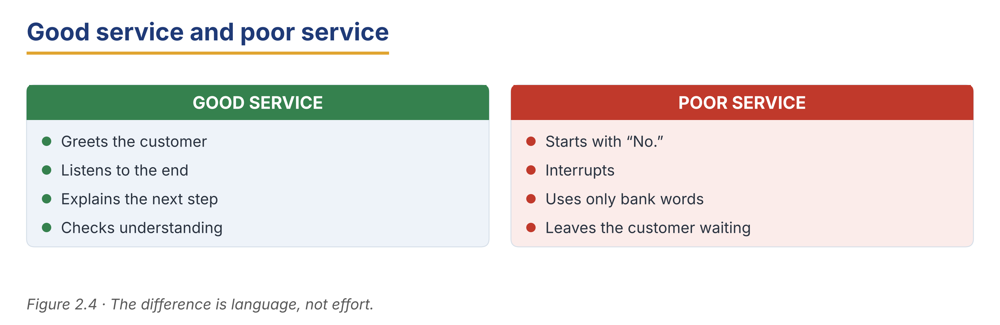


## Part 6 · Writing
*In-class / homework output*


### 6A  Guided writing — complete the service email
*Complete the reply email with the words: apologise, confirm, assist, contact, regards.*

**Word bank:** apologise | confirm | assist | contact | regards

1. Dear Mr Okonkwo, thank you for your email. I am happy to ______________________ you.
2. First, I would like to ______________________ for the delay.
3. I can ______________________ that your new card is ready to collect.
4. If you have any questions, please ______________________ us on the number below.
5. Kind ______________________, Customer Service Team.


### 6B  Account inquiry email (50–70 words)
*A customer asks how to open a savings account. Write a short, polite reply.*

> **Model — read this first**
> Subject: Your question about a savings account
> Dear Ms Fernandes, Thank you for your email. I am happy to help. To open a savings account, could you please visit our branch with your ID and proof of address? The procedure is quick, and a member of staff can assist you. Please contact us if you have any questions. Kind regards, Customer Service

*Plan: Subject: ___ · Dear ___, · Thank you for ___. · To ___, could you please ___? · A member of staff can ___. · Kind regards, ___*

*Phrase bank: Thank you for your email · I am happy to help · could you please… · a member of staff can assist you · Kind regards*

**Check before you finish**
- ☐ A clear subject line?
- ☐ A polite request with could/please?
- ☐ A warm greeting and close?
- ☐ 50–70 words?

> ✎ *Write your response here.*


### 6C  Lost-card response email (50–70 words)
*A customer emails to say they lost their card. Write a calm, helpful reply.*

> **Model — read this first**
> Subject: Your lost card
> Dear Mr Tanaka, Thank you for letting us know. I am sorry to hear about your lost card. For your security, we have frozen it. Could you please visit the branch with your ID so we can issue a new card? If you see any transaction you did not make, please contact us at once. Kind regards, Customer Service

*Plan: Subject: ___ · Dear ___, · Thank you for ___. · I am sorry to hear ___. · For your security, we have ___. · Could you please ___? · Kind regards, ___*

**Check before you finish**
- ☐ A calm, polite tone?
- ☐ One polite modal request?
- ☐ A clear next step for the customer?
- ☐ 50–70 words?

> ✎ *Write your response here.*


### 6D  Peer check
*Swap your email from 6B or 6C with a partner. Give one piece of positive feedback and one suggestion.*

*Checklist: subject line? · polite modal? · clear next step? · warm close?*

> **Model — read this first**
> “Great calm tone and a clear next step. Next time, try to add ‘please’ to your request.”


## Part 7 · Management File — Coaching Your Team on Service
*Practitioner track (optional for beginners) · experienced staff*


### 7A  Feedback phrases — praise or improvement?
*Put each phrase into the correct group: Praise or Suggestion for improvement.*

- Praise: ____
- Suggestion: ____

Phrases: “You handled that very well.” · “One thing to try next time is…” · “Your greeting was friendly.” · “Let’s work on staying calm with upset customers.”

> **Model — read this first**
> Praise: “You handled that very well.”, “Your greeting was friendly.”
> Suggestion: “One thing to try next time is…”, “Let’s work on staying calm…”


### 7B  Listening — giving feedback after a hard customer
**🔊 Audio 2.4** (optional) — or read the script below.

```
Marta: Ana, you did well with that difficult customer. You stayed calm.
Ana: Thank you. I was a little nervous.
Marta: That’s normal. Your greeting was friendly, and you apologised nicely.
Ana: Is there anything I should improve?
Marta: One thing to try next time is to explain the next step earlier. That helps the customer feel calm.
Ana: That’s good advice. Thank you, Ms Nowak.
```

*Answer the questions.*

**Example: 0. Who gives the feedback? → Marta.**

1. What did Ana do well?
2. How did Ana feel during the conversation?
3. What should Ana try next time?


### 7C  Turn blunt feedback into supportive feedback
*Rewrite each blunt comment so it is supportive and kind.*

**Example: 0. “You were rude.” → “Let’s work on staying calm and polite with upset customers.”**

1. “You were too slow.”
2. “You forgot to greet the customer.”
3. “Your explanation was confusing.”
4. “You didn’t listen to the customer.”

> ✎ *Write your response here.*


### 7D  Role play — coach a colleague
*You are a supervisor. A new teller’s greeting is too fast and abrupt. Give kind, useful feedback.*

> **Model — read this first**
> “You’re working hard, and that’s great. One thing to try is a slower, warmer greeting — ‘Good morning, how may I help you?’ Shall we practise it together?”

**Card A (supervisor):** give one praise + one suggestion + offer to practise.

**Card B (teller):** listen and respond.

*Stretch: the teller feels upset by the feedback — reassure them.*


### 7E  Writing — a short feedback note (50–70 words)
*Write a friendly feedback note to a team member after a busy day.*

> **Model — read this first**
> Dear Ana, thank you for your hard work today. You stayed calm with a difficult customer, and your greetings were warm and friendly. One thing to try next time is to explain the next step a little earlier — it helps customers relax. Overall, you did very well. Keep it up! Best, Marta

*Plan: Dear ___, thank you for ___. You did well at ___. One thing to try next time is ___. Overall, ___. Best, ___*

*Phrase bank: thank you for your hard work · you did well at… · one thing to try next time is… · keep it up*

**Check before you finish**
- ☐ One clear praise?
- ☐ One kind suggestion?
- ☐ A warm tone?
- ☐ 50–70 words?

> ✎ *Write your response here.*


## Part 8 · Global Case Study — A Service Culture
*Practitioner track · read then discuss*

*Before you read: what makes you go back to the same shop or bank again and again?*

> **Service That Customers Remember** — *About 210 words · a made-up example based on real practice*
>
> A large international bank wanted to keep more of its customers. So it changed how its staff worked, in every country where it has branches. The bank made three simple rules for every employee. The first rule was to greet each customer by name. When staff use a name, customers feel known and valued. The second rule was ‘first-contact resolution’. This means staff try to solve the customer’s problem in one visit, without sending them to another desk. The third rule was to say sorry quickly. If a customer waited too long or had a problem, staff apologised at once and offered a clear solution.
> The bank trained every employee in the same way in each country. It also asked customers for feedback each month. After one year, complaints fell by almost half, and more customers stayed with the bank. This is called ‘loyalty’. The bank learned an important lesson: good service is not expensive, but it is very valuable.

**Glossary help**
- **first-contact resolution** — solving a problem in one visit
- **complaint** — when a customer says something is wrong
- **loyalty** — when customers stay with the same bank
- **feedback** — customers’ opinions about the service


### 8A  Comprehension
**Example: 0. How many rules did the bank make? → Three.**

1. Why does using a customer’s name help?
2. What does ‘first-contact resolution’ mean?
3. What happened to complaints after one year?
4. How did the bank find out customers’ opinions?
5. What lesson did the bank learn?


### 8B  Vocabulary in context
*Match the word to its meaning (one is extra).*


| Column A | Column B |
|---|---|
| 1. loyalty ____ | **a)** when a customer says something is wrong |
| 2. complaint ____ | **b)** solving a problem in one visit |
| 3. feedback ____ | **c)** customers’ opinions about the service |
| 4. first-contact resolution ____ | **d)** when customers stay with the same bank |
|  | **e)** a fee for a service (extra) |


### 8C  Discussion
*Frames: “This is similar to a bank in my country because ___.” “This is different because ___.”*

- Would greeting customers by name work in your bank? Why / why not?
- Which of the three rules is easiest to start today?


### 8D  Your view (short write, 30–40 words)
*Which of the three service rules would help most in your bank, and why?*

> ✎ *Write your response here.*


## Part 9 · Branch Case Study — Manila in Focus: The Crowded Branch
*Practitioner track · read then decide*

*Before you read: what happens to service when a branch is very busy?*

> **A Busy Day at the Branch** — *About 170 words*
>
> It is the end of the month, and the Harbour Bank branch in Manila is very busy. Many people come to withdraw their salaries, and several are collecting transfers sent by family working abroad. The queue is long, and the wait is over thirty minutes. Liza Cruz is at the counter. She is polite and careful, but she is also a little slow because she is still new. One customer, an older man, is tired of waiting. When he reaches the counter, he speaks in an angry voice. Liza stays calm. She remembers her training: greet, apologise, and offer help. But the queue behind him is growing, and other customers look unhappy too. Nina Santos, the experienced teller, is fast, but she cannot serve everyone alone. The manager, Carlos Reyes, watches from his office and must decide how to keep service polite and fast. He does not want to lose calm, loyal customers on a difficult day.


### 9A  Comprehension
**Example: 0. Why is the branch busy? → It is the end of the month and people withdraw salaries.**

1. How long is the wait?
2. Why is Liza a little slow?
3. What does Liza remember from her training?
4. Who is the experienced teller?


### 9B  Decision task
*What should Carlos do to keep service polite and fast? Write 40–60 words. Use the frame and phrase bank.*

> **Model — read this first**
> I think Carlos should open a second counter and help at the busy times. He can move Nina to serve customers quickly, while Liza takes simple transactions. Also, Carlos can apologise to the angry customer and thank everyone for waiting. This keeps service calm and faster.

*Frame: I think Carlos should ___, because ___. Also, ___.*

*Phrase bank: open a second counter · move ___ to the busy window · apologise for the wait · thank customers for waiting*

> ✎ *Write your response here.*


## Part 10 · Review & Can-Do
*Homework / self-study*


### 10A  Spiral review
*Complete the sentences. Use a polite modal (can/could/may) or the correct word. Items 7–8 review Unit 1.*

**Example: 0. ____ I help you? → May / Can.**

1. ______________________ you confirm your address, please? (polite request)
2. ______________________ I see your ID? (formal permission)
3. A customer’s question for information is an ______________________. (word)
4. To check that something is true is to ______________________ it. (word)
5. Please ______________________ for the delay and offer a solution. (verb, service)
6. ______________________ I get you a copy of the receipt? (friendly offer)
7. A ______________________ handles deposits and withdrawals. (Unit 1 role)
8. Right now, the new teller ______________________ (learn) the system. (Unit 1 grammar)


### 10B  Can-Do checklist
**Can-Do checklist — tick what you can do now**
- ☐ I can greet a customer politely.
- ☐ I can make requests and offers with can, could and may.
- ☐ I can handle a simple problem calmly.
- ☐ I can understand short service conversations.
- ☐ I can write a short, polite service email.


### 10C  Unit glossary
**Glossary help**
- **assist** — to help a customer
- **verify** — to check that something is true
- **authorise** — to give official permission
- **inquiry** — a question asking for information
- **procedure** — the official steps to do something
- **transaction** — a deposit, withdrawal or transfer
- **complaint** — when a customer says something is wrong
- **loyalty** — when customers stay with the same bank
- **feedback** — customers’ opinions about the service
- **first-contact resolution** — solving a problem in one visit


# Unit 3 · Everyday Banking Transactions
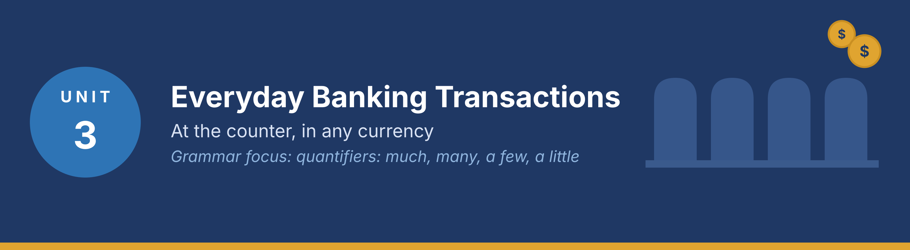

*In this unit you learn the language of everyday transactions at the counter, how to talk about amounts, how to follow a conversation with a customer, and how to write a short internal note. Grammar focus: quantifiers (much, many, a few, a little).*

## Part · · Warm-Up
*In-class starter · speak before you read*


### W-A  Daily transactions (brainstorm)
*With a partner, list everything a customer can do at a bank counter in one day.*

> **Model — read this first**
> Deposit cash. Withdraw cash. Pay a bill. Transfer money to another account. Change one currency for another.

- Which of these do you do most often?
- Which one takes the longest? Why?


### W-B  Teller security checks (think–pair–share)
*Think for one minute, then compare with a partner.*

- What does a teller check before paying out cash?
- Why does the bank ask for ID for a large amount?

*Useful words: Use the words amount, limit, ID, receipt and signature in your answer.*


## Part 1 · Vocabulary
*Pre-class input*


### 1A  Match the term to the meaning
*Match each transaction word (1–7) to the correct meaning (a–h). One meaning is extra.*

**Example: 0. Receipt → g)**


| Column A | Column B |
|---|---|
| 1. Deposit ____ | **a)** money taken out of an account |
| 2. Withdrawal ____ | **b)** money paid into an account |
| 3. Transfer ____ | **c)** money moved from one account to another |
| 4. Balance ____ | **d)** the money in an account at this moment |
| 5. Statement ____ | **e)** a list of all the transactions on an account |
| 6. Standing order ____ | **f)** the same payment, sent again and again |
| 7. Direct debit ____ | **g)** permission for a company to collect a payment |
|  | **h)** a fee the bank charges for a service (extra) |

*Pronunciation — word stress. Say these words: de·PO·sit, with·DRAW·al, TRANS·fer (noun), trans·FER (verb), BA·lance.*


### 1B  Sort the transactions
*Put each word from 1A into the correct group.*

- Money in: ____
- Money out: ____
- Information only: ____

> **Model — read this first**
> Money in: deposit. Money out: withdrawal, standing order, direct debit. Information only: balance, statement. (A transfer can be either, depending on the direction.)


### 1C  Complete the sentences
*Complete the sentences with the correct word.*

**Word bank:** deposit | withdraw | balance | transfer | statement | receipt | limit | currency | fee

**Example: 0. Please sign here and keep your receipt.**

1. I would like to ______________________ 200 in cash, please.
2. Could you check the ______________________ on my current account?
3. The daily ______________________ at the machine is 500.
4. I want to ______________________ this money into my savings account.
5. Please send me a ______________________ for the last three months.
6. There is a small ______________________ for an international transfer.


### 1D  Word partners (collocations)
*Match the verb to the noun to make a common banking phrase (one noun is extra).*


| Column A | Column B |
|---|---|
| 1. make ____ | **a)** cash |
| 2. withdraw ____ | **b)** a deposit |
| 3. check ____ | **c)** a transfer |
| 4. send ____ | **d)** the balance |
| 5. sign ____ | **e)** the slip |
|  | **f)** a queue (extra) |


### 1E  Write with the words (40–60 words)
*Write about one transaction you made recently. Use at least five words from Part 1.*

> **Model — read this first**
> Last Friday I went to my branch to deposit my salary. The teller checked my ID and gave me a receipt. Then I asked for my balance and sent a small transfer to my sister. The whole visit took ten minutes.

**Check before you finish**
- ☐ Five Part-1 words?
- ☐ 40–60 words?
- ☐ Short, clear sentences?

> ✎ *Write your response here.*

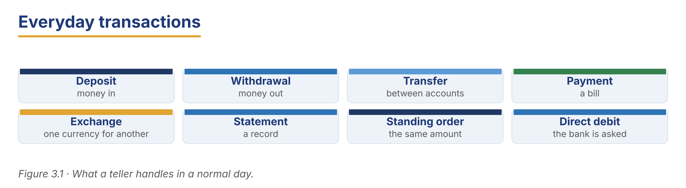


## Part 2 · Grammar — Quantifiers (much, many, a few, a little)
*Pre-class input*


### 2A  Notice the grammar
*Read the short dialogue. Underline much, many, a few and a little. Which words go with countable nouns?*

```
Grace: Good morning. How much cash would you like today?
Customer: Three hundred, please. And how many notes can I have?
Grace: As many as you like. There are a few large notes left, and a little change.
Customer: Large notes, please. I don’t have much time.
```

1. much — countable or uncountable? ____
2. many — countable or uncountable? ____
3. a few / a little — which one goes with notes? ____


### Grammar Focus

| Quantifier | Use | Example |
|---|---|---|
| much | uncountable nouns, mostly in questions and negatives | How much cash do you need? |
| many | countable nouns | How many notes would you like? |
| a few / a little | a small amount: a few (countable), a little (uncountable) | a few coins; a little change |

> **Remember:** cash, money, time and change are uncountable → much, a little. notes, coins, accounts and forms are countable → many, a few.

> **⚠ Watch out!**
> ✗ How many money do you need? → ✓ How much money do you need?
> ✗ I have a little coins. → ✓ I have a few coins.


### 2B  Controlled practice (choose the quantifier)
*Choose much, many, a few or a little.*

**Word bank:** much | many | a few | a little | how much | how many

**Example: 0. ____ cash do you need? → How much.**

1. ______________________ notes would you like, sir?
2. I only have ______________________ change in the drawer.
3. We do not have ______________________ time before the branch closes.
4. ______________________ customers are waiting outside?
5. There are still ______________________ forms on the counter.
6. She put ______________________ money into her savings account.


### 2C  Error correction
*Find and correct the mistake in each sentence.*

**Example: 0. How many cash? → How much cash?**

1. How many money would you like to deposit?
2. I have a little notes in my wallet.
3. There aren’t much customers today.
4. He needs a few cash for the weekend.
5. How much forms do I have to sign?

> ✎ *Write your response here.*


### 2D  Ask about amounts
*Write three questions a teller asks a customer about amounts. Use much, many and a few.*

> **Model — read this first**
> How much would you like to withdraw? How many notes would you like? Would you like a few coins as well?

> ✎ *Write your response here.*


### 2E  Freer practice (speaking at the counter)
*In pairs, act a short counter conversation. The teller asks at least three questions about amounts.*

> **Model — read this first**
> “Good morning. How much would you like to deposit? … And how many of these are large notes?”

*Tip: You will see these quantifiers again in the reading in Part 5 (5A and 5B). Look for them there.*

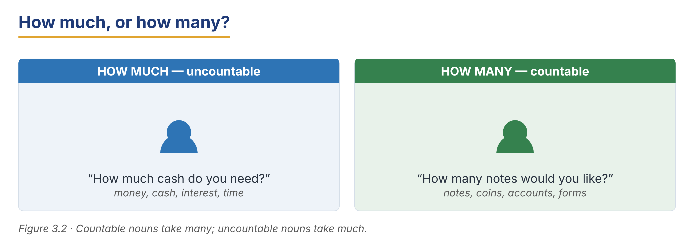


## Part 3 · Listening
*Pre-class input · scripts printed below*


### 3A  Before you listen (predict)
*You will hear three counter conversations. What does a teller usually say first?*

> **Model — read this first**
> “I think the teller will greet the customer and ask how she can help.”


### 3B  A simple withdrawal
**🔊 Audio 3.1** (optional) — or read the script below.

```
Grace: Good morning. How can I help you?
Customer: I’d like to withdraw three hundred, please.
Grace: Certainly. May I see your card and your ID?
Customer: Here you are.
Grace: Thank you. How many large notes would you like?
Customer: All large, please. And a receipt.
```

*Read and decide: True, False, or Not Given.*

**Example: 0. The customer wants to take out money. → True.**

1. The teller asks for one document only.
2. The customer wants small notes.
3. The customer has used this branch before.

*Useful language: How can I help you? · May I see your card and your ID? · How many large notes would you like?*


### 3C  A cash deposit
**🔊 Audio 3.2** (optional) — or read the script below.

```
Customer: Hello. I’d like to deposit this cash into my current account.
Tomasz: Of course. How much is it?
Customer: Four hundred and fifty. I counted it twice.
Tomasz: Thank you. Could you complete this deposit slip, please? I will count it again in front of you.
Customer: Will the money be in the account today?
Tomasz: Yes. Cash deposits are available at once.
```

*Read and decide: True or False.*

1. The customer is paying money into an account.
2. The teller does not count the money again.
3. The customer must complete a slip.
4. Cash deposits take three days.
5. The customer counted the money before coming.


### 3D  A customer with several transactions (longer)
**🔊 Audio 3.3** (optional) — or read the script below.

```
Customer: Good afternoon. I have a few things to do today, I’m afraid.
Grace: That’s no problem. Let’s take them one at a time.
Customer: First, I’d like to withdraw two hundred. Then I want to pay my electricity bill. And I need a statement for the last three months, because my landlord has asked for one.
Grace: Certainly. How much is the bill?
Customer: Eighty-five. I have the paper here.
Grace: Thank you. I’ll do the withdrawal first, then the bill, and I’ll print the statement last. It takes a little time, but not much.
Customer: That’s fine. I’m not in a hurry today.
```

*Read and decide: True, False, or Not Given.*

**Example: 0. The customer has more than one transaction. → True.**

1. The customer wants a statement for six months.
2. The teller does the three transactions in order.
3. The customer is in a hurry.


### 3E  Identify the transaction type
*Match each sentence from the listenings to the type of transaction (one is extra).*


| Column A | Column B |
|---|---|
| 1. “I’d like to withdraw three hundred.” ____ | **a)** a cash deposit |
| 2. “I’d like to deposit this cash.” ____ | **b)** a cash withdrawal |
| 3. “I want to pay my electricity bill.” ____ | **c)** a bill payment |
| 4. “I need a statement for three months.” ____ | **d)** a request for information |
|  | **e)** a currency exchange (extra) |

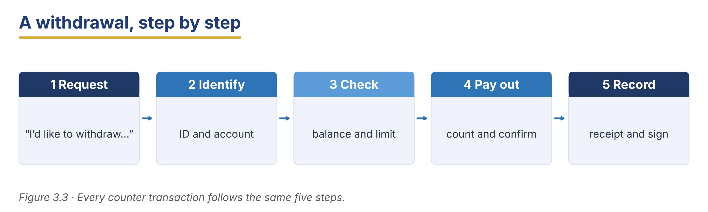


## Part 4 · Speaking
*In-class output*


### 4A  Functional language — at the counter
*Match the function to a phrase (one is extra).*


| Column A | Column B |
|---|---|
| 1. Greet the customer ____ | **a)** “How much would you like to withdraw?” |
| 2. Ask about an amount ____ | **b)** “Good morning. How can I help you?” |
| 3. Ask for a document ____ | **c)** “Could I see your ID, please?” |
| 4. Confirm and close ____ | **d)** “Here is your receipt. Anything else?” |
|  | **e)** “Your card has been blocked.” (extra) |


### 4B  Teller role-play (pairwork)
*Act a counter transaction, then swap roles.*

> **Model — read this first**
> A: Good morning. How can I help you? — B: I’d like to deposit four hundred. — A: Certainly. Could you complete this slip? How many notes are there? — B: Eight. — A: Thank you. Here is your receipt.

**Card A (teller):** greet · ask the amount · ask for ID · give a receipt.

**Card B (customer):** you want to deposit cash; you have your ID; you also want your balance.


### 4C  Three-step banking task
*Your customer has three things to do. Serve them in a clear order and say what you are doing.*

> **Model — read this first**
> “Let’s take them one at a time. First the withdrawal, then the bill, and I’ll print the statement last.”

*Stretch: the customer adds a fourth request at the end — handle it politely.*


### 4D  Find the information (pairwork info-gap)
*Student A is a teller; Student B is a customer. Ask and answer to complete the transaction.*

**Card A (teller):** you can pay out up to 500 in cash; a statement takes two minutes; a bill payment needs the paper bill.

**Card B (customer):** you want 600 in cash, a statement for three months, and to pay a bill of 85.

*Useful language: How much would you like? · How many notes? · Do you have the bill with you?*


### 4E  Closing the transaction
*Match the closing phrase to the situation (one is extra).*


| Column A | Column B |
|---|---|
| 1. “Here is your receipt.” ____ | **a)** giving the customer the record |
| 2. “Would you like a statement as well?” ____ | **b)** offering one more service |
| 3. “Please check the amount before you leave.” ____ | **c)** asking the customer to check |
| 4. “Is there anything else today?” ____ | **d)** checking there is nothing more |
|  | **e)** “Please take a seat.” (extra) |

*In pairs, close a counter transaction politely. Use two phrases above.*


## Part 5 · Reading
*Pre-class input*


### 5A  Teller guidelines
*Read the counter guidelines. Notice the quantifiers (much, many, a few, a little).*

> **Harbour Bank — Guidelines for the Counter** — *About 200 words*
>
> These guidelines are the same in every Harbour Bank branch. Before you pay out cash, always check two things: the customer’s ID and the balance on the account. If the amount is large, ask a colleague to check with you. It takes a little time, but it prevents mistakes. Count notes twice. Count them once in the drawer and once in front of the customer. Many customers like to see the money counted, and a few will count it again themselves. That is normal, and you should never hurry them. Ask how many large notes the customer would like. Some want large notes because they are easier to carry; others want small notes. Give a receipt for every transaction, even a small one. Finally, remember that not much goes wrong at a quiet counter; most mistakes happen when there is a queue and too little time. If you feel rushed, slow down and say, “One moment, please.” A short pause is better than a wrong amount.

*Answer the questions.*

**Example: 0. What two things do you check before paying out cash? → ID and balance.**

1. What should you do if the amount is large?
2. How many times should you count notes?
3. Why do some customers want large notes?
4. When do most mistakes happen?
5. What should you say if you feel rushed?
6. Who do these guidelines apply to?


### 5B  Grammar in context (from 5A)
*Look back at the guidelines. Find one example of each quantifier.*

1. much: ____
2. many: ____
3. a few: ____
4. a little: ____

*Now complete these sentences about the counter.*

1. There isn’t ______________________ time when the queue is long.


### 5C  A customer’s bank statement
*Read the short statement note. What does each line show?*

> **Reading a Statement** — *About 130 words*
>
> A statement is a list of everything that has happened on an account. Each line shows the date, a short description, the amount, and the balance after the transaction. A customer called the branch last week because she could not understand one line. It said “DD — CITY POWER — 85.00”. DD means direct debit: the customer gave the electricity company permission to collect the payment every month. Another line said “ATM — 14 MAR — 200.00”: a cash withdrawal from a machine. When you explain a statement, start with the date and read across the line slowly.

1. What four things does each line of a statement show?
2. What does DD mean?
3. Why did the customer call the branch?
4. How should you explain a line to a customer?


### 5D  Discussion
*In pairs, compare the guidelines with your own workplace.*

*Useful frame: “At my bank we also ___, but we do not ___.”*

- Which guideline is the most important? Why?
- What does your bank do when there is a long queue?

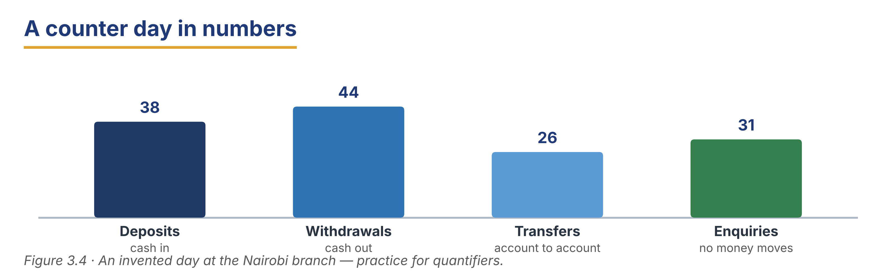


## Part 6 · Writing
*In-class / homework output*


### 6A  Guided writing — complete the transaction note
*Complete the internal note with the words: deposited, balance, receipt, verified, slip.*

**Word bank:** deposited | balance | receipt | verified | slip

1. At 10:15 a customer ______________________ 450 in cash into a current account.
2. I ______________________ the customer’s ID before the transaction.
3. The customer completed a deposit ______________________ and signed it.
4. The new ______________________ was shown to the customer on screen.
5. A printed ______________________ was given to the customer.


### 6B  Internal email — process report (50–70 words)
*Write a short internal email to your supervisor about a busy hour at the counter.*

> **Model — read this first**
> Subject: Counter report — Tuesday morning
> Dear Ms Nowak, Between nine and eleven we served forty-two customers. Most of them were cash deposits and withdrawals. There were a few bill payments and a little trouble with the note counter, which I have reported to IT. No cash differences at the end of the hour. Best regards, Grace

*Plan: Subject: ___ · Dear ___, · Between ___ and ___ we ___. · Most of them were ___. · There were a few ___. · Best regards, ___*

*Phrase bank: Between ___ and ___ we served… · Most of them were… · There were a few… · No cash differences*

**Check before you finish**
- ☐ A clear subject line?
- ☐ One quantifier used correctly?
- ☐ A short, factual tone?
- ☐ 50–70 words?

> ✎ *Write your response here.*


### 6C  Customer inquiry email (50–70 words)
*A customer emails to ask why a payment left her account. Write a short, clear reply.*

> **Model — read this first**
> Subject: Your question about a payment
> Dear Ms Fernandes, Thank you for your email. The payment of 85.00 on 14 March was a direct debit to City Power. A direct debit is a payment you have given a company permission to collect. If you would like to stop it, could you please visit the branch with your ID? Kind regards, Customer Service

*Plan: Subject: ___ · Dear ___, · Thank you for ___. · The payment of ___ was ___. · A ___ is ___. · Could you please ___? · Kind regards, ___*

**Check before you finish**
- ☐ A clear subject line?
- ☐ A simple explanation of the banking word?
- ☐ A clear next step?
- ☐ 50–70 words?

> ✎ *Write your response here.*


### 6D  Peer check
*Swap your email from 6B or 6C with a partner. Give one piece of positive feedback and one suggestion.*

*Checklist: subject line? · correct quantifier? · clear next step? · 50–70 words?*

> **Model — read this first**
> “Clear subject line and a good explanation of ‘direct debit’. Next time, try to give the date as well.”


## Part 7 · Management File — Running the Counter
*Practitioner track (optional for beginners) · experienced staff*


### 7A  Shift and cash-control phrases
*Match the phrase to its purpose (one is extra).*


| Column A | Column B |
|---|---|
| 1. “The drawer balances.” ____ | **a)** the cash counted matches the record |
| 2. “We are two hundred short.” ____ | **b)** the cash counted is less than the record |
| 3. “I’m handing over to Tomasz.” ____ | **c)** passing the counter to a colleague |
| 4. “Please countersign the float.” ____ | **d)** asking a colleague to check and sign |
|  | **e)** closing an account (extra) |


### 7B  Listening — the shift handover
**🔊 Audio 3.4** (optional) — or read the script below.

```
Grace: Right, I’m handing over to you now. The drawer balances — I’ve counted it twice.
Tomasz: Thanks. How much is in the float?
Grace: Two thousand, and a little change. There are only a few large notes left, so order more if the queue builds.
Tomasz: Anything else I should know?
Grace: One customer is coming back at three for a statement. Her name is on the pad.
```

*Answer the questions.*

**Example: 0. Who is taking over the counter? → Tomasz.**

1. How much is in the float?
2. Why should Tomasz order more large notes?
3. What is happening at three o’clock?


### 7C  Controlled practice — the handover note
*Complete the handover note. Use the correct quantifier or word.*

**Word bank:** balances | float | a few | a little | short | countersigned

1. The drawer ______________________ at the end of my shift.
2. There are only ______________________ large notes left in the drawer.
3. We have ______________________ change, so please order more coins.
4. The ______________________ was counted and ______________________ by a colleague.
5. We are not ______________________ any cash today.

> ✎ *Write your response here.*


### 7D  Role play — hand over the counter
*You are finishing your shift. Hand over the counter to a colleague clearly and completely.*

> **Model — read this first**
> “The drawer balances. There is a little change and only a few large notes. One customer is returning at three. Please countersign the float before I go.”

**Card A (leaving):** say the drawer balances · say what is low · say what is outstanding · ask for a countersignature.

**Card B (arriving):** ask two questions and repeat back what you heard.

*Stretch: the drawer does not balance — explain calmly what you will do next.*


### 7E  Writing — an end-of-shift summary (50–70 words)
*Write a short end-of-shift summary for the supervisor.*

> **Model — read this first**
> Subject: End of shift — counter 2
> The drawer balances. I served sixty-one customers today, mostly deposits and withdrawals. There were a few bill payments and one statement request. We are low on large notes, so I have ordered more for tomorrow. Nothing outstanding. Countersigned by Tomasz Wójcik at 16:05. Grace Otieno

*Plan: Subject: ___ · The drawer ___. · I served ___. · There were a few ___. · We are low on ___. · Countersigned by ___.*

*Phrase bank: the drawer balances · mostly deposits and withdrawals · we are low on… · nothing outstanding · countersigned by…*

**Check before you finish**
- ☐ Does it say whether the drawer balances?
- ☐ One quantifier used correctly?
- ☐ Anything outstanding named?
- ☐ 50–70 words?

> ✎ *Write your response here.*


## Part 8 · Global Case Study — Cutting the Queue
*Practitioner track · read then discuss*

*Before you read: what makes a bank queue move faster — more staff, or something else?*

> **Twenty Minutes Saved** — *About 200 words · a made-up example based on real practice*
>
> A bank with branches in several countries had the same problem everywhere: at the end of the month, customers waited twenty minutes or more. The bank did not want to pay for many extra staff, so it looked at the queue itself. It found that a little over half of the people in the queue did not need a teller at all. They were checking a balance, printing a statement, or paying a routine bill — all things a machine or the app can do. So the bank made three changes. First, it put a member of staff at the door to ask each customer what they needed. This person is called a greeter. If the customer only needed a balance, the greeter showed them the machine. Second, it moved bill payments to a separate, faster desk. Third, it taught customers to use the app, one customer at a time, while they waited. After three months, the average wait fell from twenty minutes to eight. The bank had not added a single teller.

**Glossary help**
- **greeter** — a member of staff who meets customers at the door
- **queue** — a line of people waiting
- **average wait** — the usual waiting time
- **routine payment** — a payment that happens again and again


### 8A  Comprehension
**Example: 0. How long did customers wait at the end of the month? → Twenty minutes or more.**

1. What did the bank find about the people in the queue?
2. What does a greeter do?
3. Why did the bank move bill payments to a separate desk?
4. How long was the average wait after three months?
5. How many extra tellers did the bank add?


### 8B  Vocabulary in context
*Match the word to its meaning (one is extra).*


| Column A | Column B |
|---|---|
| 1. greeter ____ | **a)** a line of people waiting |
| 2. queue ____ | **b)** a member of staff who meets customers at the door |
| 3. average wait ____ | **c)** a payment that happens again and again |
| 4. routine payment ____ | **d)** the usual waiting time |
|  | **e)** a charge for a service (extra) |


### 8C  Discussion
*Frames: “This would work in my branch because ___.” “This would be difficult because ___.”*

- Would a greeter work in your branch? Why / why not?
- Which of the three changes is easiest to start tomorrow?


### 8D  Your view (short write, 30–40 words)
*Which change would cut the queue most in your bank, and why?*

> ✎ *Write your response here.*


## Part 9 · Branch Case Study — Istanbul in Focus: When the Rate Moves
*Practitioner track · read then decide*

*Before you read: what happens at the counter when an exchange rate changes quickly?*

> **A Morning of Questions** — *About 175 words*
>
> The Harbour Bank branch in Istanbul opens at nine. This morning the exchange rate has moved a long way overnight, and many customers want to change money before it moves again. By half past nine there is a queue of about twenty people. Most of them have only one question: “How much will I get today?” Zeynep Kaya is on the exchange desk. She is careful and polite, but each customer wants to talk about the rate, and a few are angry about the spread between the buy rate and the sell rate. Meanwhile, the ordinary counter has its own queue of deposits and withdrawals. The branch manager, Kerem Aydın, has four staff this morning and two desks. He knows the rate will probably move again at eleven, when the market opens. He must decide how to use his people in the next two hours, and what to tell the customers who are waiting.


### 9A  Comprehension
**Example: 0. Where is the branch? → In Istanbul.**

1. Why do many customers want to change money this morning?
2. What one question do most of them have?
3. What are a few customers angry about?
4. How many staff and desks does Kerem have?


### 9B  Decision task
*What should Kerem do in the next two hours? Write 40–60 words. Use the frame and the phrase bank.*

> **Model — read this first**
> I think Kerem should open the second desk for exchange only, because most customers have the same question. He can put a board at the door with today’s rate, so people do not have to ask. Also, he can ask Zeynep to explain the spread once, clearly, to everyone waiting.

*Frame: I think Kerem should ___, because ___. Also, ___.*

*Phrase bank: open a second desk for ___ only · put today’s rate on a board · explain the spread once, clearly · ask customers with one question to ___*

> ✎ *Write your response here.*


## Part 10 · Review & Can-Do
*Homework / self-study*


### 10A  Spiral review
*Complete the sentences. Use a quantifier or the correct word. Items 5–6 review Units 1 and 2.*

**Example: 0. How ____ cash do you need? → much.**

1. How ______________________ notes would you like, sir? (quantifier)
2. There isn’t ______________________ time before we close. (quantifier)
3. Money paid into an account is a ______________________. (word)
4. A list of all your transactions is a ______________________. (word)
5. ______________________ you confirm your address, please? (Unit 2 modal)
6. At the moment, the teller ______________________ (count) the drawer. (Unit 1 grammar)


### 10B  Can-Do checklist
**Can-Do checklist — tick what you can do now**
- ☐ I can name the everyday transactions at a counter.
- ☐ I can ask about amounts with much, many, a few and a little.
- ☐ I can serve a customer with several transactions in order.
- ☐ I can understand a short counter conversation.
- ☐ I can write a short internal note about a shift.


### 10C  Unit glossary
**Glossary help**
- **deposit** — money paid into an account
- **withdrawal** — money taken out of an account
- **transfer** — money moved from one account to another
- **balance** — the money in an account at this moment
- **statement** — a list of all the transactions on an account
- **standing order** — the same payment, sent again and again
- **direct debit** — permission for a company to collect a payment
- **float** — the cash a teller starts the shift with
- **greeter** — a member of staff who meets customers at the door
- **average wait** — the usual waiting time


# Unit 4 · Banking Products and Services
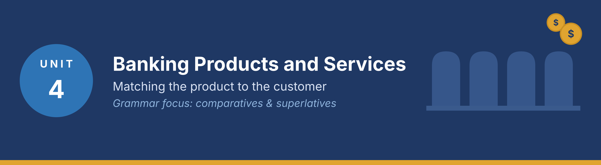

*In this unit you learn the names of the bank’s main products, how to compare them, how to recommend the right one to a customer, and how to write a short recommendation email. Grammar focus: comparatives and superlatives.*

## Part · · Warm-Up
*In-class starter · speak before you read*


### W-A  What do customers need? (discussion)
*In small groups, think of three different customers and what each one needs from a bank.*

> **Model — read this first**
> A student needs a simple account with no fees. A shop owner needs a business account and a small loan. A family saving for a house needs a savings account with a good rate.

- Who are the three most common customers at your branch?
- What does each of them ask for first?


### W-B  Products and uses (quick match)
*In pairs, say which product each person needs. One minute only.*

- Someone who is paid every month and pays bills: ____
- Someone who wants to keep money for three years: ____
- Someone who needs 5,000 to buy a van for work: ____

*Useful words: Use the words account, card, loan and deposit in your answers.*


## Part 1 · Vocabulary
*Pre-class input*


### 1A  Match the product to the definition
*Match each product (1–8) to the correct definition (a–i). One definition is extra.*

**Example: 0. Overdraft → h)**


| Column A | Column B |
|---|---|
| 1. Current account ____ | **a)** money you keep and do not spend every day |
| 2. Savings account ____ | **b)** an account for everyday payments and bills |
| 3. Fixed deposit ____ | **c)** money locked away for a fixed time at a fixed rate |
| 4. Debit card ____ | **d)** a card that spends your own money |
| 5. Credit card ____ | **e)** a card that spends the bank’s money, repaid later |
| 6. Personal loan ____ | **f)** money you borrow and repay in monthly amounts |
| 7. Mortgage ____ | **g)** a long loan to buy a property |
| 8. Overdraft ____ | **h)** permission to go below zero on a current account |
|  | **i)** a charge for sending money abroad (extra) |

*Pronunciation — word stress. Say these words: MORT·gage, O·ver·draft, de·PO·sit, in·TE·rest, in·STAL·ment.*


### 1B  Sort the products
*Put each product from 1A into the correct group.*

- For keeping money: ____
- For spending money: ____
- For borrowing money: ____

> **Model — read this first**
> For keeping money: savings account, fixed deposit. For spending money: current account, debit card. For borrowing money: credit card, personal loan, mortgage, overdraft.


### 1C  Complete the sentences
*Complete the sentences with the correct word.*

**Word bank:** interest | rate | fee | instalment | term | limit | apply | repay | balance

**Example: 0. The bank pays interest on your savings.**

1. Our savings account pays a higher ______________________ than our current account.
2. There is no monthly ______________________ on a student account.
3. You repay a personal loan in equal monthly ______________________.
4. A fixed deposit has a ______________________ of one, two or three years.
5. Your credit card has a ______________________ of 2,000.
6. You can ______________________ for a loan online or at the branch.


### 1D  Word partners (collocations)
*Match the verb to the noun to make a common banking phrase (one noun is extra).*


| Column A | Column B |
|---|---|
| 1. open ____ | **a)** a loan |
| 2. apply for ____ | **b)** an account |
| 3. pay ____ | **c)** interest |
| 4. earn ____ | **d)** a fee |
| 5. repay ____ | **e)** the instalments |
|  | **f)** a queue (extra) |


### 1E  Write with the words (40–60 words)
*Write about one banking product you use. Use at least five words from Part 1.*

> **Model — read this first**
> I have a current account for my salary and a savings account for my holiday. The savings account pays a better rate, but I cannot use the money every day. I do not pay a monthly fee, and my debit card is free.

**Check before you finish**
- ☐ Five Part-1 words?
- ☐ 40–60 words?
- ☐ Short, clear sentences?

> ✎ *Write your response here.*

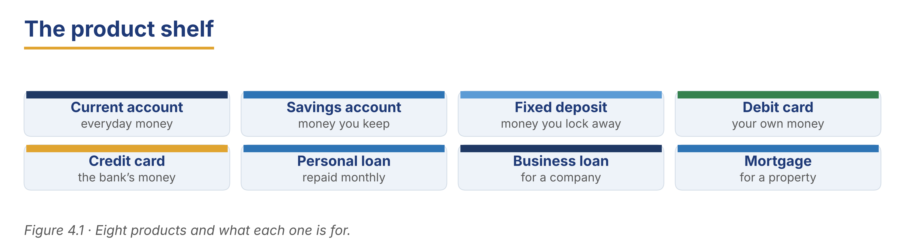


## Part 2 · Grammar — Comparatives and Superlatives
*Pre-class input*


### 2A  Notice the grammar
*Read the short dialogue. Underline the comparatives and superlatives. Which compares two things, and which compares all of them?*

```
Diego: The Step Saver pays a higher rate than the Everyday Saver.
Customer: And which is the best for me?
Diego: If you can wait a year, the Fixed 12 is the highest of the three. It is also the least flexible.
Customer: So it is better for money I don’t need?
Diego: Exactly. It is the safest choice for long-term saving.
```

1. higher — comparative or superlative? ____
2. the best — how many things is it comparing? ____
3. less flexible / the least flexible — which compares two? ____


### Grammar Focus

| Form | Use | Example |
|---|---|---|
| -er / more … than | comparing two things | This card is cheaper than that one. |
| the -est / the most … | comparing three or more | This is the cheapest card we offer. |
| less / the least | the opposite direction | the least flexible account |

> **Remember:** short words add -er / -est (high → higher → the highest). Long words take more / the most (flexible → more flexible → the most flexible).

> **⚠ Watch out!**
> ✗ This account is more better. → ✓ This account is better.
> ✗ It is the most cheap card. → ✓ It is the cheapest card.


### 2B  Controlled practice (comparative or superlative)
*Write the correct form of the word in brackets.*

**Example: 0. The Fixed 12 pays a ____ (high) rate than the Step Saver. → higher.**

1. A credit card is ______________________ (expensive) than a debit card.
2. This is the ______________________ (good) account for a student.
3. A mortgage is ______________________ (long) than a personal loan.
4. Our online application is the ______________________ (fast) way to apply.
5. A fixed deposit is ______________________ (safe) than an investment.
6. The Everyday Saver is the ______________________ (flexible) of the three.


### 2C  Error correction
*Find and correct the mistake in each sentence.*

**Example: 0. It is more cheaper. → It is cheaper.**

1. This card is more better than the old one.
2. The Fixed 12 is the most high rate we offer.
3. A loan is expensiver than an overdraft.
4. This is the more flexible account of the three.
5. A debit card is cheap than a credit card.

> ✎ *Write your response here.*


### 2D  Compare two products
*Write three sentences comparing two accounts your bank offers. Use one superlative.*

> **Model — read this first**
> The Step Saver pays a higher rate than the Everyday Saver. However, the Everyday Saver is more flexible, because you can withdraw any day. For long-term money, the Fixed 12 is the best of the three.

> ✎ *Write your response here.*


### 2E  Freer practice (speaking)
*In pairs, compare three products and recommend one. Use at least two comparatives and one superlative.*

> **Model — read this first**
> “The Fixed 12 pays the highest rate, but the Everyday Saver is more flexible. For your situation, I think the Step Saver is better.”

*Tip: You will see these forms again in the reading in Part 5 (5A and 5B). Look for them there.*

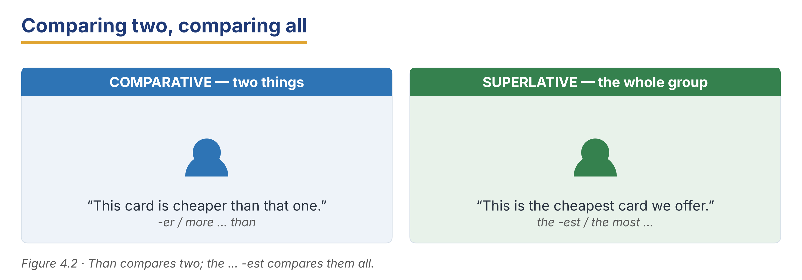


## Part 3 · Listening
*Pre-class input · scripts printed below*


### 3A  Before you listen (predict)
*You will hear customers choosing products. What questions do customers ask before they choose?*

> **Model — read this first**
> “I think they will ask about the rate, the fees, and how soon they can take the money out.”


### 3B  Choosing an account
**🔊 Audio 4.1** (optional) — or read the script below.

```
Customer: I’d like to open a savings account, but I don’t know which one.
Diego: Of course. How soon might you need the money?
Customer: Maybe in a year. Maybe not.
Diego: Then the Step Saver is probably better than the Fixed 12. It pays a little less, but you can take money out twice a year.
Customer: That sounds safer for me.
```

*Read and decide: True, False, or Not Given.*

**Example: 0. The customer wants a savings account. → True.**

1. The Fixed 12 pays less than the Step Saver.
2. The customer may need the money within a year.
3. The customer already has an account at this bank.

*Useful language: How soon might you need the money? · It pays a little less, but… · That sounds safer for me.*


### 3C  A product recommendation
**🔊 Audio 4.2** (optional) — or read the script below.

```
Customer: My shop is growing. I need to buy a van, about eight thousand.
Priya: Then a business loan is better than an overdraft for that amount. An overdraft is more expensive over a long period.
Customer: How long would I repay it?
Priya: Up to five years. The longer the term, the smaller the monthly instalment — but the more interest you pay in total.
Customer: I see. I’d like the shortest term I can manage.
```

*Read and decide: True or False.*

1. An overdraft is cheaper than a loan over a long period.
2. The customer wants to buy a vehicle for the business.
3. A longer term means a smaller monthly payment.
4. The customer prefers a long term.


### 3D  A family chooses a product (longer)
**🔊 Audio 4.3** (optional) — or read the script below.

```
Priya: How can I help you both today?
Customer A: We are saving for a deposit on a flat. We have six thousand and can add two hundred a month.
Priya: For how long?
Customer B: Three years.
Priya: Then let me compare three. The Everyday Saver is the most flexible but pays the lowest rate. The Step Saver pays more, with two withdrawals a year. The Fixed 12 pays the highest, but the money is locked for a year.
Customer A: Could we use more than one?
Priya: Yes, and that is often the best answer. Keep some where you can reach it, and the rest where it earns more.
```

*Read and decide: True, False, or Not Given.*

**Example: 0. The customers are saving for a flat. → True.**

1. The Everyday Saver pays the highest rate.
2. The customers can save two hundred a month.
3. They decide today which account to open.


### 3E  Match the recommendation
*Match each customer to the right product (one is extra).*


| Column A | Column B |
|---|---|
| 1. A customer who may need the money in a year ____ | **a)** a business loan over five years |
| 2. A shop owner buying a van ____ | **b)** the Fixed 12, locked for a year |
| 3. A family saving for three years ____ | **c)** a mix of two accounts |
| 4. Someone who will not touch the money ____ | **d)** the Step Saver |
|  | **e)** a credit card with a high limit (extra) |

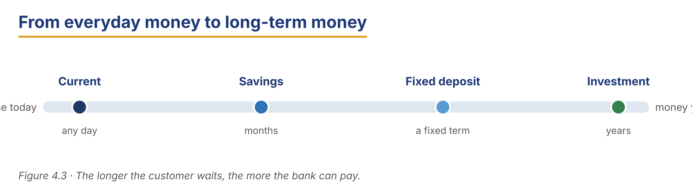


## Part 4 · Speaking
*In-class output*


### 4A  Functional language — comparing and recommending
*Match the function to a phrase (one is extra).*


| Column A | Column B |
|---|---|
| 1. Compare two products ____ | **a)** “Based on what you’ve told me, I’d suggest…” |
| 2. Recommend one ____ | **b)** “The Step Saver pays more than the Everyday Saver.” |
| 3. Ask about the customer’s need ____ | **c)** “How soon might you need the money?” |
| 4. Check the customer agrees ____ | **d)** “Does that sound right for you?” |
|  | **e)** “Your card has been declined.” (extra) |


### 4B  Recommend a product (pairwork)
*Listen to the customer, compare two products, and recommend one. Then swap roles.*

> **Model — read this first**
> A: How soon might you need the money? — B: In about a year. — A: Then the Step Saver is better than the Fixed 12, because you can withdraw twice a year. It pays a little less, but it is more flexible.

**Card A (adviser):** ask one question · compare two products · recommend one · check the customer agrees.

**Card B (customer):** you have 3,000 to save; you may need it next summer; you do not like risk.


### 4C  Compare and decide
*Your customer cannot choose between two cards. Compare them and help them decide.*

> **Model — read this first**
> “The debit card is cheaper, because there is no annual fee. The credit card costs more, but it is safer for buying online and in another country. For travelling, I think the credit card is better.”

*Stretch: the customer says “Which would you choose?” — answer professionally.*


### 4D  Find the information (pairwork info-gap)
*Student A is an adviser; Student B is a customer. Ask and answer to find the best product.*

**Card A (adviser):** Everyday Saver 1%, withdraw any day · Step Saver 3%, two withdrawals a year · Fixed 12 5%, locked one year.

**Card B (customer):** you have 10,000; you need 2,000 of it within three months; the rest can wait two years.

*Useful language: How much would you like to save? · How soon might you need it? · Would you prefer a higher rate or more flexibility?*


### 4E  Close the recommendation
*Match the closing phrase to the situation (one is extra).*


| Column A | Column B |
|---|---|
| 1. “Shall I open that for you now?” ____ | **a)** moving to action |
| 2. “You can change this later if your plans change.” ____ | **b)** reassuring the customer |
| 3. “I’ll send you the details in writing.” ____ | **c)** confirming afterwards |
| 4. “Take your time and come back if you wish.” ____ | **d)** giving the customer space |
|  | **e)** “Please take a seat.” (extra) |

*In pairs, close a product conversation politely. Use two phrases above.*


## Part 5 · Reading
*Pre-class input*


### 5A  Our products, compared
*Read the product page. Notice the comparatives and superlatives.*

> **Harbour Bank — Savings Products Compared** — *About 200 words*
>
> Harbour Bank offers three savings accounts, and the right one depends on when you need your money. The Everyday Saver is the most flexible of the three. You can withdraw any day, and there is no fee. However, it pays the lowest rate. The Step Saver pays more than the Everyday Saver, but you may make only two withdrawals a year. The Fixed 12 pays the highest rate we offer. The money is locked for twelve months, and you cannot take it out early without losing the interest. It is the best choice for money you are sure you will not need. All three accounts are available in every country where we operate, and the rate is set locally. Many customers use more than one account: some money where they can reach it quickly, and the rest where it earns more. If you are not sure, start with the Everyday Saver. It is easier to move money later than to take it out early.

*Answer the questions.*

**Example: 0. How many savings accounts does the bank offer? → Three.**

1. Which account is the most flexible, and why does it pay less?
2. How many withdrawals a year does the Step Saver allow?
3. What happens if you take money out of the Fixed 12 early?
4. Why is the rate not the same in every country?
5. What does the page suggest if a customer is not sure?


### 5B  Grammar in context (from 5A)
*Look back at the product page. Find two comparatives and two superlatives.*

1. Comparatives: ____ , ____
2. Superlatives: ____ , ____

*Now complete these sentences about the accounts.*

1. The Fixed 12 pays a ______________________ (high) rate than the Step Saver.
2. The Everyday Saver is the ______________________ (flexible) of the three.
3. The Step Saver is ______________________ (good) than the Everyday Saver for two-year savings.


### 5C  Meet a customer
*Read the short customer profile. Which account would you recommend?*

> **Meet a Customer — Rafael Lima** — *About 120 words*
>
> Rafael Lima runs a small printing shop in São Paulo. He has about nine thousand saved, and he adds three hundred most months. Next year he wants to buy a second printer, but he is not sure exactly when. He also keeps two thousand for emergencies, because a machine can break at any time. Rafael does not like risk. He says, “I would rather earn a little less and sleep well.” His bank has suggested one account for everything, but Rafael thinks that two accounts might suit him better: one he can reach quickly, and one that pays more.

1. What does Rafael do, and where?
2. Why does he keep two thousand separate?
3. What does Rafael think would suit him better than one account?


### 5D  Discussion
*In pairs, compare the products at your own bank.*

*Useful frame: “At my bank, the ___ pays more than the ___, but it is less ___.”*

- Which product do customers ask about most?
- Which is the hardest to explain, and why?

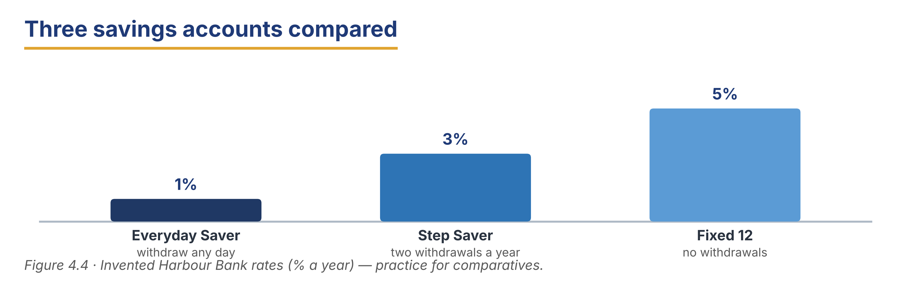


## Part 6 · Writing
*In-class / homework output*


### 6A  Guided writing — complete the recommendation
*Complete the email with the words: suggest, flexible, rate, compared, suit.*

**Word bank:** suggest | flexible | rate | compared | suit

1. Dear Mr Okonkwo, thank you for your visit. I have ______________________ our three savings accounts for you.
2. Based on what you told me, I would ______________________ the Step Saver.
3. It pays a better ______________________ than the Everyday Saver.
4. It is less ______________________, but you may still withdraw twice a year.
5. I believe it would ______________________ your plans for next year.


### 6B  Product recommendation email (50–70 words)
*Write a short email recommending one product to a customer. Use one comparative and one superlative.*

> **Model — read this first**
> Subject: Your savings — my recommendation
> Dear Mr Lima, Thank you for coming in. Based on your plans, I would suggest the Step Saver. It pays a higher rate than the Everyday Saver, and it still allows two withdrawals a year. The Fixed 12 pays the highest rate, but your money would be locked for twelve months. Kind regards, Diego Moreno

*Plan: Subject: ___ · Dear ___, · Thank you for ___. · Based on ___, I would suggest ___. · It pays a ___ rate than ___. · Kind regards, ___*

*Phrase bank: Based on what you told me… · I would suggest… · It pays a higher rate than… · the highest rate we offer*

**Check before you finish**
- ☐ A clear subject line?
- ☐ One comparative and one superlative?
- ☐ A reason for the recommendation?
- ☐ 50–70 words?

> ✎ *Write your response here.*


### 6C  Compare-two-cards email (50–70 words)
*A customer asks which card to take abroad. Write a short, clear reply.*

> **Model — read this first**
> Subject: Debit card or credit card abroad
> Dear Ms Fernandes, Thank you for your question. A debit card is cheaper, because there is no annual fee. However, a credit card is safer abroad, as it is easier to stop a payment if something goes wrong. For a two-week trip, I would suggest taking both and using the credit card for hotels. Kind regards, Customer Service

*Plan: Subject: ___ · Dear ___, · Thank you for ___. · A ___ is ___ because ___. · However, a ___ is ___. · I would suggest ___. · Kind regards, ___*

**Check before you finish**
- ☐ A clear subject line?
- ☐ Two products compared?
- ☐ A clear recommendation?
- ☐ 50–70 words?

> ✎ *Write your response here.*


### 6D  Peer check
*Swap your email from 6B or 6C with a partner. Give one piece of positive feedback and one suggestion.*

*Checklist: subject line? · one comparative? · a reason given? · 50–70 words?*

> **Model — read this first**
> “Clear comparison and a good reason. Next time, try to add one superlative so the customer can see the whole range.”


## Part 7 · Management File — Briefing the Team on a New Product
*Practitioner track (optional for beginners) · experienced staff*


### 7A  Briefing and target phrases
*Match the phrase to its purpose (one is extra).*


| Column A | Column B |
|---|---|
| 1. “From Monday we are offering…” ____ | **a)** announcing something new |
| 2. “The main difference is…” ____ | **b)** naming what has changed |
| 3. “Our target is twenty a week.” ____ | **c)** setting a goal for the team |
| 4. “If a customer asks about fees, say…” ____ | **d)** giving staff the exact words |
|  | **e)** closing a complaint (extra) |


### 7B  Listening — briefing the team
**🔊 Audio 4.4** (optional) — or read the script below.

```
Marta: Good morning, everyone. From Monday we are offering a new account, the Step Saver Plus.
Ana: How is it different from the Step Saver?
Marta: The main difference is the rate: it is half a point higher, but you may withdraw only once a year.
Ana: And our target?
Marta: Twenty new accounts a week across the branch. If a customer asks about fees, say there are none, but the withdrawal limit is strict.
```

*Answer the questions.*

**Example: 0. When does the new account start? → On Monday.**

1. What is the main difference from the Step Saver?
2. What is the team’s target?
3. What should staff say if a customer asks about fees?


### 7C  Controlled practice — the product comparison
*Complete the briefing note. Use the correct comparative or superlative.*

**Word bank:** higher | strictest | better | the most | less

1. The Step Saver Plus pays a ______________________ rate than the Step Saver.
2. It is ______________________ flexible, because there is only one withdrawal a year.
3. For long-term money it is ______________________ than the Everyday Saver.
4. It has the ______________________ withdrawal rule of all our accounts.
5. The Fixed 12 is still ______________________ generous account we offer.

> ✎ *Write your response here.*


### 7D  Role play — brief your team
*You are a branch manager. Brief your team on a new product in two minutes.*

> **Model — read this first**
> “From Monday we are offering the Step Saver Plus. The main difference is the rate — half a point higher — but only one withdrawal a year. Our target is twenty a week. If a customer asks about fees, say there are none.”

**Card A (manager):** announce · name the main difference · give the target · give the exact words for one likely question.

**Card B (team member):** ask two questions, one of them difficult.

*Stretch: a team member says the target is too high — respond professionally.*


### 7E  Writing — an internal product note (50–70 words)
*Write a short internal note introducing a new product to the branch.*

> **Model — read this first**
> Subject: New account from Monday — Step Saver Plus
> From Monday we are offering the Step Saver Plus. It pays half a point more than the Step Saver, but customers may withdraw only once a year. It is the best choice for money that will not be touched. There are no fees. Our target is twenty new accounts a week. Marta Nowak

*Plan: Subject: ___ · From ___ we are offering ___. · It pays ___ than ___. · It is the best choice for ___. · Our target is ___.*

*Phrase bank: From Monday we are offering… · the main difference is… · it pays more than… · our target is…*

**Check before you finish**
- ☐ A clear subject line?
- ☐ One comparative and one superlative?
- ☐ The target named?
- ☐ 50–70 words?

> ✎ *Write your response here.*


## Part 8 · Global Case Study — Launching a Product Worldwide
*Practitioner track · read then discuss*

*Before you read: why might the same product work in one country and fail in another?*

> **One Account, Six Countries** — *About 200 words · a made-up example based on real practice*
>
> An international bank designed a single savings account and launched it in six countries on the same day. The marketing was the same everywhere: a higher rate than the bank’s other accounts, in exchange for fewer withdrawals. In three countries it sold very well. In the other three it sold almost nothing, and the bank wanted to know why. The answer was not the product. It was the context. In the three successful countries, most customers were paid monthly into a bank account, and they were used to leaving money untouched. In the other three, many customers were paid in cash, or were paid weekly, and they needed to reach their money often. The rate was more attractive, but the rule was impossible. The bank made one change. It kept the same account, but it let each country set its own withdrawal rule: once a year in some markets, four times a year in others. Sales rose in all six countries. The lesson was simple: a product can travel, but the rules around it may have to change at the border.

**Glossary help**
- **launch** — to start selling a new product
- **market** — the customers in one country or area
- **withdrawal rule** — how often a customer may take money out
- **context** — the situation around the product


### 8A  Comprehension
**Example: 0. In how many countries did the bank launch the account? → Six.**

1. What did the bank offer in exchange for fewer withdrawals?
2. Why did the account fail in three countries?
3. What one change did the bank make?
4. What is the lesson of the case?


### 8B  Vocabulary in context
*Match the word to its meaning (one is extra).*


| Column A | Column B |
|---|---|
| 1. launch ____ | **a)** the customers in one country or area |
| 2. market ____ | **b)** to start selling a new product |
| 3. withdrawal rule ____ | **c)** the situation around the product |
| 4. context ____ | **d)** how often a customer may take money out |
|  | **e)** a charge for a service (extra) |


### 8C  Discussion
*Frames: “In my country this would work because ___.” “It would be harder because ___.”*

- Are most customers in your country paid into an account, or in cash?
- Which rule would you change for your market?


### 8D  Your view (short write, 30–40 words)
*Which rule should be set locally, and which should be the same everywhere? Why?*

> ✎ *Write your response here.*


## Part 9 · Branch Case Study — São Paulo in Focus: A Loan for a Small Shop
*Practitioner track · read then decide*

*Before you read: what does a bank need to know before it lends to a small shop?*

> **The Second Printer** — *About 185 words*
>
> Rafael Lima has banked with the Harbour Bank branch in São Paulo for six years. His printing shop is small but steady, and he has never missed a payment. Now he wants to borrow nine thousand to buy a second printer. He says the new machine will double what the shop can produce, and he already has two customers waiting. The loan officer, Beatriz Costa, looks at his account. The shop’s income is good in most months, but it falls sharply every January, when his business customers are closed. A five-year loan would give him the smallest monthly instalment, but he would pay the most interest in total. A three-year loan costs less overall, but the instalment is larger than his January income can carry. Rafael says he can manage, but Beatriz has seen careful business owners get into difficulty in a quiet month. She must decide what to offer, and how to explain it so that Rafael can make a good decision himself.


### 9A  Comprehension
**Example: 0. How long has Rafael banked here? → Six years.**

1. What does Rafael want to buy, and why?
2. What does Beatriz notice about the shop’s income?
3. What is the problem with the three-year loan?


### 9B  Decision task
*What should Beatriz offer Rafael? Write 40–60 words. Use the frame and the phrase bank.*

> **Model — read this first**
> I think Beatriz should offer a four-year loan with a smaller instalment in January, because the shop’s income falls in that month. She should explain that a longer term costs more interest in total. Also, she can suggest keeping two thousand in the Everyday Saver for quiet months.

*Frame: I think Beatriz should ___, because ___. Also, ___.*

*Phrase bank: offer a ___-year term · a smaller instalment in ___ · explain that a longer term costs more in total · keep a reserve for quiet months*

> ✎ *Write your response here.*


## Part 10 · Review & Can-Do
*Homework / self-study*


### 10A  Spiral review
*Complete the sentences. Use a comparative, a superlative or the correct word. Items 5–6 review Units 2 and 3.*

**Example: 0. This card is ____ (cheap) than that one. → cheaper.**

1. The Fixed 12 pays the ______________________ (high) rate of the three.
2. A mortgage is ______________________ (long) than a personal loan.
3. Money you borrow and repay monthly is a ______________________. (word)
4. The money in your account right now is your ______________________. (word)
5. ______________________ I see your ID, please? (Unit 2 modal)
6. How ______________________ notes would you like? (Unit 3 quantifier)


### 10B  Can-Do checklist
**Can-Do checklist — tick what you can do now**
- ☐ I can name the bank’s main products and say what each is for.
- ☐ I can compare two products with comparatives.
- ☐ I can recommend the best product with a superlative.
- ☐ I can understand a short product conversation.
- ☐ I can write a short recommendation email.


### 10C  Unit glossary
**Glossary help**
- **current account** — an account for everyday payments and bills
- **savings account** — an account for money you keep
- **fixed deposit** — money locked away for a fixed time at a fixed rate
- **overdraft** — permission to go below zero on a current account
- **mortgage** — a long loan to buy a property
- **instalment** — one of the equal monthly payments on a loan
- **term** — how long a loan or deposit lasts
- **interest rate** — what the bank pays you, or charges you, each year
- **launch** — to start selling a new product
- **market** — the customers in one country or area


# Unit 5 · Digital and Online Banking


*In this unit you learn the language of online and mobile banking, how to explain the app to a customer, how to describe what the system does, and how to write a clear notice. Grammar focus: active and passive voice.*

## Part · · Warm-Up
*In-class starter · speak before you read*


### W-A  Digital banking (discussion)
*In small groups, talk about how you use banking on a phone or computer.*

> **Model — read this first**
> I check my balance on the app every morning. I pay my bills online, but I still go to the branch for cash.

- What do you do on the app, and what do you still do at the branch?
- What do your customers find hardest about the app?


### W-B  Quick survey
*Ask three classmates and note their answers. Two minutes only.*

- Do you use the app every day, every week, or rarely?
- What is the one thing you wish the app could do?

*Useful words: Use the words log in, password, code, app and transfer in your answers.*


## Part 1 · Vocabulary
*Pre-class input*


### 1A  Match the term to the meaning
*Match each digital banking word (1–8) to the correct meaning (a–i). One meaning is extra.*

**Example: 0. Username → h)**


| Column A | Column B |
|---|---|
| 1. Log in ____ | **a)** a short number sent to your phone for one use only |
| 2. Password ____ | **b)** the secret word you type to enter your account |
| 3. One-time code ____ | **c)** to enter your account with your details |
| 4. Two-factor authentication ____ | **d)** two different checks before you are let in |
| 5. App ____ | **e)** a program on a phone |
| 6. Online banking ____ | **f)** using your bank through a browser |
| 7. Notification ____ | **g)** a short message from the bank on your screen |
| 8. Freeze ____ | **h)** to stop a card being used, for a short time |
|  | **i)** a paper record of a transaction (extra) |

*Pronunciation — word stress. Say these words: PASS·word, no·ti·fi·CA·tion, au·then·ti·CA·tion, SE·cu·ri·ty.*


### 1B  Sort the words
*Put each word from 1A into the correct group.*

- Getting in: ____
- Staying safe: ____
- Using the service: ____

> **Model — read this first**
> Getting in: log in, password, username. Staying safe: one-time code, two-factor authentication, freeze. Using the service: app, online banking, notification.


### 1C  Complete the sentences
*Complete the sentences with the correct word.*

**Word bank:** code | password | app | frozen | notification | transfer | screen | updated | login

**Example: 0. Please download the app from the official store.**

1. A one-time ______________________ is sent to your phone each time you log in.
2. Your card has been ______________________, so no payments can be made.
3. The ______________________ was reset yesterday, so please use the new one.
4. You will receive a ______________________ when the money arrives.
5. The ______________________ has been ______________________, so some buttons have moved.
6. Please confirm the ______________________ on the next screen.


### 1D  Word partners (collocations)
*Match the verb to the noun to make a common digital-banking phrase (one noun is extra).*


| Column A | Column B |
|---|---|
| 1. download ____ | **a)** your password |
| 2. reset ____ | **b)** the app |
| 3. enter ____ | **c)** a card |
| 4. freeze ____ | **d)** the code |
| 5. receive ____ | **e)** a notification |
|  | **f)** a queue (extra) |


### 1E  Write with the words (40–60 words)
*Write about how a customer uses the app in one week. Use at least five words from Part 1.*

> **Model — read this first**
> On Monday she logs in with her password and a one-time code. On Wednesday she makes a transfer and receives a notification. On Friday she loses her card, so she freezes it in the app. She does not visit the branch at all.

**Check before you finish**
- ☐ Five Part-1 words?
- ☐ 40–60 words?
- ☐ Short, clear sentences?

> ✎ *Write your response here.*

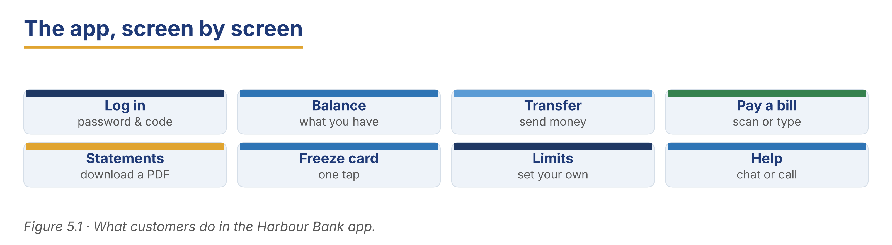


## Part 2 · Grammar — Active and Passive Voice
*Pre-class input*


### 2A  Notice the grammar
*Read the short dialogue. Underline the passive verbs. Who or what does the action?*

```
Customer: I didn’t get my code.
Petra: Let me check. The code is sent to the number on your file.
Customer: That number is old.
Petra: Then it must be changed first. Your details are checked by the system, so the new number will be confirmed by a text tomorrow.
```

1. is sent — active or passive? ____
2. must be changed — who changes it? ____
3. are checked by the system — why does the speaker say ‘by the system’? ____


### Grammar Focus

| Form | Use | Example |
|---|---|---|
| am / is / are + past participle | the present passive, for systems and rules | A code is sent to your phone. |
| was / were + past participle | the past passive, for what happened | The card was blocked last night. |
| modal + be + past participle | the passive with can, must, will | The number must be changed first. |

> **Remember:** use the passive when the doer is obvious, unknown or not important. Add by + the doer only when it matters.

> **⚠ Watch out!**
> ✗ The code is send to your phone. → ✓ The code is sent to your phone.
> ✗ Your card was block. → ✓ Your card was blocked.


### 2B  Controlled practice (make it passive)
*Rewrite each sentence in the passive. Leave out the doer where it is obvious.*

**Example: 0. We send a code to your phone. → A code is sent to your phone.**

1. We check every login.
2. The system blocked the card.
3. We will send a notification.
4. Someone reset the password this morning.
5. The bank must verify your identity.
6. We update the app every month.
7. We do not store your password.


### 2C  Error correction
*Find and correct the mistake in each sentence.*

**Example: 0. The code is send now. → The code is sent now.**

1. Your account was froze last night.
2. The payment is process in two minutes.
3. The app has update.
4. Your details are check by the system.
5. The card must be block immediately.

> ✎ *Write your response here.*


### 2D  Active to passive
*Rewrite these three notices in the passive, so they sound official.*

**Example: 0. We will close the app on Sunday. → The app will be closed on Sunday.**

1. We check all transfers over 1,000.
2. We sent your new card yesterday.
3. We do not accept payments after 23:00.

> ✎ *Write your response here.*


### 2E  Freer practice (speaking)
*In pairs, explain to a customer what happens when they tap “Send”. Use at least three passive verbs.*

> **Model — read this first**
> “Your details are checked, a code is sent to your phone, and the payment is processed in a few seconds. You will be notified when it arrives.”

*Tip: You will see the passive again in the reading in Part 5 (5A and 5B). Look for it there.*

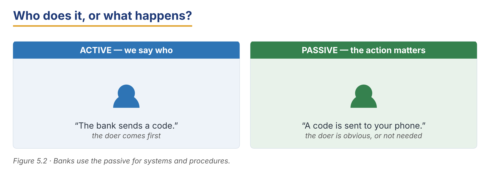


## Part 3 · Listening
*Pre-class input · scripts printed below*


### 3A  Before you listen (predict)
*You will hear three app conversations. What goes wrong most often with online banking?*

> **Model — read this first**
> “I think customers forget their password, or the code does not arrive.”


### 3B  A login problem
**🔊 Audio 5.1** (optional) — or read the script below.

```
Customer: I can’t log in. It says my password is wrong.
Petra: I’m sorry about that. Has the password been changed recently?
Customer: My daughter changed it for me last month.
Petra: That explains it. Your account is not blocked — the old password is simply no longer accepted. A reset link can be sent to your email now.
Customer: Please do that.
```

*Read and decide: True, False, or Not Given.*

**Example: 0. The customer cannot log in. → True.**

1. The customer’s account has been blocked.
2. The password was changed last month.
3. The customer’s email address is out of date.

*Useful language: Has the password been changed recently? · Your account is not blocked. · A reset link can be sent to your email.*


### 3C  A delayed transfer
**🔊 Audio 5.2** (optional) — or read the script below.

```
Customer: I sent money to my brother yesterday and it hasn’t arrived.
Mei: Let me look. The payment was sent at 18:40.
Customer: So where is it?
Mei: It was received by his bank this morning, and it is being checked now. Transfers over a certain amount are always checked.
Customer: How long does that take?
Mei: Usually a few hours. You will be notified as soon as it is released.
```

*Read and decide: True or False.*

1. The payment left this customer’s account.
2. The money has not reached the other bank.
3. Large transfers are always checked.
4. The customer must call again to find out.


### 3D  Learning the app (longer)
**🔊 Audio 5.3** (optional) — or read the script below.

```
Mei: I understand you would like some help with the app.
Customer: Yes. My son set it up, but I don’t know what anything does.
Mei: Let’s start at the first screen. Your balance is shown at the top, and the last ten payments are listed below it.
Customer: And this button?
Mei: That is for transfers. When you tap it, you choose the person, you type the amount, and then a code is sent to your phone. The payment is not made until the code is entered.
Customer: So nothing can be sent by accident?
Mei: Exactly. And your card can be frozen from this screen, and unfrozen later.
Customer: That is a relief.
```

*Read and decide: True, False, or Not Given.*

**Example: 0. The customer’s son set up the app. → True.**

1. The balance is shown at the bottom of the screen.
2. A payment is made before the code is entered.
3. The customer has used the app before today.


### 3E  Match the passive phrase
*Match each phrase from the listenings to what it means (one is extra).*


| Column A | Column B |
|---|---|
| 1. “Your account is not blocked.” ____ | **a)** you can still use it |
| 2. “It is being checked now.” ____ | **b)** the work is happening at this moment |
| 3. “You will be notified.” ____ | **c)** we will tell you |
| 4. “Your card can be frozen.” ____ | **d)** you can stop it yourself |
|  | **e)** “Your account has been closed.” (extra) |

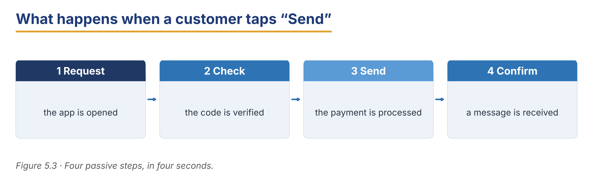


## Part 4 · Speaking
*In-class output*


### 4A  Functional language — explaining the app
*Match the function to a phrase (one is extra).*


| Column A | Column B |
|---|---|
| 1. Start an explanation ____ | **a)** “Let’s start at the first screen.” |
| 2. Describe what the system does ____ | **b)** “A code is sent to your phone.” |
| 3. Reassure ____ | **c)** “Nothing can be sent by accident.” |
| 4. Check understanding ____ | **d)** “Shall I show you that again?” |
|  | **e)** “Your card has been declined.” (extra) |


### 4B  Explain the app (pairwork)
*Explain one app screen to a customer, step by step. Then swap roles.*

> **Model — read this first**
> A: Let’s start at the first screen. Your balance is shown at the top. — B: And this button? — A: That is for transfers. A code is sent to your phone before anything is paid.

**Card A (staff):** start at the first screen · name two things · explain one action · check understanding.

**Card B (customer):** you are nervous about the app; ask two questions; ask whether you can undo a mistake.


### 4C  Help a nervous customer
*A customer is afraid of making a mistake online. Reassure them and explain the safety steps.*

> **Model — read this first**
> “Nothing is sent until the code is entered, so a payment cannot be made by accident. And if you are ever worried, your card can be frozen from this screen, and unfrozen later.”

*Stretch: the customer says “I would rather come to the branch” — respond respectfully.*


### 4D  Find the information (pairwork info-gap)
*Student A works in digital support; Student B is a customer. Ask and answer to solve the problem.*

**Card A (support):** a reset link can be sent to email; codes go to the number on file; transfers over 1,000 are checked.

**Card B (customer):** you cannot log in; your phone number changed last year; you sent 1,500 yesterday and it has not arrived.

*Useful language: When was it changed? · Has a code been sent to you? · Would you like a reset link sent to your email?*


### 4E  Close the explanation
*Match the closing phrase to the situation (one is extra).*


| Column A | Column B |
|---|---|
| 1. “Shall I write the steps down for you?” ____ | **a)** giving the customer something to keep |
| 2. “You can always freeze the card yourself.” ____ | **b)** leaving the customer in control |
| 3. “If it happens again, call this number.” ____ | **c)** giving a clear next step |
| 4. “Would you like to try it once with me?” ____ | **d)** practising together |
|  | **e)** “Please take a seat.” (extra) |

*In pairs, close a digital-support conversation politely. Use two phrases above.*


## Part 5 · Reading
*Pre-class input*


### 5A  The new Harbour app (a leaflet)
*Read the leaflet. Notice the passive verbs.*

> **Harbour Bank — Your Money, Everywhere** — *About 200 words*
>
> The Harbour app has been rebuilt, and the new version is available in every country where we operate. Your balance is shown as soon as you log in, and your last ten payments below it. Payments are made in three steps: the person is chosen, the amount is typed, and a code is sent to your phone. Nothing is paid until that code is entered. Your details are protected by two-factor authentication. Two different checks are made before you are let in: something you know, and something you have. Transfers abroad are now handled in the app as well. The rate and the fee are shown before you confirm, so nothing is hidden. Payments are usually received within one working day. A lost card can be frozen from the main screen in one tap, and unfrozen later. No data is stored on your phone, so if the phone is lost, your money is not at risk.

*Answer the questions.*

**Example: 0. Where is the new version available? → In every country where the bank operates.**

1. What three steps are a payment made in?
2. What are the two checks in two-factor authentication?
3. What is shown before you confirm an international transfer?
4. What can be done if a card is lost?
5. Why is your money safe if the phone is lost?


### 5B  Grammar in context (from 5A)
*Look back at the leaflet. Find three passive verbs.*

1. Passive verb 1: ____
2. Passive verb 2: ____
3. Passive verb 3: ____

*Now rewrite these active sentences as the leaflet would write them.*

1. We show your balance at once. → ____
2. We send a code to your phone. → ____
3. We do not store any data on your phone. → ____


### 5C  Should you trust the advert?
*Read the short note. What is the difference between a bank message and a scam message?*

> **Two Messages, One Difference** — *About 120 words*
>
> A customer received two messages one morning. The first: “Your payment of 240 has been received. No action is needed.” The second: “Your account has been blocked. Click here within one hour.” Both looked official. The first was from the bank. The second was not. A real message tells you what has happened. A false message tells you to act now, and gives you a link. The bank never asks for a password or a one-time code, and it never gives a deadline of one hour. If a message makes you feel in a hurry, that feeling is the warning.

1. What did the first message say had happened?
2. What two things made the second message false?
3. What does a bank never ask for?


### 5D  Discussion
*In pairs, compare the app at your own bank.*

*Useful frame: “On our app, the ___ is shown before you ___, but the ___ is not.”*

- What do customers ask about most often?
- What would you change on the first screen?

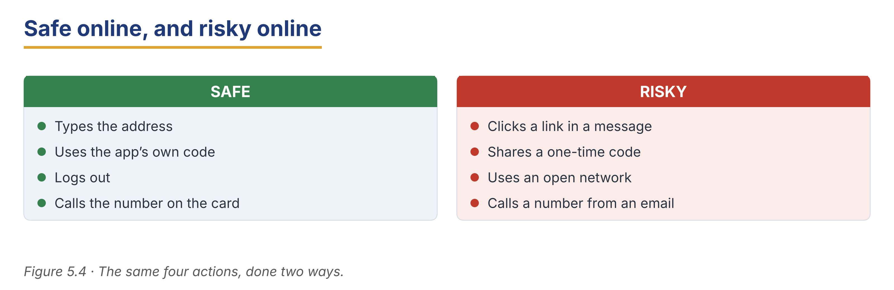


## Part 6 · Writing
*In-class / homework output*


### 6A  Guided writing — complete the notice
*Complete the staff notice with the words: updated, shown, sent, entered, notified.*

**Word bank:** updated | shown | sent | entered | notified

1. The app will be ______________________ on Sunday night.
2. From Monday, the balance is ______________________ at the top of the first screen.
3. A one-time code is ______________________ to the customer’s phone for every payment.
4. No payment is made until the code is ______________________.
5. Customers will be ______________________ by a message in the app.


### 6B  Staff notice about a new online service (50–70 words)
*Write a short internal notice about a change to the app. Use at least two passive verbs.*

> **Model — read this first**
> Subject: App update — Sunday night
> The Harbour app will be updated on Sunday night between 23:00 and 02:00. During this time, payments cannot be made and balances are not shown. From Monday, international transfers are handled in the app, and the rate and fee are shown before the customer confirms. Please tell customers who ask at the counter. Petra Horak

*Plan: Subject: ___ · The ___ will be ___ on ___. · During this time, ___. · From ___, ___ is ___. · Please ___.*

*Phrase bank: will be updated on… · during this time… · payments cannot be made · please tell customers who ask*

**Check before you finish**
- ☐ A clear subject line?
- ☐ Two passive verbs?
- ☐ The time of the change?
- ☐ 50–70 words?

> ✎ *Write your response here.*


### 6C  Security alert to a customer (50–70 words)
*A customer has received a suspicious message. Write a short, calm reply.*

> **Model — read this first**
> Subject: The message you received
> Dear Mrs Oyelaran, Thank you for sending this to us. The message was not sent by the bank. Your account has not been blocked, and no action is needed. The bank never asks for a password or a one-time code, and never gives a deadline. Please delete the message and do not click the link. Kind regards, Customer Service

*Plan: Subject: ___ · Dear ___, · Thank you for ___. · The message was not ___. · Your account has not been ___. · Please ___. · Kind regards, ___*

**Check before you finish**
- ☐ A calm, clear tone?
- ☐ Two passive verbs?
- ☐ A clear instruction to the customer?
- ☐ 50–70 words?

> ✎ *Write your response here.*


### 6D  Peer check
*Swap your notice or email with a partner. Give one piece of positive feedback and one suggestion.*

*Checklist: subject line? · two passives? · clear instruction? · 50–70 words?*

> **Model — read this first**
> “Very calm and clear, and the passive sounds official. Next time, try to say what the customer should do first.”


## Part 7 · Management File — Leading a Digital Change
*Practitioner track (optional for beginners) · experienced staff*


### 7A  Change-management phrases
*Match the phrase to its purpose (one is extra).*


| Column A | Column B |
|---|---|
| 1. “I know this is a big change.” ____ | **a)** recognising how the team feels |
| 2. “Nothing will be lost.” ____ | **b)** reassuring about the risk |
| 3. “Training will be provided on Thursday.” ____ | **c)** saying what support is coming |
| 4. “Please tell me what is not working.” ____ | **d)** inviting feedback |
|  | **e)** closing an account (extra) |


### 7B  Listening — reassuring the team
**🔊 Audio 5.4** (optional) — or read the script below.

```
Marta: I know this is a big change, and some of you are worried about the new screens.
Tomasz: The old system was slow, but at least we knew it.
Marta: That is fair. Nothing will be lost — every record has been copied, and the old screens can still be opened for a month.
Tomasz: And if a customer asks something we can’t answer?
Marta: Training will be provided on Thursday. Until then, write the question down and send it to me.
```

*Answer the questions.*

**Example: 0. What is the team worried about? → The new screens.**

1. What has been done with every record?
2. How long can the old screens still be opened?
3. What should staff do with questions before Thursday?


### 7C  Controlled practice — rewrite the customer notice
*Rewrite each blunt line so it sounds calm and official. Use the passive.*

**Example: 0. We are turning the app off on Sunday. → The app will be unavailable on Sunday.**

1. We changed your login screen.
2. We blocked your card.
3. We will send you a new card.
4. We are checking your payment.
5. We don’t keep your password.
6. We will tell you when it arrives.

> ✎ *Write your response here.*


### 7D  Role play — lead the change
*You are a manager. Your team is anxious about a new system. Lead a short team meeting.*

> **Model — read this first**
> “I know this is a big change. Nothing will be lost — every record has been copied. Training will be provided on Thursday, and until then, please tell me what is not working.”

**Card A (manager):** recognise the feeling · reassure about the risk · say what support is coming · invite feedback.

**Card B (team member):** you are experienced and you preferred the old system; ask two hard questions.

*Stretch: a team member says customers will leave — answer with evidence, not opinion.*


### 7E  Writing — a staff notice about the app (50–70 words)
*Write a short notice to your team about the new app, in a calm, official tone.*

> **Model — read this first**
> Subject: The new app — what changes on Monday
> From Monday the new app will be used in all branches. Every record has been copied, and nothing will be lost. The old screens can still be opened until the end of the month. Training will be provided on Thursday at 09:00. Until then, please send any customer question to me. Marta Nowak

*Plan: Subject: ___ · From ___ the ___ will be ___. · Every ___ has been ___. · Training will be ___. · Until then, please ___.*

*Phrase bank: will be used from… · nothing will be lost · training will be provided · please send any question to…*

**Check before you finish**
- ☐ A clear subject line?
- ☐ Two passive verbs?
- ☐ A date for the training?
- ☐ 50–70 words?

> ✎ *Write your response here.*


## Part 8 · Global Case Study — The App-Only Bank
*Practitioner track · read then discuss*

*Before you read: could a bank work with no branches at all? Who would it not suit?*

> **A Bank With No Door** — *About 205 words · a made-up example based on real practice*
>
> An app-only bank was launched in four countries at once, with no branches and no counters. Accounts were opened in eight minutes from a phone, and identity was confirmed by a short video. Costs were low, so the rates offered were better than those of older banks. Then the complaints began — not about the technology, which worked well, but about the moments when something went wrong. A customer whose card was used by a thief wanted to speak to a person, and there was nobody to speak to. An older customer could not pass the video check, because her flat was dark. A small business owner needed to pay in cash. The bank made two changes. It opened a telephone line answered by people, not machines. And it agreed with a chain of shops that its customers could pay in cash there. It still has no branches, but it learned that a bank without a door still needs a way in.

**Glossary help**
- **app-only bank** — a bank with no branches
- **identity check** — proving who you are
- **complaint** — when a customer says something is wrong
- **cash deposit point** — a place where customers can pay in cash


### 8A  Comprehension
**Example: 0. How many countries was the bank launched in? → Four.**

1. How was a customer’s identity confirmed?
2. Why were the bank’s rates better than those of older banks?
3. What were the complaints about, and what were they not about?
4. What two changes did the bank make?
5. What did the bank learn?


### 8B  Vocabulary in context
*Match the word to its meaning (one is extra).*


| Column A | Column B |
|---|---|
| 1. app-only bank ____ | **a)** proving who you are |
| 2. identity check ____ | **b)** a bank with no branches |
| 3. complaint ____ | **c)** a place where customers can pay in cash |
| 4. cash deposit point ____ | **d)** when a customer says something is wrong |
|  | **e)** a monthly charge (extra) |


### 8C  Discussion
*Frames: “This would suit customers in my country because ___.” “It would not suit ___ because ___.”*

- Which of your customers could not use an app-only bank?
- What is the one thing a branch does that an app cannot?


### 8D  Your view (short write, 30–40 words)
*Which customers still need a branch, and why?*

> ✎ *Write your response here.*


## Part 9 · Branch Case Study — Warsaw in Focus: Banking on a Weak Signal
*Practitioner track · read then decide*

*Before you read: what happens to a digital service when the connection is poor?*

> **When the Signal Drops** — *About 185 words*
>
> The Harbour Bank branch in Warsaw serves a wide area, and many of its customers live in villages where the mobile signal is weak. The bank has asked every branch to move routine payments to the app, and in the city this is working well. In the villages it is not. A customer told Marta Nowak last week that her payment had been started but never finished, because the one-time code arrived forty minutes late. Another said that the app had worked at her daughter’s house in town but not at home. Three customers have now gone back to paying at the counter, and two have said they will move to another bank. Marta understands the policy: payments made in the app cost the bank far less than payments made at the counter. But she also knows that a service that fails on a weak signal is not a service. She has one morning with the regional team on Thursday, and she wants to go with a clear proposal.


### 9A  Comprehension
**Example: 0. Where is the branch? → In Warsaw.**

1. Why is the policy not working in the villages?
2. What happened to the first customer’s payment?
3. Why does the bank want payments made in the app?


### 9B  Decision task
*What should Marta propose on Thursday? Write 40–60 words. Use the frame and the phrase bank.*

> **Model — read this first**
> I think Marta should propose that codes can be sent by email as well as by text, because email arrives even on a weak signal. She should also ask that counter payments stay free for village customers. Also, she can show the regional team how many customers are affected.

*Frame: I think Marta should propose ___, because ___. Also, ___.*

*Phrase bank: send codes by email as well · keep counter payments free for ___ · show how many customers are affected · ask for the policy to be local, not national*

> ✎ *Write your response here.*


## Part 10 · Review & Can-Do
*Homework / self-study*


### 10A  Spiral review
*Complete the sentences. Use the passive or the correct word. Items 5–6 review Units 3 and 4.*

**Example: 0. A code ____ (send) to your phone. → is sent.**

1. Your details ______________________ (check) by the system every time.
2. The card ______________________ (block) last night after three wrong codes.
3. Two different checks before you are let in is called ______________________. (word)
4. A short number sent to your phone for one use is a ______________________. (word)
5. How ______________________ notes would you like? (Unit 3 quantifier)
6. The Fixed 12 pays the ______________________ (high) rate of the three. (Unit 4 grammar)


### 10B  Can-Do checklist
**Can-Do checklist — tick what you can do now**
- ☐ I can name the main parts of online and mobile banking.
- ☐ I can describe what the system does, using the passive.
- ☐ I can explain an app screen to a nervous customer.
- ☐ I can understand a short digital-support conversation.
- ☐ I can write a clear notice about a change.


### 10C  Unit glossary
**Glossary help**
- **log in** — to enter your account with your details
- **one-time code** — a short number sent to your phone for one use only
- **two-factor authentication** — two different checks before you are let in
- **notification** — a short message from the bank on your screen
- **freeze** — to stop a card being used, for a short time
- **reset** — to set a password again from the beginning
- **app-only bank** — a bank with no branches
- **identity check** — proving who you are
- **cash deposit point** — a place where customers can pay in cash
- **passive voice** — saying what happens, without naming the doer


# Unit 6 · Currency Exchange and Money Transfer
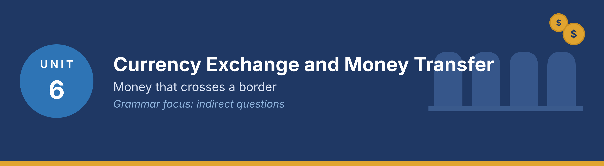

*In this unit you learn the language of exchanging money and sending it abroad, how to ask and answer politely, how to follow a transfer conversation, and how to write a short inquiry and reply. Grammar focus: indirect questions.*

## Part · · Warm-Up
*In-class starter · speak before you read*


### W-A  Changing and sending money (discussion)
*In small groups, talk about moving money between countries.*

> **Model — read this first**
> My cousin works abroad and sends money home every month. He uses the bank because it is safer, even though it is a little slower.

- Who in your country receives money from abroad, and why?
- What do people worry about most: the rate, the fee, or the time?


### W-B  Polite questions (think–pair)
*Think for one minute, then compare with a partner.*

- Which sounds better to a customer: “What is the rate?” or “Could you tell me what the rate is?”
- Why does a bank use longer, politer questions?

*Useful words: Use the words rate, fee, transfer and exchange in your answers.*


## Part 1 · Vocabulary
*Pre-class input*


### 1A  Match the term to the meaning
*Match each word (1–8) to the correct meaning (a–i). One meaning is extra.*

**Example: 0. Receipt → h)**


| Column A | Column B |
|---|---|
| 1. Exchange rate ____ | **a)** what one currency is worth in another |
| 2. Spread ____ | **b)** the difference between the buy rate and the sell rate |
| 3. IBAN ____ | **c)** the international number of a bank account |
| 4. BIC / SWIFT ____ | **d)** the code that says which bank |
| 5. Correspondent bank ____ | **e)** a bank that passes money between two other banks |
| 6. Remittance ____ | **f)** money sent home by someone working abroad |
| 7. Beneficiary ____ | **g)** the person who receives the money |
| 8. Commission ____ | **h)** what the bank charges for the service |
|  | **i)** a card used only inside one country (extra) |

*Pronunciation — word stress. Say these words: ex·CHANGE, re·MIT·tance, be·ne·FI·ci·a·ry, com·MIS·sion.*


### 1B  Sort the words
*Put each word from 1A into the correct group.*

- About the price: ____
- About the route: ____
- About the people: ____

> **Model — read this first**
> About the price: exchange rate, spread, commission. About the route: IBAN, BIC, correspondent bank. About the people: beneficiary, remittance.


### 1C  Complete the sentences
*Complete the sentences with the correct word.*

**Word bank:** rate | fee | IBAN | beneficiary | currency | transfer | spread | abroad | working day

**Example: 0. Today’s exchange rate is shown on the board.**

1. Could you tell me the full name of the ______________________, please?
2. We will need the ______________________ of the account you are sending to.
3. There is a flat ______________________ of twelve for an international transfer.
4. The money should arrive within one ______________________.
5. In which ______________________ would you like the money to arrive?
6. The difference between our buy and sell price is called the ______________________.


### 1D  Word partners (collocations)
*Match the verb to the noun to make a common banking phrase (one noun is extra).*


| Column A | Column B |
|---|---|
| 1. send ____ | **a)** the rate |
| 2. check ____ | **b)** a fee |
| 3. charge ____ | **c)** a transfer |
| 4. convert ____ | **d)** an amount |
| 5. confirm ____ | **e)** the beneficiary’s details |
|  | **f)** a queue (extra) |


### 1E  Write with the words (40–60 words)
*Write about one international transfer, from start to finish. Use at least five words from Part 1.*

> **Model — read this first**
> A customer wanted to send 400 to her son abroad. We checked the rate, confirmed the beneficiary’s IBAN, and charged a flat fee of twelve. The money was converted and sent the same afternoon, and it arrived the next working day.

**Check before you finish**
- ☐ Five Part-1 words?
- ☐ 40–60 words?
- ☐ Short, clear sentences?

> ✎ *Write your response here.*

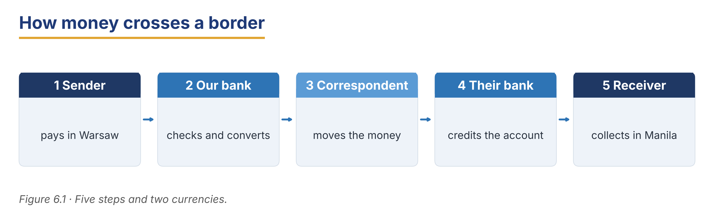


## Part 2 · Grammar — Indirect Questions
*Pre-class input*


### 2A  Notice the grammar
*Read the short dialogue. Underline the indirect questions. What happens to the word order?*

```
Customer: Could you tell me what today’s rate is?
Ana: Of course. It is 4.35 to the euro.
Customer: And do you know how long the transfer takes?
Ana: One working day. May I ask whether you have the IBAN with you?
Customer: I do, yes.
```

1. “what today’s rate is” — where is the verb? ____
2. “how long the transfer takes” — is there do/does? ____
3. whether — what kind of question does it introduce? ____


### Grammar Focus

| Form | Example |
|---|---|
| Could you tell me + question word + subject + verb | Could you tell me what the rate is? |  |
| Do you know + question word + subject + verb | Do you know how long it takes? |  |
| May I ask + whether / if + subject + verb | May I ask whether you have the IBAN? |  |

> **Remember:** in an indirect question the subject comes before the verb, and do / does / did disappears. Use whether or if when there is no question word.

> **⚠ Watch out!**
> ✗ Could you tell me what is the rate? → ✓ Could you tell me what the rate is?
> ✗ Do you know how long does it take? → ✓ Do you know how long it takes?


### 2B  Controlled practice (make it indirect)
*Rewrite each direct question as an indirect question.*

**Example: 0. What is the fee? → Could you tell me what the fee is?**

1. How much does it cost?
2. Where is the beneficiary’s bank?
3. When will the money arrive?
4. Does the rate change today?
5. What is your account number?


### 2C  Error correction
*Find and correct the mistake in each sentence.*

**Example: 0. Could you tell me what is the rate? → Could you tell me what the rate is?**

1. Do you know when does the branch close?
2. Could you tell me how much is the fee?
3. May I ask do you have the IBAN?
4. I would like to know where is the beneficiary’s bank.
5. Can you tell me what time does it arrive?

> ✎ *Write your response here.*


### 2D  Ask politely
*Write three indirect questions you would ask a customer who is sending money abroad.*

> **Model — read this first**
> Could you tell me the full name of the beneficiary? May I ask which currency you would like the money to arrive in? Do you know whether the account is held at that branch?

> ✎ *Write your response here.*


### 2E  Freer practice (speaking)
*In pairs, act a short exchange-desk conversation. Each speaker asks at least two indirect questions.*

> **Model — read this first**
> “Could you tell me how much you would like to change? … And may I ask whether you have your ID with you?”

*Tip: You will see indirect questions again in the reading in Part 5 (5A and 5B). Look for them there.*

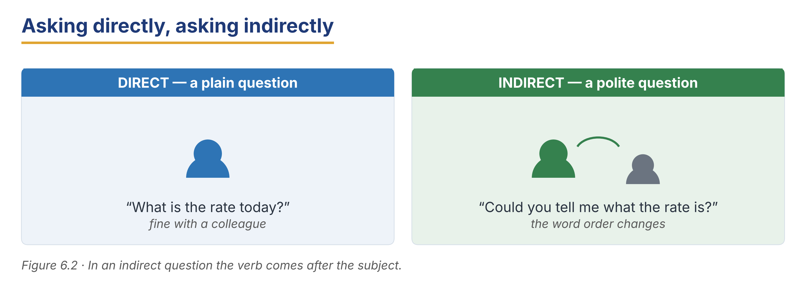


## Part 3 · Listening
*Pre-class input · scripts printed below*


### 3A  Before you listen (predict)
*You will hear three conversations about moving money. What does a customer ask first?*

> **Model — read this first**
> “I think the customer will ask about the rate, and then about the fee.”


### 3B  Asking about the rate
**🔊 Audio 6.1** (optional) — or read the script below.

```
Customer: Good morning. Could you tell me what the rate is today?
Zeynep: Good morning. We are buying at 4.28 and selling at 4.42.
Customer: Why are there two numbers?
Zeynep: The difference is called the spread. It is how the bank is paid for the service. There is no separate commission for cash.
Customer: I see. That is clearer than I expected.
```

*Read and decide: True, False, or Not Given.*

**Example: 0. The customer asks about the rate. → True.**

1. There is a separate commission for changing cash.
2. The bank buys at a lower number than it sells at.
3. The customer changes money today.

*Useful language: Could you tell me what the rate is today? · We are buying at… and selling at… · The difference is called the spread.*


### 3C  Sending a transfer
**🔊 Audio 6.2** (optional) — or read the script below.

```
Customer: I would like to send three hundred to my daughter.
Luca: Certainly. May I ask whether you have her IBAN?
Customer: Yes, here it is. Do you know how long it will take?
Luca: Usually one working day. Could you tell me the full name on the account, exactly as the bank has it?
Customer: Maria Oliveira. Is the fee the same for any amount?
Luca: Up to a thousand, yes — a flat twelve.
```

*Read and decide: True or False.*

1. The customer has the beneficiary’s IBAN.
2. The transfer usually takes one working day.
3. The name on the account does not have to match exactly.
4. The fee is twelve for amounts up to a thousand.


### 3D  Collecting a transfer from abroad (longer)
**🔊 Audio 6.3** (optional) — or read the script below.

```
Customer: My brother sent me money from abroad last Friday, but nothing has arrived.
Luca: Could you tell me the date and the amount?
Customer: Friday the fourteenth. Five hundred.
Luca: May I ask whether he gave the bank your IBAN, or only your account number?
Customer: I’m not sure. He gave the number from my card.
Luca: That may be the problem. Money from abroad needs the IBAN and our BIC. Without them it can sit at a correspondent bank for days.
Customer: What should I do now?
Luca: I will write down your IBAN and our BIC. Send them to your brother today, and if nothing moves by Thursday, come back.
```

*Read and decide: True, False, or Not Given.*

**Example: 0. The money has not arrived. → True.**

1. The customer is certain her brother used her IBAN.
2. A payment can wait at a correspondent bank for several days.
3. The brother lives in Spain.


### 3E  Match the polite question
*Match each indirect question from the listenings to what it asks for (one is extra).*


| Column A | Column B |
|---|---|
| 1. “Could you tell me what the rate is today?” ____ | **a)** the price of one currency in another |
| 2. “May I ask whether you have her IBAN?” ____ | **b)** the account number abroad |
| 3. “Do you know how long it will take?” ____ | **c)** the time the transfer needs |
| 4. “Could you tell me the full name on the account?” ____ | **d)** the beneficiary’s exact name |
|  | **e)** “Could you tell me your address?” (extra) |

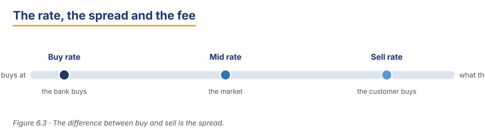


## Part 4 · Speaking
*In-class output*


### 4A  Functional language — polite questions and answers
*Match the function to a phrase (one is extra).*


| Column A | Column B |
|---|---|
| 1. Ask politely for information ____ | **a)** “Could you tell me the beneficiary’s full name?” |
| 2. Give a price ____ | **b)** “We are selling at 4.42 today.” |
| 3. Explain a charge ____ | **c)** “The difference is called the spread.” |
| 4. Give a time ____ | **d)** “It usually arrives within one working day.” |
|  | **e)** “Your card has been declined.” (extra) |


### 4B  At the exchange desk (pairwork)
*Act a short exchange-desk conversation, then swap roles.*

> **Model — read this first**
> A: Could you tell me how much you would like to change? — B: Two hundred. What is the rate? — A: We are selling at 4.42. May I ask whether you have your ID with you?

**Card A (staff):** ask the amount politely · give the rate · explain the spread · ask for ID.

**Card B (customer):** you want to change 200; you ask why there are two rates; you have your passport.


### 4C  Explain a transfer
*A customer does not understand why a transfer takes a day. Explain the route simply.*

> **Model — read this first**
> “Your money leaves us today, it is passed through a partner bank overnight, and it is credited to your daughter’s account tomorrow morning. Three banks are involved, and each one checks the payment.”

*Stretch: the customer asks why a payment within the country is instant but this is not — answer clearly.*


### 4D  Find the information (pairwork info-gap)
*Student A works at the transfer desk; Student B is a customer. Ask and answer to complete the transfer.*

**Card A (staff):** fee is a flat 12 up to 1,000, then 20 · one working day · you need the IBAN, the BIC and the exact name.

**Card B (customer):** you are sending 1,400 to Manila; you have the IBAN but not the BIC; you want it to arrive by Friday.

*Useful language: Could you tell me how much you would like to send? · May I ask whether you have the BIC? · Do you know when it needs to arrive?*


### 4E  Close the conversation
*Match the closing phrase to the situation (one is extra).*


| Column A | Column B |
|---|---|
| 1. “Here is your receipt with the reference number.” ____ | **a)** giving the customer the record |
| 2. “Please keep this in case you need to trace it.” ____ | **b)** explaining why the record matters |
| 3. “If it has not arrived by Thursday, come back.” ____ | **c)** giving a clear next step |
| 4. “Would you like today’s rate written down?” ____ | **d)** offering something extra |
|  | **e)** “Please take a seat.” (extra) |

*In pairs, close a transfer conversation politely. Use two phrases above.*


## Part 5 · Reading
*Pre-class input*


### 5A  Common questions about transfers (FAQ)
*Read the FAQ page. Notice the indirect questions.*

> **Harbour Bank — Sending Money Abroad** — *About 195 words*
>
> Customers often ask us how an international transfer works, so here are the questions we hear most. Could you tell me what I need before I start? You need three things: the beneficiary’s full name exactly as their bank holds it, their IBAN, and the BIC of their bank. A missing BIC is the most common reason a payment is delayed. Do you know how long it takes? Most arrive within one working day, but a payment sent on Friday afternoon may not move until Monday. May I ask why there are two rates on the board? One is the price at which we buy a currency, and one is the price at which we sell it. The difference is called the spread. Could you tell me what the fee is? It is a flat twelve up to one thousand, and twenty above that. Do you know where my money is now? Every transfer has a reference number on your receipt. Bring it to any branch and we can see which bank is holding the payment.

*Answer the questions.*

**Example: 0. What are the three things you need? → The full name, the IBAN and the BIC.**

1. What is the most common reason a payment is delayed?
2. Why might a Friday payment not move until Monday?
3. What is the spread, and what is it for?
4. What is the fee for a transfer of 1,500?
5. What should a customer bring if they want to trace a payment?


### 5B  Grammar in context (from 5A)
*Look back at the FAQ. Find three indirect questions.*

1. Indirect question 1: ____
2. Indirect question 2: ____
3. Indirect question 3: ____

*Now rewrite these direct questions as the FAQ would write them.*

1. How much is the fee? → ____
2. Where is my money? → ____


### 5C  How a transfer moves
*Read the short note. Which banks touch the money?*

> **Three Banks, One Payment** — *About 120 words*
>
> When money is sent from one country to another, it usually passes through three banks, not two. The sender’s bank takes the money and converts it. A correspondent bank in the middle moves it between the two countries, because the first and last banks may have no direct link. The beneficiary’s bank then credits the account. Each bank checks the payment against its own country’s rules. This is why an international transfer takes a day, while a payment inside one country can be instant. It is also why a missing BIC is serious: without it, the middle bank does not know where to send the money next.

1. How many banks usually touch an international payment?
2. What does the correspondent bank do?
3. Why is a missing BIC serious?


### 5D  Discussion
*In pairs, compare transfers at your own bank.*

*Useful frame: “At my bank, a transfer to ___ takes ___, and the fee is ___.”*

- Which country do your customers send money to most?
- What do customers find hardest to understand about the fee?

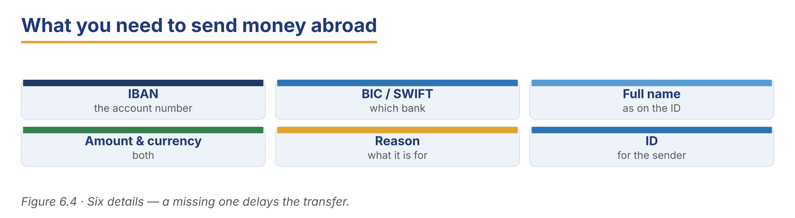


## Part 6 · Writing
*In-class / homework output*


### 6A  Guided writing — complete the inquiry email
*Complete the email with the words: confirm, whether, arrive, charged, reference.*

**Word bank:** confirm | whether | arrive | charged | reference

1. Dear Transfers Team, could you please ______________________ the status of the payment below?
2. The ______________________ number is HB-4471-22.
3. I would like to know ______________________ the BIC was included.
4. The customer expected the money to ______________________ on Tuesday.
5. Please also tell me what fee was ______________________.


### 6B  Transfer inquiry email (50–70 words)
*Write a short internal email asking about a delayed transfer. Use two indirect questions.*

> **Model — read this first**
> Subject: Delayed transfer — reference HB-4471-22
> Dear Transfers Team, Could you tell me where payment HB-4471-22 is at the moment? It was sent on Friday the fourteenth and has not arrived. May I also ask whether the BIC was included when it left us? The customer is returning on Thursday. Kind regards, Luca Rossi

*Plan: Subject: ___ · Dear ___, · Could you tell me ___? · It was sent on ___. · May I also ask whether ___? · Kind regards, ___*

*Phrase bank: Could you tell me where… · May I ask whether… · It was sent on… · the customer is returning on…*

**Check before you finish**
- ☐ A clear subject line with the reference?
- ☐ Two indirect questions?
- ☐ The date the payment was sent?
- ☐ 50–70 words?

> ✎ *Write your response here.*


### 6C  Reply to a customer (50–70 words)
*A customer asks why her transfer has not arrived. Write a short, honest reply.*

> **Model — read this first**
> Subject: Your transfer of 500
> Dear Mrs Oyelaran, Thank you for your patience. The payment left us on Friday and is currently held by the partner bank, because the BIC was missing. We have now supplied it, and the money should arrive within one working day. Could you let us know if it has not arrived by Thursday? Kind regards, Customer Service

*Plan: Subject: ___ · Dear ___, · Thank you for ___. · The payment ___. · We have now ___. · Could you let us know ___? · Kind regards, ___*

**Check before you finish**
- ☐ A clear subject line?
- ☐ An honest explanation of the delay?
- ☐ One indirect question?
- ☐ 50–70 words?

> ✎ *Write your response here.*


### 6D  Peer check
*Swap your email from 6B or 6C with a partner. Give one piece of positive feedback and one suggestion.*

*Checklist: subject line? · two indirect questions? · the date given? · 50–70 words?*

> **Model — read this first**
> “Good polite questions and a clear reference. Next time, try to say what you will do next, not only what went wrong.”


## Part 7 · Management File — Handling a Rate Query
*Practitioner track (optional for beginners) · experienced staff*


### 7A  Explaining rates and fees — phrases
*Match the phrase to its purpose (one is extra).*


| Column A | Column B |
|---|---|
| 1. “The rate on the board is the rate you get.” ____ | **a)** removing a doubt |
| 2. “The difference is called the spread.” ____ | **b)** naming the charge |
| 3. “I can write both numbers down for you.” ____ | **c)** making it checkable |
| 4. “The rate moves during the day.” ____ | **d)** explaining why it changed |
|  | **e)** closing an account (extra) |


### 7B  Listening — coaching on a rate query
**🔊 Audio 6.4** (optional) — or read the script below.

```
Kerem: You handled that well, but the customer left still unsure. May I ask what you told him?
Zeynep: I said the rate had changed since the morning.
Kerem: That is true, but it sounds like an excuse. Tell him what the rate is now, write both numbers down, and say that the board is updated when the market moves.
Zeynep: So give him something he can check.
Kerem: Exactly. A customer who can check a number does not need to trust you.
```

*Answer the questions.*

**Example: 0. Who is giving the coaching? → Kerem.**

1. What did Zeynep tell the customer?
2. Why does Kerem say that answer is not enough?
3. What should Zeynep give the customer instead?


### 7C  Controlled practice — make the question polite
*Rewrite each blunt question as an indirect question a colleague could use with a customer.*

**Example: 0. What do you want to send? → Could you tell me how much you would like to send?**

1. What is the beneficiary’s name?
2. Where does the money go?
3. Do you have the BIC?
4. When do you need it there?
5. Why are you sending this amount?

> ✎ *Write your response here.*


### 7D  Role play — handle a rate complaint
*A customer says the rate was better this morning. Handle the complaint professionally.*

> **Model — read this first**
> “You are right that it has moved. The rate on the board is the rate you get, and it is updated when the market moves. Let me write both numbers down so you can see today’s exactly.”

**Card A (staff):** accept the fact · explain without excuses · give something checkable · offer a next step.

**Card B (customer):** you were quoted a better rate at 9 a.m.; you feel the bank changed it on purpose.

*Stretch: the customer asks you to give the morning rate — answer honestly and politely.*


### 7E  Writing — a short reply about fees (50–70 words)
*Write a short reply to a customer who says the fee was too high.*

> **Model — read this first**
> Dear Mr Tanaka, Thank you for writing. The fee on your transfer was twenty, because the amount was above one thousand; below that it is a flat twelve. The rate you received was the sell rate shown on the board at 14:20. I have attached both figures. Could you tell me whether you would like a copy by post? Kind regards, Zeynep Kaya

*Plan: Dear ___, Thank you for ___. · The fee was ___, because ___. · The rate you received was ___. · Could you tell me whether ___? · Kind regards, ___*

*Phrase bank: the fee was ___ because… · the rate shown at… · I have attached both figures · could you tell me whether…*

**Check before you finish**
- ☐ Does it give the exact figures?
- ☐ One indirect question?
- ☐ No excuses?
- ☐ 50–70 words?

> ✎ *Write your response here.*


## Part 8 · Global Case Study — How Money Crosses Borders
*Practitioner track · read then discuss*

*Before you read: why does money sent abroad cost more and take longer than money sent at home?*

> **The Cost of Sending Home** — *About 205 words · a made-up example based on real practice*
>
> Every year, people working away from home send money back to their families. For many countries these payments, called remittances, are larger than all foreign aid together. The amounts are usually small — often two or three hundred at a time. That is the problem. A fee of twelve is small on a transfer of five thousand. On a transfer of two hundred, it is six per cent of the money, and the spread on the exchange rate may cost as much again. An international body set a target: the average cost of sending money home should fall below three per cent. One bank tried to reach it. It could not cut the fee, because each payment is checked by three banks. Instead it changed the product. Customers who send money to the same person every month pay one fee for twelve payments, set up once. The checks are done at the start, not twelve times. The cost for those customers fell from six per cent to just under two. The bank did not make the transfer cheaper. It made it fewer transfers.

**Glossary help**
- **remittance** — money sent home by someone working abroad
- **spread** — the difference between the buy rate and the sell rate
- **foreign aid** — money given by one country to another
- **standing transfer** — the same payment, set up once and repeated


### 8A  Comprehension
**Example: 0. What are remittances? → Money sent home by people working abroad.**

1. Why is a flat fee a bigger problem on a small transfer?
2. What target did the international body set?
3. Why could the bank not simply cut the fee?
4. What did the bank change instead, and what was the result?


### 8B  Vocabulary in context
*Match the word to its meaning (one is extra).*


| Column A | Column B |
|---|---|
| 1. remittance ____ | **a)** the difference between the buy rate and the sell rate |
| 2. spread ____ | **b)** money sent home by someone working abroad |
| 3. foreign aid ____ | **c)** the same payment, set up once and repeated |
| 4. standing transfer ____ | **d)** money given by one country to another |
|  | **e)** a charge for a lost card (extra) |


### 8C  Discussion
*Frames: “In my country the cost of sending money is ___.” “This idea would help because ___.”*

- Do your customers send the same amount to the same person each month?
- What would make a standing transfer hard to sell?


### 8D  Your view (short write, 30–40 words)
*Would a standing transfer help your customers? Why, or why not?*

> ✎ *Write your response here.*


## Part 9 · Branch Case Study — Manila in Focus: Money from Abroad
*Practitioner track · read then decide*

*Before you read: what should a branch do when a payment from abroad goes missing?*

> **The Payment That Stopped** — *About 185 words*
>
> It is the first week of the month at the Harbour Bank branch in Manila, and the counter is busy with people collecting money sent from abroad. Mrs Reyes has been waiting since the branch opened. Her son works overseas and sends two hundred on the same day every month. This month it has not arrived, and she needs it today to pay her rent. Priya Raman checks the system. The payment left her son’s bank eight days ago, but it is sitting at a correspondent bank, because the name on the transfer is “M. Reyes” and the account is held as “Maria Reyes Santos”. The correspondent bank will not release it until the names match. Fixing it will take two more days, and the request must come from the sending bank, not from Manila. Mrs Reyes is calm but close to tears. The branch has a small hardship fund for exactly this kind of case, but it needs the manager’s approval, and the manager is away until tomorrow.


### 9A  Comprehension
**Example: 0. Where is the payment now? → At a correspondent bank.**

1. Why has the correspondent bank not released the money?
2. Who has to ask for the payment to be fixed?
3. Why can Priya not use the hardship fund straight away?


### 9B  Decision task
*What should Priya do today? Write 40–60 words. Use the frame and the phrase bank.*

> **Model — read this first**
> I think Priya should call the sending bank herself, because only they can correct the name. She should also phone the manager for approval of the hardship fund by telephone. Also, she can give Mrs Reyes a written note of the reference number and the exact name to send her son.

*Frame: I think Priya should ___, because ___. Also, ___.*

*Phrase bank: contact the sending bank directly · ask for approval by telephone · give a written note of the reference · explain exactly what the name must say*

> ✎ *Write your response here.*


## Part 10 · Review & Can-Do
*Homework / self-study*


### 10A  Spiral review
*Complete the sentences. Use an indirect question or the correct word. Items 5–6 review Units 4 and 5.*

**Example: 0. What is the fee? → Could you tell me what the fee is?**

1. Where is the money now? → Could you tell me ______________________?
2. Does he have the IBAN? → May I ask ______________________?
3. The difference between the buy and sell rate is the ______________________. (word)
4. A bank that passes money between two other banks is a ______________________. (word)
5. The Fixed 12 pays the ______________________ (high) rate of the three. (Unit 4 grammar)
6. A code ______________________ (send) to your phone every time. (Unit 5 grammar)


### 10B  Can-Do checklist
**Can-Do checklist — tick what you can do now**
- ☐ I can name the parts of an international transfer.
- ☐ I can ask politely with indirect questions.
- ☐ I can explain a rate, a spread and a fee to a customer.
- ☐ I can understand a short transfer conversation.
- ☐ I can write a short inquiry about a delayed payment.


### 10C  Unit glossary
**Glossary help**
- **exchange rate** — what one currency is worth in another
- **spread** — the difference between the buy rate and the sell rate
- **IBAN** — the international number of a bank account
- **BIC** — the code that says which bank
- **correspondent bank** — a bank that passes money between two other banks
- **remittance** — money sent home by someone working abroad
- **beneficiary** — the person who receives the money
- **commission** — what the bank charges for the service
- **working day** — a day the banks are open
- **indirect question** — a polite question with the subject before the verb


# Unit 7 · Security and Fraud
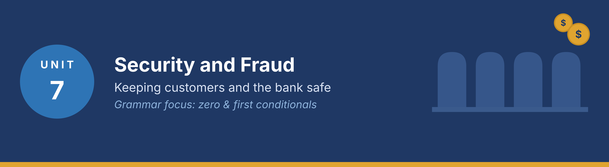

*In this unit you learn the language of bank security and fraud, how to warn and advise a customer, how to follow a conversation about a scam, and how to write safety advice. Grammar focus: zero and first conditionals.*

## Part · · Warm-Up
*In-class starter · speak before you read*


### W-A  Staying safe (discussion)
*In small groups, talk about how people lose money to fraud.*

> **Model — read this first**
> My neighbour got a message saying her account was blocked. She clicked the link and typed her password. The money was gone in ten minutes.

- What scams have you heard about where you live?
- Why do people believe a message that is clearly false?


### W-B  Safe or risky? (quick sort)
*In pairs, decide whether each habit is safe or risky. One minute only.*

- Writing the PIN on a piece of paper in a wallet: ____
- Calling the number printed on the back of the card: ____
- Reading a one-time code aloud on the phone: ____

*Useful words: Use the words PIN, code, link and caller in your answers.*


## Part 1 · Vocabulary
*Pre-class input*


### 1A  Match the term to the meaning
*Match each security word (1–8) to the correct meaning (a–i). One meaning is extra.*

**Example: 0. PIN → h)**


| Column A | Column B |
|---|---|
| 1. Fraud ____ | **a)** taking money by lying or tricking someone |
| 2. Phishing ____ | **b)** a false email that asks for your details |
| 3. Smishing ____ | **c)** a false text message that asks you to act |
| 4. Skimming ____ | **d)** copying a card’s details at a machine |
| 5. Suspicious ____ | **e)** looking as though something may be wrong |
| 6. To block ____ | **f)** to stop a card or account being used |
| 7. Unauthorised ____ | **g)** done without the owner’s permission |
| 8. Scam ____ | **h)** a plan to take money dishonestly |
|  | **i)** the money left in an account (extra) |

*Pronunciation — word stress. Say these words: FRAUD, PHISH·ing, sus·PI·cious, un·AU·thor·ised.*


### 1B  Sort the words
*Put each word from 1A into the correct group.*

- The crime: ____
- The method: ____
- What the bank does: ____

> **Model — read this first**
> The crime: fraud, scam, unauthorised. The method: phishing, smishing, skimming. What the bank does: block, check anything suspicious.


### 1C  Complete the sentences
*Complete the sentences with the correct word.*

**Word bank:** blocked | suspicious | link | code | unauthorised | report | fraud | caller | PIN

**Example: 0. Never share your PIN with anyone.**

1. If a message asks you to click a ______________________, do not click it.
2. Your card has been ______________________ as a precaution.
3. We found three ______________________ payments on the account.
4. Please ______________________ anything ______________________ to us at once.
5. The ______________________ said he worked for the bank, but he did not.
6. The bank will never ask you for a one-time ______________________.


### 1D  Word partners (collocations)
*Match the verb to the noun to make a common security phrase (one noun is extra).*


| Column A | Column B |
|---|---|
| 1. block ____ | **a)** a scam |
| 2. report ____ | **b)** the PIN |
| 3. cover ____ | **c)** a card |
| 4. spot ____ | **d)** fraud |
| 5. change ____ | **e)** your password |
|  | **f)** a queue (extra) |


### 1E  Write with the words (40–60 words)
*Write about one fraud case you know, or invent one. Use at least five words from Part 1.*

> **Model — read this first**
> A customer received a text saying her account was blocked. The message had a link, and she typed her password. The next morning there were three unauthorised payments. She reported it, and we blocked the card and opened a fraud case the same day.

**Check before you finish**
- ☐ Five Part-1 words?
- ☐ 40–60 words?
- ☐ Short, clear sentences?

> ✎ *Write your response here.*

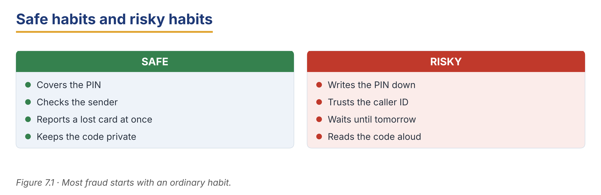


## Part 2 · Grammar — Zero and First Conditionals
*Pre-class input*


### 2A  Notice the grammar
*Read the short dialogue. Underline the two conditionals. Which one is a general rule?*

```
Customer: I think someone has used my card.
Elif: If you tell us straight away, we can usually stop the payment.
Customer: And if I had waited?
Elif: If a customer waits a week, the money is much harder to recover. That is always true.
Customer: Then please block it now.
Elif: I will block it, and if anything else appears, we will call you.
```

1. “If a customer waits a week, the money is harder to recover” — rule or one occasion? ____
2. “If anything else appears, we will call you” — rule or one occasion? ____
3. Which tense comes after if in both sentences? ____


### Grammar Focus

| Conditional | Form | Use | Example |
|---|---|---|---|
| Zero | if + present, present | a rule that is always true | If you share a code, your account is at risk. |
| First | if + present, will / can | one real possibility, now or soon | If you call us now, we will block the card. |

> **Remember:** after if, use the present — never will. The will goes in the other half of the sentence.

> **⚠ Watch out!**
> ✗ If you will share your code, the account is at risk. → ✓ If you share your code, the account is at risk.
> ✗ If you call us, we block the card. → ✓ If you call us, we will block the card.


### 2B  Controlled practice (zero or first)
*Write the correct form of the verb in brackets.*

**Example: 0. If you lose your card, you ____ (must) call us. → must.**

1. If you share a one-time code, anyone ______________________ (can) use your account.
2. If you call us before midnight, we ______________________ (block) the card tonight.
3. If a message asks for your password, it ______________________ (be) not from the bank.
4. If the customer ______________________ (come) in tomorrow, we will issue a new card.
5. If you cover the keypad, nobody ______________________ (see) your PIN.
6. If you ______________________ (report) it today, we can still trace the payment.


### 2C  Error correction
*Find and correct the mistake in each sentence.*

**Example: 0. If you will call us, we block it. → If you call us, we will block it.**

1. If you will share your code, your money is at risk.
2. If a customer calls, we blocking the card.
3. If you clicked the link, tell us now and we blocked it.
4. If water gets into the machine, it will always stop working.
5. If you will come tomorrow, we will give you a new card.

> ✎ *Write your response here.*


### 2D  Give safety advice
*Write three pieces of advice for a customer. Use one zero conditional and two first conditionals.*

> **Model — read this first**
> If you share a one-time code, anyone can use your account. If you receive a message in a hurry, call us before you click. If you lose your card, we will block it immediately.

> ✎ *Write your response here.*


### 2E  Freer practice (speaking)
*In pairs, advise a customer who has clicked a link in a false message. Use at least three conditionals.*

> **Model — read this first**
> “If you typed your password, we should change it now. If anything has been taken, we will open a case today.”

*Tip: You will see these conditionals again in the reading in Part 5 (5A and 5B). Look for them there.*

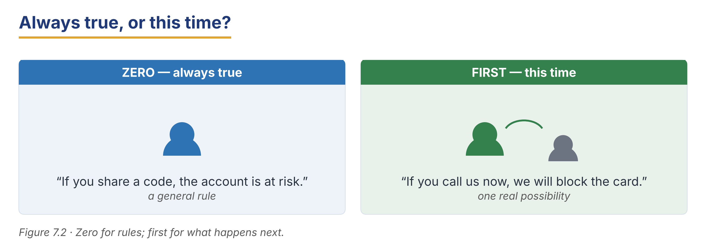


## Part 3 · Listening
*Pre-class input · scripts printed below*


### 3A  Before you listen (predict)
*You will hear three conversations about security. What does a worried customer say first?*

> **Model — read this first**
> “I think the customer will say that something strange has happened, and that she is frightened.”


### 3B  A suspicious message
**🔊 Audio 7.1** (optional) — or read the script below.

```
Customer: I got a text saying my account will be closed in one hour.
Elif: Thank you for calling us instead of clicking. That message is not from us.
Customer: How can you be sure?
Elif: If a message gives you a deadline of one hour, it is a scam. The bank never does that, in any country.
Customer: Should I do anything?
Elif: Delete it. If you clicked the link, tell me now and we will change your password.
```

*Read and decide: True, False, or Not Given.*

**Example: 0. The customer received a text message. → True.**

1. The message came from the bank.
2. A one-hour deadline is a sign of a scam.
3. The customer clicked the link.

*Useful language: Thank you for calling us instead of clicking. · That message is not from us. · If you clicked the link, tell me now.*


### 3C  Blocking a lost card
**🔊 Audio 7.2** (optional) — or read the script below.

```
Customer: I can’t find my card. I think I left it in a shop.
Grace: I can block it now. May I ask when you last used it?
Customer: About an hour ago.
Grace: Good. If a payment appears after that time, we will refund it. A new card will be posted today and should arrive in three days.
Customer: And if I find the old one?
Grace: Once a card is blocked, it cannot be used again. Please cut it up.
```

*Read and decide: True or False.*

1. The card can be unblocked if the customer finds it.
2. Payments after the lost time will be refunded.
3. The new card arrives the same day.
4. Nothing can be spent on a blocked card.


### 3D  Staying safe — advice (longer)
**🔊 Audio 7.3** (optional) — or read the script below.

```
Elif: Three rules, and they are the same in every branch of this bank.
Elif: First, codes. If someone asks you for a one-time code, that person is not from the bank. We never ask.
Elif: Second, hurry. If a call makes you feel you must act within minutes, stop. Fraud works on hurry, and if you slow down most scams fail.
Elif: Third, the number. Call the number printed on your card, not the one in the message. A caller can say any name.
Elif: And if you make a mistake, tell us at once. If you report it in the first hour, we can usually stop the money.
```

*Read and decide: True, False, or Not Given.*

**Example: 0. The rules are the same in every branch. → True.**

1. The bank sometimes asks for a one-time code.
2. Calling the number in a message is safer than the number on the card.
3. Most customers in the room have been victims of fraud.


### 3E  Match the safe response
*Match each situation to the safe response (one is extra).*


| Column A | Column B |
|---|---|
| 1. A text gives you a one-hour deadline ____ | **a)** delete it and call the bank |
| 2. A caller asks for your one-time code ____ | **b)** end the call; the bank never asks |
| 3. You cannot find your card ____ | **c)** call and have it blocked |
| 4. You clicked a link and typed your password ____ | **d)** tell the bank at once and change it |
|  | **e)** send the code to the caller (extra) |

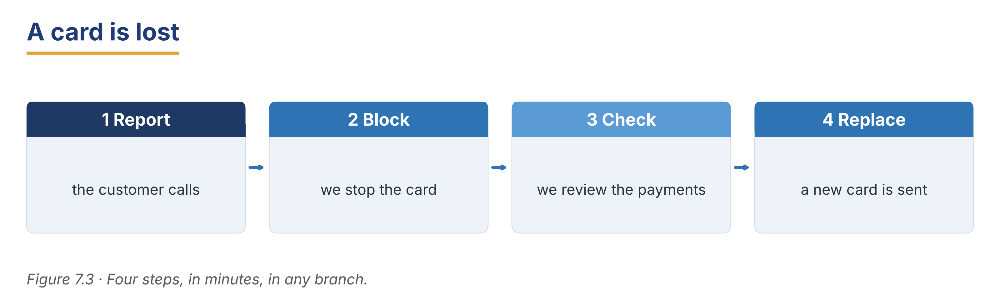


## Part 4 · Speaking
*In-class output*


### 4A  Functional language — warning and advising
*Match the function to a phrase (one is extra).*


| Column A | Column B |
|---|---|
| 1. Warn ____ | **a)** “If you share that code, anyone can use your account.” |
| 2. Advise ____ | **b)** “I would call the number on your card.” |
| 3. Reassure ____ | **c)** “Nobody here will blame you.” |
| 4. Act ____ | **d)** “I will block the card now.” |
|  | **e)** “Your card has been declined.” (extra) |


### 4B  Advise a worried customer (pairwork)
*Advise a customer who thinks they have been tricked. Then swap roles.*

> **Model — read this first**
> A: Thank you for telling us. If you typed your password, we will change it now. — B: Will I lose the money? — A: If a payment appears, we will refund it. Let me block the card first.

**Card A (staff):** thank them · act first · explain with a conditional · say what happens next.

**Card B (customer):** you clicked a link last night and typed your password; you are embarrassed and frightened.


### 4C  Help someone stay calm
*A customer is panicking on the phone. Slow the conversation down and take the first step.*

> **Model — read this first**
> “Let’s take one thing at a time. First, I am blocking the card — that is done. Now, if you tell me when you last used it, we can check everything after that.”

*Stretch: the customer blames themselves — reassure them without making a promise you cannot keep.*


### 4D  Find the information (pairwork info-gap)
*Student A works in the fraud team; Student B is a customer. Ask and answer to open a case.*

**Card A (fraud team):** you can block cards instantly; payments after the reported time are refunded; a new card takes three days.

**Card B (customer):** you last used the card at 11:00; two payments appeared at 14:30; you still have the card in your bag.

*Useful language: When did you last use it? · Do you still have the card? · Did you share a code with anyone?*


### 4E  Close the call safely
*Match the closing phrase to the situation (one is extra).*


| Column A | Column B |
|---|---|
| 1. “Your card is blocked, and nothing can be spent.” ____ | **a)** confirming the action |
| 2. “A new card will arrive in three days.” ____ | **b)** saying what happens next |
| 3. “If anything else appears, call this number.” ____ | **c)** giving a clear next step |
| 4. “You did the right thing by calling.” ____ | **d)** reassuring the customer |
|  | **e)** “Please take a seat.” (extra) |

*In pairs, close a fraud call safely. Use two phrases above.*


## Part 5 · Reading
*Pre-class input*


### 5A  Stay safe: security tips
*Read the customer leaflet. Notice the conditionals.*

> **Harbour Bank — Six Rules That Keep Your Money Safe** — *About 200 words*
>
> If you follow six simple rules, most fraud will never reach you. One: never share a one-time code. If somebody asks you for a code, that person is not from this bank. Two: slow down. If a message or a call makes you feel you must act within minutes, it is almost certainly a scam. Fraud works on hurry. Three: use the number on your card. If you want to check whether a call was real, hang up and call the number printed on it. A caller can claim any name. Four: cover the keypad. If you cover your hand when you type your PIN, a camera above the machine sees nothing. Five: check your statement. If you look at your payments once a week, you will see a wrong one early, while it can still be stopped. Six: tell us at once. If you report something in the first hour, we can usually stop the money; if you wait a week, it is much harder. We would always rather have a false alarm than a late one.

*Answer the questions.*

**Example: 0. How many rules are there? → Six.**

1. What does the leaflet say about anyone who asks for a code?
2. Why does fraud work on hurry?
3. Which number should a customer call to check a call?
4. Why should a customer look at the statement each week?
5. What is the difference between reporting in the first hour and waiting a week?


### 5B  Grammar in context (from 5A)
*Look back at the leaflet. Find two zero conditionals and one first conditional.*

1. Zero conditional 1: ____
2. Zero conditional 2: ____
3. First conditional: ____

*Now complete these sentences about safety.*

1. If you ______________________ (cover) the keypad, nobody can see your PIN.
2. If you report it today, we ______________________ (can) stop the payment.


### 5C  A close call
*Read the short story. What stopped the fraud?*

> **One Question Saved It** — *About 120 words*
>
> A customer in her seventies received a call. The caller knew her name, her bank and the last four digits of her card. He said there had been an unauthorised payment and that her money had to be moved. She almost agreed. Then she asked one question: “Can I call you back on the number on my card?” The caller said no, there was no time. That was the moment she knew. She put the phone down and called the branch. The money was never moved. She says now that the caller knew everything except one thing: a real bank is always happy to be called back.

1. What did the caller already know about her?
2. What one question did she ask?
3. What was the caller’s answer, and why did it matter?


### 5D  Discussion
*In pairs, compare the advice with what customers actually do.*

*Useful frame: “Our customers find rule ___ easy, but rule ___ is hard because ___.”*

- Which rule do your customers forget most often?
- What is the best way to teach a rule to someone who does not use a phone?

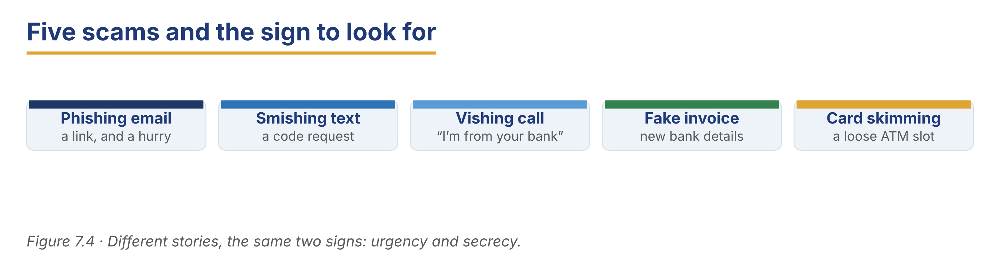


## Part 6 · Writing
*In-class / homework output*


### 6A  Guided writing — complete the safety notice
*Complete the notice with the words: share, delete, report, printed, blocked.*

**Word bank:** share | delete | report | printed | blocked

1. Never ______________________ a one-time code with anyone, including bank staff.
2. If you receive a message with a deadline, please ______________________ it.
3. If you want to check a call, use the number ______________________ on your card.
4. Your card can be ______________________ in one tap in the app.
5. Please ______________________ anything unusual to us at once.


### 6B  Safety advice email to customers (50–70 words)
*Write a short email to customers with safety advice. Use two conditionals.*

> **Model — read this first**
> Subject: Keeping your account safe
> Dear Customer, We are seeing more false messages at the moment. If a message asks you for a one-time code, it is not from us. If you want to check whether a call is real, please hang up and dial the number printed on your card. You can freeze your card in the app at any time. Kind regards, Harbour Bank

*Plan: Subject: ___ · Dear ___, · We are seeing ___. · If a message ___, it ___. · If you want to ___, please ___. · Kind regards, ___*

*Phrase bank: if a message asks you for… · it is not from us · please hang up and dial… · you can freeze your card at any time*

**Check before you finish**
- ☐ A clear subject line?
- ☐ Two conditionals?
- ☐ One clear action for the customer?
- ☐ 50–70 words?

> ✎ *Write your response here.*


### 6C  Reply to a worried customer (50–70 words)
*A customer writes that she clicked a link. Write a calm, practical reply.*

> **Model — read this first**
> Subject: The link you clicked
> Dear Ms Fernandes, Thank you for telling us so quickly. Your card has been blocked, and nothing can be spent on it. If a payment appears after the time you reported, we will refund it. Could you change your password today? A new card will arrive within three days. You did the right thing by calling. Kind regards, Customer Service

*Plan: Subject: ___ · Dear ___, · Thank you for ___. · Your card has been ___. · If ___, we will ___. · Could you ___? · Kind regards, ___*

**Check before you finish**
- ☐ A calm, non-blaming tone?
- ☐ One conditional?
- ☐ A clear next step for the customer?
- ☐ 50–70 words?

> ✎ *Write your response here.*


### 6D  Peer check
*Swap your email from 6B or 6C with a partner. Give one piece of positive feedback and one suggestion.*

*Checklist: subject line? · two conditionals? · one clear action? · 50–70 words?*

> **Model — read this first**
> “Very calm, and the conditional makes the advice clear. Next time, try to put the action the customer must take in its own sentence.”


## Part 7 · Management File — Keeping Customers Safe
*Practitioner track (optional for beginners) · experienced staff*


### 7A  Fraud-awareness phrases
*Match the phrase to its purpose (one is extra).*


| Column A | Column B |
|---|---|
| 1. “We have seen four cases this week.” ____ | **a)** giving the team the current picture |
| 2. “If a customer hesitates, slow down.” ____ | **b)** giving staff a rule to follow |
| 3. “Nobody will be blamed for a false alarm.” ____ | **c)** making it safe to report |
| 4. “Escalate anything over five thousand.” ____ | **d)** setting the line for referral |
|  | **e)** closing an account (extra) |


### 7B  Listening — a staff briefing
**🔊 Audio 7.4** (optional) — or read the script below.

```
Elif: Four cases this week, all the same. A caller says he is from the fraud team and asks the customer to move money to a “safe account”.
Tomasz: What should we do if a customer comes in to make that transfer?
Elif: If a customer asks to move everything to a new account, slow down and ask who told them. If the answer is a phone call, stop the transfer and call me.
Tomasz: And if we are wrong?
Elif: Nobody will be blamed for a false alarm. Escalate anything over five thousand to me directly.
```

*Answer the questions.*

**Example: 0. How many cases have there been this week? → Four.**

1. What does the caller ask the customer to do?
2. What should staff do if a customer wants to move everything to a new account?
3. What is the rule for amounts over five thousand?


### 7C  Controlled practice — advice with conditionals
*Rewrite each note as advice for a colleague. Use a zero or first conditional.*

**Example: 0. Customer in a hurry → If a customer is in a hurry, slow the conversation down.**

1. Caller claims to be from the fraud team.
2. Customer wants to move everything to a new account.
3. Transfer is over five thousand.
4. Customer has already shared a one-time code.
5. Staff member is not sure whether it is fraud.

> ✎ *Write your response here.*


### 7D  Role play — advise a scared customer
*A customer has been told by a caller to move her savings. Stop the transfer without frightening her further.*

> **Model — read this first**
> “I am not going to make that transfer today, and I will explain why. If someone has told you to move money to a safe account, that call was not from this bank. Let’s check it together, and nothing will be lost.”

**Card A (staff):** refuse calmly · explain with a conditional · offer to check together · escalate.

**Card B (customer):** you were called this morning; the caller knew your name and your card’s last four digits; you are certain he was genuine.

*Stretch: the customer insists it is her money and her decision — respond respectfully and still protect her.*


### 7E  Writing — a staff safety reminder (50–70 words)
*Write a short reminder to your team about a current scam.*

> **Model — read this first**
> Subject: Safe-account scam — four cases this week
> We have seen four cases this week. A caller claims to be from the fraud team and asks the customer to move money to a “safe account”. If a customer asks to move everything to a new account, slow down and ask who told them. If the answer is a phone call, stop the transfer and call me. Elif Demir

*Plan: Subject: ___ · We have seen ___. · A caller claims ___. · If a customer ___, ___. · If ___, ___.*

*Phrase bank: we have seen ___ cases this week · a caller claims to be… · if a customer asks to…, slow down · escalate anything over…*

**Check before you finish**
- ☐ A clear subject line?
- ☐ Two conditionals?
- ☐ A clear instruction for the team?
- ☐ 50–70 words?

> ✎ *Write your response here.*


## Part 8 · Global Case Study — A Scam-Awareness Campaign
*Practitioner track · read then discuss*

*Before you read: does telling people about a scam actually stop it?*

> **The Campaign That Worked** — *About 200 words · a made-up example based on real practice*
>
> A bank with branches in several countries ran a campaign about one scam: the “safe account” call. For three months, every branch had a poster, every statement had a line at the bottom, and every member of staff was trained to ask one question. The posters did almost nothing. The line on the statement did almost nothing. The one question worked. Staff were taught that if a customer asks to move a large amount to an account they have only just heard about, the staff member should ask, simply and without alarm, “Who told you about this account?” If the answer was a phone call, the transfer was stopped and checked. In three months, that single question stopped payments worth more than two million. The bank learned two things. The first was that general advice reaches people who are not in danger, while a question reaches the person who is. The second was harder: some customers were angry at being stopped. The bank decided that this was a price worth paying, and it published the figure so that customers could see why.

**Glossary help**
- **campaign** — an organised effort to tell people something
- **safe-account scam** — a call telling you to move money to a new account
- **to escalate** — to pass something to a more senior person
- **false alarm** — a warning about something that turns out to be fine


### 8A  Comprehension
**Example: 0. How long did the campaign run? → Three months.**

1. Which two parts of the campaign did almost nothing?
2. What was the one question staff were taught to ask?
3. What happened if the answer was a phone call?
4. What two things did the bank learn?


### 8B  Vocabulary in context
*Match the word to its meaning (one is extra).*


| Column A | Column B |
|---|---|
| 1. campaign ____ | **a)** a call telling you to move money to a new account |
| 2. safe-account scam ____ | **b)** an organised effort to tell people something |
| 3. to escalate ____ | **c)** a warning about something that turns out to be fine |
| 4. false alarm ____ | **d)** to pass something to a more senior person |
|  | **e)** a charge for a service (extra) |


### 8C  Discussion
*Frames: “In my branch this question would work because ___.” “It would be difficult because ___.”*

- How would customers in your country react to being stopped?
- Is a poster ever worth the wall space? Why, or why not?


### 8D  Your view (short write, 30–40 words)
*Is stopping a customer’s own transfer the right thing to do? Give one reason.*

> ✎ *Write your response here.*


## Part 9 · Branch Case Study — Istanbul in Focus: The Phone Call
*Practitioner track · read then decide*

*Before you read: what would you do if a customer insisted on a transfer you believed was fraud?*

> **Mr Aydın’s Difficult Morning** — *About 185 words*
>
> A customer, Mr Şahin, has come into the Istanbul branch to transfer forty thousand to an account he was given this morning. He says a man from the bank’s fraud team called him at seven and told him his savings were at risk. The man knew his name, his branch and the last four digits of his card. Mr Şahin is a careful man, and he is embarrassed to be asked about it. He says he is seventy-one years old and perfectly able to manage his own money. Zeynep Kaya, at the desk, is certain this is the safe-account scam. The branch rule is clear: stop the transfer and escalate anything over five thousand. But Mr Şahin is becoming angry, other customers can hear, and he has threatened to close his accounts and go elsewhere. The manager, Kerem Aydın, has been called to the desk. He has perhaps two minutes before the conversation becomes a scene, and the money, if it goes, will not come back.


### 9A  Comprehension
**Example: 0. How much does Mr Şahin want to transfer? → Forty thousand.**

1. What did the caller tell Mr Şahin, and what did he already know?
2. What is the branch rule for amounts over five thousand?
3. Why is the situation becoming difficult for the branch?


### 9B  Decision task
*What should Kerem do in the next two minutes? Write 40–60 words. Use the frame and the phrase bank.*

> **Model — read this first**
> I think Kerem should take Mr Şahin into a private room, because the conversation should not happen at the counter. He should explain that the transfer is paused, not refused, and offer to call the fraud team together. Also, he can show Mr Şahin that the bank never calls about a safe account.

*Frame: I think Kerem should ___, because ___. Also, ___.*

*Phrase bank: move the conversation somewhere private · say the transfer is paused, not refused · offer to call the fraud team together · show the rule in writing*

> ✎ *Write your response here.*


## Part 10 · Review & Can-Do
*Homework / self-study*


### 10A  Spiral review
*Complete the sentences. Use a conditional or the correct word. Items 5–6 review Units 5 and 6.*

**Example: 0. If you share a code, anyone ____ use your account. → can.**

1. If you ______________________ (click) a link in a false message, tell us at once.
2. If you call us tonight, we ______________________ (block) the card immediately.
3. A false email that asks for your details is called ______________________. (word)
4. Done without the owner’s permission is ______________________. (word)
5. A code ______________________ (send) to your phone every time. (Unit 5 grammar)
6. Could you tell me what the rate ______________________? (Unit 6 indirect question)


### 10B  Can-Do checklist
**Can-Do checklist — tick what you can do now**
- ☐ I can name the common types of fraud.
- ☐ I can give safety advice with zero and first conditionals.
- ☐ I can calm and advise a worried customer.
- ☐ I can understand a short conversation about a scam.
- ☐ I can write safety advice for customers or staff.


### 10C  Unit glossary
**Glossary help**
- **fraud** — taking money by lying or tricking someone
- **phishing** — a false email that asks for your details
- **smishing** — a false text message that asks you to act
- **skimming** — copying a card’s details at a machine
- **suspicious** — looking as though something may be wrong
- **to block** — to stop a card or account being used
- **unauthorised** — done without the owner’s permission
- **safe-account scam** — a call telling you to move money to a new account
- **to escalate** — to pass something to a more senior person
- **false alarm** — a warning about something that turns out to be fine


# Unit 8 · Rules and Compliance
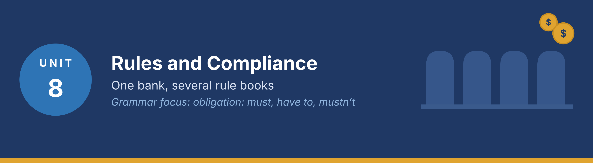

*In this unit you learn the language of banking rules, how to explain an obligation politely, how to follow a conversation about a check, and how to write a short procedure note. Grammar focus: obligation — must, have to, mustn’t, don’t have to.*

## Part · · Warm-Up
*In-class starter · speak before you read*


### W-A  Rules at the bank (discussion)
*In small groups, list the rules a bank asks its customers to follow.*

> **Model — read this first**
> You must show ID to open an account. You must not let anyone else use your card. You do not have to come to the branch for a small transfer.

- Which rule do customers find hardest to accept?
- Which rule protects the customer rather than the bank?


### W-B  Must or mustn’t? (quick sort)
*In pairs, decide whether each line is must or mustn’t. One minute only.*

- Check the ID before a large deposit: ____
- Tell a customer that they have been reported: ____
- Keep the records for the full period: ____

*Useful words: Use must, mustn’t and don’t have to in your answers.*


## Part 1 · Vocabulary
*Pre-class input*


### 1A  Match the term to the meaning
*Match each compliance word (1–8) to the correct meaning (a–i). One meaning is extra.*

**Example: 0. Audit → h)**


| Column A | Column B |
|---|---|
| 1. Compliance ____ | **a)** following the rules that apply to the bank |
| 2. KYC ____ | **b)** knowing who your customer really is |
| 3. Anti-money-laundering ____ | **c)** stopping criminal money entering the system |
| 4. Sanctions screening ____ | **d)** checking a name against official lists |
| 5. Due diligence ____ | **e)** the careful checking the bank must do |
| 6. To escalate ____ | **f)** to pass something to a more senior person |
| 7. Record keeping ____ | **g)** storing documents for the required period |
| 8. Regulator ____ | **h)** the body that supervises banks in a country |
|  | **i)** the money left in an account (extra) |

*Pronunciation — word stress. Say these words: com·PLI·ance, LAUN·der·ing, SANC·tions, re·gu·LA·tion.*


### 1B  Sort the words
*Put each word from 1A into the correct group.*

- Before you open an account: ____
- Every day at the counter: ____
- After the transaction: ____

> **Model — read this first**
> Before you open an account: KYC, due diligence, sanctions screening. Every day at the counter: compliance, escalate. After the transaction: record keeping, regulator.


### 1C  Complete the sentences
*Complete the sentences with the correct word.*

**Word bank:** compliance | escalate | records | identity | screening | regulator | source | threshold | unusual

**Example: 0. We must check the customer’s identity before we open an account.**

1. Every name is checked by sanctions ______________________ before a transfer leaves.
2. Please ______________________ anything ______________________ to the compliance officer.
3. We must keep the ______________________ for at least five years.
4. Above the reporting ______________________, a form must be completed.
5. The ______________________ can ask to see any file at any time.
6. For a large cash deposit, we must ask about the ______________________ of the funds.


### 1D  Word partners (collocations)
*Match the verb to the noun to make a common compliance phrase (one noun is extra).*


| Column A | Column B |
|---|---|
| 1. verify ____ | **a)** a report |
| 2. keep ____ | **b)** the identity |
| 3. file ____ | **c)** a case |
| 4. screen ____ | **d)** records |
| 5. escalate ____ | **e)** a name |
|  | **f)** a queue (extra) |


### 1E  Write with the words (40–60 words)
*Write about one compliance check you do at work. Use at least five words from Part 1.*

> **Model — read this first**
> Before we open an account, we verify the customer’s identity with an official document. The name is screened against the sanctions lists. If anything looks unusual, we escalate it to the compliance officer, and we keep the records for five years.

**Check before you finish**
- ☐ Five Part-1 words?
- ☐ 40–60 words?
- ☐ Short, clear sentences?

> ✎ *Write your response here.*

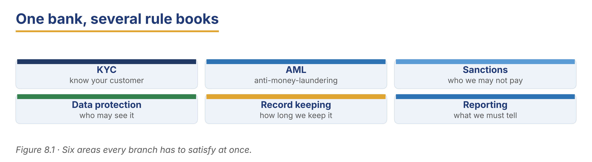


## Part 2 · Grammar — Obligation: must, have to, mustn’t, don’t have to
*Pre-class input*


### 2A  Notice the grammar
*Read the short dialogue. Underline must, mustn’t, have to and don’t have to. Which two mean the same?*

```
Customer: Do I have to bring my passport? I have my driving licence.
Elif: For a new account you must bring an official photo document, so a licence is fine.
Customer: And must I come to this branch?
Elif: No, you don’t have to. Any branch can do it. But you mustn’t send the documents by email — we are not allowed to accept them that way.
```

1. must / have to — do they mean the same here? ____
2. mustn’t — is it a rule or a free choice? ____
3. don’t have to — is it a rule or a free choice? ____


### Grammar Focus

| Form | Use | Example |
|---|---|---|
| must / have to | it is necessary | You must show an official document. |
| mustn’t | it is forbidden | You mustn’t send documents by email. |
| don’t have to | it is not necessary; you may choose | You don’t have to come to this branch. |

> **Remember:** mustn’t and don’t have to are opposites, not the same. Mustn’t forbids; don’t have to frees.

> **⚠ Watch out!**
> ✗ You don’t have to share your PIN. → ✓ You mustn’t share your PIN.
> ✗ You must to bring your ID. → ✓ You must bring your ID.


### 2B  Controlled practice (choose the modal)
*Choose must, mustn’t or don’t have to.*

**Example: 0. You ____ show ID for a new account. → must.**

1. Staff ______________________ share a customer’s details with anyone outside the bank.
2. You ______________________ make an appointment; you can come at any time.
3. We ______________________ keep the records for five years.
4. A customer ______________________ sign the form in front of us.
5. You ______________________ write your PIN down anywhere.
6. Customers ______________________ bring two documents; one is enough.


### 2C  Error correction
*Find and correct the mistake in each sentence.*

**Example: 0. You must to bring your ID. → You must bring your ID.**

1. Staff don’t have to share customer data with anyone.
2. You must bringing an official document.
3. We have to keeping the records for five years.
4. You mustn’t to send documents by email.
5. He doesn’t must come to this branch.

> ✎ *Write your response here.*


### 2D  State the rule
*Write three rules for a new colleague: one with must, one with mustn’t and one with don’t have to.*

> **Model — read this first**
> You must verify the customer’s identity before you open an account. You mustn’t tell a customer that a report has been made. You don’t have to ask for a second document if the first one is valid.

> ✎ *Write your response here.*


### 2E  Freer practice (speaking)
*In pairs, explain three branch rules to a new colleague. Use all three forms.*

> **Model — read this first**
> “You must screen every name. You mustn’t guess if you are unsure — ask. And you don’t have to decide alone; that is what escalation is for.”

*Tip: You will see these forms again in the reading in Part 5 (5A and 5B). Look for them there.*

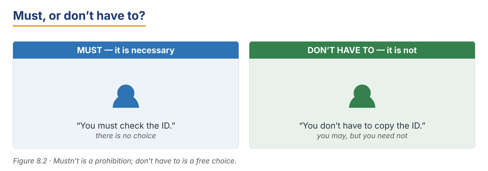


## Part 3 · Listening
*Pre-class input · scripts printed below*


### 3A  Before you listen (predict)
*You will hear three conversations about rules. How does a customer feel when asked for ID again?*

> **Model — read this first**
> “I think the customer will say that he has banked here for years and should not have to prove who he is.”


### 3B  Asking for ID politely
**🔊 Audio 8.1** (optional) — or read the script below.

```
Customer: I’ve had this account for fifteen years. Why do you need my passport again?
Ana: I understand. We have to check the document is still valid, and yours expired in March.
Customer: Nothing has changed. I’m the same person.
Ana: Of course. The rule is not about you — every customer must have a current document on file. If you bring it tomorrow, I can update it in two minutes.
```

*Read and decide: True, False, or Not Given.*

**Example: 0. The customer has had the account a long time. → True.**

1. The rule applies only to new customers.
2. The customer’s document has expired.
3. The customer brings the passport the next day.

*Useful language: We have to check the document is still valid. · The rule is not about you. · Every customer must have a current document on file.*


### 3C  Explaining a rule
**🔊 Audio 8.2** (optional) — or read the script below.

```
Customer: I want to deposit fifteen thousand in cash.
Tomasz: Certainly. For an amount like this we must ask about the source of the funds, and complete a short form.
Customer: Are you saying I have done something wrong?
Tomasz: Not at all. We have to ask everyone the same question above a certain amount. It takes about three minutes, and you don’t have to bring anything extra today.
```

*Read and decide: True or False.*

1. The bank asks about the source of funds only for suspicious customers.
2. The form takes about three minutes.
3. The customer must bring extra documents today.
4. A rule applies above a certain amount.


### 3D  Escalating something unusual (longer)
**🔊 Audio 8.3** (optional) — or read the script below.

```
Ana: A customer has deposited nine thousand in cash on three days this week.
Elif: Each one below the reporting threshold.
Ana: Exactly. Each on its own is normal. Together they are not.
Elif: You were right to bring it to me. We call that structuring — breaking a large amount into smaller ones so each stays below the line. It must be escalated either way.
Ana: Do I say anything to him?
Elif: No. You mustn’t tell a customer that a report has been made. That is a rule in every country we work in.
Ana: What happens now?
Elif: I file the report today. Write down exactly what you saw.
```

*Read and decide: True, False, or Not Given.*

**Example: 0. The customer deposited cash on three days. → True.**

1. Each single deposit was above the reporting threshold.
2. Ana must tell the customer that a report has been made.
3. The customer knew about the threshold.


### 3E  Match the rule to the reason
*Match each rule to the reason behind it (one is extra).*


| Column A | Column B |
|---|---|
| 1. Every customer must have a current document on file ____ | **a)** so the bank knows who it is dealing with |
| 2. Large cash deposits must be explained ____ | **b)** so criminal money cannot enter the system |
| 3. Names must be screened before a transfer ____ | **c)** so the bank does not pay a sanctioned person |
| 4. Records must be kept for five years ____ | **d)** so the regulator can check later |
|  | **e)** to make the queue shorter (extra) |

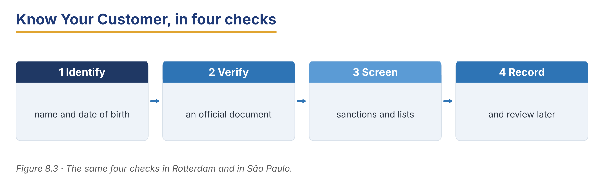


## Part 4 · Speaking
*In-class output*


### 4A  Functional language — explaining rules politely
*Match the function to a phrase (one is extra).*


| Column A | Column B |
|---|---|
| 1. Soften the rule ____ | **a)** “We have to ask everyone the same question.” |
| 2. Say it is not personal ____ | **b)** “I understand — it does feel like a lot.” |
| 3. Say what is needed ____ | **c)** “We must see an official photo document.” |
| 4. Say what is not needed ____ | **d)** “You don’t have to bring anything else today.” |
|  | **e)** “Your card has been declined.” (extra) |


### 4B  Explain a rule (pairwork)
*Explain one branch rule to a customer who does not like it. Then swap roles.*

> **Model — read this first**
> A: For this amount we must ask about the source of the funds. — B: Do you think I’m a criminal? — A: Not at all. We have to ask everyone the same question above a certain amount. It takes three minutes.

**Card A (staff):** state the rule · say it applies to everyone · say how long it takes · say what is not needed.

**Card B (customer):** you are depositing a large amount from the sale of a car; you feel insulted by the question.


### 4C  A customer refuses
*A customer refuses to answer a compliance question. Stay polite and do not break the rule.*

> **Model — read this first**
> “I am sorry — I cannot complete the deposit without the form. It is not my decision, and it is the same in every branch. If you would rather do it another day, the money is safe where it is.”

*Stretch: the customer asks to speak to the manager — hand over professionally.*


### 4D  Find the information (pairwork info-gap)
*Student A works in compliance; Student B is a colleague with a question. Ask and answer.*

**Card A (compliance):** source of funds above 10,000 · documents must be current · escalate three similar deposits in a week · never tell the customer.

**Card B (colleague):** a customer has paid in 9,000 twice this week; his ID expired last month; he is asking why.

*Useful language: Do I have to escalate this? · Must the document be current? · What am I not allowed to say?*


### 4E  Close politely
*Match the closing phrase to the situation (one is extra).*


| Column A | Column B |
|---|---|
| 1. “Thank you for your patience with the form.” ____ | **a)** thanking the customer |
| 2. “Everything is in order now.” ____ | **b)** confirming the check is finished |
| 3. “Please bring the new document when you can.” ____ | **c)** giving a clear next step |
| 4. “The rule is the same in every branch.” ____ | **d)** showing it is not personal |
|  | **e)** “Please take a seat.” (extra) |

*In pairs, close a compliance conversation politely. Use two phrases above.*


## Part 5 · Reading
*Pre-class input*


### 5A  A staff compliance guide
*Read the staff guide. Notice must, mustn’t and don’t have to.*

> **Harbour Bank — What Every Member of Staff Must Know** — *About 200 words*
>
> Harbour Bank works in six countries, and each has its own rule book. Some rules are international; others are local. You must follow both, and where they differ, the stricter one. Before an account is opened, you must verify the customer’s identity with a current official document and screen the name against the sanctions lists. You don’t have to ask for two documents if the first is current. Above the local reporting threshold, you must ask about the source of the funds and complete the form. You mustn’t guess: if you are unsure, escalate it to the compliance officer. You don’t have to decide alone. If a report is made, you mustn’t tell the customer. It is a rule in every country where we operate, and it protects you as well as the case. Records must be kept for at least five years, longer in some countries. Nobody has ever been disciplined here for escalating something that turned out to be nothing.

*Answer the questions.*

**Example: 0. How many countries does the bank work in? → Six.**

1. What must you do if an international rule and a local rule differ?
2. What two things must be done before an account is opened?
3. When don’t you have to ask for a second document?
4. What must you do if you are unsure whether something is unusual?
5. Why mustn’t staff tell a customer that a report has been made?


### 5B  Grammar in context (from 5A)
*Look back at the guide. Find one example of each form.*

1. must: ____
2. mustn’t: ____
3. don’t have to: ____

*Now complete these sentences about the rules.*

1. You ______________________ keep the records for at least five years.
2. You ______________________ decide alone; you can escalate.


### 5C  Why the rules protect you
*Read the short note. Who do the rules protect?*

> **The Rule Is Your Friend** — *About 120 words*
>
> New staff often think the compliance rules are there to protect the bank. They are, but not only. If you follow the rule and complete the form, nobody can later ask why you did not. If you escalate something and it turns out to be nothing, no harm is done. If you do not escalate, and it turns out to be something, the question will be asked. They also protect you from pressure. A customer who is angry is arguing with the rule, not with you, and you can say so politely. In an international bank the rule is the same in every branch, so nobody has to invent an answer alone.

1. Who do new staff think the rules protect?
2. What happens if you escalate something that turns out to be nothing?
3. How do the rules protect staff from pressure?


### 5D  Discussion
*In pairs, compare the rules with your own workplace.*

*Useful frame: “In my country we must ___, but we don’t have to ___.”*

- Which rule is hardest to explain to a customer?
- What would you add to the guide for new staff?

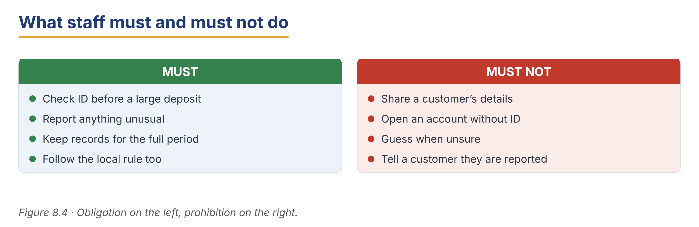


## Part 6 · Writing
*In-class / homework output*


### 6A  Guided writing — complete the staff notice
*Complete the notice with the words: verify, escalate, threshold, records, disclose.*

**Word bank:** verify | escalate | threshold | records | disclose

1. Before any account is opened, you must ______________________ the customer’s identity.
2. Above the local reporting ______________________, the source-of-funds form is required.
3. You must ______________________ anything unusual to the compliance officer.
4. You mustn’t ______________________ to a customer that a report has been made.
5. ______________________ must be kept for at least five years.


### 6B  Internal escalation note (50–70 words)
*Write a short note escalating something unusual to the compliance officer.*

> **Model — read this first**
> Subject: Three cash deposits — account 4471
> Dear Ms Demir, A customer has deposited nine thousand in cash on three days this week. Each amount is below the reporting threshold, but together they are not. The ID on file is current. I have said nothing to the customer. Could you tell me whether anything further is needed from me? Kind regards, Ana Silva

*Plan: Subject: ___ · Dear ___, · A customer has ___. · Each ___, but ___. · I have said nothing to ___. · Could you tell me ___? · Kind regards, ___*

*Phrase bank: each amount is below the threshold · together they are not · I have said nothing to the customer · could you tell me whether…*

**Check before you finish**
- ☐ A clear subject line with the account?
- ☐ The facts, with no opinion?
- ☐ A statement that the customer was not told?
- ☐ 50–70 words?

> ✎ *Write your response here.*


### 6C  Explain a rule to a customer (50–70 words)
*A customer has emailed to complain about being asked for ID again. Write a short, polite reply.*

> **Model — read this first**
> Subject: Your question about identification
> Dear Mr Okonkwo, Thank you for your email, and I am sorry for the inconvenience. We must hold a current official document for every customer, and the one on your file expired in March. You don’t have to bring anything else — one valid document is enough, and any branch can update it in two minutes. Kind regards, Customer Service

*Plan: Subject: ___ · Dear ___, · Thank you for ___. · We must ___. · You don’t have to ___. · Kind regards, ___*

**Check before you finish**
- ☐ A polite, non-defensive tone?
- ☐ One must and one don’t have to?
- ☐ A clear next step?
- ☐ 50–70 words?

> ✎ *Write your response here.*


### 6D  Peer check
*Swap your note or email with a partner. Give one piece of positive feedback and one suggestion.*

*Checklist: subject line? · must and don’t have to? · facts only? · 50–70 words?*

> **Model — read this first**
> “Clear facts and no opinion, which is right for an escalation. Next time, try to give the exact dates as well as the amounts.”


## Part 7 · Management File — Handling an Escalation
*Practitioner track (optional for beginners) · experienced staff*


### 7A  Escalation phrases
*Match the phrase to its purpose (one is extra).*


| Column A | Column B |
|---|---|
| 1. “You were right to bring this to me.” ____ | **a)** supporting the person who reported |
| 2. “Write down exactly what you saw.” ____ | **b)** preserving the evidence |
| 3. “Say nothing to the customer.” ____ | **c)** protecting the investigation |
| 4. “I will file the report today.” ____ | **d)** taking responsibility for the next step |
|  | **e)** closing an account (extra) |


### 7B  Listening — handling the escalation
**🔊 Audio 8.4** (optional) — or read the script below.

```
Ana: I’m sorry to bring you something so small.
Elif: It isn’t small, and you were right to bring it to me. Tell me what you saw, in order.
Ana: Three deposits, nine thousand each, Monday, Wednesday and Thursday. Same customer, same counter.
Elif: Write that down exactly as you said it, with the times. Say nothing to the customer, and serve him normally if he comes back.
Ana: Won’t he notice?
Elif: Not if nothing changes. That is why the rule exists. I will file the report today.
```

*Answer the questions.*

**Example: 0. Who is escalating? → Ana.**

1. What does Elif ask Ana to write down?
2. How should Ana behave if the customer returns?
3. Who will file the report?


### 7C  Controlled practice — write the procedure
*Write each step of the escalation procedure as a rule. Use must, mustn’t or don’t have to.*

**Example: 0. report to compliance → You must report it to the compliance officer.**

1. write down what you saw, with times
2. tell the customer
3. change how you serve the customer
4. decide alone whether it is serious
5. file the report yourself

> ✎ *Write your response here.*


### 7D  Role play — support a junior colleague
*A new colleague is worried that they have escalated something trivial. Support them and set the next steps.*

> **Model — read this first**
> “You were right to bring this to me. Nobody here has ever been in trouble for escalating something that turned out to be nothing. Write down what you saw, say nothing to the customer, and leave the rest with me.”

**Card A (senior):** support · ask for the facts in order · give three clear instructions · take the next step yourself.

**Card B (junior):** you are embarrassed; you are afraid the customer will notice; you want to be told you did the right thing.

*Stretch: the junior asks what will happen to the customer — answer honestly within the rules.*


### 7E  Writing — a short procedure note (50–70 words)
*Write a short procedure note for the team on what to do when something looks unusual.*

> **Model — read this first**
> Subject: What to do when something looks unusual
> If a transaction looks unusual, you must escalate it to the compliance officer the same day. You must write down exactly what you saw, with times. You mustn’t tell the customer, and you mustn’t change how you serve them. You don’t have to decide whether it is serious — that is my job, not yours. Elif Demir

*Plan: Subject: ___ · If ___, you must ___. · You must also ___. · You mustn’t ___. · You don’t have to ___.*

*Phrase bank: you must escalate the same day · write down exactly what you saw · you mustn’t tell the customer · that decision is not yours*

**Check before you finish**
- ☐ A clear subject line?
- ☐ All three forms used?
- ☐ A clear instruction for the team?
- ☐ 50–70 words?

> ✎ *Write your response here.*


## Part 8 · Global Case Study — Know Your Customer
*Practitioner track · read then discuss*

*Before you read: should the same identity rules apply in every country?*

> **One Customer, Six Rule Books** — *About 200 words · a made-up example based on real practice*
>
> A bank operating in six countries found that customers were asked for the same documents again and again. A man who banked with it in two countries proved who he was twice, with different documents, because each regulator required something different. Many customers of international banks live in one country, work in another and send money to a third. The bank tried to build one identity check, accepted everywhere. It could not. Each regulator is answerable to its own law, and no bank can agree on its behalf. So the bank built something smaller instead. It kept one file, recorded which documents satisfied which country, and asked only for what was missing. The man in two countries now provides one extra document instead of a second full check. The lesson is modest but useful: you cannot make six rule books into one, but you can stop asking the same customer the same question six times.

**Glossary help**
- **regulator** — the body that supervises banks in a country
- **rule book** — the set of rules that applies in one place
- **identity file** — the bank’s record of who a customer is
- **duplicate check** — asking for the same proof twice


### 8A  Comprehension
**Example: 0. In how many countries does the bank operate? → Six.**

1. Why did one customer have to prove who he was twice?
2. Why could the bank not build a single identity check?
3. What did the bank build instead?
4. What is the lesson of the case?


### 8B  Vocabulary in context
*Match the word to its meaning (one is extra).*


| Column A | Column B |
|---|---|
| 1. regulator ____ | **a)** the set of rules that applies in one place |
| 2. rule book ____ | **b)** the body that supervises banks in a country |
| 3. identity file ____ | **c)** asking for the same proof twice |
| 4. duplicate check ____ | **d)** the bank’s record of who a customer is |
|  | **e)** a charge for a service (extra) |


### 8C  Discussion
*Frames: “In my country the regulator requires ___.” “This would be easier if ___.”*

- Do your customers ever bank in more than one country?
- What document is accepted everywhere, in your experience?


### 8D  Your view (short write, 30–40 words)
*Should identity rules be international or local? Give one reason.*

> ✎ *Write your response here.*


## Part 9 · Branch Case Study — Rotterdam in Focus: A Large Deposit
*Practitioner track · read then decide*

*Before you read: what would you do if a good customer could not explain where money came from?*

> **The Builder’s Envelope** — *About 185 words*
>
> Mr de Groot has banked at the Rotterdam branch for twenty years. He is a builder, well known in the area, and his account has never given trouble. This morning he has come in with thirty-two thousand in cash and wants to deposit it. He says it is payment for a job finished last month, and that the client preferred to pay in cash. He has no invoice with him, and he cannot remember the client’s full name — only a first name and the street. Sanne de Vries, at the counter, must ask about the source of the funds, and the answer she is given does not satisfy the form. Mr de Groot is not angry; he is baffled. “You have known me for twenty years,” he says. The compliance officer is in a meeting until noon. There is a queue, the money is on the counter, and Sanne has to decide what to do next.


### 9A  Comprehension
**Example: 0. How long has Mr de Groot banked here? → Twenty years.**

1. Where does Mr de Groot say the money came from?
2. What cannot he provide?
3. Why can Sanne not ask the compliance officer now?


### 9B  Decision task
*What should Sanne do? Write 40–60 words. Use the frame and the phrase bank.*

> **Model — read this first**
> I think Sanne should take the deposit into a private room and record exactly what Mr de Groot said, because the money must not sit on an open counter. She should explain that the form is required for everyone. Also, she can escalate it to the compliance officer at noon, without telling the customer.

*Frame: I think Sanne should ___, because ___. Also, ___.*

*Phrase bank: move the money and the conversation somewhere private · record exactly what the customer said · explain that the form applies to everyone · escalate without telling the customer*

> ✎ *Write your response here.*


## Part 10 · Review & Can-Do
*Homework / self-study*


### 10A  Spiral review
*Complete the sentences. Use must, mustn’t, don’t have to, or the correct word. Items 5–6 review Units 6 and 7.*

**Example: 0. You ____ show ID for a new account. → must.**

1. Staff ______________________ share a customer’s details with anyone outside the bank.
2. You ______________________ make an appointment; any branch will do.
3. Checking a name against official lists is called sanctions ______________________. (word)
4. To pass something to a more senior person is to ______________________ it. (word)
5. Could you tell me what the rate ______________________? (Unit 6 indirect question)
6. If you share a one-time code, anyone ______________________ use your account. (Unit 7 conditional)


### 10B  Can-Do checklist
**Can-Do checklist — tick what you can do now**
- ☐ I can name the main compliance checks a bank makes.
- ☐ I can state an obligation with must, mustn’t and don’t have to.
- ☐ I can explain a rule politely to a customer who dislikes it.
- ☐ I can understand a short conversation about an escalation.
- ☐ I can write a short escalation or procedure note.


### 10C  Unit glossary
**Glossary help**
- **compliance** — following the rules that apply to the bank
- **KYC** — knowing who your customer really is
- **anti-money-laundering** — stopping criminal money entering the system
- **sanctions screening** — checking a name against official lists
- **due diligence** — the careful checking the bank must do
- **to escalate** — to pass something to a more senior person
- **record keeping** — storing documents for the required period
- **regulator** — the body that supervises banks in a country
- **threshold** — the amount above which a rule applies
- **structuring** — breaking one large amount into smaller ones


# Unit 9 · Saving and Investing Basics
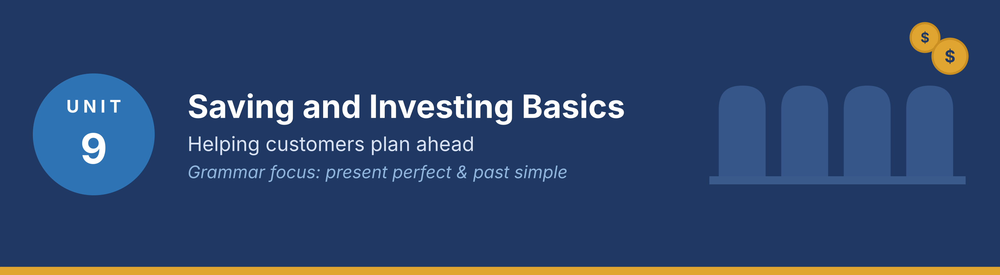

*In this unit you learn the language of saving and investing, how to talk about what a customer has done and what they did, how to help someone plan, and how to write a short saving plan. Grammar focus: present perfect and past simple.*

## Part · · Warm-Up
*In-class starter · speak before you read*


### W-A  Why we save (discussion)
*In small groups, talk about why people save money.*

> **Model — read this first**
> Some people save for something they want, like a car. Others save because they are worried about losing their job. Both are good reasons, but they need different accounts.

- What do people in your country save for most often?
- What stops people from saving?


### W-B  A saving goal (think–pair)
*Think of one goal, then tell your partner three things about it.*

- How much is the goal, and when do you want to reach it?
- How much would you need to put aside each month?

*Useful words: Use the words goal, amount, monthly and interest in your answers.*


## Part 1 · Vocabulary
*Pre-class input*


### 1A  Match the term to the meaning
*Match each saving word (1–8) to the correct meaning (a–i). One meaning is extra.*

**Example: 0. Budget → h)**


| Column A | Column B |
|---|---|
| 1. Interest ____ | **a)** what the bank pays you for keeping your money |
| 2. Compound interest ____ | **b)** interest paid on your interest as well as on your savings |
| 3. Emergency fund ____ | **c)** money kept for something unexpected |
| 4. Goal ____ | **d)** the amount you are saving towards |
| 5. Risk ____ | **e)** the chance that the value can fall |
| 6. Return ____ | **f)** what your money earns |
| 7. Investment ____ | **g)** money put into something that may grow or fall |
| 8. Inflation ____ | **h)** the way prices rise over time |
|  | **i)** a charge for sending money abroad (extra) |

*Pronunciation — word stress. Say these words: IN·te·rest, in·VEST·ment, in·FLA·tion, e·MER·gen·cy.*


### 1B  Sort the words
*Put each word from 1A into the correct group.*

- About saving: ____
- About investing: ____
- About the money losing value: ____

> **Model — read this first**
> About saving: interest, compound interest, emergency fund, goal. About investing: risk, return, investment. About the money losing value: inflation.


### 1C  Complete the sentences
*Complete the sentences with the correct word.*

**Word bank:** interest | goal | risk | return | inflation | emergency | monthly | regular | compound

**Example: 0. Small regular amounts are easier than one large one.**

1. Her ______________________ is six thousand by next December.
2. We suggest keeping three months’ expenses as an ______________________ fund.
3. A savings account has almost no ______________________, but the ______________________ is small.
4. ______________________ interest means you earn interest on your interest.
5. If prices rise faster than your interest, ______________________ is taking the difference.
6. A ______________________ transfer on payday is the easiest way to save.


### 1D  Word partners (collocations)
*Match the verb to the noun to make a common saving phrase (one noun is extra).*


| Column A | Column B |
|---|---|
| 1. set ____ | **a)** interest |
| 2. reach ____ | **b)** a risk |
| 3. earn ____ | **c)** a goal |
| 4. take ____ | **d)** your savings |
| 5. build up ____ | **e)** the target |
|  | **f)** a queue (extra) |


### 1E  Write with the words (40–60 words)
*Write about one saving goal, yours or a customer’s. Use at least five words from Part 1.*

> **Model — read this first**
> My customer has set a goal of six thousand for a deposit. She has already saved two thousand, and she puts aside two hundred on payday. The account earns a small amount of interest, and she keeps one month’s expenses as an emergency fund.

**Check before you finish**
- ☐ Five Part-1 words?
- ☐ 40–60 words?
- ☐ Short, clear sentences?

> ✎ *Write your response here.*

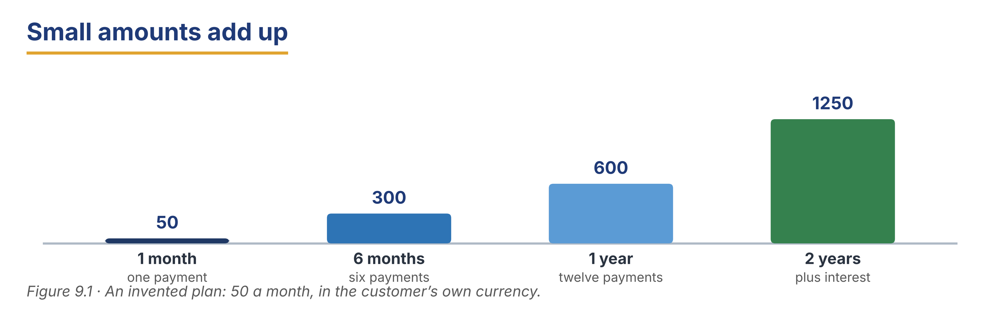


## Part 2 · Grammar — Present Perfect and Past Simple
*Pre-class input*


### 2A  Notice the grammar
*Read the short dialogue. Underline the present perfect and the past simple. Which one gives a finished time?*

```
Johanna: How long have you been saving?
Customer: I opened the account in March, so about eight months.
Johanna: And how much have you saved so far?
Customer: Two thousand. I added three hundred last month, which was a good month.
Johanna: You have done better than you think.
```

1. “I opened the account in March” — why the past simple? ____
2. “How much have you saved so far?” — is the saving finished? ____
3. “I added three hundred last month” — finished or continuing? ____


### Grammar Focus

| Form | Use | Example |
|---|---|---|
| Past simple | a finished time is given or understood | I opened the account in March. |
| Present perfect | from the past up to now; no finished time | I have saved two thousand so far. |
| Present perfect with for / since | how long something has continued | I have saved since March. / for eight months. |

> **Remember:** a finished time word — yesterday, last month, in March, in 2023 — takes the past simple. so far, already, yet, ever and since take the present perfect.

> **⚠ Watch out!**
> ✗ I have opened the account in March. → ✓ I opened the account in March.
> ✗ I save since March. → ✓ I have saved since March.


### 2B  Controlled practice (which tense?)
*Write the correct form of the verb in brackets.*

**Example: 0. I ____ (save) two thousand so far. → have saved.**

1. She ______________________ (open) the account last March.
2. We ______________________ (not reach) the goal yet.
3. How much ______________________ you ______________________ (put) aside this year?
4. He ______________________ (add) three hundred last month.
5. I ______________________ (save) for this since January.
6. They ______________________ (never invest) in anything before.


### 2C  Error correction
*Find and correct the mistake in each sentence.*

**Example: 0. I have opened it in March. → I opened it in March.**

1. She has reached her goal last week.
2. I save since January.
3. We didn’t reached the target yet.
4. How long do you save for this?
5. He has added three hundred yesterday.

> ✎ *Write your response here.*


### 2D  Talk about saving
*Write three sentences about a customer’s saving: two in the present perfect and one in the past simple.*

> **Model — read this first**
> She has saved two thousand so far. She has been putting money aside since March. She opened the account last year, after she changed jobs.

> ✎ *Write your response here.*


### 2E  Freer practice (speaking)
*In pairs, ask and answer about saving. Use both tenses.*

> **Model — read this first**
> “How long have you been saving? … And when did you start putting money aside each month?”

*Tip: You will see both tenses again in the reading in Part 5 (5A and 5B). Look for them there.*

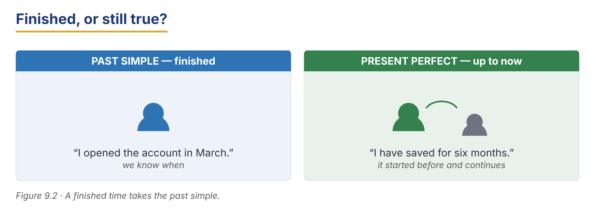


## Part 3 · Listening
*Pre-class input · scripts printed below*


### 3A  Before you listen (predict)
*You will hear three conversations about saving. What does a customer want to know first?*

> **Model — read this first**
> “I think the customer will ask how much she needs to save each month to reach her goal.”


### 3B  Setting a savings goal
**🔊 Audio 9.1** (optional) — or read the script below.

```
Customer: I would like to save for a deposit on a flat.
Johanna: That is a good goal. How much have you saved so far?
Customer: About two thousand. I started in March.
Johanna: Then you have saved two thousand in eight months — two hundred and fifty a month. If you keep that up, you will reach six thousand by next December.
Customer: I hadn’t worked it out like that.
```

*Read and decide: True, False, or Not Given.*

**Example: 0. The customer is saving for a flat. → True.**

1. The customer started saving in March.
2. She has saved about six thousand so far.
3. She will definitely buy the flat next year.

*Useful language: How much have you saved so far? · If you keep that up, you will reach… · I hadn’t worked it out like that.*


### 3C  Saving experience
**🔊 Audio 9.2** (optional) — or read the script below.

```
Johanna: Have you ever saved regularly before?
Customer: I tried two years ago, but I stopped after four months.
Johanna: What happened?
Customer: My car broke down, and I used all of it. Then I felt I had failed, so I didn’t start again.
Johanna: That is very common. It is why we suggest two accounts: one for the goal, and a small emergency fund so the goal is not touched.
```

*Read and decide: True or False.*

1. The customer has saved regularly before.
2. She stopped because of an unexpected cost.
3. She started again straight away.
4. The adviser suggests keeping two accounts.


### 3D  Saving or investing? (longer)
**🔊 Audio 9.3** (optional) — or read the script below.

```
Customer: My brother says I should invest, not save. He has made a lot this year.
Johanna: May I ask when he will need that money?
Customer: He doesn’t need it. He already has a house.
Johanna: That is the difference. Investing can give a better return over many years, but the value can fall. Saving gives a smaller return, but the amount does not go down.
Customer: So which should I do?
Johanna: It depends on your goal. For money you need in two years, I would save. For twenty years, my answer would differ.
Customer: And my brother?
Johanna: He is answering a different question. He already has his house.
```

*Read and decide: True, False, or Not Given.*

**Example: 0. The brother has made money this year. → True.**

1. Investing always gives a better return than saving.
2. The customer needs the money in about two years.
3. The adviser tells the customer her brother is wrong.


### 3E  Match the idea
*Match each phrase from the listenings to what it means (one is extra).*


| Column A | Column B |
|---|---|
| 1. “How much have you saved so far?” ____ | **a)** asking about progress up to now |
| 2. “I stopped after four months.” ____ | **b)** a finished event in the past |
| 3. “The value can fall.” ____ | **c)** describing risk |
| 4. “A small emergency fund” ____ | **d)** money kept so the goal is not touched |
|  | **e)** “Your card has been blocked.” (extra) |

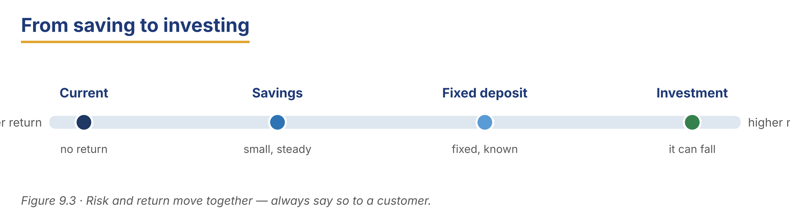


## Part 4 · Speaking
*In-class output*


### 4A  Functional language — talking about saving
*Match the function to a phrase (one is extra).*


| Column A | Column B |
|---|---|
| 1. Ask about progress ____ | **a)** “How much have you saved so far?” |
| 2. Ask about the goal ____ | **b)** “When will you need the money?” |
| 3. Explain risk ____ | **c)** “The value can fall as well as rise.” |
| 4. Encourage ____ | **d)** “You have done better than you think.” |
|  | **e)** “Your card has been declined.” (extra) |


### 4B  Help a customer plan (pairwork)
*Help a customer turn a wish into a plan. Then swap roles.*

> **Model — read this first**
> A: How much have you saved so far? — B: About two thousand. — A: And when do you want the money? — B: In two years. — A: Then two hundred a month will get you there. Shall we set up a standing transfer on payday?

**Card A (adviser):** ask about progress · ask about the goal and the date · do the arithmetic aloud · suggest one action.

**Card B (customer):** you want 8,000 in three years; you have 1,500; you are paid on the 28th.


### 4C  Saving or investing?
*A customer asks whether to invest. Explain the difference honestly without giving financial advice.*

> **Model — read this first**
> “Both can be right, but they answer different questions. Saving gives a smaller return and the amount does not go down. Investing can give more over many years, but the value can fall. The question is when you will need the money.”

*Stretch: the customer asks “What would you do?” — answer professionally and stay within your role.*


### 4D  Find the information (pairwork info-gap)
*Student A is an adviser; Student B is a customer. Ask and answer to build a plan.*

**Card A (adviser):** Everyday Saver, withdraw any day · Step Saver, two withdrawals a year · standing transfer free on any payday.

**Card B (customer):** you have 1,500 saved; your goal is 8,000 in three years; you have no emergency fund; you were paid yesterday.

*Useful language: How much have you saved so far? · When did you start? · How much could you put aside each month?*


### 4E  Close the meeting
*Match the closing phrase to the situation (one is extra).*


| Column A | Column B |
|---|---|
| 1. “Shall I set up the transfer for payday?” ____ | **a)** moving to action |
| 2. “You have done better than you think.” ____ | **b)** encouraging the customer |
| 3. “Come back in six months and we’ll review it.” ____ | **c)** planning the next step |
| 4. “Nothing here is fixed; you can change it.” ____ | **d)** leaving the customer in control |
|  | **e)** “Please take a seat.” (extra) |

*In pairs, close a savings meeting warmly. Use two phrases above.*


## Part 5 · Reading
*Pre-class input*


### 5A  Simple ways to save
*Read the customer leaflet. Notice the present perfect and the past simple.*

> **Harbour Bank — Five Habits That Build Savings** — *About 200 words*
>
> Most people who have built real savings did not earn more than their neighbours. First, they paid themselves first. They set up a transfer on payday, so the money left the current account before it could be spent. Second, they started small. A customer who began with twenty a month five years ago has saved far more than one who waited for the perfect moment and never started. Third, they kept an emergency fund. A saver without a buffer has to take money from the goal, and often gives up. Fourth, they gave the goal a name and a date. “Six thousand by December” works; “some savings one day” does not. Fifth, they reviewed it twice a year, and they were honest when it was not working. One of our customers has saved for three goals since 2021 and has missed her target twice. She moved the date and carried on, and she has now reached the third. That is the real habit: not perfect saving, but saving that survives a bad month.

*Answer the questions.*

**Example: 0. How many habits does the leaflet give? → Five.**

1. What does “paying yourself first” mean in practice?
2. Why is an emergency fund important for a saver?
3. What is the difference between a good goal and a bad one?
4. What did the customer do when she missed her target?
5. What does the leaflet say the real habit is?


### 5B  Grammar in context (from 5A)
*Look back at the leaflet. Find two present perfect verbs and two past simple verbs.*

1. Present perfect: ____ , ____
2. Past simple: ____ , ____

*Now complete these sentences about the customer.*

1. She ______________________ (save) for three goals since 2021.
2. She ______________________ (miss) her target twice.


### 5C  Saving and investing — the simple idea
*Read the short note. What is the one question that decides?*

> **One Question Decides** — *About 120 words*
>
> Customers often ask whether they should save or invest, and they expect a complicated answer. It is simpler than they think. Saving means the amount does not go down, and it grows slowly. Investing means the amount can go up or down, and over many years it has usually grown more. The one question that decides is: when will you need this money? If the answer is within about three years, save it, because a fall in value just before you need it cannot be waited out. If the answer is ten years or more, investing deserves a conversation. And if a customer cannot sleep at night, the answer is saving, whatever the arithmetic says.

1. What is the difference between saving and investing, in one line each?
2. What is the one question that decides?
3. What should the answer be if a customer cannot sleep?


### 5D  Discussion
*In pairs, compare saving habits where you live.*

*Useful frame: “In my country people usually save for ___, and they ___.”*

- Which of the five habits is hardest where you live?
- What would you add to the list?

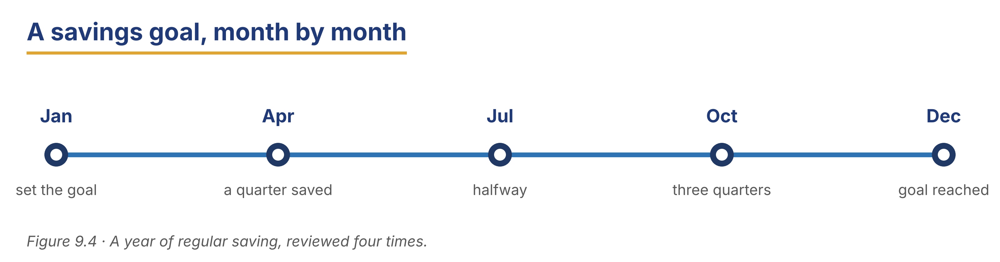


## Part 6 · Writing
*In-class / homework output*


### 6A  Guided writing — complete the saving plan
*Complete the plan with the words: goal, aside, payday, reached, review.*

**Word bank:** goal | aside | payday | reached | review

1. Your ______________________ is six thousand by next December.
2. You have ______________________ two thousand so far.
3. You will put two hundred and fifty ______________________ each month.
4. The transfer will leave your account on ______________________.
5. We will ______________________ the plan in six months.


### 6B  A short saving plan (50–70 words)
*Write a short saving plan for a customer. Use one present perfect and one past simple.*

> **Model — read this first**
> Subject: Your saving plan
> Dear Ms Cruz, Thank you for coming in. You opened the account in March and you have saved two thousand so far — about two hundred and fifty a month. To reach six thousand by December, we will keep that amount and move the transfer to payday. We will review the plan in six months. Kind regards, Johanna Berg

*Plan: Subject: ___ · Dear ___, · You opened ___ and you have saved ___. · To reach ___, we will ___. · We will review ___. · Kind regards, ___*

*Phrase bank: you have saved ___ so far · you opened the account in… · to reach ___ by ___ · we will review the plan in…*

**Check before you finish**
- ☐ A clear subject line?
- ☐ One present perfect and one past simple?
- ☐ A date for the review?
- ☐ 50–70 words?

> ✎ *Write your response here.*


### 6C  Reply to a customer about investing (50–70 words)
*A customer asks whether she should invest her deposit money. Write an honest, careful reply.*

> **Model — read this first**
> Subject: Your question about investing
> Dear Ms Cruz, Thank you for your question. You have told me that you will need this money in about two years. For money needed that soon, saving is usually the better choice, because the value of an investment can fall just when you need it. If your plans change, we can look at it again. Kind regards, Johanna Berg

*Plan: Subject: ___ · Dear ___, · Thank you for ___. · You have told me ___. · For money needed ___, ___. · If ___, we can ___. · Kind regards, ___*

**Check before you finish**
- ☐ An honest, careful tone?
- ☐ One present perfect?
- ☐ No promise about returns?
- ☐ 50–70 words?

> ✎ *Write your response here.*


### 6D  Peer check
*Swap your plan or reply with a partner. Give one piece of positive feedback and one suggestion.*

*Checklist: subject line? · both tenses? · a date given? · 50–70 words?*

> **Model — read this first**
> “The arithmetic is clear and the tone is honest. Next time, try to name the review date rather than saying ‘in a few months’.”


## Part 7 · Management File — Coaching a Savings Goal
*Practitioner track (optional for beginners) · experienced staff*


### 7A  Coaching phrases
*Match the phrase to its purpose (one is extra).*


| Column A | Column B |
|---|---|
| 1. “How much have you saved so far?” ____ | **a)** starting from where the customer is |
| 2. “What got in the way last time?” ____ | **b)** finding the real obstacle |
| 3. “Shall we move the date rather than stop?” ____ | **c)** keeping the goal alive |
| 4. “You have done better than you think.” ____ | **d)** giving honest encouragement |
|  | **e)** closing an account (extra) |


### 7B  Listening — coaching a customer
**🔊 Audio 9.4** (optional) — or read the script below.

```
Johanna: You have saved two thousand since March. That is better than you think.
Customer: It doesn’t feel like it. I wanted three by now.
Johanna: May I ask what got in the way?
Customer: My car. It cost eight hundred in July and I never caught up.
Johanna: Then the plan was missing a buffer, not the discipline. Shall we move the date to February and start a small emergency fund alongside?
Customer: That feels possible.
```

*Answer the questions.*

**Example: 0. How much has the customer saved? → Two thousand.**

1. What got in the way in July?
2. What does Johanna say was missing from the plan?
3. What two changes does Johanna suggest?


### 7C  Controlled practice — the coaching summary
*Complete the coaching summary. Use the present perfect or the past simple.*

**Example: 0. She ____ (save) two thousand since March. → has saved.**

1. She ______________________ (open) the account in March.
2. She ______________________ (save) two thousand so far.
3. Her car ______________________ (cost) eight hundred in July.
4. She ______________________ (not reach) the original target.
5. We ______________________ (agree) a new date today.

> ✎ *Write your response here.*


### 7D  Role play — coach a customer
*A customer has missed her savings target and wants to give up. Coach her without judging.*

> **Model — read this first**
> “You have saved two thousand since March, which is more than most people manage. May I ask what got in the way? … Then the plan was missing a buffer, not the discipline. Shall we move the date rather than stop?”

**Card A (adviser):** start from what has been done · find the obstacle · name it kindly · offer two changes.

**Card B (customer):** you have saved 2,000 since March; your car cost 800 in July; you feel you have failed.

*Stretch: the customer says she wants to stop altogether — keep the door open without pressure.*


### 7E  Writing — a coaching summary note (50–70 words)
*Write a short note summarising the meeting for the customer’s file.*

> **Model — read this first**
> Subject: Savings review — Ms Cruz
> Ms Cruz opened the account in March and has saved two thousand since then. She did not reach the original target because of an unexpected car repair in July. We have agreed a new date of February and a small emergency fund alongside the goal. Review again in three months. Johanna Berg

*Plan: Subject: ___ · ___ opened ___ and has saved ___. · She did not ___ because ___. · We have agreed ___. · Review again ___.*

*Phrase bank: has saved ___ since… · did not reach the target because… · we have agreed… · review again in…*

**Check before you finish**
- ☐ A clear subject line?
- ☐ One present perfect and one past simple?
- ☐ The agreed next step?
- ☐ 50–70 words?

> ✎ *Write your response here.*


## Part 8 · Global Case Study — The Savings Habit
*Practitioner track · read then discuss*

*Before you read: what would make you save without thinking about it?*

> **The Default That Changed Everything** — *About 200 words · a made-up example based on real practice*
>
> A bank in several countries wanted more of its customers to save. For years it had explained why saving matters: leaflets, posters, a line in every statement. Almost nothing changed. Then it tried something much smaller. When a customer opened a current account, the form had a box already ticked: “Move 5% of each salary to a savings account.” The customer could untick it in one second, and many did. But most did not, and most of those who left it ticked were still saving two years later. The bank called this the default. It had not persuaded anybody. It had simply changed which choice required effort. The result was uncomfortable as well as useful. Some customers said later that they had not noticed the box, and the bank agreed that a default must be obvious, easy to undo, and never hidden. It moved the box to its own line, in larger type, and take-up fell a little. The bank accepted that. A habit that depends on the customer not reading the form is not a habit the bank should want.

**Glossary help**
- **default** — the choice that happens if you do nothing
- **to opt out** — to say no to something you were given automatically
- **habit** — something you do regularly without deciding each time
- **take-up** — how many people accept something offered


### 8A  Comprehension
**Example: 0. What did the bank try for years? → Explaining why saving matters.**

1. What was the small change the bank made?
2. What happened to most customers who left the box ticked?
3. Why did the bank move the box to its own line?
4. What principle did the bank accept at the end?


### 8B  Vocabulary in context
*Match the word to its meaning (one is extra).*


| Column A | Column B |
|---|---|
| 1. default ____ | **a)** to say no to something you were given automatically |
| 2. to opt out ____ | **b)** the choice that happens if you do nothing |
| 3. habit ____ | **c)** how many people accept something offered |
| 4. take-up ____ | **d)** something you do regularly without deciding each time |
|  | **e)** a charge for a service (extra) |


### 8C  Discussion
*Frames: “A default like this would work in my country because ___.” “It would be unfair if ___.”*

- Is a pre-ticked box fair? Why, or why not?
- What default would help your customers most?


### 8D  Your view (short write, 30–40 words)
*Should a bank set a saving default for new customers? Give one reason.*

> ✎ *Write your response here.*


## Part 9 · Branch Case Study — Nairobi in Focus: Saving When Prices Rise
*Practitioner track · read then decide*

*Before you read: what is the point of saving when prices are rising quickly?*

> **The Interest That Is Not Enough** — *About 185 words*
>
> Mrs Wanjiru has saved with the Nairobi branch for four years. She has built up just over three thousand, which she keeps for her children’s school fees. This morning she has come in angry, holding a statement. Her account has paid interest every year, exactly as promised, but the school fees have risen faster. In real terms, she says, she has less than she had two years ago, and she is right. She wants to move all of it into something that pays more, and she has been told by a neighbour about an investment scheme promising a high monthly return. Grace Otieno, at the counter, knows two things at once. The first is that Mrs Wanjiru’s complaint about inflation is correct and should not be brushed aside. The second is that a scheme promising a high fixed monthly return is almost always a fraud, and the fees are due in six weeks. Grace cannot give investment advice, and she must not simply tell a customer what to do with her own money.


### 9A  Comprehension
**Example: 0. How long has Mrs Wanjiru saved here? → Four years.**

1. Why does Mrs Wanjiru feel she has less than before?
2. What has her neighbour told her about?
3. What two things does Grace know at the same time?


### 9B  Decision task
*What should Grace do? Write 40–60 words. Use the frame and the phrase bank.*

> **Model — read this first**
> I think Grace should agree with Mrs Wanjiru about inflation first, because her complaint is correct and she needs to be heard. Then she should explain that a high fixed monthly return is a warning sign. Also, she can offer a fixed deposit for the money not needed in six weeks.

*Frame: I think Grace should ___, because ___. Also, ___.*

*Phrase bank: agree with the part that is true · explain why a fixed high return is a warning sign · keep the fee money where it cannot fall · offer an appointment with an adviser*

> ✎ *Write your response here.*


## Part 10 · Review & Can-Do
*Homework / self-study*


### 10A  Spiral review
*Complete the sentences. Use the present perfect, the past simple, or the correct word. Items 5–6 review Units 7 and 8.*

**Example: 0. I ____ (save) two thousand so far. → have saved.**

1. She ______________________ (open) the account in March.
2. We ______________________ (not reach) the target yet.
3. Money kept for something unexpected is an ______________________ fund. (word)
4. The way prices rise over time is called ______________________. (word)
5. If you share a one-time code, anyone ______________________ use your account. (Unit 7 conditional)
6. Staff ______________________ share a customer’s details. (Unit 8 obligation)


### 10B  Can-Do checklist
**Can-Do checklist — tick what you can do now**
- ☐ I can name the basic words of saving and investing.
- ☐ I can use the present perfect and the past simple correctly.
- ☐ I can help a customer turn a wish into a plan.
- ☐ I can understand a short conversation about saving.
- ☐ I can write a short saving plan or review note.


### 10C  Unit glossary
**Glossary help**
- **interest** — what the bank pays you for keeping your money
- **compound interest** — interest paid on your interest as well as on your savings
- **emergency fund** — money kept for something unexpected
- **goal** — the amount you are saving towards
- **risk** — the chance that the value can fall
- **return** — what your money earns
- **investment** — money put into something that may grow or fall
- **inflation** — the way prices rise over time
- **default** — the choice that happens if you do nothing
- **take-up** — how many people accept something offered


# Unit 10 · Corporate Banking
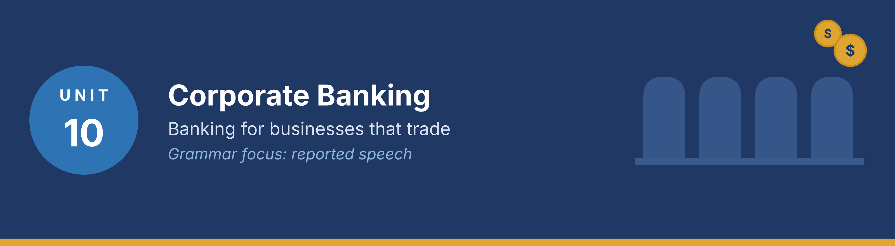

*In this unit you learn the language of banking for businesses, how to report what a customer said, how to follow a meeting, and how to write a meeting note and a business reply. Grammar focus: reported speech.*

## Part · · Warm-Up
*In-class starter · speak before you read*


### W-A  Business customers (discussion)
*In small groups, talk about the businesses that bank with you.*

> **Model — read this first**
> We have a bakery, two builders and a small import company. The import company is the most complicated, because it pays suppliers abroad.

- What kinds of business bank at your branch?
- What do they need that a personal customer does not?


### W-B  Passing on a message (think–pair)
*Think for one minute, then compare with a partner.*

- Your colleague says, “I need the figures by Friday.” How do you tell the manager?
- Why is it important to report exactly, and not nearly?

*Useful words: Use said, told and asked in your answers.*


## Part 1 · Vocabulary
*Pre-class input*


### 1A  Match the term to the meaning
*Match each business-banking word (1–8) to the correct meaning (a–i). One meaning is extra.*

**Example: 0. Receipt → h)**


| Column A | Column B |
|---|---|
| 1. Business account ____ | **a)** a bank account for a company |
| 2. Invoice ____ | **b)** a bill asking a customer to pay |
| 3. Payroll ____ | **c)** the money a company pays its staff |
| 4. Cash flow ____ | **d)** money coming in and going out of a business |
| 5. Facility ____ | **e)** an arrangement to borrow up to a limit |
| 6. Supplier ____ | **f)** a company that sells goods to a business |
| 7. Letter of credit ____ | **g)** a bank promise to pay a seller when documents are shown |
| 8. Relationship manager ____ | **h)** one bank contact who knows the business |
|  | **i)** a card used only inside one country (extra) |

*Pronunciation — word stress. Say these words: IN·voice, PAY·roll, fa·CI·li·ty, sup·PLI·er.*


### 1B  Sort the words
*Put each word from 1A into the correct group.*

- Money coming in: ____
- Money going out: ____
- The bank’s part: ____

> **Model — read this first**
> Money coming in: invoice, cash flow. Money going out: payroll, supplier. The bank’s part: business account, facility, letter of credit, relationship manager.


### 1C  Complete the sentences
*Complete the sentences with the correct word.*

**Word bank:** invoice | payroll | facility | cash flow | supplier | limit | overdue | trade | credit

**Example: 0. A business account is for a company, not a person.**

1. We run the ______________________ on the 25th of every month.
2. The customer has asked for a ______________________ of fifty thousand.
3. Three of her ______________________ are now ______________________ by more than sixty days.
4. A letter of ______________________ is used when the buyer and the seller are in different countries.
5. Her ______________________ is good in summer but weak in January.
6. We pay our main ______________________ in another currency.


### 1D  Word partners (collocations)
*Match the verb to the noun to make a common business-banking phrase (one noun is extra).*


| Column A | Column B |
|---|---|
| 1. raise ____ | **a)** payroll |
| 2. run ____ | **b)** the facility |
| 3. chase ____ | **c)** an invoice |
| 4. agree ____ | **d)** a supplier |
| 5. pay ____ | **e)** an overdue payment |
|  | **f)** a queue (extra) |


### 1E  Write with the words (40–60 words)
*Write about one business customer, real or invented. Use at least five words from Part 1.*

> **Model — read this first**
> Our customer runs a small printing business. She raises about thirty invoices a month and runs the payroll on the 25th. Her cash flow is weak in January, so we have agreed a small facility. She pays one supplier abroad, in another currency.

**Check before you finish**
- ☐ Five Part-1 words?
- ☐ 40–60 words?
- ☐ Short, clear sentences?

> ✎ *Write your response here.*

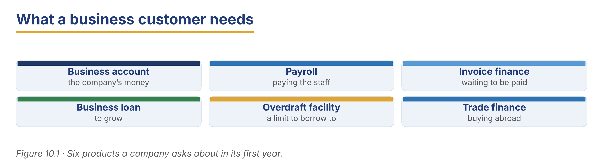


## Part 2 · Grammar — Reported Speech
*Pre-class input*


### 2A  Notice the grammar
*Read the short dialogue. Underline the reported sentences. What happens to the tense?*

```
Priya: What did the customer say?
Diego: She said she needed a facility of fifty thousand.
Priya: Did she say why?
Diego: She told me that three invoices were overdue, and she asked whether we could decide by Friday.
Priya: Then I will call her tomorrow.
```

1. “I need a facility” → “She said she ______________________ a facility.”
2. said / told — which one is followed by a person? ____
3. asked whether — what kind of sentence is being reported? ____
4. “by Friday” — does a time word ever change in reported speech? ____


### Grammar Focus

| Direct | Reported |
|---|---|
| “I need a facility.” | She said she needed a facility. |
| “We have paid.” | He said they had paid. |
| “Can you decide by Friday?” | She asked whether we could decide by Friday. |

> **Remember:** the verb usually steps back one tense: present → past, present perfect → past perfect, can → could, will → would. Say takes no person; tell takes one (she told me).

> **⚠ Watch out!**
> ✗ She said me that she needed it. → ✓ She told me that she needed it.
> ✗ He said he has paid. → ✓ He said he had paid.


### 2B  Controlled practice (report what they said)
*Report each sentence. Use said, told or asked.*

**Example: 0. “The account is ready.” (she) → She said the account was ready.**

1. “I need a facility.” (he)
2. “We have paid the invoice.” (she)
3. “Can you decide by Friday?” (she, to me)
4. “We are opening a second shop.” (they)
5. “I will send the figures tomorrow.” (he, to us)


### 2C  Error correction
*Find and correct the mistake in each sentence.*

**Example: 0. She said me she needed it. → She told me she needed it.**

1. He said he has paid the invoice.
2. She told that the figures were ready.
3. They asked me can we decide by Friday.
4. He said me the payroll runs on the 25th.
5. She said she will send it tomorrow.

> ✎ *Write your response here.*


### 2D  Report a customer
*Write three reported sentences from a meeting you have had, or invent one.*

> **Model — read this first**
> She said that three invoices were overdue. She told me that her cash flow was weak in January. She asked whether we could decide by Friday.

> ✎ *Write your response here.*


### 2E  Freer practice (speaking)
*In pairs, one of you is a customer and one takes notes. Then report the meeting to a third person.*

> **Model — read this first**
> “She said she needed a facility of fifty thousand, and she told me that three invoices were overdue.”

*Tip: You will see reported speech again in the reading in Part 5 (5A and 5B). Look for it there.*

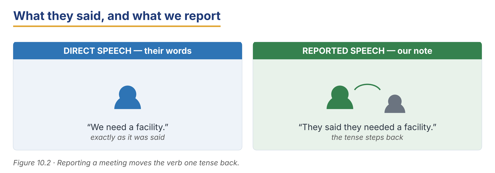


## Part 3 · Listening
*Pre-class input · scripts printed below*


### 3A  Before you listen (predict)
*You will hear three business conversations. What does a company ask a bank for first?*

> **Model — read this first**
> “I think the customer will ask to open a business account, and then about borrowing.”


### 3B  Opening a business account
**🔊 Audio 10.1** (optional) — or read the script below.

```
Customer: I have just registered my company and I need a business account.
Luca: Congratulations. May I ask what the company does?
Customer: We import coffee and sell it to cafés.
Luca: Then you will be paying suppliers abroad. We should set the account up for international payments from the start. Could you bring the registration documents and the ID of every owner?
Customer: There are two of us.
```

*Read and decide: True, False, or Not Given.*

**Example: 0. The customer has registered a company. → True.**

1. The company sells only inside the country.
2. The bank needs the ID of each owner.
3. The account will be opened today.

*Useful language: May I ask what the company does? · We should set the account up for… · Could you bring the registration documents?*


### 3C  Reporting a meeting
**🔊 Audio 10.2** (optional) — or read the script below.

```
Priya: How did the meeting go?
Diego: Well. She said she needed a facility of fifty thousand.
Priya: Did she say why?
Diego: She told me that three invoices were overdue by more than sixty days, and that the payroll runs on the 25th.
Priya: And the decision?
Diego: She asked whether we could decide by Friday. I said I would call her tomorrow.
```

*Read and decide: True or False.*

1. The customer asked for fifty thousand.
2. Two invoices are overdue.
3. The payroll runs on the 25th.
4. Diego promised a decision on Friday.


### 3D  A business loan inquiry (longer)
**🔊 Audio 10.3** (optional) — or read the script below.

```
Customer: We have an order from a buyer abroad, the largest we have ever had.
Priya: When do you have to pay your supplier?
Customer: That is the problem. He wants paying before shipping, and the buyer will not pay until the goods arrive. Eleven weeks in between.
Priya: Common in trade. One answer is a facility: you borrow for eleven weeks and repay when the buyer pays. The other is a letter of credit, where our bank pays the seller against the shipping documents.
Customer: Which is better?
Priya: A facility helps your cash flow. A letter of credit reassures a supplier who does not know you.
Customer: They have already asked for one.
```

*Read and decide: True, False, or Not Given.*

**Example: 0. The order is the largest the company has had. → True.**

1. The buyer pays before the goods are shipped.
2. A letter of credit reassures a supplier who does not know the buyer.
3. The supplier has already asked for a letter of credit.


### 3E  Match the report
*Match each direct sentence to its correct report (one is extra).*


| Column A | Column B |
|---|---|
| 1. “I need a facility.” ____ | **a)** She said she needed a facility. |
| 2. “We have paid.” ____ | **b)** He said they had paid. |
| 3. “Can you decide by Friday?” ____ | **c)** She asked whether we could decide by Friday. |
| 4. “The payroll runs on the 25th.” ____ | **d)** She told me the payroll ran on the 25th. |
|  | **e)** She said she will call us. (extra) |

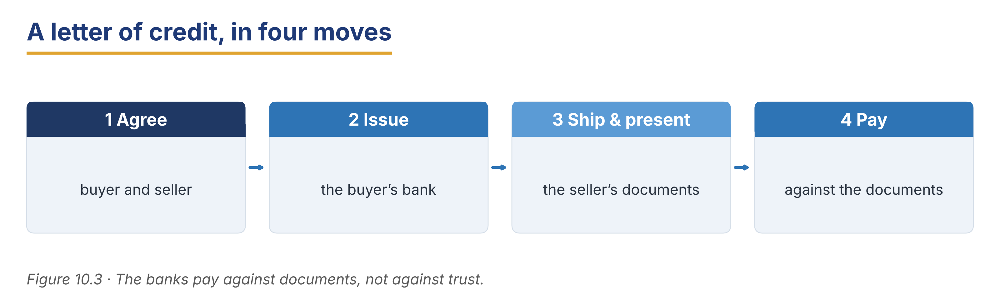


## Part 4 · Speaking
*In-class output*


### 4A  Functional language — business talk and reporting
*Match the function to a phrase (one is extra).*


| Column A | Column B |
|---|---|
| 1. Open a business meeting ____ | **a)** “May I ask what the company does?” |
| 2. Check a figure ____ | **b)** “Could you confirm the amount for me?” |
| 3. Report what was said ____ | **c)** “She told me that three invoices were overdue.” |
| 4. Agree a next step ____ | **d)** “I will call you tomorrow with an answer.” |
|  | **e)** “Your card has been declined.” (extra) |


### 4B  Meet a business customer (pairwork)
*Hold a short meeting with a business customer, then swap roles.*

> **Model — read this first**
> A: May I ask what the company does? — B: We import coffee. — A: And what do you need from us? — B: A facility of fifty thousand. — A: Could you confirm when the payroll runs? I will call you tomorrow.

**Card A (relationship manager):** ask what the business does · ask what is needed · check two figures · agree a next step.

**Card B (business customer):** you import coffee; three invoices are overdue; payroll runs on the 25th; you need an answer by Friday.


### 4C  Report the meeting
*Report the meeting from 4B to a colleague. Use at least three reported sentences.*

> **Model — read this first**
> “She said she needed a facility of fifty thousand. She told me that three invoices were overdue by sixty days. She asked whether we could decide by Friday.”

*Stretch: your colleague asks a question you did not ask in the meeting — say so honestly.*


### 4D  Find the information (pairwork info-gap)
*Student A is a relationship manager; Student B is a colleague in credit. Ask and answer to complete the file.*

**Card A (relationship manager):** you met the customer; facility 50,000; three invoices overdue 60+ days; payroll on the 25th; answer wanted by Friday.

**Card B (credit):** you need the amount, the reason, the date of the payroll and the deadline, and you must know whether the customer has borrowed before.

*Useful language: What did she say she needed? · Did she tell you why? · Did she ask for a date?*


### 4E  Close the meeting
*Match the closing phrase to the situation (one is extra).*


| Column A | Column B |
|---|---|
| 1. “Let me read my notes back to you.” ____ | **a)** checking you have understood |
| 2. “I will call you tomorrow with an answer.” ____ | **b)** agreeing the next step |
| 3. “I cannot promise it, but I will put the case.” ____ | **c)** being honest about the decision |
| 4. “Could you send the last three statements?” ____ | **d)** asking for what is missing |
|  | **e)** “Please take a seat.” (extra) |

*In pairs, close a business meeting professionally. Use two phrases above.*


## Part 5 · Reading
*Pre-class input*


### 5A  Banking for business
*Read the business page. Notice the reported speech.*

> **Harbour Bank — Banking for Businesses That Trade** — *About 200 words*
>
> Every business that banks with us is given one contact, a relationship manager, who knows what the company does. That matters most when a business trades across borders. Last year one of our customers, a coffee importer, told us that her supplier had refused to ship before payment, while her buyer would not pay until the goods arrived. She said there were eleven weeks between the two, and she asked whether we could help. We offered two things. The first was a facility: an arrangement to borrow up to an agreed limit and repay when the buyer pays. The second was a letter of credit: a promise by this bank to pay the seller when the shipping documents are presented. Each solves a different problem. A facility helps the customer’s cash flow. A letter of credit reassures a supplier who does not know the buyer. We also run payroll and pay suppliers in nine currencies. Our customers tell us that the useful part is having one person who already knows the business when the difficult week arrives.

*Answer the questions.*

**Example: 0. What is a relationship manager? → One bank contact who knows the business.**

1. What problem did the coffee importer describe?
2. What is a facility, and what problem does it solve?
3. What is a letter of credit, and who does it reassure?
4. What three other services are mentioned?
5. What do customers say the useful part is?


### 5B  Grammar in context (from 5A)
*Look back at the business page. Find three reported sentences.*

1. Reported sentence 1: ____
2. Reported sentence 2: ____
3. Reported sentence 3: ____

*Now report these sentences as the page would.*

1. “My supplier will not ship before payment.” → She said ____
2. “We can help.” → We told her ____


### 5C  The relationship manager
*Read the short profile. What does a relationship manager actually do?*

> **A Day With Priya** — *About 120 words*
>
> Priya Raman has eleven business customers, and she has worked with some of them for six years. She says most of her day is not banking at all: she reads, she listens, and she writes things down. In the morning she met a builder who told her that two of his customers had stopped paying. In the afternoon she wrote a short note for the credit team saying exactly what he had said, with the figures and the dates, and nothing else. “My job,” she says, “is to arrive at the credit meeting with the business owner’s own words, not my opinion of them. If I report it well, the decision is fair.”

1. How many business customers does Priya have?
2. What did the builder tell her?
3. What does Priya say her job is?


### 5D  Discussion
*In pairs, compare business banking where you work.*

*Useful frame: “At my bank a business customer gets ___, and the hardest part is ___.”*

- Do your business customers have one contact, or many?
- What do they ask for that your bank cannot offer?

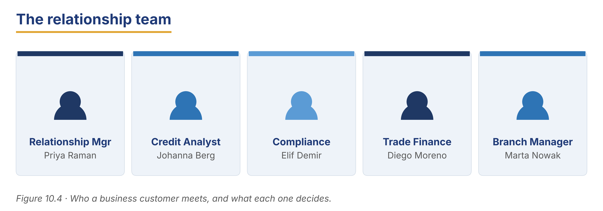


## Part 6 · Writing
*In-class / homework output*


### 6A  Guided writing — complete the meeting note
*Complete the note with the words: said, told, asked, overdue, facility.*

**Word bank:** said | told | asked | overdue | facility

1. Ms Okafor ______________________ she needed a ______________________ of fifty thousand.
2. She ______________________ me that three invoices were ______________________ by sixty days.
3. She ______________________ whether we could decide by Friday.
4. I ______________________ her that I would call tomorrow.


### 6B  Report a customer meeting (50–70 words)
*Write a short meeting note for the credit team. Use three reported sentences.*

> **Model — read this first**
> Subject: Meeting note — Okafor Coffee Ltd
> Ms Okafor said she needed a facility of fifty thousand. She told me that three invoices were overdue by more than sixty days, and that the payroll runs on the 25th. She asked whether we could decide by Friday. I said I would call her tomorrow. Statements for the last three months are attached. Diego Moreno

*Plan: Subject: ___ · ___ said ___. · She told me that ___. · She asked whether ___. · I said I would ___.*

*Phrase bank: she said she needed… · she told me that… · she asked whether… · I said I would…*

**Check before you finish**
- ☐ A clear subject line with the company?
- ☐ Three reported sentences?
- ☐ The customer’s words, not your opinion?
- ☐ 50–70 words?

> ✎ *Write your response here.*


### 6C  Reply to a business customer (50–70 words)
*Write a short reply to the business customer after the meeting.*

> **Model — read this first**
> Subject: Your facility request
> Dear Ms Okafor, Thank you for your time this morning. I have put your request to the credit team and explained that three invoices are overdue and that the payroll runs on the 25th. They have asked for the last three statements. Could you send them today so that we can answer by Friday? Kind regards, Diego Moreno

*Plan: Subject: ___ · Dear ___, · Thank you for ___. · I have put ___ and explained ___. · They have asked for ___. · Could you ___? · Kind regards, ___*

**Check before you finish**
- ☐ A clear subject line?
- ☐ What you have done, and what is still needed?
- ☐ A clear deadline?
- ☐ 50–70 words?

> ✎ *Write your response here.*


### 6D  Peer check
*Swap your note or email with a partner. Give one piece of positive feedback and one suggestion.*

*Checklist: subject line? · three reported sentences? · facts only? · 50–70 words?*

> **Model — read this first**
> “The reported speech is accurate and there is no opinion in it, which is right for a credit note. Next time, try to put the deadline in its own sentence.”


## Part 7 · Management File — Relationship Management
*Practitioner track (optional for beginners) · experienced staff*


### 7A  Relationship-management phrases
*Match the phrase to its purpose (one is extra).*


| Column A | Column B |
|---|---|
| 1. “Let me read my notes back to you.” ____ | **a)** checking you have understood |
| 2. “I cannot promise it, but I will put the case.” ____ | **b)** being honest about a decision |
| 3. “What would worry you most about next year?” ____ | **c)** asking a question that opens up |
| 4. “I will take that to the credit meeting myself.” ____ | **d)** taking responsibility |
|  | **e)** closing an account (extra) |


### 7B  Listening — reporting a client meeting
**🔊 Audio 10.4** (optional) — or read the script below.

```
Marta: How did it go with Okafor Coffee?
Priya: She said she needed fifty thousand, and she told me three invoices were overdue by sixty days.
Marta: Did she say what had changed?
Priya: She said her largest buyer had moved to ninety-day terms without asking her.
Marta: That is the real story, then. Put that in the note, in her words.
Priya: I will. She also asked whether we could decide by Friday, and I said I would put the case but could not promise it.
```

*Answer the questions.*

**Example: 0. How much did the customer ask for? → Fifty thousand.**

1. What had the largest buyer done?
2. What does Marta say should go in the note?
3. What did Priya promise, and what did she not promise?


### 7C  Controlled practice — the relationship report
*Report each sentence for the credit file. Use said, told or asked.*

**Example: 0. “I need fifty thousand.” → She said she needed fifty thousand.**

1. “Three invoices are overdue.”
2. “My largest buyer has moved to ninety-day terms.”
3. “We have never missed a payment.” (she, to me)
4. “Can you decide by Friday?”
5. “I will send the statements today.” (she)

> ✎ *Write your response here.*


### 7D  Role play — a relationship review
*Hold an annual review with a business customer. Listen more than you speak, and report back accurately.*

> **Model — read this first**
> “Before we talk about the facility, what would worry you most about next year? … Let me read my notes back to you, so I take your words to the credit meeting and not mine.”

**Card A (relationship manager):** open with a question · take notes · read them back · be honest about the decision.

**Card B (business customer):** your largest buyer has moved to ninety-day terms; you have never missed a payment; you need an answer by Friday.

*Stretch: the customer asks you to predict the decision — stay honest and still be useful.*


### 7E  Writing — a relationship-review note (50–70 words)
*Write a short review note for the customer’s file.*

> **Model — read this first**
> Subject: Annual review — Okafor Coffee Ltd
> Ms Okafor said her largest buyer had moved to ninety-day terms without notice. She told me that three invoices were overdue but that the company had never missed a payment. She asked whether a decision could be made by Friday. I said I would put the case at Thursday’s meeting. Statements requested. Priya Raman

*Plan: Subject: ___ · ___ said ___. · She told me that ___. · She asked whether ___. · I said I would ___.*

*Phrase bank: she said ___ had… · she told me that… · she asked whether… · I said I would put the case*

**Check before you finish**
- ☐ A clear subject line?
- ☐ Three reported sentences?
- ☐ The customer’s words, not your opinion?
- ☐ 50–70 words?

> ✎ *Write your response here.*


## Part 8 · Global Case Study — A Long Relationship
*Practitioner track · read then discuss*

*Before you read: is it worth a bank keeping a customer who is in difficulty?*

> **The Account Nobody Wanted** — *About 200 words · a made-up example based on real practice*
>
> A small furniture company had banked with the same international bank for twenty-two years. In its worst year, a large customer failed without paying, and the company could not meet its payroll. On paper the bank should have closed the facility. Two things stopped it. The first was a note in the file: nine years earlier, a relationship manager had written down why the owner turned down a cheaper offer from another bank — the bank had answered the phone on a Saturday. The second was the relationship manager at the time, who told the credit committee that the company had never missed a payment in twenty-two years and that the failure was its customer’s, not its own. The committee extended the facility for six months instead of closing it. The company survived, repaid in full, and is still a customer. The bank found afterwards that it had done well out of patience, but it was careful about the lesson. It did not conclude that long customers should always be supported. It concluded that a decision is only as good as the file it is made from.

**Glossary help**
- **facility** — an arrangement to borrow up to a limit
- **credit committee** — the group that decides on lending
- **to extend** — to allow more time
- **file note** — a written record of what was said


### 8A  Comprehension
**Example: 0. How long had the company banked with the bank? → Twenty-two years.**

1. What happened in the company’s worst year?
2. What had the relationship manager written down nine years earlier?
3. What did the committee decide?
4. What lesson did the bank draw, and what lesson did it refuse to draw?


### 8B  Vocabulary in context
*Match the word to its meaning (one is extra).*


| Column A | Column B |
|---|---|
| 1. facility ____ | **a)** the group that decides on lending |
| 2. credit committee ____ | **b)** an arrangement to borrow up to a limit |
| 3. to extend ____ | **c)** a written record of what was said |
| 4. file note ____ | **d)** to allow more time |
|  | **e)** a charge for a service (extra) |


### 8C  Discussion
*Frames: “In my bank this decision would be made by ___.” “A long relationship matters because ___.”*

- Should a long relationship count in a lending decision?
- What is in your files that a future colleague would thank you for?


### 8D  Your view (short write, 30–40 words)
*Should the length of a relationship affect a credit decision? Give one reason.*

> ✎ *Write your response here.*


## Part 9 · Branch Case Study — São Paulo in Focus: A Workshop Needs Help
*Practitioner track · read then decide*

*Before you read: what does a bank owe a small business in a bad month?*

> **Eleven Weeks** — *About 190 words*
>
> Rafael Lima’s printing workshop in São Paulo has its largest order ever: eight thousand books for a buyer in another country. The buyer will pay thirty days after delivery. The paper supplier, who has never traded with Rafael before, wants to be paid before shipping. There are eleven weeks between the two payments, and Rafael cannot bridge them. He has come to the branch and told Beatriz Costa that this is the order that changes the business. Beatriz has checked the file. The shop has never missed a payment, but January was weak, and the existing loan for the second printer still has two years to run. She can offer a short facility, which would help his cash flow but add to what he already owes. She can arrange a letter of credit, which would satisfy the supplier but costs a fee and does not put money in Rafael’s account. She has to recommend something to the credit committee by Thursday.


### 9A  Comprehension
**Example: 0. How large is the order? → Eight thousand books.**

1. Why is there a gap of eleven weeks?
2. What does the paper supplier want, and why?
3. What are the three options Beatriz is weighing?


### 9B  Decision task
*What should Beatriz recommend? Write 40–60 words. Use the frame and the phrase bank.*

> **Model — read this first**
> I think Beatriz should recommend a letter of credit, because it satisfies the supplier without adding to what Rafael already owes. She should also report his record in his own words, including the weak January. Also, she can ask the committee for a small facility only if the buyer’s terms are confirmed in writing.

*Frame: I think Beatriz should ___, because ___. Also, ___.*

*Phrase bank: recommend a letter of credit · avoid adding to existing borrowing · report the record in the customer’s own words · ask for written confirmation of the buyer’s terms*

> ✎ *Write your response here.*


## Part 10 · Review & Can-Do
*Homework / self-study · end of course*


### 10A  Spiral review
*Complete the sentences. Use reported speech or the correct form. Items 3–6 review Units 6 to 9.*

**Example: 0. “The account is ready.” (she) → She said the account was ready.**

1. “I need a facility.” (he) → He said he ______________________ a facility.
2. “We have paid.” (she) → She said they ______________________ paid.
3. I ______________________ (save) money since last year. (Unit 9: up to now)
4. Staff ______________________ share a customer’s details. (Unit 8: not allowed)
5. Could you tell me what the rate ______________________? (Unit 6 indirect question)
6. If you share a one-time code, anyone ______________________ use your account. (Unit 7 conditional)


### 10B  Can-Do checklist
**Can-Do checklist — tick what you can do now**
- ☐ I can name business-banking terms.
- ☐ I can report what a customer said (reported speech).
- ☐ I can help a business customer and explain a benefit.
- ☐ I can understand a short business conversation.
- ☐ I can write a short meeting report or business reply.


### 10C  Course Can-Do — look how far you have come
*Across this course, you can now:*

**Can-Do checklist — tick what you can do now**
- ☐ Introduce yourself and describe your work (Unit 1).
- ☐ Serve customers politely and handle problems (Units 2, 7).
- ☐ Talk about transactions, products and digital banking (Units 3–5).
- ☐ Explain rates, rules, saving and business banking (Units 6, 8–10).
- ☐ Use ten grammar areas, from present tenses to reported speech.

Well done. You have completed English for Banking and Finance (B1), International Edition. Keep using these skills every day at work — that is how they grow.


### 10D  Unit glossary
**Glossary help**
- **business account** — a bank account for a company
- **invoice** — a bill asking a customer to pay
- **payroll** — the money a company pays its staff
- **cash flow** — money coming in and going out of a business
- **facility** — an arrangement to borrow up to a limit
- **supplier** — a company that sells goods to a business
- **letter of credit** — a bank promise to pay a seller when documents are shown
- **corporate customer** — a business that banks with us
- **relationship manager** — one bank contact who knows a business
- **reported speech** — telling what someone said


