# English for Business — International Edition
*Blue Door Group · five countries, one ledger · B1.1–B1.2*

# Unit 1: The Daily Work of a Group Accounts Office
*Present simple and present continuous · B1.1–B1.2 · Blue Door Group · five countries, one ledger*

## Warm Up
*[OP] Accounts track · in-class starter*
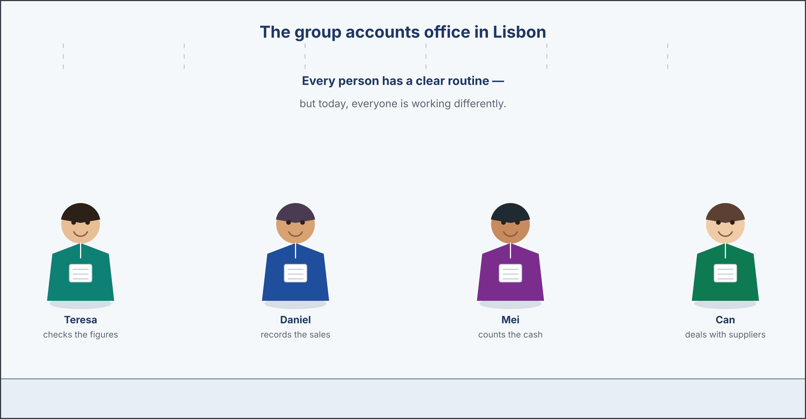
*The group accounts team at their desks, each with a daily routine.*

### Warm-up: Words About the Working Day
**Match the words with their meanings. One meaning is not needed. Write the letter.**
0. Office → the room where people do their business work. (example)

**Column A**
1. **Routine** ____
2. **Task** ____
3. **Colleague** ____
4. **Deal with** ____
5. **Keep track of** ____

**Column B**
a) a piece of work you have to do
b) a person you work with
c) something you do regularly, in the same way
d) to take care of, or handle, something
e) to follow and remember the details of something
f) a bill from a supplier

### Warm-up: Complete the Sentences
**Complete the sentences using the words in the word bank.**
**Word bank:** routine | task | colleague | deals with
0. Every person in the office has a clear job. (example)
1. Every morning, Daniel follows the same ____________________ .
2. Recording the sales in Nairobi is his main ____________________ .
3. Mei is a friendly ____________________ who works at the till in Singapore.
4. Can ____________________ the suppliers and their invoices in Istanbul.

### Warm-up: Reading — A Day in the Group Accounts Office
**Read the text and choose the correct answer.**
> The group accounts office in Lisbon is a busy place, and every person in it has a clear routine. Teresa, the group financial controller, arrives first each morning, because she likes to check the figures before the messages begin. Daniel, the bookkeeper, records the sales and the costs of the Nairobi restaurant every single day, while Mei, the cashier in Singapore, counts the cash and gives every guest exact change. Can deals with the suppliers in Istanbul, and he keeps track of every invoice that comes into the office. Because the five restaurants are in five countries, the team also converts each day's figures into euro, the currency the group reports in. Nobody has to be told what to do, because the routine does the telling. Today, though, is not an ordinary day. The group auditor is coming next week, so everyone is doing something different. Teresa is training a new assistant instead of checking the figures, Daniel is looking through last year's records rather than yesterday's, and Can is calling the suppliers about the final orders of the month. By Friday the routine will be back, and everybody is quietly looking forward to it.
0. Every person in the office has a clear routine. (example)
**1. What does the team normally do every day?**
- ○ A) Prepare for an audit
- ○ B) Their daily routines
- ○ C) Train new staff
- ○ D) Close the restaurants
**2. Why is today different from a normal day?**
- ○ A) The group auditor is coming next week
- ○ B) The office is closed
- ○ C) Teresa is away
- ○ D) The system is broken

## Part 1 · Vocabulary and Terminology
*[OP] Accounts track · pre-class input*
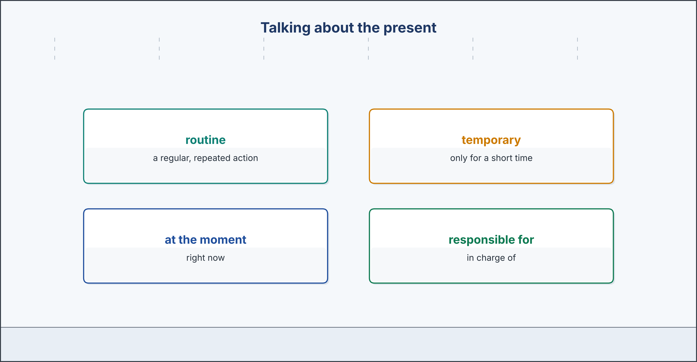
*Words for the present: routine, temporary, at the moment, responsible for.*

### Part 1: Words for the Present
**Match the words with their meanings. One meaning is not needed. (0. is done for you.)**
0. Routine → a regular, repeated action.

**Column A**
1. **Temporary** ____
2. **At the moment** ____
3. **These days** ____
4. **Responsible for** ____
5. **Department** ____
6. **State verb** ____
7. **Colleague** ____

**Column B**
a) right now
b) in this general period
c) lasting only for a short time
d) in charge of, and expected to do
e) a section of a business
f) a verb that describes how things are, not an action
g) a person you work with
h) a plan for next year
**Gloss:** responsible for = in charge of, and expected to do · state verb = a verb that describes how things are, not an action

### Part 1: Pronunciation
**🔊 Audio Track 1.1**
**Listen and practise these words. Say each word aloud and stress the loud syllable (CAPITALS).**
- colleague — **CO-lleague**
- temporary — **TEM-po-ra-ry**
- routine — **rou-TINE**
- responsible — **res-PON-si-ble**
- currency — **CU-rren-cy**
- continuous — **con-TI-nu-ous**

### Part 1: Present Forms — Match the Use
**Match each form with the way we use it. One use is not needed. Write the letter.**
0. recorded → a finished action in the past. (example)

**Column A**
1. **records** ____
2. **is recording** ____
3. **opens** ____
4. **is opening** ____
5. **understands** ____

**Column B**
a) a routine, repeated every day
b) an action happening now, or this week
c) a general fact that is always true
d) a temporary change, just for this period
e) a state, which has no continuous form
f) a plan for next year
**Gloss:** present continuous = am/is/are + the -ing form · temporary = lasting only for a short time

### Part 1: The Present — Multiple Choice
**Read and choose the correct answer.**
0. 'At the moment' means right now. (example)
**1. What is a 'routine'?**
- ○ A) A regular, repeated action
- ○ B) A single mistake
- ○ C) A future plan
- ○ D) A tax
**2. What does 'temporary' mean?**
- ○ A) Permanent
- ○ B) Very large
- ○ C) Lasting only a short time
- ○ D) Expensive
**3. What is a 'state verb'?**
- ○ A) An action you repeat
- ○ B) A verb that describes how things are
- ○ C) A past action
- ○ D) A question

### Part 1: Vocabulary Fill-in
**Complete the sentences with the correct word or phrase.**
**Word bank:** temporary | responsible | department | at the moment
0. Every person has a clear task. (example)
1. Teresa is ____________________ for the whole group accounts office.
2. ____________________ , Daniel is checking last year's figures.
3. The accounts ____________________ is on the first floor in Lisbon.
4. This extra job is only ____________________ ; it ends next week.

### Part 1: Write Two Sentences (short)
**Write one sentence about your routine (present simple) and one about now (present continuous).**
**Plan (make notes, then write):** Every day, I ______ . At the moment, I am ______ .
Then swap your two sentences with a partner, and check together that each verb is in the correct tense.

## Part 2 · Grammar — Present Simple and Present Continuous
*[OP] Accounts track · grammar focus*
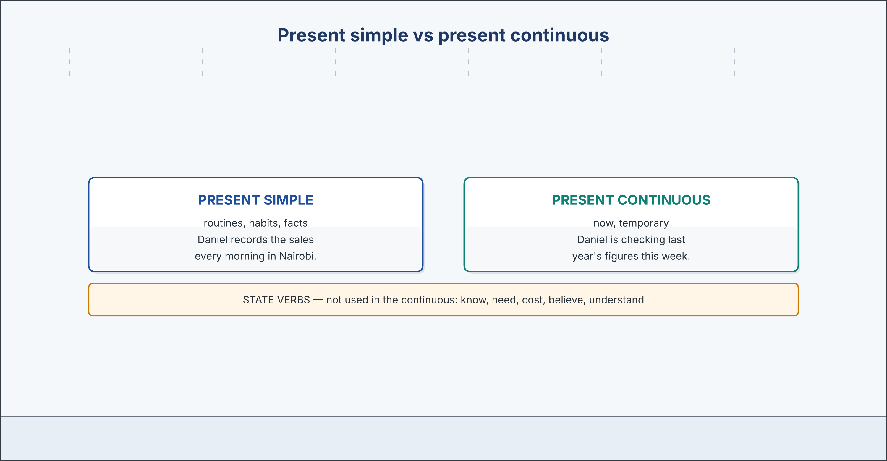
*Present simple (routine) vs present continuous (now), plus state verbs.*

### Part 2: Notice
> Look carefully at these two tenses. We use the present simple for routines, habits, and facts that are always true. 'Daniel records the Nairobi sales every day. The Lisbon restaurant opens at noon.' We form it with the base verb, and we add '-s' for he, she, or it. We use the present continuous for actions happening now, and for temporary situations. 'Daniel is checking last year's figures at the moment.' We form it with 'am', 'is', or 'are' and the '-ing' form. There is also one important exception. Some verbs, such as 'know', 'understand', 'need', 'cost', and 'believe', describe states rather than actions, and we do not normally use them in the continuous.
**Look at your teacher's copy. Which sentences are routines? Which describe now? Find one state verb.**

### Part 2: Grammar Focus Box

| | Form | Use |
|---|---|---|
| present simple | Daniel records the sales every day. | routines, habits, general facts |
| present continuous | Daniel is checking the figures now. | actions now, temporary situations |
| forming them | base (+ -s) / am/is/are + -ing | he/she/it takes '-s' |
| state verbs | I understand the report. (not 'am understanding') | know, need, cost, believe — no continuous |
**Remember:** Use the present simple for routines and facts, and the present continuous for what is happening now or temporarily. State verbs like 'know' and 'understand' are not usually used in the continuous.
**Watch out!** Watch out: do not use state verbs in the continuous — say 'I understand' (not 'I am understanding').
**Gloss:** habit = something you do regularly · exception = a case that does not follow the rule

### Part 2: Controlled Practice — Simple or Continuous?
**Complete each sentence with the present simple or the present continuous.**
0. Teresa usually arrives (arrive) first each morning. (example)
1. Daniel usually ____________________ (record) the Nairobi sales in the morning.
2. At the moment, he ____________________ (check) last year's figures.
3. The Lisbon restaurant ____________________ (open) at noon every day.
4. Look — Can ____________________ (talk) to a supplier in Istanbul right now.

### Part 2: State Verbs and Negatives
**Complete each sentence with the correct form.**
1. I ______ (understand) the group report now. (state verb)
2. This new system ______ (not / work) well this week.
3. She ______ (know) the exchange rate already. (state verb)

### Part 2: Correct the Sentence
**Each sentence has one mistake. Write it correctly.**
1. I am understanding the new report.
2. Daniel record the sales every day.
3. At the moment, Can talk to a supplier.

### Part 2: Freer Practice
**Talk with a partner. Describe your normal routine, then say what you are doing this week that is different.**
Normally, I ______ , and I usually ______ .
But this week, I am ______ , because ______ .

### Part 2: Grammar Review
**Choose the correct answer.**
**1. At the moment, Daniel ______ last year's figures.**
- ○ A) checks
- ○ B) check
- ○ C) checking
- ○ D) is checking
**2. The Lisbon restaurant ______ at noon every day.**
- ○ A) opens
- ○ B) is opening
- ○ C) open
- ○ D) are opening

## Part 3 · Listening and Dialogue
*[OP] Accounts track · listening*
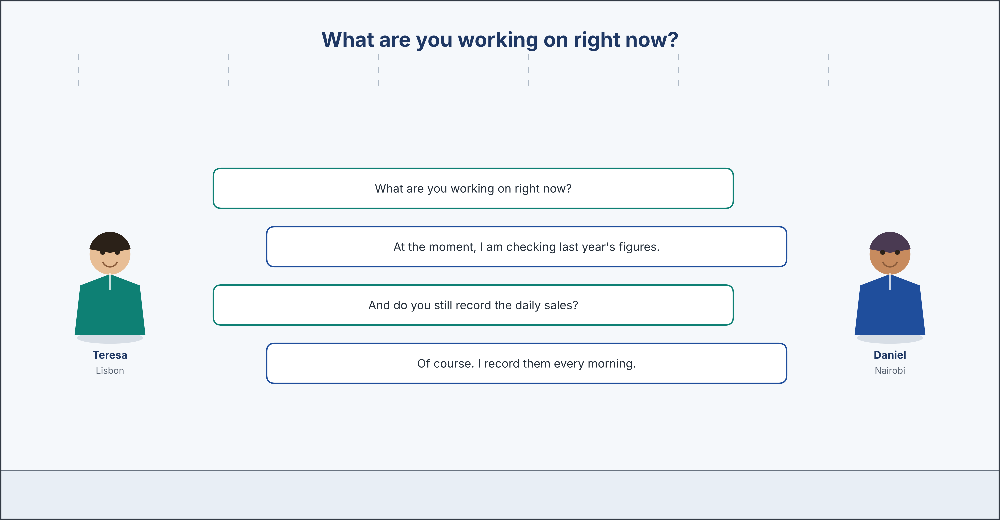
*Teresa asks what Daniel is doing now; he contrasts routine and this week.*

### Part 3: Teresa Explains the Two Tenses
**🔊 Audio Track 1.2**
Before you listen: which tense do we use for a routine, and which for something happening now?
> Teresa: Let me explain the two tenses we use most often in this office, because they describe our work in different ways. The first is the present simple. We use it for routines and for things that are always true. Daniel records the Nairobi sales every morning, and the Lisbon restaurant opens at noon. Those facts do not change from week to week. The second is the present continuous. We use it for what is happening right now, and for situations that are only temporary. At this moment, Daniel is checking last year's figures, because the group auditor is coming. That is not his routine; it is this week only. There is one more thing you must remember. Some verbs describe states, not actions, and we do not use them in the continuous. We say 'I understand the report', never 'I am understanding the report'. The same is true of 'know', 'need', 'cost' and 'believe'. If you remember only one rule from today, remember this: ask yourself whether the sentence is about every day or about now, and the tense will choose itself.
**While you listen: write True (T) or False (F). (0. is done.)**
0. We use the present simple for routines and things that are always true. — T
1. We use the present simple for routines and things that are always true. ____
2. We use the present continuous only for the past. ____
3. Some state verbs are not used in the continuous form. ____
4. 'I am understanding' is the correct form. ____
Useful phrases: we use the present simple for routines · the present continuous for now · state verbs have no continuous.

### Part 3: Routine and Exception
**🔊 Audio Track 1.3**
Before you listen: what is Daniel doing this week that is different from his routine?
> Teresa: Good morning, Daniel. What are you working on right now? Daniel: Good morning. At the moment, I am checking last year's figures for the group audit. It is taking longer than I expected. Teresa: I understand. And do you still record the daily sales? Daniel: Of course. I record them every morning before anything else, and I convert them into euro. That routine never changes. Teresa: So you are doing two jobs these days. Daniel: Exactly. The routine in the morning, and the audit work in the afternoon. Teresa: And how long will the second job last? Daniel: Until the auditor has what she needs — two weeks, I think. After that I go back to one job, and I will be glad. Teresa: Thank you. That is exactly the difference I want the new assistant to hear: what you do every day, and what you are doing this fortnight.
**While you listen: answer the questions. (0. is done.)**
0. What is Daniel working on right now? — He is checking last year's figures for the group audit.
1. Does Daniel still record the daily sales?
2. What two jobs is Daniel doing these days?
3. Which sentence describes his routine, and which describes this week?
Useful phrases: at the moment, I am checking… · I record the sales every morning · that routine never changes.

### Part 3: Today's Special Tasks
**🔊 Audio Track 1.4**
Before you listen: how does the team change its work when a group auditor visits?
> Teresa: Right, everyone, this is not an ordinary day, so let me give out today's special tasks. Daniel, you normally record the sales, but this morning I need you to gather all the receipts from the last three months. Mei, instead of your usual cash counting, please print the bank statements from Singapore for the auditor. Can, you deal with the suppliers every day, so today please list every open invoice and the currency it is in. I am going to check that nothing is missing, and I will answer the auditor's questions myself. Noor, you are new, so today you are watching and taking notes; that is a real task, and it is the fastest way to learn how five branches fit together. Remember that none of this is our routine. We are doing it because the auditor comes on Monday. Tomorrow we all go back to our normal work, and the day after that nobody will remember this morning.
**While you listen: match each person with today's special task. One task is not needed. (0. is done.) Write the letter.**
0. Teresa → gives out the tasks and checks that nothing is missing.

**Column A**
1. **Daniel** ____
2. **Mei** ____
3. **Can** ____
4. **Teresa** ____

**Column B**
a) gathers all the receipts from the last three months
b) prints the bank statements from Singapore
c) lists every open invoice and its currency
d) answers the auditor's questions
e) cooks the evening service

## Part 4 · Speaking
*[OP] Accounts track · speaking*
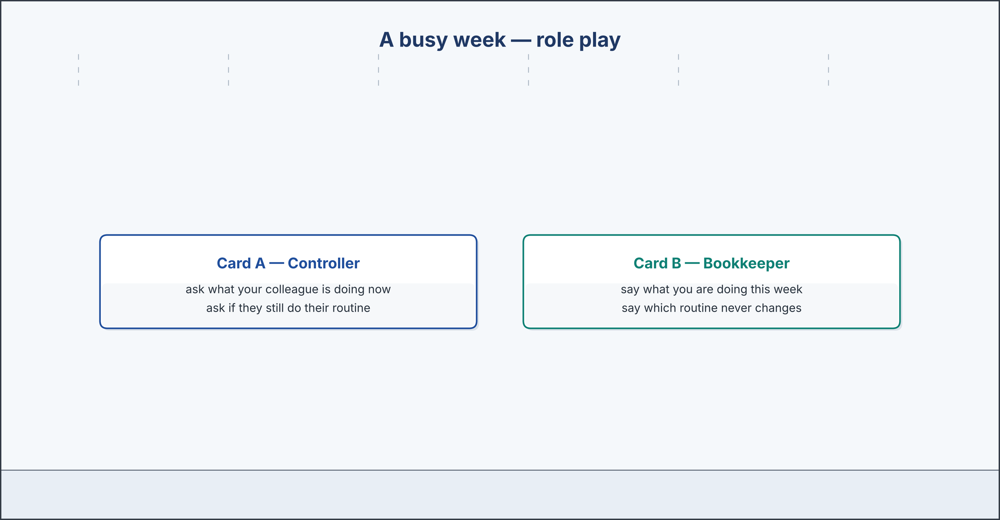
*Role play: a busy week (Card A and Card B).*

### Part 4: Talking About Your Work
**Work with a partner. Ask and answer these questions. Use both present tenses.**
What do you normally do every day at work or in your studies?
What are you doing this week that is different from your routine?
Why is it useful to know the difference between the two tenses?
Which of your daily tasks would be the hardest to explain clearly in English, and why do you think so?
Useful language: every day, I… · at the moment, I am… · usually… , but this week… · I understand / I know…

### Part 4: A Busy Week — Role Play
**Work in pairs. Read the model, then use the cards.**
Model: A: What are you working on at the moment? — B: I am checking last year's figures for the group audit. — A: And do you still do your normal job? — B: Of course. I record the Nairobi sales every morning, as always. So I am doing two jobs at once this week.
Useful language: at the moment, I am… · I still… every day · as always · two jobs at once.
Card A — Controller: ask what your colleague is doing now · ask if they still do their routine.
Card B — Bookkeeper: say what you are doing this week · say which routine never changes.
Your turn: run the dialogue, then change roles.

### Part 4: Mini-Presentation
**Prepare a short talk (about one minute). Describe your normal working day, then explain what you are doing differently this week. Use both tenses.**
**Plan (make notes, then write):** Normally, I… every day. This week, I am… , because… My routine that never changes is…

## Part 5 · Extended Reading
*[OP] Accounts track · extended reading*
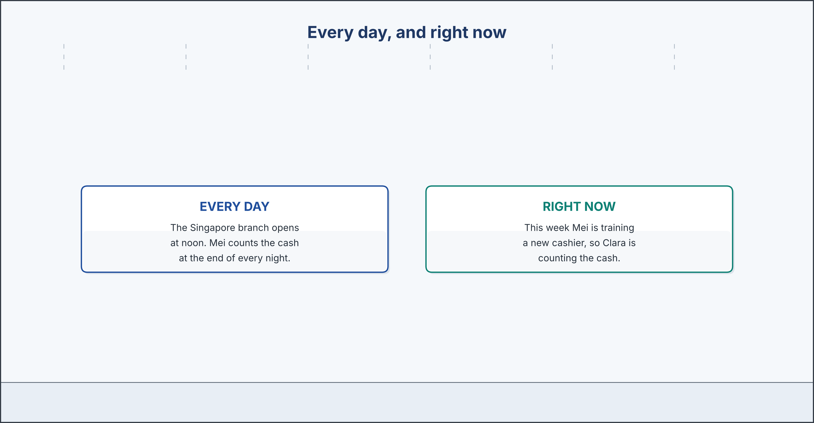
*Every day (present simple) vs right now (present continuous).*

### Part 5: Now and Every Day
**Read the text and choose the correct answer.**
> Every accountant needs to describe two different kinds of action, and English gives us two tenses to do exactly that. The first is the present simple, which we use for routines, habits, and general facts. In a group with five restaurants, the routines are what hold everything together: each branch records its sales every day, each branch counts its cash every night, and the group converts every figure into euro at the end of the week. These sentences are true in January and true in July, so they take the present simple. The second tense is the present continuous, which we use for what is happening at this moment, and for situations that are temporary. When a group auditor is expected, the office works differently for a week or two: people are gathering receipts, printing statements, and listing invoices. Those sentences are true today and untrue next month. There is one group of verbs that does not follow this pattern. State verbs, such as know, understand, need, cost, and believe, describe how things are rather than what somebody is doing, and they are not normally used in the continuous. The difference matters in an accounts office, because a routine and a one-off task are not the same thing, and a reader in another country cannot see which is which unless the tense tells them.
0. English gives us two tenses for two kinds of action. (example)
**1. When do we use the present simple?**
- ○ A) For actions happening right now
- ○ B) Only for the past
- ○ C) For routines and general facts
- ○ D) For temporary situations
**2. Which is a state verb that we do NOT use in the continuous?**
- ○ A) Record
- ○ B) Check
- ○ C) Convert
- ○ D) Understand
**3. Why does the difference between the tenses matter in an accounts office?**
- ○ A) It makes reports colourful
- ○ B) A routine and a one-off task are not the same
- ○ C) It saves paper
- ○ D) It is faster

### Part 5: Vocabulary in Context
**Match each word from the text with its meaning. One meaning is not needed. (0. is done.) Write the letter.**
0. describe → to say what something is like. (example)

**Column A**
1. **convert** ____
2. **general** ____
3. **pattern** ____
4. **temporary** ____
5. **confuse** ____

**Column B**
a) to change money from one currency into another
b) true in most cases; not detailed
c) a way that something regularly happens
d) lasting only for a short time
e) to mix two things up by mistake
f) to pay an invoice early
**Gloss:** convert = to change an amount from one currency into another · general = true in most cases; not detailed

### Part 5: The Rhythm of a Restaurant Year
**Read about the restaurant year. Then mark each sentence True (T) or False (F).**
> A restaurant does not earn the same amount of money every month, because business follows the rhythm of the year. In a group with five restaurants, those rhythms are not even the same from city to city. In Lisbon, the warm summer months are the busiest, since visitors fill the tables until late. In Singapore, the quiet months are different again, and in Montréal the coldest weeks are the slowest of all. A good accountant knows these patterns and plans for them, instead of being surprised twice a year. That is why the group keeps the figures of every branch beside each other: when one restaurant is quiet, another is usually busy, and the group as a whole is steadier than any single branch. Right now, the team is preparing for the Lisbon summer and for the Montréal winter at the same time, which is exactly what a group accounts office is for. The routines do not change with the seasons; only the numbers do. Every branch still records its sales each day, and the group still converts them into euro each week, in July and in January alike.
0. A restaurant does not earn the same amount every month. → T (example)
1. In Lisbon, the warm summer months are the busiest. ____
2. A good accountant only reacts to the numbers, and never plans ahead. ____
3. Right now, the team is preparing for two seasons at the same time. ____
4. The present continuous describes the daily routine. ____

## Part 6 · Writing
*[OP] Accounts track · writing*
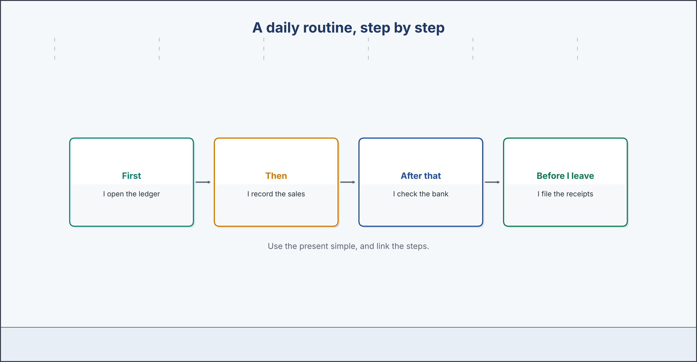
*A daily routine, step by step, in the present simple.*

### Part 6: My Daily Routine (70–130 words)
**Describe your normal working day, or a working day you know well. Use the present simple.**
**Model — read this first:**
> My name is Daniel, and I am the bookkeeper for the Nairobi restaurant. My daily routine rarely changes. I arrive at eight o'clock, and the first thing I do is make a coffee. Then I open the ledger and record all of yesterday's sales. After that, I convert the day's total into euro for the group, and I check it against the bank. In the afternoon, I enter the suppliers' invoices and file the receipts. Before I leave, I send the daily figure to Lisbon. It is the same every day, and that is exactly why it works: when every step happens in the same order, nothing is ever forgotten.
**Plan (make notes, then write):** I arrive at… First, I… Then I… In the afternoon, I… Before I leave, I…
**Check before you finish:** ☐ present simple used for the routine?  ☐ several linked steps?  ☐ 70–130 words?

### Part 6: A Different Week (70–130 words)
**Describe what is happening in an office this week that is different from normal. Use the present continuous.**
**Model — read this first:**
> This week is not a normal week in the group accounts office, because the auditor is visiting. At the moment, everyone is doing something unusual. Daniel is gathering all the receipts from the last three months, and Mei is printing the bank statements from Singapore instead of counting the cash. Can is listing every open invoice and the currency it is in. Teresa is answering questions all day, so she is not checking the figures herself. Even the coffee machine is working harder than usual. Nobody is panicking, because the records are already there; we are only finding them. Next week, everything goes back to normal, and we are all looking forward to it.
**Check before you finish:** ☐ present continuous used for now?  ☐ several people described?  ☐ 70–130 words?

### Part 6: A Colleague's Job (70–120 words)
**Describe a colleague's job. Use the present simple for their routine and the present continuous for what they are doing right now.**
**Model — read this first:**
> My colleague Mei is the cashier at the Singapore restaurant, and she has a very important job. Every evening, she takes the payments from the guests, and she counts the cash carefully at the end of the night. She also checks that the card machine agrees with the till. Right now, however, she is not counting cash at all. She is printing three months of bank statements for the group auditor, and she is training a new cashier at the same time. She knows the system better than anyone, so she is the right person to teach it.
**Plan (make notes, then write):** My colleague ______ is the ______ . Every day, she/he… Right now, she/he is…
**Check before you finish:** ☐ both tenses used correctly?  ☐ routine and 'now' both shown?  ☐ 70–120 words?

### Part 6: The Routine and the Exception (70–120 words)
**Write about a normal routine and a temporary exception to it. Use your own ideas.**
**Model — read this first:**
> In a group accounts office, most days follow the same steady routine, but sometimes an exception appears. Normally, our system records every sale automatically and converts it into euro overnight, so the work is quick and simple. This month, however, the rate feed is not working in one country, so we are converting the Istanbul figures by hand every morning. It takes an extra hour, and we check each total twice. The routine has not changed; it is simply waiting. As soon as the feed is repaired, the exception will end, and the morning will be quiet again.
**Check before you finish:** ☐ a routine and an exception?  ☐ both tenses used?  ☐ 70–120 words?

## Part 7 · Restaurant-Accounting Track
*[RA] Restaurant track · the floor and the office*
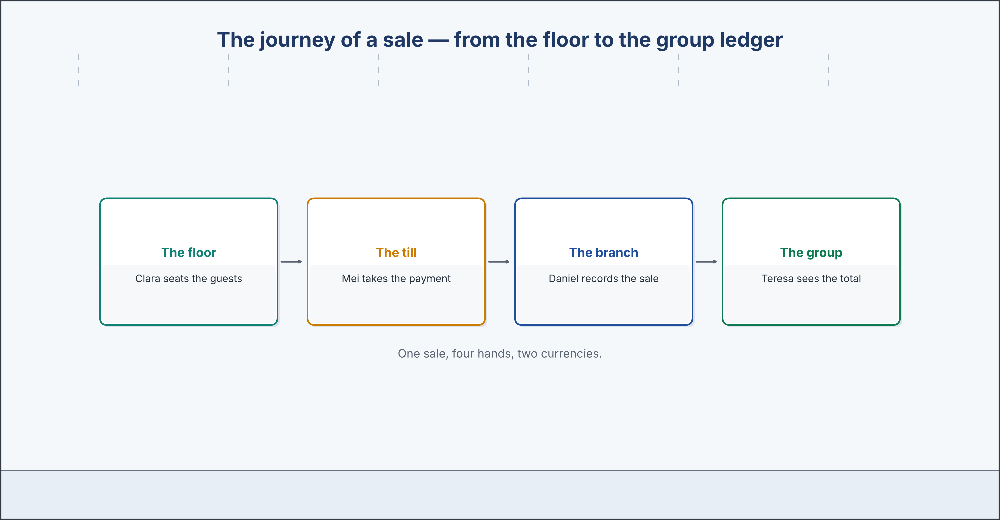
*The journey of a sale from the floor to the group ledger.*

### 7A: Phrase Bank — The Journey of a Sale
**Match each step with what it means. One meaning is not needed. (0. is done.) Write the letter.**
0. Greet the guests. → welcome the guests to the restaurant. (example)

**Column A**
1. **Seat the guests.** ____
2. **Take the order.** ____
3. **Bring the bill.** ____
4. **Take the payment.** ____
5. **Record the sale.** ____

**Column B**
a) show them to a table
b) write down what they want to eat
c) give them the paper that shows what they must pay
d) receive the money, in cash or by card
e) enter the amount in the ledger
f) order the ingredients from a supplier

### 7B: The Floor and the Office
**🔊 Audio Track 1.5**
Before you listen: how does the work on the restaurant floor connect to the group accounts office?
> Clara: Teresa, I sometimes wonder how your work in the office connects to my work on the floor. They feel so separate. Teresa: They are closer than you think. Every time you seat a table, you start a story that ends in my ledger. Clara: So the story begins with me? Teresa: It begins on the floor, every time. You seat the guests, your team takes the order, and Mei takes the payment. Then Daniel records the sale, and I watch the totals appear from five countries. Clara: And right now? Teresa: Right now you are serving lunch, and I am watching your lunch sales arrive in euro, about a minute after each table pays. Clara: A minute? I thought it took days. Teresa: It takes days only when something is written on paper and nobody enters it. Clara: So when my team is careful with an order, you are the person who notices. Teresa: I am the person who never has to notice. That is the whole point. Two jobs, one story.
**Answer the questions. (0. is done.)**
0. What does Clara wonder about? — How the office work connects to her work on the floor.
1. According to Teresa, where does the story of every sale begin?
2. What is Clara doing right now, and what is Teresa doing at the same time?
3. How does Teresa describe the floor and the office?

### 7C: Controlled Practice — The Journey of a Sale
**Put the steps of a sale in order. Number them 1–5. (0. is done.)**
0. Clara seats the guests at a table. — 1
___ Clara's team takes the order and sends it to the kitchen.
___ Mei takes the payment at the end of the meal.
___ Daniel records the sale in the branch ledger.
___ Teresa watches the totals arrive in euro.

### 7D: Role-Play — The Floor and the Office
**In pairs. One is the restaurant manager (Clara); one is the controller (Teresa). Use the model and cards.**
Model: Clara: How does my work connect to yours? — Teresa: Every sale begins on the floor and ends in my ledger. — Clara: So what are you doing right now? — Teresa: I am watching your lunch sales arrive in euro.
Card A — Manager (Clara): ask how the two jobs connect · ask what Teresa is doing now.
Card B — Controller (Teresa): explain the journey of a sale · use both present tenses.

### 7E: Restaurant Writing (70–130 words)
**You are Clara. Write a short note describing your routine on the floor and what your team is doing right now.**
**Model — read this first:**
> Every evening, my team and I follow the same routine on the floor. We greet the guests, we seat them at their tables, and we take their orders. When the meal ends, we bring the bill and thank the guests for coming. Tonight, though, the restaurant is fuller than usual, because a conference is in the city. At the moment, two of my team are serving the terrace, and I am helping at the door myself. The routine is the same; there is simply more of it. By midnight, every order will be in the system for Lisbon.
**Check before you finish:** ☐ both present tenses used?  ☐ routine and 'now' both shown?  ☐ 70–130 words?

## Part 8 · Consolidation
*[OP] Accounts track · consolidation*
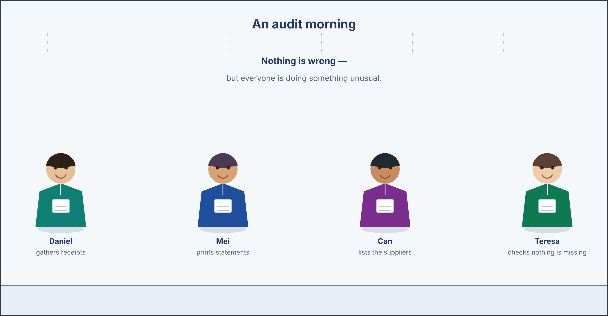
*An audit morning: everyone is doing something unusual.*

### Part 8: Reading — A Different Kind of Morning
Before you read: why is an honest daily routine nothing to fear during an audit?
> Most mornings in the group accounts office follow the same quiet pattern. Daniel arrives at eight, he makes a coffee, and he opens the ledger to record yesterday's sales. Mei counts the cash in the Singapore till and sends the figure north. Teresa reads her emails and checks the exchange rates before the day begins. This morning is different, because the group auditor arrives on Monday, and five sets of records must be ready for her. Daniel is gathering receipts from three months instead of recording yesterday's sales. Mei is printing bank statements rather than counting cash. Can is listing every open invoice, in four currencies, and marking which ones are still unpaid. Noor, who joined two weeks ago, is watching all of it and writing down what she does not yet understand. Nobody is worried. 'An audit is only frightening when the daily routine has been careless,' Teresa says. 'Ours has not been. Everything the auditor wants to see, we wrote down on the day it happened, in the currency it happened in.' She points at the shelf where the files from five countries stand side by side. 'We are not preparing the records this week. We are only finding them. There is a very large difference between the two, and every accountant learns it exactly once.'
**Answer the questions. (0. is done.)**
0. What is a normal morning in the office like? — Quiet and ordered: Daniel records sales, Mei counts the cash, Teresa reads emails.
1. Why is this morning different?
2. What is each person doing to prepare?
3. What does Teresa say about an honest daily routine?
**Gloss:** auditor = a person who checks that records are correct · gather = to bring things together in one place

### Part 8: Vocabulary in Context
**Match each word with its meaning. One meaning is not needed. (0. is done.) Write the letter.**
0. familiar → well known, because you see it often. (example)

**Column A**
1. **gather** ____
2. **careless** ____
3. **unpaid** ____
4. **statement** ____
5. **pattern** ____

**Column B**
a) to bring things together in one place
b) not careful; done without enough attention
c) not yet settled; still owing
d) a record from the bank of money in and out
e) a way that something regularly happens
f) a guest who complains
**Gloss:** statement = a record from the bank of money in and out · unpaid = not yet settled; still owing

### Part 8: Discussion
**Talk with a partner. Use the frames and give reasons.**
Discussion frames: 'I think the most important routine is…' · 'I agree, because…' · 'Yes, but…'
Why is it important to keep the daily routine going, even during a busy week?
Why does a team with honest daily records not need to fear an audit?
How would you describe your own 'normal' and your own 'this week'?

## Part 9 · Decision Task
*[OP] Accounts track · judgement*
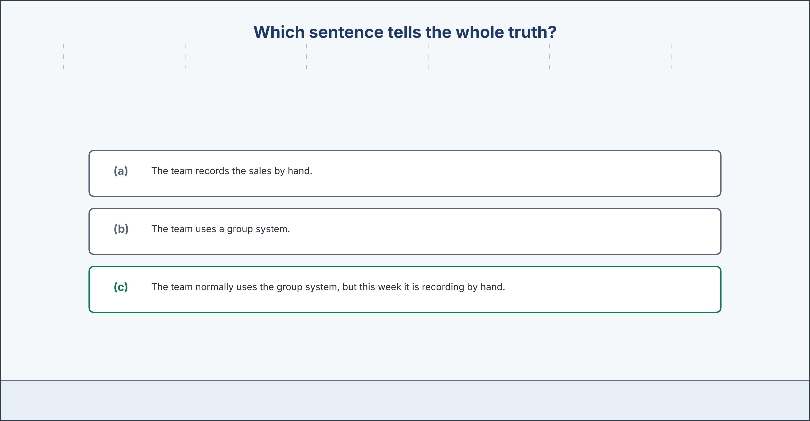
*A decision about which tense tells the whole truth.*

### Part 9: Which Sentence Tells the Truth?
Before you read: how can the wrong tense make a true sentence misleading?
> The new assistant, Noor, is writing a short description of the group accounts office for the auditor. She wants every sentence to be accurate, but she is not sure which tense to use in one place. Normally, the office records every sale through the group system, which converts each branch's figures into euro overnight. This month, however, the rate feed from one bank is not working, so the team is converting the Istanbul figures by hand each morning until it is repaired. Noor has three choices. She could write 'The team records the sales by hand,' which uses the present simple and sounds like the permanent routine. She could write 'The team uses a group system,' which is the routine but hides this month entirely. Or she could write both, and say which is which. Noor knows that the auditor values a clear and honest picture, so she thinks carefully about which sentence tells the whole truth. She also knows that her sentence will be read in another country by someone who has never seen the office, and who cannot ask a quick question across a desk. Whatever she writes will be the only thing that reader has.
**Answer the questions. (0. is done.)**
0. What is Noor writing? — A description of the group accounts office for the auditor.
1. How does the office normally convert the figures, and how is it converting them this month?
2. Why is the team converting by hand at the moment?
3. What are Noor's three choices?

### Part 9: Make the Decision
**Which sentence should Noor write — (a) 'The team converts the figures by hand,' (b) 'The team uses a group system,' or (c) 'The team normally uses a group system, but this month it is converting the Istanbul figures by hand'? Choose one and give your reasons.**
Answer frame: 'I think Noor should write sentence ___ , because ___ . The other choices ___ .'
**Model — read this first:**
> Model decision: I think Noor should write the third sentence. It is the only one that tells the whole truth. The first sentence uses the present simple, so it makes a temporary problem sound like the permanent routine, and the auditor would think the group has no system at all. The second sentence describes the routine correctly, but it hides what is actually happening this month, and an auditor who later saw the handwritten sheets would wonder what else was missing. The third sentence uses both tenses, exactly as this unit teaches: the present simple for the routine, and the present continuous for the temporary exception. It is longer, but it is complete.
Phrase bank: I think… should… · it tells the whole truth · the present simple for the routine · the present continuous for this month.
My decision: ______ because ______ .

## Part 10 · Review and Can-Do
*[OP] Accounts track · review*
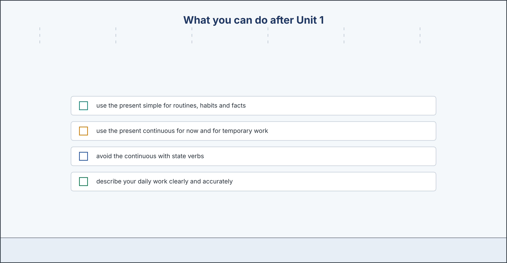
*What you can do after Unit 1.*

### Part 10: Spiral Review
**Complete with the present simple or the present continuous.**
**Word bank:** records | is checking | opens | understand
0. Teresa arrives first every morning. (example)
1. Every day, Daniel ____________________ the Nairobi sales.
2. At the moment, he ____________________ last year's figures.
3. The Lisbon restaurant ____________________ at noon.
4. I ____________________ the group report now.

### Part 10: Can-Do

**Can-Do checklist**
- ☐ I can use the present simple for routines, habits and facts
- ☐ I can use the present continuous for actions now and temporary situations
- ☐ I can avoid the continuous with state verbs (know, understand, need)
- ☐ I can describe my daily work clearly and accurately

### Part 10: Unit 1 glossary

**Unit 1 glossary**
> bookkeeper = a person who records the daily money · present simple = the tense for routines, habits and facts · present continuous = am/is/are + the -ing form, for actions now · state verb = a verb that describes how things are, not an action · routine = something you do regularly, in the same way · temporary = lasting only for a short time · responsible for = in charge of, and expected to do · convert = to change an amount from one currency into another · reporting currency = the one currency a group adds everything up in · auditor = a person who checks that records are correct · ledger = the book or system where every sale and cost is recorded · branch = one restaurant or office of a larger group · group = several businesses owned together and reported as one · exchange rate = how much one currency is worth in another · at the moment = right now, in this short period

# Unit 2: The Day It Went Wrong
*Past simple and past continuous · B1.1–B1.2 · Blue Door Group · five countries, one ledger*

## Warm Up
*[OP] Accounts track · in-class starter*
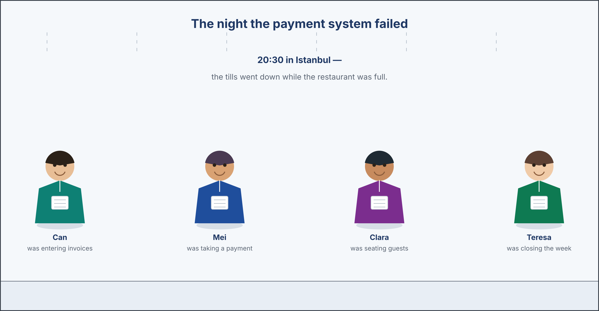
*A busy evening goes wrong when the payment system fails at 20:30.*

### Warm-up: Words About an Incident
**Match the words with their meanings. One meaning is not needed. Write the letter.**
0. Incident → something unexpected that happens and must be dealt with. (example)

**Column A**
1. **Fail** ____
2. **Suddenly** ____
3. **Interrupt** ____
4. **Report (v)** ____
5. **Backup** ____

**Column B**
a) to stop working
b) quickly and without warning
c) to stop something that is happening
d) to tell somebody officially what happened
e) a second copy, kept in case the first is lost
f) a bill from a supplier

### Warm-up: Complete the Sentences
**Complete the sentences using the words in the word bank.**
**Word bank:** failed | suddenly | interrupted | reported
0. The restaurant was full when it happened. (example)
1. At half past eight, the payment system ____________________ .
2. The lights stayed on, but the tills stopped ____________________ .
3. The problem ____________________ the service for forty minutes.
4. Can ____________________ the incident to Lisbon the same night.

### Warm-up: Reading — The Night the System Failed
**Read the text and choose the correct answer.**
> It was a Friday evening in Istanbul, and the restaurant was completely full. Can was entering invoices in the small office behind the kitchen, and Mei, who was visiting from Singapore that week, was helping at the till. At half past eight, while the team was serving the busiest tables of the night, the payment system suddenly failed. The lights stayed on and the kitchen kept cooking, but no card payment would go through, and the tills showed nothing at all. Nobody panicked. The manager told the guests what had happened, the waiters wrote every order on paper, and Mei recorded each amount by hand in a notebook. At ten past nine, the system came back. The team then entered every paper slip into the ledger, one by one, and checked the total twice. Can wrote a short report that night and sent it to Lisbon before he went home. He gave the time of the failure, the time of the repair, the number of slips and the final total. Teresa read it the next morning, and the first thing she did was thank him. The second was to send it to the other four branches, so everybody would know what to do if the same evening happened to them.
0. The restaurant was full that evening. (example)
**1. What was the team doing when the system failed?**
- ○ A) Closing the restaurant
- ○ B) Serving the busiest tables of the night
- ○ C) Counting the week's cash
- ○ D) Training new staff
**2. What did the team do while the system was down?**
- ○ A) They sent the guests home
- ○ B) They wrote every order on paper
- ○ C) They stopped cooking
- ○ D) They waited for Lisbon

## Part 1 · Vocabulary and Terminology
*[OP] Accounts track · pre-class input*
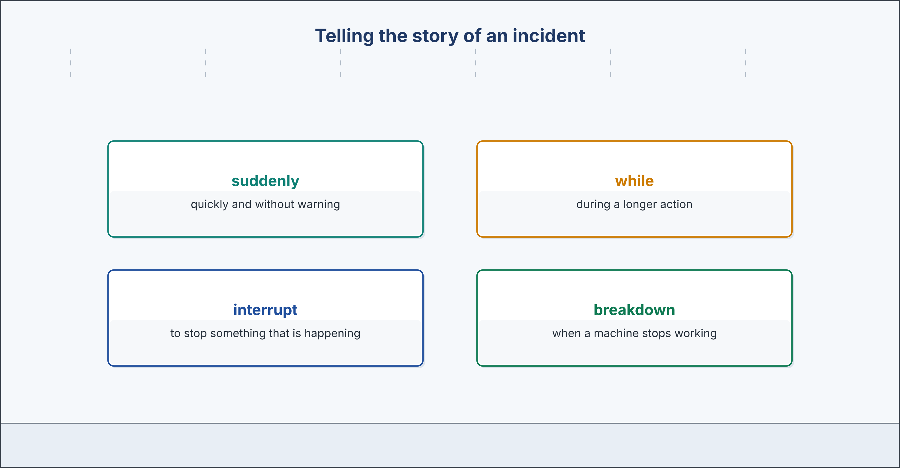
*Words for narrating: past simple, past continuous, while, when.*

### Part 1: Words for Telling What Happened
**Match the words with their meanings. One meaning is not needed. (0. is done for you.)**
0. Incident → something unexpected that must be dealt with.

**Column A**
1. **While** ____
2. **When** ____
3. **Breakdown** ____
4. **Slip (n)** ____
5. **Reconcile** ____
6. **Delay (n)** ____
7. **Witness (n)** ____

**Column B**
a) during a longer action
b) at the moment that something happened
c) the moment a machine stops working
d) a small piece of paper with an amount on it
e) to make two records agree
f) a period of waiting, longer than planned
g) a person who saw what happened
h) a plan for next year
**Gloss:** slip = a small piece of paper with an amount written on it · reconcile = to make two records agree

### Part 1: Pronunciation
**🔊 Audio Track 2.1**
**Listen and practise these words. Say each word aloud and stress the loud syllable (CAPITALS).**
- incident — **IN-ci-dent**
- suddenly — **SU-dden-ly**
- reconcile — **RE-con-cile**
- report — **re-PORT**
- continuous — **con-TI-nu-ous**
- interrupted — **in-te-RRUP-ted**

### Part 1: Past Forms — Match the Use
**Match each form with the way we use it. One use is not needed. Write the letter.**
0. records → a routine that happens every day. (example)

**Column A**
1. **failed** ____
2. **was serving** ____
3. **were writing** ____
4. **had failed** ____
5. **reconciled** ____

**Column B**
a) a single, finished event in the past
b) a longer action going on at that moment
c) two or more people in the middle of an action
d) something that happened before another past action
e) a finished action, completed and checked
f) something happening right now
**Gloss:** past continuous = was/were + the -ing form · past simple = the finished event

### Part 1: Telling What Happened — Multiple Choice
**Read and choose the correct answer.**
0. 'Suddenly' means quickly and without warning. (example)
**1. What does 'while' introduce?**
- ○ A) A finished event
- ○ B) A longer action going on at the time
- ○ C) A future plan
- ○ D) A price
**2. What is a 'slip'?**
- ○ A) A mistake in the ledger
- ○ B) A small piece of paper with an amount on it
- ○ C) A kind of invoice
- ○ D) A bank account
**3. What does 'reconcile' mean?**
- ○ A) To make two records agree
- ○ B) To cancel a payment
- ○ C) To hire a new cashier
- ○ D) To close a branch

### Part 1: Vocabulary Fill-in
**Complete the sentences with the correct word or phrase.**
**Word bank:** while | when | breakdown | reconciled
0. The incident happened on a Friday. (example)
1. ____________________ the team was serving, the system failed.
2. Mei was writing in her notebook ____________________ the lights flickered.
3. The engineer called the problem a complete ____________________ .
4. The next morning, Daniel ____________________ the slips with the ledger.

### Part 1: Write Two Sentences (short)
**Write one sentence about a longer past action (past continuous) and one about a sudden event (past simple).**
**Plan (make notes, then write):** At eight o'clock, I was ______ . Then ______ happened.
Then swap your two sentences with a partner, and check together that each verb is in the correct tense.

## Part 2 · Grammar — Past Simple and Past Continuous
*[OP] Accounts track · grammar focus*
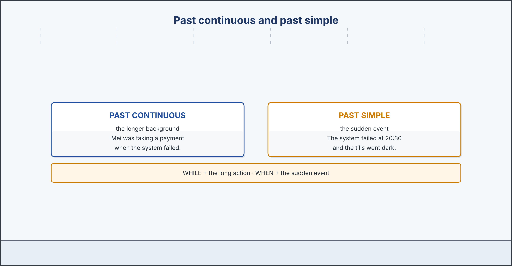
*A long background action (continuous) interrupted by a sudden event (simple).*

### Part 2: Notice
> Look carefully at these two past tenses, because together they tell a story. We use the past simple for a finished event: something happened, and it is over. 'The system failed at half past eight. Can wrote the report that night.' We form it with the past form of the verb, and most verbs add '-ed'. We use the past continuous for a longer action that was already going on at that moment. 'The team was serving the busiest tables. The waiters were writing the orders on paper.' We form it with 'was' or 'were' and the '-ing' form. The two tenses work together. The past continuous sets the scene, and the past simple breaks into it: 'While the team was serving, the system suddenly failed.'
**Look at your teacher's copy. Which sentence is the background? Which is the sudden event? Find one 'while' and one 'when'.**

### Part 2: Grammar Focus Box

| | Form | Use |
|---|---|---|
| past simple | The system failed at 20:30. | a single finished event |
| past continuous | The team was serving dinner. | a longer action going on at that time |
| the two together | While we were serving, the system failed. | the background, broken by the event |
| while and when | while + the long action · when + the event | 'while' takes the continuous |
**Remember:** Use the past continuous for the longer action that was already happening, and the past simple for the sudden event that interrupted it. 'While' usually introduces the long action; 'when' usually introduces the short one.
**Watch out!** Watch out: the sudden, short event takes the past simple — say 'the system failed' (not 'the system was failing').
**Gloss:** background = the longer action already happening · interrupt = to break into something that is happening

### Part 2: Controlled Practice — Simple or Continuous?
**Complete each sentence with the past simple or the past continuous.**
0. The team was serving (serve) dinner when the system failed. (example)
1. At 20:30, the payment system ____________________ (fail) completely.
2. Can ____________________ (enter) invoices when the lights flickered.
3. While Mei ____________________ (help) at the till, the tills went blank.
4. The team ____________________ (write) every order on paper that evening.

### Part 2: While, When and the Order of Events
**Complete each sentence with the correct form.**
1. While the kitchen ______ (cook), the office ______ (lose) the system.
2. When the system ______ (come) back, the team ______ (enter) every slip.
3. Teresa ______ (read) the report while she ______ (drink) her coffee.

### Part 2: Correct the Sentence
**Each sentence has one mistake. Write it correctly.**
1. While the team served, the system was failing.
2. Can was write the report at eleven o'clock.
3. When the lights flickered, Mei was wrote in her notebook.

### Part 2: Freer Practice
**Talk with a partner. Describe something that went wrong at work or at home. Say what was happening, and what suddenly happened.**
I was ______ when ______ .
While we were ______ , ______ .

### Part 2: Grammar Review
**Choose the correct answer.**
**1. While the team ______ dinner, the system failed.**
- ○ A) served
- ○ B) was serving
- ○ C) serves
- ○ D) is serving
**2. When the system came back, the team ______ every slip.**
- ○ A) entered
- ○ B) was entering
- ○ C) enters
- ○ D) is entering

## Part 3 · Listening and Dialogue
*[OP] Accounts track · listening*
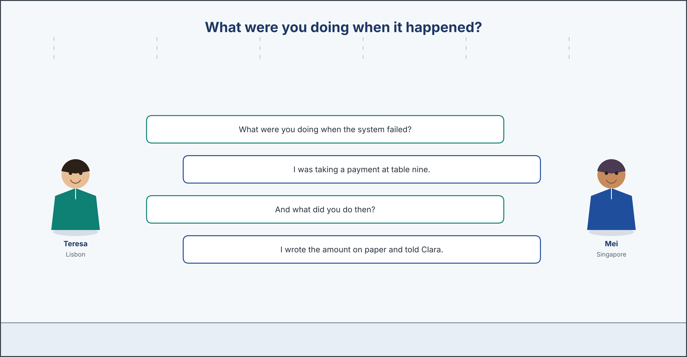
*Teresa asks Mei what she was doing when the system went down.*

### Part 3: Teresa Explains the Two Past Tenses
**🔊 Audio Track 2.2**
Before you listen: which tense sets the scene, and which tells you what happened?
> Teresa: When something goes wrong, you will have to explain it, so let me show you how the two past tenses work together. The past simple gives the event. The system failed at half past eight. Can wrote the report that night. Each of those is one finished thing, with a time attached. The past continuous gives the background. The team was serving the busiest tables. The waiters were writing orders on paper. Those actions had already started and were still going on. Now put them together, and you have a story a reader in another country can follow: while the team was serving, the system suddenly failed. Notice that 'while' takes the longer action, and 'when' usually takes the short one. If you get those two tenses the right way round, nobody will ask you a second question. If you get them the wrong way round, a reader in another country will think the system was failing all evening, or that the team only started serving after the trouble began. Neither of those is what happened, and neither of them is what you meant to say.
**While you listen: write True (T) or False (F). (0. is done.)**
0. The past simple gives the finished event. — T
1. The past continuous gives the background action. ____
2. 'While' usually introduces the short, sudden event. ____
3. The two tenses are often used together in one sentence. ____
4. 'The system was failing at 20:30' is the better sentence. ____
Useful phrases: while we were serving… · the system failed at… · when the lights went out…

### Part 3: What Were You Doing?
**🔊 Audio Track 2.3**
Before you listen: what was Mei doing at the moment the system failed?
> Teresa: Mei, I have Can's report, but I would like to hear it from you. What were you doing when the system failed? Mei: I was taking a payment at table nine. The guest's card was in the machine, and then the screen simply went blank. Teresa: And what did you do? Mei: I apologised, I wrote the amount on paper, and I asked the guest to wait two minutes. Teresa: Did the guest mind? Mei: Not at all. She said she had seen worse in her own restaurant. Teresa: And after that? Mei: While the team kept serving, I wrote every amount in a notebook. When the system came back at ten past nine, we entered all of them together. Teresa: That is exactly what should have happened. Thank you.
**While you listen: answer the questions. (0. is done.)**
0. What was Mei doing when the system failed? — She was taking a payment at table nine.
1. What did Mei do immediately after the screen went blank?
2. What was she doing while the team kept serving?
3. What happened at ten past nine?
Useful phrases: I was taking a payment when… · I wrote the amount on paper · when the system came back…

### Part 3: Reporting the Incident to Lisbon
**🔊 Audio Track 2.4**
Before you listen: what does a head office need to know about an incident?
> Can: Teresa, I am calling about Friday evening. At 20:30 the payment system failed, and it was down for forty minutes. Teresa: What was the restaurant doing at the time? Can: We were serving a full dining room. The kitchen carried on, and the waiters wrote every order by hand. Teresa: Did you lose any sales? Can: No. We recorded forty-one slips, and we entered all of them when the system returned. The total agreed with the kitchen's list. Teresa: Did anybody check it twice? Can: Mei and I checked it together before we left. Teresa: Good. Send me the slips and the report, and I will tell the group auditor before she asks.
**While you listen: match each person with what they did that evening. One action is not needed. (0. is done.) Write the letter.**
0. The kitchen → carried on cooking the whole time.

**Column A**
1. **Mei** ____
2. **The waiters** ____
3. **Can** ____
4. **Teresa** ____

**Column B**
a) wrote every amount in a notebook
b) wrote every order on paper
c) sent the report and the slips to Lisbon
d) told the group auditor before she asked
e) closed the restaurant for the evening

## Part 4 · Speaking
*[OP] Accounts track · speaking*
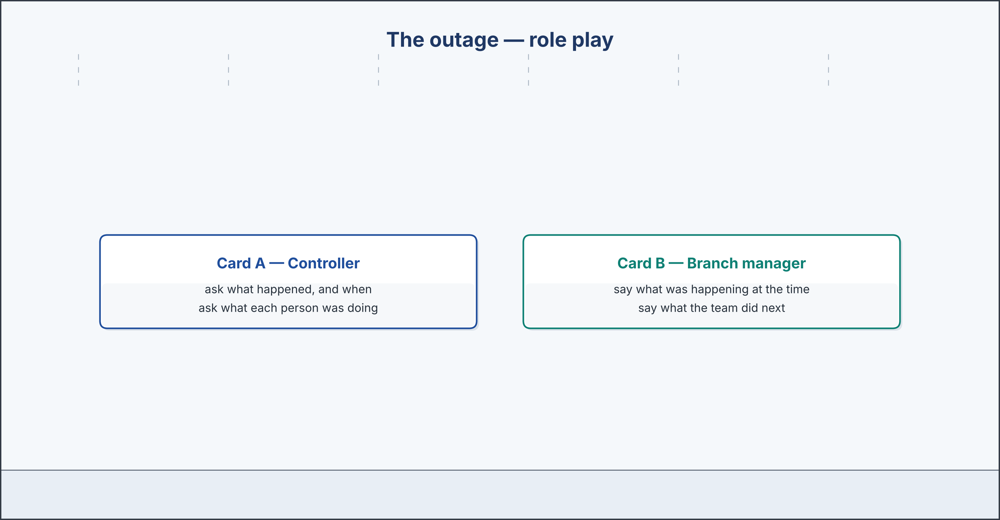
*Role play: the outage (Card A and Card B).*

### Part 4: Talking About Something That Went Wrong
**Work with a partner. Ask and answer these questions. Use both past tenses.**
What were you doing yesterday evening at eight o'clock?
Describe something that once went wrong at work or at school. What were you doing at the time?
What did you and the people around you do next?
Why is it useful to write down exactly what was happening when something failed?
Useful language: I was… when… · while we were… · suddenly… · after that, we…

### Part 4: The Outage — Role Play
**Work in pairs. Read the model, then use the cards.**
Model: A: What were you doing when it happened? — B: I was taking a payment at table nine. — A: And what did you do then? — B: I wrote the amount on paper and told the manager. While the team kept serving, I recorded every slip.
Useful language: I was… when it happened · while we were… · then I… · we checked it twice.
Card A — Controller: ask what happened, and when · ask what each person was doing.
Card B — Branch manager: say what was happening at the time · say what the team did next.
Your turn: run the dialogue, then change roles.

### Part 4: Mini-Presentation
**Prepare a short talk (about one minute). Tell the story of something that went wrong. Say what was happening, what suddenly happened, and what you did.**
**Plan (make notes, then write):** At about… , we were… Then suddenly… After that, we… In the end…

## Part 5 · Extended Reading
*[OP] Accounts track · extended reading*
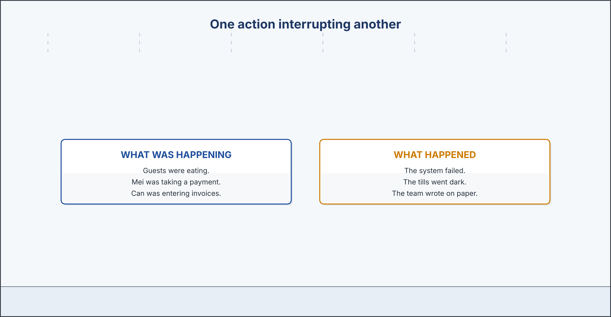
*One event interrupting another: what was happening, and what changed.*

### Part 5: The Story of an Evening
**Read the text and choose the correct answer.**
> Every business has an evening it remembers, and in a restaurant that evening is usually a busy one. The story is always told with two tenses, because two kinds of thing were going on. First there is the background: the dining room was full, the kitchen was working at its fastest, and the waiters were moving between twenty tables. Those actions had begun before the trouble started and continued after it. English puts them in the past continuous, with 'was' or 'were' and the '-ing' form. Then there is the event: at half past eight, the payment system failed. One moment, one verb, one finished action. English puts that in the past simple. A reader who was not there can follow the whole evening from those two tenses alone, because the grammar tells them what was already happening and what suddenly changed. This is not only a language point. In a group that reports from five countries, the person who reads the report has never seen the room, does not know the staff, and cannot ask a question until the next morning. The tenses are the only thing carrying the shape of the evening, so getting them right is part of the job.
0. Two kinds of action are described in the story. (example)
**1. Which tense gives the background?**
- ○ A) The past simple
- ○ B) The past continuous
- ○ C) The present simple
- ○ D) The present perfect
**2. Which sentence is the event?**
- ○ A) The dining room was full
- ○ B) The waiters were moving between tables
- ○ C) The payment system failed
- ○ D) The kitchen was working fast
**3. Why do the tenses matter so much in a group report?**
- ○ A) They make the report longer
- ○ B) The reader was not there and cannot ask
- ○ C) They are easier to translate
- ○ D) They save paper

### Part 5: Vocabulary in Context
**Match each word from the text with its meaning. One meaning is not needed. (0. is done.) Write the letter.**
0. background → what was already happening at the time. (example)

**Column A**
1. **event** ____
2. **continue** ____
3. **shape (n)** ____
4. **carry (v)** ____
5. **follow (v)** ____

**Column B**
a) one thing that happened, at one moment
b) to go on, without stopping
c) the general form of something; how it is put together
d) to hold something and take it somewhere
e) to understand the order of what happened
f) to pay an invoice early
**Gloss:** event = one thing that happened, at one moment · shape = the general form of something

### Part 5: What a Good Incident Report Contains
**Read about incident reports. Then mark each sentence True (T) or False (F).**
> A good incident report is short, and it answers four questions. What was happening before the problem? What exactly happened, and at what time? What did the team do about it? And what was the result, in numbers? The first question takes the past continuous, and the other three take the past simple. A report that answers all four can be read in a minute by somebody in another country who was asleep when it happened. Two things spoil a report. The first is a missing time: 'the system failed on Friday' is far weaker than 'the system failed at 20:30 on Friday'. The second is a missing number: 'we lost some sales' is not a report at all, while 'we recorded forty-one slips and entered every one' is. Write the report the same evening, while you still remember, and send it before anybody asks for it. A report that arrives on its own is read as information; the same report, asked for twice, is read as an excuse. Send it to everybody who will have to answer a question about that evening, and keep a copy where the next person can find it.
0. A good incident report answers four questions. → T (example)
1. The first question is answered with the past continuous. ____
2. A report is better without an exact time. ____
3. 'We lost some sales' is a complete report. ____
4. The report should be written the same evening. ____

## Part 6 · Writing
*[OP] Accounts track · writing*
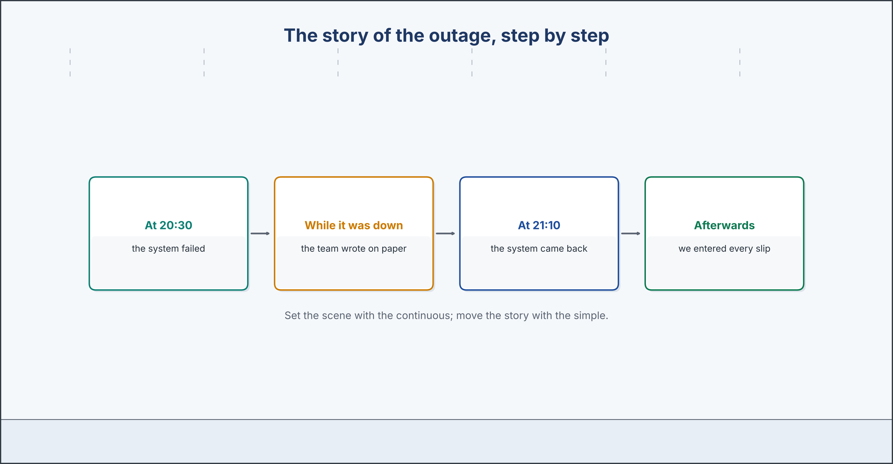
*The story of the outage, step by step.*

### Part 6: What Happened on Friday (70–130 words)
**Tell the story of something that went wrong. Use the past continuous for the background and the past simple for the events.**
**Model — read this first:**
> On Friday evening, the Istanbul restaurant was completely full. At half past eight, while the team was serving the busiest tables, the payment system suddenly failed. The lights stayed on and the kitchen continued cooking, but no card would go through. The manager told the guests at once, and the waiters wrote every order on paper. Mei recorded each amount in a notebook while the service carried on. At ten past nine, the system came back, and the team entered all forty-one slips together. We checked the total twice, and it agreed with the kitchen's list.
**Plan (make notes, then write):** At about… , we were… Then, suddenly… While that was happening, we… In the end…
**Check before you finish:** ☐ past continuous for the background?  ☐ past simple for the events?  ☐ 70–130 words?

### Part 6: A Short Incident Report (70–130 words)
**Write a short, factual incident report for a head office in another country. Give times and numbers.**
**Model — read this first:**
> Incident report — Istanbul, Friday 14 March. At 20:30 the payment system failed. At the time, the restaurant was serving a full dining room and the kitchen was working normally. The system was unavailable for forty minutes. During that period the team recorded every order on paper, and the cashier wrote each amount in a notebook. At 21:10 the system returned, and the team entered forty-one slips into the ledger. The total was checked twice and agreed with the kitchen's list. No sale was lost. The slips are scanned and attached. The engineer visited on Saturday and replaced the card reader.
**Check before you finish:** ☐ every time given?  ☐ every number given?  ☐ 70–130 words?

### Part 6: What a Colleague Was Doing (70–120 words)
**Describe what two colleagues were doing when something happened. Use the past continuous and the past simple.**
**Model — read this first:**
> When the system failed, everybody in the building was already busy. Can was entering supplier invoices in the small office behind the kitchen, and he did not notice the screens at first. Mei was taking a payment at table nine, so she saw it immediately: the card machine simply went blank in her hand. She apologised to the guest and wrote the amount on paper. Can came out of the office, spoke to the manager, and began collecting the paper slips. Neither of them stopped working, and neither of them raised their voice.
**Plan (make notes, then write):** When it happened, ______ was… and ______ was… Then they…
**Check before you finish:** ☐ both tenses used correctly?  ☐ two people described?  ☐ 70–120 words?

### Part 6: The Lesson We Learned (70–120 words)
**Write about what a team learned from something that went wrong. Use your own ideas.**
**Model — read this first:**
> We learned three things that evening. First, the paper notebook was worth more than the whole system, because it kept the record while the machines were dark. Second, the time matters: because Mei wrote the hour beside every amount, we could prove the order of events the next morning. Third, telling people early is always cheaper than explaining late. Can sent his report before anybody in Lisbon asked for one, and nobody had to spend Monday looking for answers. Since then, every branch keeps a notebook beside the till, and nobody thinks it is old-fashioned.
**Check before you finish:** ☐ past simple used for what happened?  ☐ a clear lesson?  ☐ 70–120 words?

## Part 7 · Restaurant-Accounting Track
*[RA] Restaurant track · handling an incident on the floor*
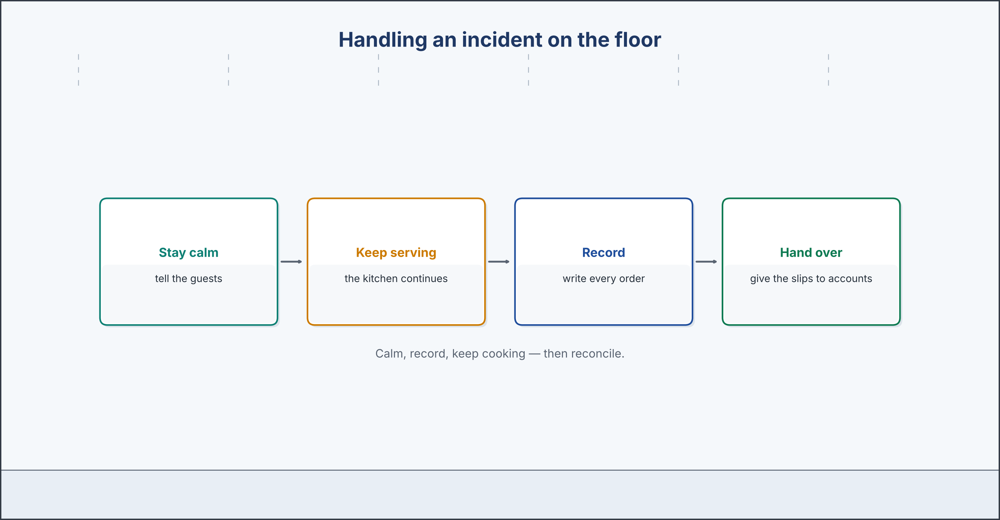
*Handling the outage on the floor: calm, record, keep cooking.*

### 7A: Phrase Bank — Handling an Incident
**Match each phrase with what it means. One meaning is not needed. (0. is done.) Write the letter.**
0. Stay calm. → do not show that you are worried. (example)

**Column A**
1. **Tell the guests.** ____
2. **Keep serving.** ____
3. **Write it down.** ____
4. **Check it twice.** ____
5. **Report it the same day.** ____

**Column B**
a) explain honestly what has happened
b) continue the service, so the evening goes on
c) record every amount on paper while the system is down
d) compare the two records before you accept them
e) send the facts to the head office before anybody asks
f) order the ingredients from a supplier

### 7B: Calm, Record, Keep Cooking
**🔊 Audio Track 2.5**
Before you listen: what should a floor team do first when a system fails?
> Clara: Can, I heard about Friday. What did your floor team actually do? Can: The first thing the manager did was walk into the dining room and tell the guests. He did not wait. Clara: And the kitchen? Can: The kitchen never stopped. The chefs were cooking the whole time and they never knew. Clara: So what changed for your waiters? Can: Only the paper. While they were serving, they wrote every order twice: one slip for the kitchen, one for the till. Clara: And afterwards? Can: We entered every slip, checked the total against the kitchen list, and found that the two agreed exactly. Clara: Calm, record, keep cooking. Can: That is the whole rule, and we put it on the wall of the office the following week. Clara: Did anybody complain? Can: One table asked for the bill twice, because the first slip went to the kitchen by mistake. We apologised and gave them the correct bill. That was the whole of the damage. The guests hardly noticed, and the records were complete before midnight.
**Answer the questions. (0. is done.)**
0. What was the first thing the manager did? — He told the guests, without waiting.
1. What was the kitchen doing during the outage?
2. What did the waiters write, and how many copies?
3. What did the team compare afterwards, and what did they find?

### 7C: Controlled Practice — The Order of the Evening
**Put the events of the evening in order. Number them 1–5. (0. is done.)**
0. The team was serving a full dining room. — 1
___ At 20:30 the payment system failed.
___ The manager told the guests what had happened.
___ The waiters wrote every order on paper.
___ At 21:10 the system came back and the team entered the slips.

### 7D: Role-Play — The Evening It Went Wrong
**In pairs. One is the restaurant manager; one is the controller. Use the model and cards.**
Model: Controller: What were you doing when it failed? — Manager: We were serving a full room. — Controller: And what did you do? — Manager: We told the guests, wrote everything on paper, and entered it all when the system came back.
Card A — Controller: ask what was happening at the time · ask what the team did next, and when.
Card B — Manager: describe the background with the past continuous · give the events, with times, in the past simple.

### 7E: Restaurant Writing (70–130 words)
**You are the restaurant manager. Write a short note to the group office describing the evening.**
**Model — read this first:**
> Friday evening, Istanbul. The dining room was full and the kitchen was working normally when the payment system failed at 20:30. I went into the dining room immediately and explained the problem to the guests, who were very patient. While the service continued, my team wrote every order on paper and the cashier recorded each amount in a notebook. The system returned at 21:10. We entered forty-one slips, checked the total against the kitchen list, and the two agreed. No sale was lost and no guest left unhappy. The notebook is in the safe, and the slips are scanned for you.
**Check before you finish:** ☐ both past tenses used?  ☐ times and numbers given?  ☐ 70–130 words?

## Part 8 · Consolidation
*[OP] Accounts track · consolidation*
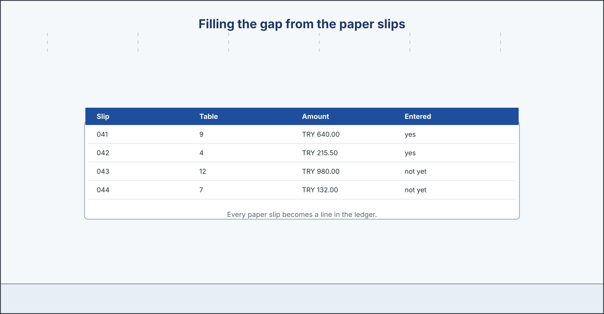
*Filling the system's gap from the handwritten paper slips.*

### Part 8: Reading — The Gap in the System
Before you read: why is a handwritten note sometimes worth more than a computer system?
> On the Monday after the outage, Daniel sat down with forty-one paper slips and a cup of coffee. His job was to close a gap. For forty minutes on Friday evening, the system had recorded nothing at all, and the only proof that those meals had happened was the handwriting of a cashier who had been working at speed. Nothing in that gap had been entered automatically, so every line had to be put there by a person, and every line had to be right. He entered each slip in the order of its time. Where a slip was unclear, he did not guess; he put it aside and asked Mei, who remembered the table. Twice the kitchen list showed a dish that no slip mentioned, and both times a waiter remembered the table and the amount. By lunchtime the ledger agreed with the kitchen list to the lira. Daniel wrote one line in the file: 'Forty-one sales entered from paper slips, 14 March, 20:30–21:10. Reconciled against the kitchen list. Two queries resolved with the staff who served the tables.' That line, Teresa said later, was worth more than the system had been that evening.
**Answer the questions. (0. is done.)**
0. What was Daniel's job on the Monday? — To close the gap left by the outage, using the paper slips.
1. What did Daniel do when a slip was unclear?
2. How were the two queries from the kitchen list resolved?
3. What did Daniel write in the file, and why did it matter?
**Gloss:** gap = a period or a place where something is missing · query = a question about something that is not clear

### Part 8: Vocabulary in Context
**Match each word with its meaning. One meaning is not needed. (0. is done.) Write the letter.**
0. proof → something that shows a thing is true. (example)

**Column A**
1. **gap** ____
2. **query** ____
3. **resolve** ____
4. **handwriting** ____
5. **at speed** ____

**Column B**
a) a place where something is missing
b) a question about something that is not clear
c) to settle a question or a problem
d) writing made by hand, not by a machine
e) quickly, under pressure
f) a guest who complains

### Part 8: Discussion
**Talk with a partner. Use the frames and give reasons.**
Discussion frames: 'I think the most important thing is…' · 'I agree, because…' · 'Yes, but…'
Why did the team write everything on paper instead of waiting for the system?
Why did Daniel ask a colleague instead of guessing?
What would you keep beside your own till, and why?

## Part 9 · Decision Task
*[OP] Accounts track · judgement*
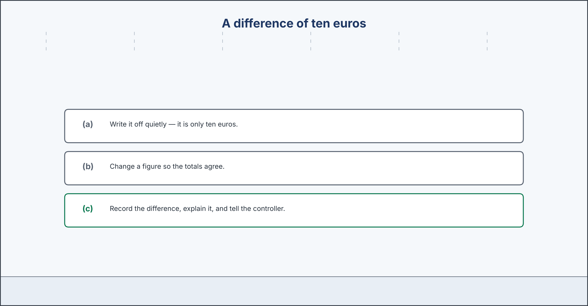
*A decision about a small difference of ten euros.*

### Part 9: The Ten-Euro Difference
Before you read: is a small difference ever too small to mention?
> When Daniel finished entering the forty-one slips, one number would not agree. The ledger showed ten euros more than the cash and card totals together. He checked the slips twice, and the difference stayed. Ten euros is very little in a restaurant that takes several thousand in an evening, and it would be easy to make it disappear. Daniel has three choices. He could write the ten euros off quietly as a rounding difference and say nothing, which would take one minute and nobody would ever ask. He could change one slip so that the totals agree, which would make the page look perfect. Or he could record the difference exactly as it is, write one line explaining what he has already checked, and tell Teresa the same day. He knows that the first choice hides something small, the second choice is not true, and the third costs him an uncomfortable conversation before lunch. He also knows which one an auditor would want to find.
**Answer the questions. (0. is done.)**
0. What would not agree? — The ledger showed ten euros more than the cash and card totals.
1. Why would it be easy to make the difference disappear?
2. What are Daniel's three choices?
3. What is wrong with the second choice?

### Part 9: Make the Decision
**Which should Daniel do — (a) write the ten euros off quietly, (b) change a slip so the totals agree, or (c) record the difference, explain what he checked, and tell Teresa today? Choose one and give your reasons.**
Answer frame: 'I think Daniel should choose ___ , because ___ . The other choices ___ .'
**Model — read this first:**
> Model decision: I think Daniel should choose the third option. The amount is small, but the principle is not. If he writes the difference off quietly, nobody learns anything, and the same ten euros may appear every Friday without anyone noticing. If he changes a slip, the page will look perfect and the record will be false, which is the one thing an accountant must never do, whatever the amount. Recording the difference costs him a short, uncomfortable conversation and nothing else. It also tells the auditor something valuable: that this team writes down what it cannot explain, instead of tidying it away.
Phrase bank: it is only ten euros, but… · a false record is a false record · I would rather explain it than hide it · tell the controller the same day.
My decision: ______ because ______ .

## Part 10 · Review and Can-Do
*[OP] Accounts track · review*
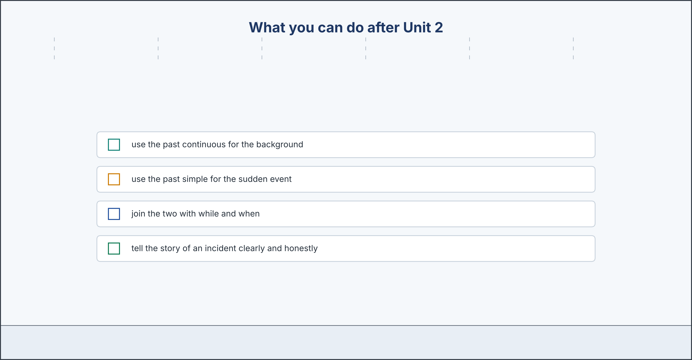
*What you can do after Unit 2.*

### Part 10: Spiral Review
**Complete with the past simple or the past continuous.**
**Word bank:** failed | was serving | were writing | entered
0. The restaurant was full that evening. (example)
1. At 20:30, the payment system ____________________ .
2. The team ____________________ a full dining room at the time.
3. The waiters ____________________ every order on paper.
4. When the system came back, we ____________________ all forty-one slips.

### Part 10: Can-Do

**Can-Do checklist**
- ☐ I can use the past simple for a single finished event
- ☐ I can use the past continuous for the background action
- ☐ I can join the two with while and when
- ☐ I can tell the story of an incident clearly and honestly

### Part 10: Unit 2 glossary

**Unit 2 glossary**
> past simple = the tense for a single finished event · past continuous = was/were + the -ing form, for the background · while = during the longer action · when = at the moment the event happened · incident = something unexpected that must be dealt with · outage = a period when a system is not working · slip = a small piece of paper with an amount written on it · reconcile = to make two records agree · query = a question about something that is not clear · gap = a period where the record is missing · report (v) = to tell somebody officially what happened · write off = to remove an amount from the records as a loss · background = the longer action that was already happening · interrupt = to break into something that is happening · the same day = before the evening is over, while you still remember

# Unit 3: The Record So Far
*Present perfect and past simple · B1.1–B1.2 · Blue Door Group · five countries, one ledger*

## Warm Up
*[OP] Accounts track · in-class starter*
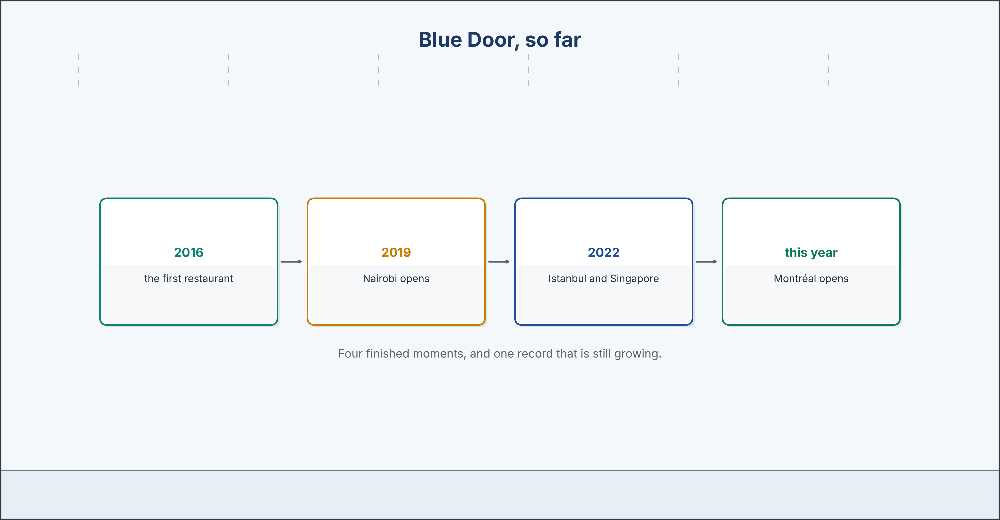
*Blue Door since 2016: four finished moments, and a record that is still growing.*

### Warm-up: Words About the Record So Far
**Match the words with their meanings. One meaning is not needed. Write the letter.**
0. Record (n) → everything that has been written down about a business. (example)

**Column A**
1. **So far** ____
2. **Already** ____
3. **Yet** ____
4. **Since** ____
5. **Growth** ____

**Column B**
a) up to now
b) sooner than expected
c) not up to now (in questions and negatives)
d) from a point in the past until now
e) an increase in size or amount
f) a bill from a supplier

### Warm-up: Complete the Sentences
**Complete the sentences using the words in the word bank.**
**Word bank:** so far | already | yet | since
0. The group has grown every year. (example)
1. ____________________ this year, we have opened one new restaurant.
2. We have ____________________ passed last year's total.
3. We have not closed the quarter ____________________ .
4. The group has traded in five countries ____________________ March.

### Warm-up: Reading — The Story So Far
**Read the text and choose the correct answer.**
> Blue Door began in 2016, when Mr Alvarez bought a small building in Lisbon and served the first meal that spring. For three years there was only one restaurant, one currency and one set of books. Then the group grew. It opened in Nairobi in 2019, and in Istanbul and Singapore in 2022. This year it has opened its fifth restaurant, in Montréal, and the accounts office has reported in euro for every one of them. Teresa keeps two kinds of sentence on the wall of her office. The first kind has a date: 'We opened in Nairobi in 2019.' The second kind has no date at all: 'We have opened five restaurants since 2016.' Both sentences are true, and they are not the same. The first is finished history. The second is the record so far, and it will change the day a sixth restaurant opens. Every quarter, Teresa writes a short report for Mr Alvarez. It always has both kinds of sentence in it, and the new assistant is learning which one to use where.
0. Blue Door began in 2016. (example)
**1. How many restaurants has the group opened since 2016?**
- ○ A) Two
- ○ B) Three
- ○ C) Five
- ○ D) Nine
**2. What is the difference between Teresa's two kinds of sentence?**
- ○ A) One is longer
- ○ B) One has a date and is finished; one is the record up to now
- ○ C) One is for guests
- ○ D) One is in euro

## Part 1 · Vocabulary and Terminology
*[OP] Accounts track · pre-class input*
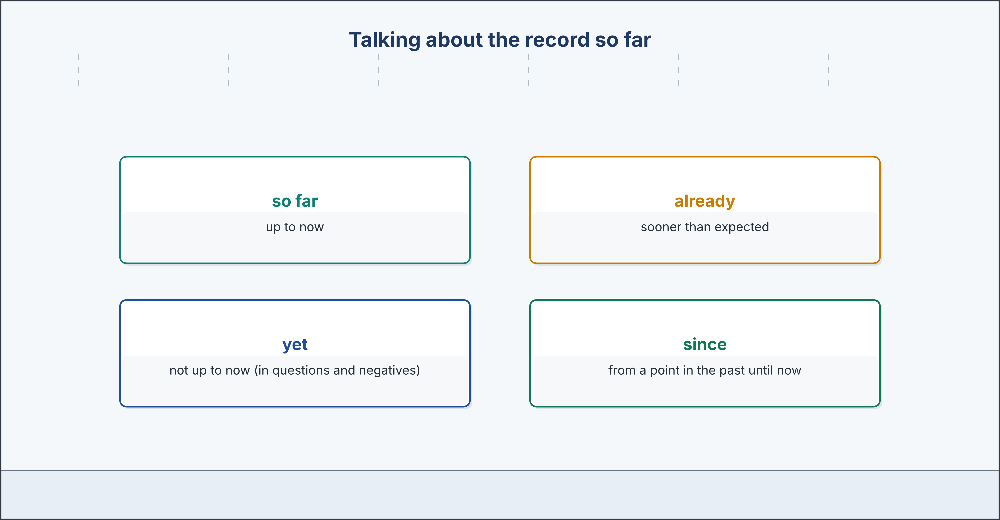
*Talking about the record so far: so far, already, yet, since.*

### Part 1: Words for the Record
**Match the words with their meanings. One meaning is not needed. (0. is done for you.)**
0. So far → up to now.

**Column A**
1. **Already** ____
2. **Yet** ____
3. **Since** ____
4. **For** ____
5. **Ever** ____
6. **Never** ____
7. **Just** ____

**Column B**
a) sooner than expected
b) not up to now, in questions and negatives
c) from a point in the past until now
d) for a length of time, from then until now
e) at any time in your life, in questions
f) at no time, up to now
g) a very short time ago
h) a plan for next year
**Gloss:** since = from a point in time · for = for a length of time · just = a very short time ago

### Part 1: Pronunciation
**🔊 Audio Track 3.1**
**Listen and practise these words. Say each word aloud and stress the loud syllable (CAPITALS).**
- already — **al-REA-dy**
- quarter — **QUAR-ter**
- reported — **re-POR-ted**
- experience — **ex-PE-rience**
- since — **SINCE**
- achievement — **a-CHIEVE-ment**

### Part 1: Perfect or Past — Match the Use
**Match each form with the way we use it. One use is not needed. Write the letter.**
0. opens → a routine that happens every day. (example)

**Column A**
1. **has opened** ____
2. **opened** ____
3. **have reported** ____
4. **reported** ____
5. **has not closed** ____

**Column B**
a) the record up to now, with no finished time
b) a finished action, at a finished time
c) the record of a group, up to today
d) what happened in a year that has ended
e) something that is still not true, up to now
f) something happening at this moment
**Gloss:** present perfect = have/has + the past participle · past simple = the finished action, with its date

### Part 1: The Record So Far — Multiple Choice
**Read and choose the correct answer.**
0. 'So far' means up to now. (example)
**1. Which sentence is about a finished time?**
- ○ A) We have opened five restaurants
- ○ B) We opened in Nairobi in 2019
- ○ C) We have not closed the quarter yet
- ○ D) We have traded since 2016
**2. What does 'yet' usually mean?**
- ○ A) Sooner than expected
- ○ B) Not up to now
- ○ C) A long time ago
- ○ D) At the same time
**3. Which word takes a length of time?**
- ○ A) since
- ○ B) ago
- ○ C) for
- ○ D) yet

### Part 1: Vocabulary Fill-in
**Complete the sentences with the correct word or phrase.**
**Word bank:** since | for | already | yet
0. The group has grown every year. (example)
1. Blue Door has traded ____________________ 2016.
2. Daniel has worked in Nairobi ____________________ four years.
3. We have ____________________ reached last year's total.
4. The Montréal figures have not arrived ____________________ .

### Part 1: Write Two Sentences (short)
**Write one sentence about the record up to now (present perfect) and one about a finished year (past simple).**
**Plan (make notes, then write):** So far this year, I have ______ . Last year, I ______ .
Then swap your two sentences with a partner, and check together that the finished time takes the past simple.

## Part 2 · Grammar — Present Perfect and Past Simple
*[OP] Accounts track · grammar focus*
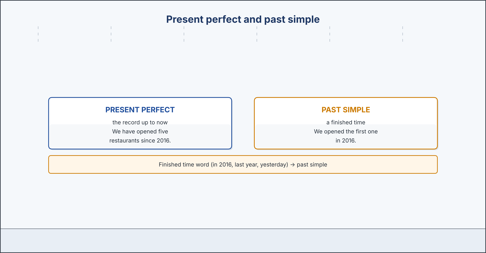
*The record up to now (perfect) and the finished moment (past simple).*

### Part 2: Notice
> Look carefully at these two tenses, because business English uses them differently. We use the present perfect for the record up to now, when the time is not finished and often not mentioned at all. 'We have opened five restaurants. Costs have risen twice this year.' We form it with 'have' or 'has' and the past participle. We use the past simple for something that happened at a finished time. 'We opened in Nairobi in 2019. Costs rose in March.' The time word decides the tense. If the sentence contains a finished time — in 2019, last year, yesterday, in March — English requires the past simple. If the period is still running — this year, this quarter, since 2016, so far — English prefers the present perfect.
**Look at your teacher's copy. Which sentences name a finished time? Which describe the record so far? Find one 'since' and one 'yet'.**

### Part 2: Grammar Focus Box

| | Form | Use |
|---|---|---|
| present perfect | We have opened five restaurants. | the record up to now, no finished time |
| past simple | We opened in Nairobi in 2019. | a finished action, at a finished time |
| since and for | since 2016 · for four years | a point in time · a length of time |
| already, yet, just | We have already passed it. Not yet. | how the record stands right now |
**Remember:** Use the present perfect for the record up to now, and the past simple when the sentence names a finished time. The time word decides the tense, not the feeling.
**Watch out!** Watch out: do not use the present perfect with a finished time — say 'we opened in 2019' (not 'we have opened in 2019').
**Gloss:** past participle = the third form of a verb: opened, risen, written · finished time = a time that has ended, such as 'last year'

### Part 2: Controlled Practice — Perfect or Past?
**Complete each sentence with the present perfect or the past simple.**
0. We have opened (open) five restaurants since 2016. (example)
1. The group ____________________ (open) in Nairobi in 2019.
2. So far this year, costs ____________________ (rise) twice.
3. Daniel ____________________ (join) the company four years ago.
4. We ____________________ (not / close) the quarter yet.

### Part 2: Since, For and the Time Words
**Complete each sentence with the correct form.**
1. Blue Door ______ (trade) in five countries since March.
2. Mei ______ (work) at the Singapore till for two years.
3. We ______ (not / receive) the Montréal figures yet.

### Part 2: Correct the Sentence
**Each sentence has one mistake. Write it correctly.**
1. We have opened the Nairobi restaurant in 2019.
2. Daniel works here since four years.
3. Did you have finished the quarter yet?

### Part 2: Freer Practice
**Talk with a partner. Say what you have done so far this year, and what you did last year.**
So far this year, I have ______ , and I have not ______ yet.
Last year, I ______ , and that was ______ .

### Part 2: Grammar Review
**Choose the correct answer.**
**1. We ______ in Nairobi in 2019.**
- ○ A) have opened
- ○ B) opened
- ○ C) have open
- ○ D) are opening
**2. So far this year, costs ______ twice.**
- ○ A) rose
- ○ B) have risen
- ○ C) rise
- ○ D) are rising

## Part 3 · Listening and Dialogue
*[OP] Accounts track · listening*
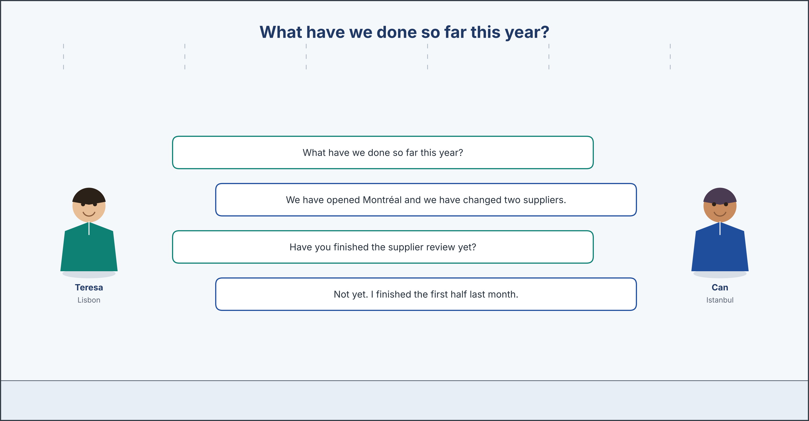
*What the group has done so far this year, and what happened in each finished year.*

### Part 3: Teresa Explains the Two Tenses
**🔊 Audio Track 3.2**
Before you listen: which tense do we use when the sentence names a year?
> Teresa: These two tenses confuse almost everybody, so let me give you the rule we use in this office. Ask yourself one question: does the sentence name a finished time? If it does — in 2019, last quarter, yesterday, in March — then English wants the past simple, and nothing will change that. We opened in Nairobi in 2019. Costs rose in March. If the sentence does not name a finished time, or if the period is still running, English prefers the present perfect. We have opened five restaurants. Costs have risen twice this year. Notice the second sentence: this year is not over, so the record is still growing. You will also meet three small words that almost always travel with the perfect: already, yet, and just. We have already passed last year's total. We have not closed the quarter yet. Mr Alvarez has just called. Learn those three with the tense, and half the work is done.
**While you listen: write True (T) or False (F). (0. is done.)**
0. A finished time in the sentence requires the past simple. — T
1. 'In 2019' requires the present perfect. ____
2. 'So far this year' suits the present perfect. ____
3. Already, yet and just usually travel with the perfect. ____
4. The feeling of the speaker decides the tense. ____
Useful phrases: so far this year… · we opened in 2019 · we have not closed the quarter yet.

### Part 3: The Quarter So Far
**🔊 Audio Track 3.3**
Before you listen: what has the group done this quarter, and what has it not done?
> Teresa: Can, give me the quarter so far. What have you done? Can: We have changed two suppliers and we have renegotiated the coffee contract. Teresa: And the supplier review? Can: I have not finished it yet. I finished the first half last month, and I will finish the rest next week. Teresa: Good — notice how you said that. The first half is a finished piece of work, so it takes the past simple. The review as a whole is not finished, so it takes the perfect. Can: I did not even think about it. Teresa: That is exactly when people get it right. Anything else? Can: Prices have risen twice since January, and I have already warned the kitchens. Teresa: Then write me those three sentences, and I will put them straight into the report.
**While you listen: answer the questions. (0. is done.)**
0. What two things has Can done this quarter? — He has changed two suppliers and renegotiated the coffee contract.
1. Has Can finished the supplier review?
2. Why does 'the first half' take the past simple?
3. What has happened to prices since January?
Useful phrases: we have changed… · I have not finished it yet · I finished the first half last month.

### Part 3: The Year the Group Grew
**🔊 Audio Track 3.4**
Before you listen: how would you describe a company's history in one minute?
> Mr Alvarez: People always ask me how it started, so I keep the answer short. I bought the building in 2016 and we served the first meal that spring. For three years nothing else happened, and I was happy. Then we opened Nairobi in 2019, because Daniel wrote to me and I could not say no. In 2022 we opened two restaurants in one year, which I do not recommend to anybody. And this year we have opened Montréal, so we have five. Teresa: And how do you describe it to the bank? Mr Alvarez: Exactly the same way, but with the dates in the right places. The bank wants to hear what we have done since 2016, and then it wants to see each year on its own.
**While you listen: match each year with what happened. One event is not needed. (0. is done.) Write the letter.**
0. 2016 → Mr Alvarez bought the building and served the first meal.

**Column A**
1. **2019** ____
2. **2022** ____
3. **this year** ____
4. **since 2016** ____

**Column B**
a) the group opened in Nairobi
b) the group opened two restaurants in one year
c) the group has opened in Montréal
d) the group has opened five restaurants in all
e) the group closed a restaurant

## Part 4 · Speaking
*[OP] Accounts track · speaking*
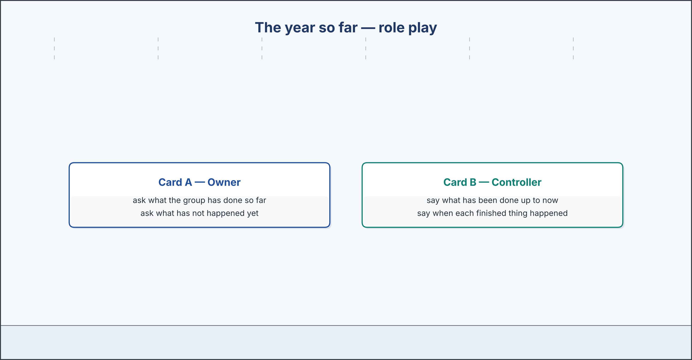
*Role play: the year so far (Card A and Card B).*

### Part 4: Talking About the Record So Far
**Work with a partner. Ask and answer these questions. Use both tenses.**
What have you done so far this year that you are pleased with?
What did you do last year that you would do differently now?
How long have you worked or studied where you are now?
Why do banks and auditors want both kinds of sentence in a report?
Useful language: so far this year, I have… · last year, I… · I have worked here for / since… · I have not… yet.

### Part 4: The Year So Far — Role Play
**Work in pairs. Read the model, then use the cards.**
Model: A: What has the group done so far this year? — B: We have opened Montréal and we have changed two suppliers. — A: And what have you not done yet? — B: We have not closed the quarter yet. We closed the last one in April.
Useful language: so far… · we have already… · we have not… yet · we did that in April.
Card A — Owner: ask what the group has done so far · ask what has not happened yet.
Card B — Controller: say what has been done up to now · give the date of each finished thing.
Your turn: run the dialogue, then change roles.

### Part 4: Mini-Presentation
**Prepare a short talk (about one minute). Describe the record of your team or your studies so far this year, and one thing you finished at a known time.**
**Plan (make notes, then write):** So far this year, we have… We have already… We have not… yet. In March, we…

## Part 5 · Extended Reading
*[OP] Accounts track · extended reading*
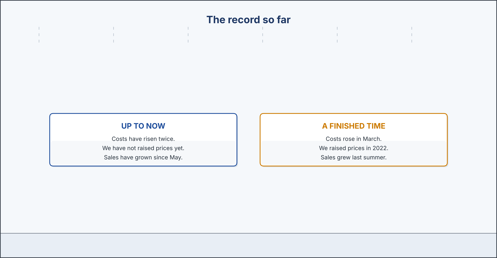
*The record up to now, and the finished year beside it.*

### Part 5: Two Ways to Tell the Same Story
**Read the text and choose the correct answer.**
> Every set of accounts tells its story twice, and the two versions are not rivals. The first version is the finished year. It has a beginning and an end, it is signed, it is audited, and nothing in it will change again. English describes it with the past simple: the group opened in Nairobi in 2019, revenue rose by nine per cent in 2022, the Istanbul restaurant made its first profit in its second year. These sentences carry dates, and the dates are the point of them. The second version is the record so far. It has a beginning but no end, because the period is still running and the figures are still arriving. English describes this with the present perfect: the group has opened five restaurants, costs have risen twice this year, Montréal has not reached its first full quarter yet. These sentences rarely carry a date at all, and that absence is deliberate. A reader who knows the difference can tell, from the tense alone, whether a number is final or still moving. In a group that reports from five countries, that single piece of information saves a great many questions, because the person reading in Lisbon on Monday cannot telephone Singapore on Sunday night to ask whether the figure is finished.
0. Accounts tell their story twice. (example)
**1. Which tense describes the finished, audited year?**
- ○ A) The present perfect
- ○ B) The past simple
- ○ C) The present continuous
- ○ D) The past continuous
**2. Why do present perfect sentences rarely carry a date?**
- ○ A) Dates are hard to translate
- ○ B) The period is still running
- ○ C) They are informal
- ○ D) They are shorter
**3. What can a reader tell from the tense alone?**
- ○ A) Who wrote the report
- ○ B) Whether a number is final or still moving
- ○ C) Which currency is used
- ○ D) How long the report is

### Part 5: Vocabulary in Context
**Match each word from the text with its meaning. One meaning is not needed. (0. is done.) Write the letter.**
0. revenue → the money a business takes in from sales. (example)

**Column A**
1. **audited** ____
2. **final** ____
3. **absence** ____
4. **deliberate** ____
5. **quarter** ____

**Column B**
a) checked officially by an independent examiner
b) settled; it will not change again
c) the fact that something is not there
d) done on purpose, for a reason
e) a period of three months
f) a guest who complains
**Gloss:** audited = checked officially by an independent examiner · quarter = a period of three months

### Part 5: What a Quarterly Report Contains
**Read about quarterly reports. Then mark each sentence True (T) or False (F).**
> A quarterly report is short, and in a group it has to be readable in five countries at once. It opens with the record so far: what the group has done since the year began, in the present perfect, with no dates. It then gives the finished quarter on its own, in the past simple, with every figure dated and every comparison named. Next come the things that have not happened yet, which are often the most useful lines in the whole document, because they tell the reader what is still moving. Finally it gives one sentence on what the group expects next. A good report never mixes the two tenses in a single line, because a sentence that says 'we have opened in 2019' tells the reader that the writer has not checked their own work. Teresa reads every branch report before it goes to Mr Alvarez, and the tense is the first thing she checks. She says it takes her thirty seconds and saves the office a week, because a reader who trusts the first page rarely argues with the fourth.
0. A quarterly report has to be readable in five countries. → T (example)
1. The report opens with the record so far, in the present perfect. ____
2. The finished quarter is given in the past simple, with dates. ____
3. Things that have not happened yet are left out. ____
4. Teresa checks the tense before the report goes to the owner. ____

## Part 6 · Writing
*[OP] Accounts track · writing*
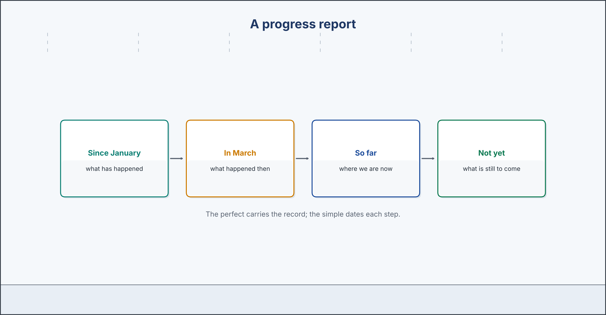
*A progress report: the record so far, and each finished step.*

### Part 6: The Year So Far (70–130 words)
**Write a short progress report on your year so far. Use the present perfect for the record and the past simple for finished moments.**
**Model — read this first:**
> So far this year, the group has opened one new restaurant and has changed two suppliers. Revenue has grown in four branches and has fallen slightly in one. We have already passed last year's total for the same period, which nobody expected in January. We have not closed the third quarter yet, so these figures are still moving. The finished steps are easy to date: we opened Montréal in April, we signed the new coffee contract in May, and we raised the Lisbon menu prices in June. Each of those is complete and will not change.
**Plan (make notes, then write):** So far this year, we have… We have already… We have not… yet. In April, we…
**Check before you finish:** ☐ present perfect for the record so far?  ☐ past simple for each dated step?  ☐ 70–130 words?

### Part 6: A Finished Year (70–130 words)
**Describe a year that has ended. Use the past simple throughout, with dates.**
**Model — read this first:**
> Last year was the busiest in the group's history. We opened two restaurants in twelve months, one in Istanbul in March and one in Singapore in September. Revenue rose by nine per cent, and food costs rose by eleven, so the margin fell slightly. We changed our coffee supplier in June after three difficult deliveries, and the kitchens noticed the improvement within a fortnight. In November the Istanbul restaurant made its first profit, two months earlier than the plan. We closed the year with five hundred and twelve staff and no unpaid supplier. It was a hard year, and it ended well.
**Check before you finish:** ☐ past simple throughout?  ☐ every figure dated?  ☐ 70–130 words?

### Part 6: A Colleague's Experience (70–120 words)
**Describe a colleague's experience. Use the present perfect for how long, and the past simple for what they did.**
**Model — read this first:**
> Daniel has worked for Blue Door since 2019, so he has seen the group grow from one restaurant to five. He has been the Nairobi bookkeeper for four years, and he has trained two assistants in that time. Before he joined us, he worked for a hotel group in Mombasa, where he learned how to close a month in three days. He has not missed a close since he arrived, which is a record nobody else in the group can claim. Last year he rebuilt the whole supplier file, and we have used his system ever since.
**Plan (make notes, then write):** ______ has worked here since… They have… Before that, they…
**Check before you finish:** ☐ both tenses used correctly?  ☐ since/for used correctly?  ☐ 70–120 words?

### Part 6: What Has Not Happened Yet (70–120 words)
**Write about what is still unfinished in your work. Use the present perfect with yet, already and just.**
**Model — read this first:**
> Three things are still open at the end of this quarter. We have not received the final Montréal figures yet, because the branch has only just finished its first full month. We have already reconciled four branches, so the work that remains is small, but it cannot be finished until the fifth arrives. The supplier review has not been completed either; Can has done the first half and will finish the rest next week. Nothing here is late, and nothing is hidden. I would rather send an honest list of what is still moving than a complete report that is not true.
**Check before you finish:** ☐ yet, already and just used correctly?  ☐ an honest list of what is open?  ☐ 70–120 words?

## Part 7 · Restaurant-Accounting Track
*[RA] Restaurant track · the restaurant's story*
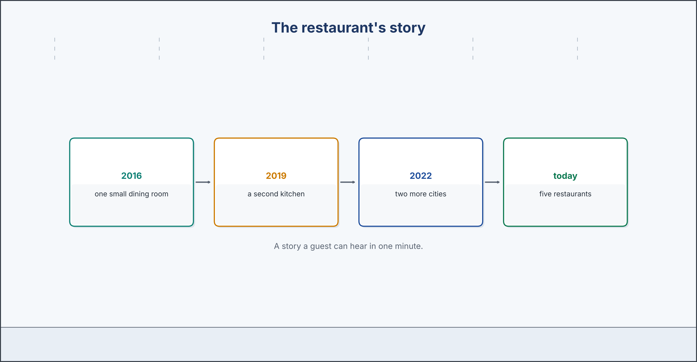
*The restaurant's story: four finished moments, one growing record.*

### 7A: Phrase Bank — Telling the Restaurant's Story
**Match each phrase with what it means. One meaning is not needed. (0. is done.) Write the letter.**
0. We opened in 2016. → a finished moment, with its date. (example)

**Column A**
1. **We have been here since 2016.** ____
2. **We have served thousands of guests.** ____
3. **We opened our second kitchen in 2019.** ____
4. **We have not changed the recipe.** ____
5. **We won an award last year.** ____

**Column B**
a) how long, from a point in the past until now
b) the record so far, with no date
c) a finished step, with the year named
d) something that is still true, up to today
e) a finished achievement, at a finished time
f) a plan for next year

### 7B: The Story a Guest Can Hear
**🔊 Audio Track 3.5**
Before you listen: how would you tell a guest the story of a restaurant in one minute?
> Clara: Guests ask me about the restaurant almost every evening. What should I say? Teresa: Say it the way Mr Alvarez says it, and keep the tenses apart. Start with the record: we have been here since 2016, and we have served more than four hundred thousand guests. Clara: And then the moments? Teresa: Then the moments, with their dates. He bought the building in 2016. We opened the second kitchen in 2019. We won the regional award in 2022. Clara: Why not mix them? Teresa: Because a guest who hears 'we have won the award in 2022' hears somebody who is not quite sure. The record makes them feel the place has lasted. The dates make them believe you. Clara: And the thing we have not done yet? Teresa: Tell them that too. We have not opened on Sundays yet — and watch their faces when you say 'yet'.
**Answer the questions. (0. is done.)**
0. What should Clara start with? — The record: how long the restaurant has been there, and how many guests it has served.
1. Which three dated moments does Teresa give?
2. Why does Teresa say the two kinds of sentence should not be mixed?
3. What does the word 'yet' do at the end of the story?

### 7C: Controlled Practice — The Restaurant's Story in Order
**Put the story in order. Number the sentences 1–5. (0. is done.)**
0. Mr Alvarez bought a small building in Lisbon in 2016. — 1
___ The restaurant served its first meal that spring.
___ We opened our second kitchen in 2019.
___ We won the regional award in 2022.
___ We have served more than four hundred thousand guests since then.

### 7D: Role-Play — Telling the Story
**In pairs. One is a guest; one is the restaurant manager. Use the model and cards.**
Model: Guest: How long have you been here? — Manager: We have been here since 2016, and we have served more than four hundred thousand guests. — Guest: And the award on the wall? — Manager: We won that in 2022.
Card A — Guest: ask how long the restaurant has been open · ask about something on the wall.
Card B — Manager: give the record with the present perfect · give each dated moment with the past simple.

### 7E: Restaurant Writing (70–130 words)
**You are the restaurant manager. Write a short paragraph for the menu telling the story of the restaurant.**
**Model — read this first:**
> Blue Door has stood on this corner since 2016, and we have served more than four hundred thousand guests in that time. Mr Alvarez bought the building in the spring of that year and cooked the first meal himself, for eleven people, on a Tuesday. We opened our second kitchen in 2019, and in 2022 we won the regional award that hangs by the door. Since then we have added four more restaurants, in four other countries, and we have kept the same bread recipe in all of them. We have not opened on Sundays yet. Perhaps one day we shall.
**Check before you finish:** ☐ present perfect for the record?  ☐ past simple for each dated moment?  ☐ 70–130 words?

## Part 8 · Consolidation
*[OP] Accounts track · consolidation*
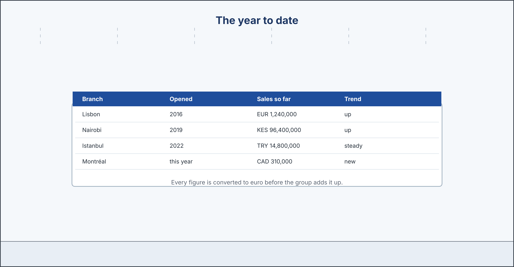
*The year to date, branch by branch.*

### Part 8: Reading — A Question of Experience
Before you read: why is it better to be honest about your experience, even when you want a job badly?
> A new assistant was needed in the group office, and Ingrid interviewed four people for it. The strongest candidate, Victor, had an impressive record, but one detail caught her eye. His application said that he had worked in group accounting for six years. In the interview, he said something slightly different: he had worked in accounts for six years, and in group accounting for two of them. Ingrid did not treat this as a disaster. She asked him directly which was correct, and he answered at once that the second version was. He explained that he had written the line quickly and had not read it again, which is exactly how most exaggerations begin. Ingrid thanked him for the straight answer and asked a second question: what had he learned in those two years? He talked for five minutes about converting currencies and closing late branches, and it was obvious that he had done the work. She gave him the job that afternoon, and she kept both versions of the sentence in the file, because the way a person corrects themselves tells you more than the line they corrected.
**Answer the questions. (0. is done.)**
0. What caught Ingrid's eye? — His application said six years of group accounting; in the interview he said two.
1. How did Victor explain the difference?
2. What did Ingrid ask him next, and what did she learn?
3. Why did she keep both versions of the sentence in the file?
**Gloss:** exaggeration = saying something is bigger or better than it really is · candidate = a person who applies for a job

### Part 8: Vocabulary in Context
**Match each word with its meaning. One meaning is not needed. (0. is done.) Write the letter.**
0. application → the form and letter you send when you want a job. (example)

**Column A**
1. **candidate** ____
2. **impressive** ____
3. **exaggeration** ____
4. **straight (adj)** ____
5. **obvious** ____

**Column B**
a) a person who applies for a job
b) good enough to make people notice
c) saying something is bigger or better than it is
d) honest and direct, with nothing hidden
e) easy to see or understand
f) a record from the bank

### Part 8: Discussion
**Talk with a partner. Use the frames and give reasons.**
Discussion frames: 'I think the most important thing is…' · 'I agree, because…' · 'Yes, but…'
Why did Ingrid give Victor the job even after she found the difference?
Is an exaggeration on an application the same as a lie? Say why.
How would you describe your own experience in two honest sentences?

## Part 9 · Decision Task
*[OP] Accounts track · judgement*
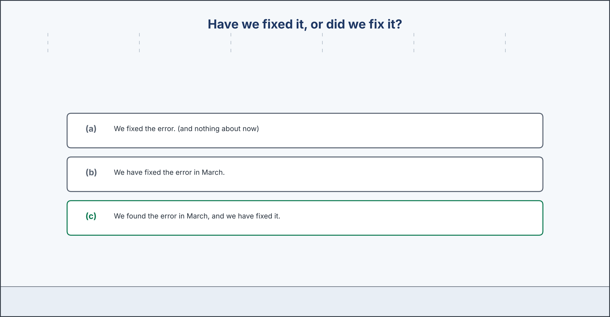
*A decision about which tense tells the truth about a repair.*

### Part 9: Have We Fixed It, or Did We Fix It?
Before you read: how can a tense make a finished problem sound unfinished — or the opposite?
> Noor is writing one line for the quarterly report about an error in the March figures. The facts are simple. In March, two supplier invoices were entered twice, which made costs look higher than they were. Daniel found the problem in April, corrected both entries, and checked the whole month again. The correction is finished and the figures are right. The question is how to write it. Noor has three choices. She could write 'We fixed the error', which is true, uses the past simple, and says nothing about the state of the accounts now. She could write 'We have fixed the error in March', which mixes a perfect with a finished time and would tell any careful reader that she had not checked her own sentence. Or she could write both halves properly: 'We found the error in March and we have corrected it', using the past simple for the dated discovery and the present perfect for the state the accounts are in today. The report goes to the bank as well as to Mr Alvarez, so the sentence has to be right the first time.
**Answer the questions. (0. is done.)**
0. What was the error? — Two supplier invoices were entered twice in March.
1. What did Daniel do, and when?
2. What is wrong with the second choice?
3. Who will read the report?

### Part 9: Make the Decision
**Which line should Noor write — (a) 'We fixed the error,' (b) 'We have fixed the error in March,' or (c) 'We found the error in March and we have corrected it'? Choose one and give your reasons.**
Answer frame: 'I think Noor should write sentence ___ , because ___ . The other choices ___ .'
**Model — read this first:**
> Model decision: I think Noor should write the third sentence. It is the only one that does both jobs at once. The first sentence is grammatically correct, but it leaves the reader wondering whether the accounts are right now, which is the only thing the bank actually wants to know. The second sentence breaks the rule this unit teaches: a finished time cannot take the present perfect, and a careful reader will stop at that line and start doubting the rest. The third sentence dates the discovery with the past simple and reports today's position with the present perfect. It is one word longer and it closes the question.
Phrase bank: we found it in March · we have corrected it · the figures are right now · the time word decides the tense.
My decision: ______ because ______ .

## Part 10 · Review and Can-Do
*[OP] Accounts track · review*
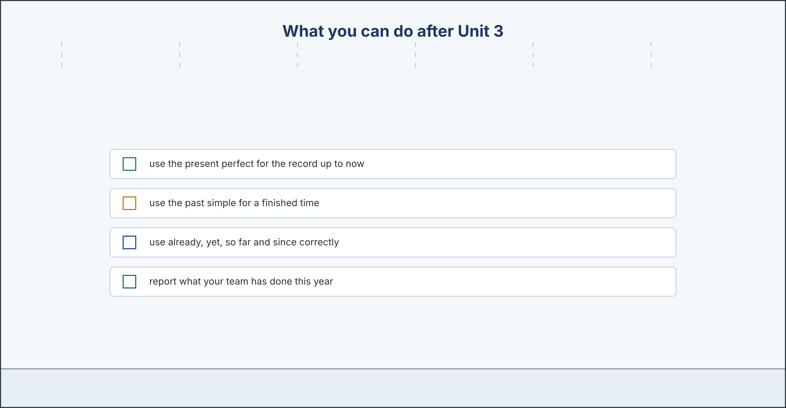
*What you can do after Unit 3.*

### Part 10: Spiral Review
**Complete with the present perfect or the past simple.**
**Word bank:** have opened | opened | has risen | rose
0. The group has grown every year. (example)
1. Since 2016, we ____________________ five restaurants.
2. We ____________________ in Nairobi in 2019.
3. So far this year, the food cost ____________________ twice.
4. Revenue ____________________ by nine per cent last year.

### Part 10: Can-Do

**Can-Do checklist**
- ☐ I can use the present perfect for the record up to now
- ☐ I can use the past simple for an action at a finished time
- ☐ I can use since, for, already, yet and just correctly
- ☐ I can report what my team has done this year

### Part 10: Unit 3 glossary

**Unit 3 glossary**
> present perfect = have/has + the past participle, for the record up to now · past simple = the finished action, at a finished time · past participle = the third form of a verb: opened, risen, written · since = from a point in time until now · for = for a length of time · already = sooner than expected · yet = not up to now, in questions and negatives · just = a very short time ago · quarter = a period of three months · audited = checked officially by an independent examiner · revenue = the money a business takes in from sales · candidate = a person who applies for a job · exaggeration = saying something is bigger or better than it really is · growth = an increase in size or amount · so far = up to now, in a period that is still running

# Unit 4: Nothing Left Out — Honest Records
*The passive voice · B1.1–B1.2 · Blue Door Group · five countries, one ledger*

## Warm Up
*[OP] Accounts track · in-class starter · INTEGRITY FOCUS*
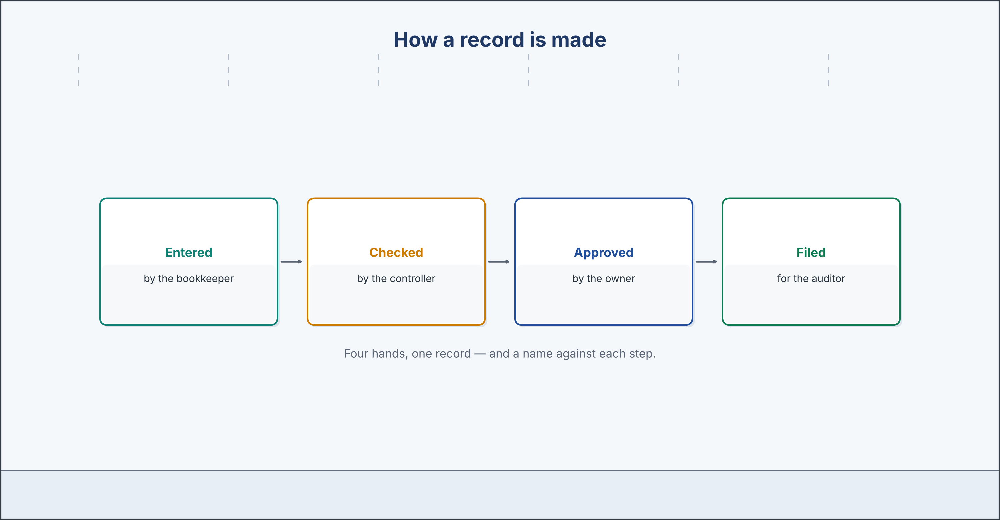
*How a record is made: entered, checked, approved, filed.*

### Warm-up: Words About an Honest Record
**Match the words with their meanings. One meaning is not needed. Write the letter.**
0. Record (v) → to write something down so it can be found again. (example)

**Column A**
1. **Enter (v)** ____
2. **Check (v)** ____
3. **Approve** ____
4. **File (v)** ____
5. **Trail** ____

**Column B**
a) to put information into a system
b) to look at something to see that it is right
c) to say officially that something is correct
d) to store a document so it can be found
e) the line of evidence that shows what was done
f) a bill from a supplier

### Warm-up: Complete the Sentences
**Complete the sentences using the words in the word bank.**
**Word bank:** entered | checked | approved | filed
0. Every invoice has a name against it. (example)
1. The invoice was ____________________ into the system on Tuesday.
2. The total was ____________________ by Teresa the next morning.
3. The payment was ____________________ by Mr Alvarez on Thursday.
4. The document was then ____________________ for the auditor.

### Warm-up: Reading — Four Hands, One Record
**Read the text and choose the correct answer.**
> In a group that trades in five countries, no record is ever made by one person alone. An invoice arrives in Istanbul and is entered by Can on the day it arrives. The total is then checked by Teresa in Lisbon, who compares it with the order and the delivery note. If everything agrees, the payment is approved by Mr Alvarez, and only then is the money sent. Finally the document is filed, with its reference number, where the group auditor can find it without asking anybody. Four hands touch every invoice, and each pair leaves its name. Teresa calls this the audit trail, and she says it is the most valuable thing the office owns. 'Any business can be wrong about a number,' she tells new assistants. 'What matters is whether the business can show how the number was reached, and who was looking at it when it was.' Notice how often she says 'was entered' and 'was approved'. In an accounts office, what was done comes first, and the name follows immediately.
0. No record is made by one person alone. (example)
**1. How many pairs of hands touch every invoice?**
- ○ A) One
- ○ B) Two
- ○ C) Four
- ○ D) Ten
**2. What does Teresa call the most valuable thing the office owns?**
- ○ A) The computer system
- ○ B) The audit trail
- ○ C) The bank account
- ○ D) The supplier list

## Part 1 · Vocabulary and Terminology
*[OP] Accounts track · pre-class input*
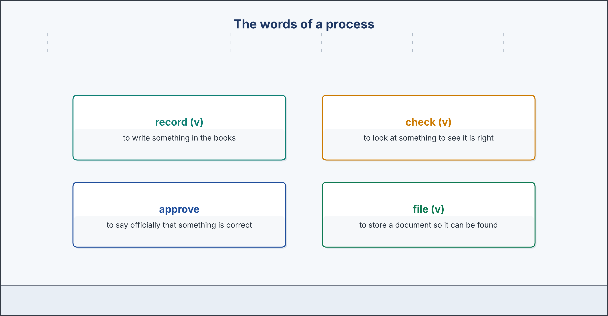
*The words of a process: record, check, approve, file.*

### Part 1: Words for a Process
**Match the words with their meanings. One meaning is not needed. (0. is done for you.)**
0. Enter → to put information into a system.

**Column A**
1. **Approve** ____
2. **Audit trail** ____
3. **Reference** ____
4. **Supporting document** ____
5. **Authorise** ____
6. **Reverse (v)** ____
7. **Evidence** ____

**Column B**
a) to say officially that something is correct
b) the line of records that shows what was done, and by whom
c) a number or code that lets you find a document again
d) a paper that proves a figure, such as a receipt
e) to give somebody the right to do something
f) to undo an entry by making an equal, opposite one
g) facts that show something is true
h) a plan for next year
**Gloss:** audit trail = the line of records that shows what was done, and by whom · reverse = to undo an entry with an equal, opposite one

### Part 1: Pronunciation
**🔊 Audio Track 4.1**
**Listen and practise these words. Say each word aloud and stress the loud syllable (CAPITALS).**
- approved — **a-PROVED**
- authorise — **AU-tho-rise**
- evidence — **E-vi-dence**
- procedure — **pro-CE-dure**
- reversed — **re-VERSED**
- documented — **DO-cu-men-ted**

### Part 1: Active or Passive — Match the Use
**Match each form with the way we use it. One use is not needed. Write the letter.**
0. Can enters the invoice. → the active: the person comes first. (example)

**Column A**
1. **The invoice is entered daily.** ____
2. **The invoice was entered on Tuesday.** ____
3. **The invoice has been entered.** ____
4. **The invoice will be entered tomorrow.** ____
5. **The invoice must be entered today.** ____

**Column B**
a) a present routine, described as a process
b) one finished action in the past
c) the record up to now, with no date
d) a future action, arranged or expected
e) an obligation, with no person named
f) an action happening at this moment
**Gloss:** the passive = be + the past participle · by + the doer = the name, added when the reader needs it

### Part 1: The Passive — Multiple Choice
**Read and choose the correct answer.**
0. The passive is formed with 'be' and the past participle. (example)
**1. Which sentence is passive?**
- ○ A) Can entered the invoice
- ○ B) The invoice was entered
- ○ C) Can is entering the invoice
- ○ D) Can will enter the invoice
**2. When should you add 'by …'?**
- ○ A) Never
- ○ B) Whenever the reader needs the name
- ○ C) Only in questions
- ○ D) Only in the past
**3. What is an 'audit trail'?**
- ○ A) A list of suppliers
- ○ B) The line of records showing what was done, and by whom
- ○ C) A kind of invoice
- ○ D) A bank statement

### Part 1: Vocabulary Fill-in
**Complete the sentences with the correct word or phrase.**
**Word bank:** approved | reference | supporting document | reversed
0. Every entry can be found again. (example)
1. The payment was ____________________ by the owner on Thursday.
2. Every entry is given a ____________________ number.
3. A receipt is the ____________________ for a cash purchase.
4. The double entry was ____________________ , not deleted.

### Part 1: Write Two Sentences (short)
**Write one active sentence about something you do, and the same idea in the passive.**
**Plan (make notes, then write):** Active: I ______ the ______ every day. Passive: The ______ is ______ every day (by me).
Then swap your two sentences with a partner, and decide together which version a reader would prefer, and why.

## Part 2 · Grammar — The Passive Voice
*[OP] Accounts track · grammar focus*
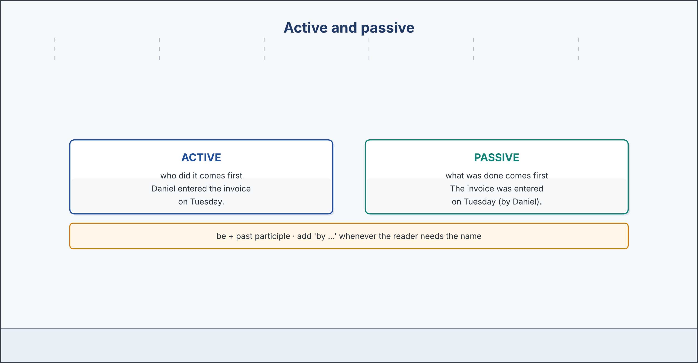
*Active and passive: who did it, and what was done.*

### Part 2: Notice
> Look carefully at these two ways of saying the same thing. In the active, the person comes first: 'Can entered the invoice on Tuesday.' In the passive, the action comes first: 'The invoice was entered on Tuesday.' We form the passive with the verb 'be' and the past participle, and 'be' carries the tense: it is entered, it was entered, it has been entered, it will be entered, it must be entered. We choose the passive when the action matters more than the person, when the person is obvious, or when the process is the point. In accounting that is very often, because a procedure belongs to the office rather than to one member of staff. But the passive has a danger. 'Mistakes were made' is a sentence with nobody in it. Whenever you know who did something and the reader needs to know, add 'by' and the name.
**Look at your teacher's copy. Which sentences are passive? Which of them should have a name added, and why?**

### Part 2: Grammar Focus Box

| | Form | Use |
|---|---|---|
| present passive | The invoice is checked every day. | a routine process |
| past passive | The invoice was entered on Tuesday. | one finished action |
| perfect and future | It has been approved. · It will be filed. | the record now · what comes next |
| by + the doer | It was approved by Mr Alvarez. | add the name whenever the reader needs it |
**Remember:** Form the passive with 'be' and the past participle. Use it when the action or the process matters most — and add 'by …' whenever you know who did it and the reader needs to know.
**Watch out!** Watch out: never use the passive to hide a name — 'mistakes were made' tells the reader nothing and costs you their trust.
**Gloss:** past participle = the third form of a verb: entered, checked, approved, written · procedure = the fixed way a task is always done

### Part 2: Controlled Practice — Make It Passive
**Rewrite each sentence in the passive. Keep the tense.**
0. Can enters the invoices. → The invoices are entered (by Can). (example)
1. Teresa checks every total. → ____________________
2. Mr Alvarez approved the payment. → ____________________
3. The office has filed the document. → ____________________
4. Daniel will reconcile the accounts. → ____________________

### Part 2: Adding the Doer
**Complete each sentence with the passive, and add 'by' and the name.**
1. The invoice ______ (enter) on Tuesday ______ Can.
2. The total ______ (check) the next morning ______ Teresa.
3. The payment ______ (approve) on Thursday ______ Mr Alvarez.

### Part 2: Correct the Sentence
**Each sentence has one mistake. Write it correctly.**
1. The invoice was enter on Tuesday.
2. The total has been check by Teresa.
3. Mistakes were made in the March figures. (name the doer)

### Part 2: Freer Practice
**Talk with a partner. Describe a process you know in the passive, step by step. Then say who does each step.**
First, the ______ is ______ . Then it is ______ by ______ .
Finally, it is ______ , so that ______ .

### Part 2: Grammar Review
**Choose the correct answer.**
**1. The payment ______ by Mr Alvarez on Thursday.**
- ○ A) approved
- ○ B) was approved
- ○ C) has approve
- ○ D) is approving
**2. Every total ______ before the money is sent.**
- ○ A) checks
- ○ B) is checked
- ○ C) has check
- ○ D) checking

## Part 3 · Listening and Dialogue
*[OP] Accounts track · listening*

*The invoice was entered, checked and approved — and each step has a name.*

### Part 3: Teresa Explains the Passive
**🔊 Audio Track 4.2**
Before you listen: why does an accounts office use the passive so often?
> Teresa: You will notice that we speak in the passive all day in this office, and there is a reason for it. A procedure belongs to the group, not to the person who happens to be doing it this week. So we say 'the invoice is entered on the day it arrives', because that is true whoever enters it, in whichever country. We form it with 'be' and the past participle, and 'be' carries the tense: it is entered, it was entered, it has been entered, it will be entered. Now, the warning. The passive lets you leave the person out, and sometimes that is exactly right, because nobody needs to know which assistant typed the line. But it also lets you hide, and that is never right. If you ever write 'mistakes were made', ask yourself who made them, and whether the reader needs to know. If the reader needs to know, put the name in, and put it in the same sentence.
**While you listen: write True (T) or False (F). (0. is done.)**
0. The passive is formed with 'be' and the past participle. — T
1. A procedure belongs to the group rather than to one person. ____
2. The verb 'be' carries the tense in a passive sentence. ____
3. Leaving the person out is always wrong. ____
4. 'Mistakes were made' is a good sentence for a report. ____
Useful phrases: the invoice is entered on the day it arrives · it was approved by… · who made them?

### Part 3: Was It Checked Before It Was Paid?
**🔊 Audio Track 4.3**
Before you listen: what does an auditor want to know about a payment?
> Teresa: Can, the auditor has asked about invoice 2291. Was it checked before it was paid? Can: Yes. It was received on the fourth of March and entered the same day. Teresa: And then? Can: The total was checked against the order and the delivery note on the fifth, by you. Teresa: So it was. And the approval? Can: It was approved by Mr Alvarez on the sixth, and the payment was sent on the seventh. Teresa: Was anything unusual about it? Can: One thing. The delivery note was signed by a driver, not by our storeman, so I wrote a note explaining why. Teresa: Good. That note is worth more than the invoice. Send her the trail, with the note attached.
**While you listen: answer the questions. (0. is done.)**
0. When was the invoice received and entered? — It was received and entered on the fourth of March.
1. What was the total checked against, and by whom?
2. When was the payment approved, and by whom?
3. What was unusual about the delivery note, and what did Can do?
Useful phrases: it was received on… · it was checked against… · it was approved by… · I wrote a note explaining why.

### Part 3: Explaining a Procedure to a New Assistant
**🔊 Audio Track 4.4**
Before you listen: how would you teach somebody a four-step procedure in one minute?
> Teresa: Noor, this is the procedure, and it is the same in all five countries. Every invoice is entered on the day it arrives. Nothing waits until tomorrow, because tomorrow is when things are forgotten. Noor: And after it is entered? Teresa: The total is checked against the order and the delivery note. If the three agree, it goes forward. If they do not, it is held and the supplier is called. Noor: Who approves the payment? Teresa: Payments under five thousand euro are approved by me. Above that, they are approved by Mr Alvarez. Noor: And then? Teresa: Then the document is filed with its reference, and the reference is written in the ledger line, so that the paper and the entry can always find each other.
**While you listen: match each step with what happens. One step is not needed. (0. is done.) Write the letter.**
0. The invoice arrives → it is entered on the same day.

**Column A**
1. **The total** ____
2. **A payment under five thousand euro** ____
3. **A payment above five thousand euro** ____
4. **The document** ____

**Column B**
a) is checked against the order and the delivery note
b) is approved by Teresa
c) is approved by Mr Alvarez
d) is filed with its reference number
e) is sent back to the supplier unopened

## Part 4 · Speaking
*[OP] Accounts track · speaking*
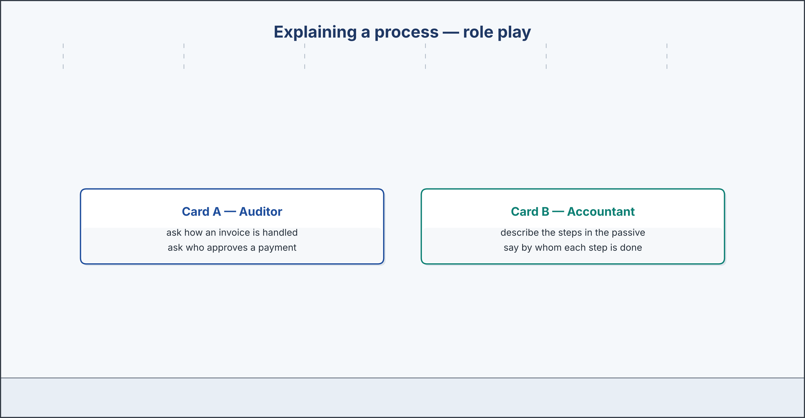
*Role play: explaining a process (Card A and Card B).*

### Part 4: Talking About How Things Are Done
**Work with a partner. Ask and answer these questions. Use the passive.**
How is an order handled where you work or study?
Who is a decision approved by, and at what level?
What is kept as proof, and where is it filed?
Why is it sometimes better to describe a process without naming a person?
Useful language: it is entered on… · it is checked against… · it is approved by… · it is filed with…

### Part 4: Explaining a Process — Role Play
**Work in pairs. Read the model, then use the cards.**
Model: A: How is an invoice handled here? — B: It is entered on the day it arrives, and the total is checked against the order. — A: And who approves the payment? — B: Payments under five thousand euro are approved by the controller; above that, by the owner.
Useful language: it is entered… · it is checked against… · it is approved by… · it is filed with its reference.
Card A — Auditor: ask how an invoice is handled · ask who approves a payment, and at what level.
Card B — Accountant: describe the four steps in the passive · add the name wherever it matters.
Your turn: run the dialogue, then change roles.

### Part 4: Mini-Presentation
**Prepare a short talk (about one minute). Describe a procedure you know in four steps, using the passive. Say who approves each step.**
**Plan (make notes, then write):** First, the ______ is ______ . Then it is ______ by ______ . After that, ______ . Finally, ______ .

## Part 5 · Extended Reading
*[OP] Accounts track · extended reading*
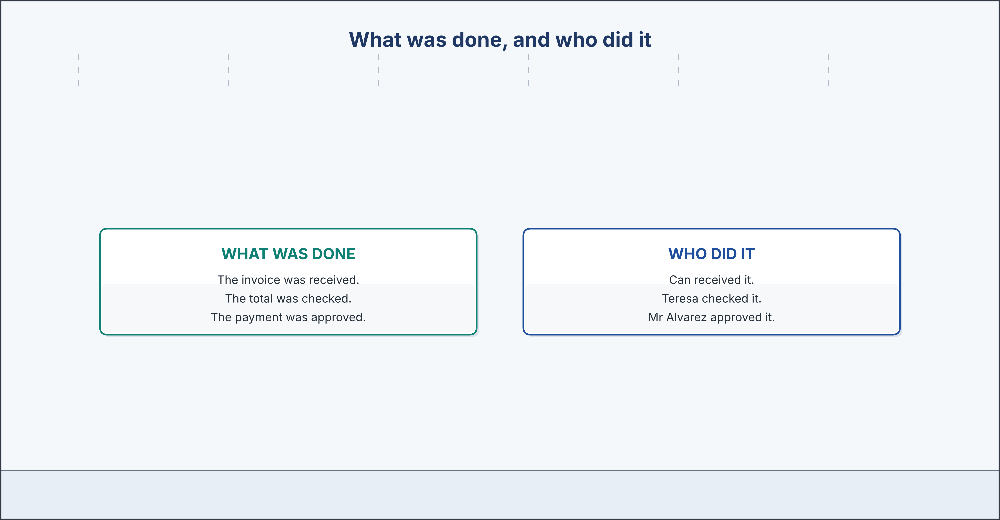
*What was done, and who did it.*

### Part 5: Why Accountants Use the Passive
**Read the text and choose the correct answer.**
> There is a reason why so much accounting English is written in the passive, and it is not laziness. An accounts procedure is meant to survive the people who carry it out. The invoice is entered on the day it arrives, whoever is at the desk that morning; the total is checked against the order, whichever country the order came from; the payment is approved at the right level, whoever happens to hold that post this year. Writing those sentences in the active would tie a permanent rule to a temporary person, and the rule would have to be rewritten every time somebody changed jobs. The passive also puts the action where a reader looks first, which matters when the reader is an auditor in another country working through two hundred pages. But the same grammar that makes a procedure durable can also make a mistake ownerless. 'Mistakes were made in the March figures' is a complete English sentence with nobody in it, and every experienced reader notices the absence immediately. The rule in this office is simple, and it costs nothing to follow: use the passive for the procedure, and use a name for the event. Processes do not make errors; people do, and people correct them.
0. Accounting English uses the passive a great deal. (example)
**1. Why is a procedure written in the passive?**
- ○ A) It is shorter
- ○ B) It survives the people who carry it out
- ○ C) It is more polite
- ○ D) It is easier to translate
**2. What is wrong with 'Mistakes were made in the March figures'?**
- ○ A) It is too long
- ○ B) It has nobody in it
- ○ C) It is in the wrong tense
- ○ D) It names too many people
**3. What is the rule in the office?**
- ○ A) Never use the passive
- ○ B) The passive for the procedure, a name for the event
- ○ C) Always name everybody
- ○ D) Use the active only in reports

### Part 5: Vocabulary in Context
**Match each word from the text with its meaning. One meaning is not needed. (0. is done.) Write the letter.**
0. procedure → the fixed way a task is always done. (example)

**Column A**
1. **durable** ____
2. **permanent** ____
3. **temporary** ____
4. **absence** ____
5. **ownerless** ____

**Column B**
a) lasting a long time without changing
b) meant to last; not for a short period only
c) lasting only for a short time
d) the fact that something is not there
e) belonging to nobody
f) a receipt for a cash purchase
**Gloss:** durable = lasting a long time without changing · ownerless = belonging to nobody

### Part 5: What an Audit Trail Must Show
**Read about audit trails. Then mark each sentence True (T) or False (F).**
> An audit trail answers four questions about every figure, and it answers them without anybody having to be asked. What was done? When was it done? By whom was it done? And what paper supports it? If a trail answers all four, an auditor in another country can follow a number from the bank statement back to the delivery note without sending a single email. If it answers three, somebody loses a morning. A trail is not a special document that is written at the year end; it is simply the ordinary record, made carefully on the day. That is why nothing is ever deleted in this office. If an entry is wrong, it is reversed by an equal and opposite entry, and both lines stay visible for ever. A deleted line looks tidy and tells the reader nothing; a reversed line is untidy and tells them everything, including the fact that somebody noticed. The same rule applies across the group, in every currency and every system, because an auditor who finds one deletion in one country will reasonably ask what has been deleted in the other four.
0. An audit trail answers four questions. → T (example)
1. A trail is written specially at the year end. ____
2. A wrong entry is deleted so the page looks tidy. ____
3. A reversal leaves both lines visible. ____
4. A complete trail saves the auditor from asking questions. ____

## Part 6 · Writing
*[OP] Accounts track · writing*
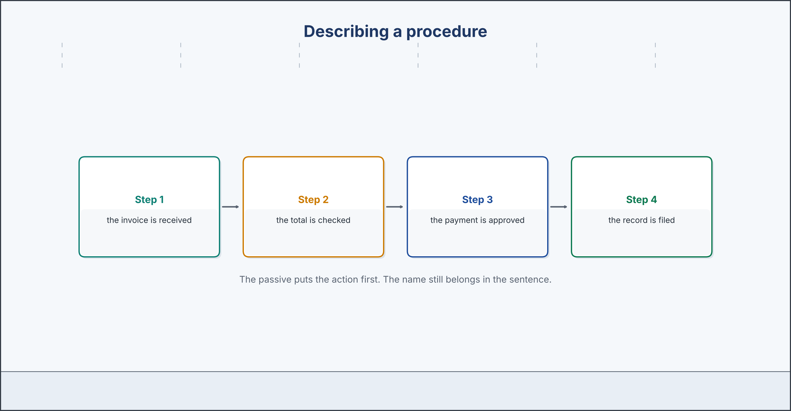
*Describing a procedure, step by step, in the passive.*

### Part 6: How an Invoice Is Handled (70–130 words)
**Describe a procedure in four steps. Use the passive, and name the approver.**
**Model — read this first:**
> Every invoice is handled in the same way in all five countries. It is entered into the system on the day it arrives, and nothing is left until the following morning. The total is then checked against the purchase order and the delivery note, and the three must agree before anything moves. If they do not agree, the invoice is held and the supplier is called the same day. Payments below five thousand euro are approved by the group controller; larger payments are approved by the owner. Finally the document is filed with its reference number, and the same reference is written in the ledger.
**Plan (make notes, then write):** First, it is… Then the total is… If they do not agree, it is… Finally, it is…
**Check before you finish:** ☐ passive used for each step?  ☐ the approver named?  ☐ 70–130 words?

### Part 6: A Short Note to an Auditor (70–130 words)
**Write a short note explaining how one payment was handled. Use the past passive, with dates and names.**
**Model — read this first:**
> Invoice 2291, Istanbul. The invoice was received on 4 March and was entered into the system on the same day by Can Demir. The total was checked against the purchase order and the delivery note on 5 March by the group controller, and the three documents agreed. The payment was approved on 6 March by Mr Alvarez, as the amount was above five thousand euro, and it was sent on 7 March. The delivery note was signed by the supplier's driver rather than by our storeman, and a note explaining this was written and filed with the invoice. All four documents are attached.
**Check before you finish:** ☐ past passive throughout?  ☐ every date and name given?  ☐ 70–130 words?

### Part 6: Explaining a Correction (70–120 words)
**Describe a mistake and how it was corrected. Use the passive for the process, and a name for the event.**
**Model — read this first:**
> Two supplier invoices were entered twice in the March figures, which made costs appear higher than they were. The duplication was found by Daniel on 11 April, while he was reconciling the quarter. Nothing was deleted. Both entries were reversed by an equal and opposite line on the same day, and the reversal was approved by the group controller. The whole month was then checked again, invoice by invoice, and no other duplicate was found. The original lines and the reversals are both visible in the ledger, so the correction can be followed by anybody who looks.
**Plan (make notes, then write):** What happened: ______ was ______ . Who found it: ______ found it on ______ . What was done: ______ .
**Check before you finish:** ☐ passive for the process?  ☐ a name for who found it?  ☐ 70–120 words?

### Part 6: A Record That Can Be Followed (70–120 words)
**Write about why nothing is deleted in an accounts office. Use your own ideas.**
**Model — read this first:**
> Nothing is ever deleted in this office, and new assistants always ask why. The answer is that a deleted line looks perfect and proves nothing. If a figure is wrong, it is reversed by an equal and opposite entry, and both lines remain in the ledger for ever. Anybody who looks can see what was entered, what was wrong with it, when it was corrected and who approved the correction. The page is less tidy than it would have been. It is also the only version that an auditor in another country can believe without telephoning anybody.
**Check before you finish:** ☐ passive used?  ☐ a clear reason given?  ☐ 70–120 words?

## Part 7 · Restaurant-Accounting Track
*[RA] Restaurant track · how a bill is created*
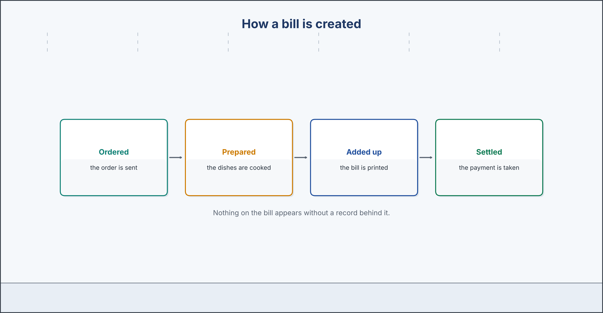
*How a bill is created: ordered, prepared, added up, settled.*

### 7A: Phrase Bank — How a Bill Is Created
**Match each step with what it means. One meaning is not needed. (0. is done.) Write the letter.**
0. The order is taken. → the guest says what they want, and it is written down. (example)

**Column A**
1. **The order is sent to the kitchen.** ____
2. **The dishes are prepared.** ____
3. **The items are added to the table's bill.** ____
4. **The bill is printed and brought to the table.** ____
5. **The payment is taken and recorded.** ____

**Column B**
a) the kitchen receives the ticket and begins
b) the food is cooked and plated
c) each dish appears on the bill as it leaves the kitchen
d) the guest is given the paper that shows what is owed
e) the money is received and entered in the system
f) the ingredients are ordered from a supplier

### 7B: Nothing Appears on a Bill by Accident
**🔊 Audio Track 4.5**
Before you listen: how does a dish get onto a bill?
> Clara: Noor asked me a good question today. How does a dish actually get onto a bill? Teresa: Tell her the whole chain, because nothing appears by accident. The order is taken at the table and is sent to the kitchen in the same moment. Clara: And the bill? Teresa: The item is added to the table's bill automatically when the ticket is printed in the kitchen, not when the plate leaves. Clara: Why not when it leaves? Teresa: Because then a dish that is cooked and sent back would never be recorded at all, and we would have paid for the ingredients with nothing to show. If a dish is returned, it is cancelled on the bill by the manager, and the cancellation is recorded with a reason. Clara: So even a cancelled dish is written down. Teresa: Especially a cancelled dish. That is the line an auditor reads first.
**Answer the questions. (0. is done.)**
0. When is the order sent to the kitchen? — In the same moment it is taken at the table.
1. When is the item added to the table's bill, and why then?
2. What happens if a dish is returned?
3. Which line does Teresa say an auditor reads first?

### 7C: Controlled Practice — How a Bill Is Created
**Put the steps in order. Number them 1–5. (0. is done.)**
0. The order is taken at the table. — 1
___ The order is sent to the kitchen and the ticket is printed.
___ The item is added to the table's bill.
___ The bill is printed and brought to the guest.
___ The payment is taken and recorded in the system.

### 7D: Role-Play — Explaining the Bill
**In pairs. One is a new waiter; one is the restaurant manager. Use the model and cards.**
Model: Waiter: How does a dish get onto the bill? — Manager: It is added when the ticket is printed in the kitchen. — Waiter: And if it is sent back? — Manager: It is cancelled by me, and the cancellation is recorded with a reason.
Card A — New waiter: ask how a dish reaches the bill · ask what happens when a dish is returned.
Card B — Manager: explain each step in the passive · say who cancels, and what is recorded.

### 7E: Restaurant Writing (70–130 words)
**You are the restaurant manager. Write a short note for new staff explaining how a bill is created.**
**Model — read this first:**
> Every bill is built the same way, and nothing is added to it by hand. The order is taken at the table and is sent to the kitchen at once. The item is added to the bill when the ticket is printed in the kitchen, not when the plate is carried out, so that every dish we cook is recorded even if it is never served. When the guests ask to pay, the bill is printed and brought to the table. The payment is taken, entered in the system, and matched to the table number. If a dish is cancelled, it is cancelled by a manager and the reason is written down.
**Check before you finish:** ☐ passive used throughout?  ☐ the exception explained?  ☐ 70–130 words?

## Part 8 · Consolidation
*[OP] Accounts track · consolidation*
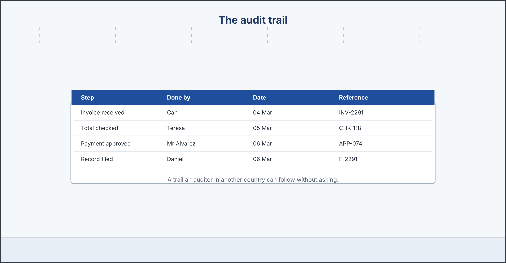
*The audit trail: what was done, when, by whom, and on what paper.*

### Part 8: Reading — The Line Nobody Deleted
Before you read: why might an untidy record be more honest than a tidy one?
> When the group auditor came in May, she asked for one thing before anything else: the list of reversals. Noor was surprised, because a reversal is the record of a mistake, and she had expected the auditor to want the clean pages first. Teresa explained it over coffee. Every business makes errors, she said, and an auditor knows this before she arrives. What she cannot know, until she looks, is what the business does about them. A company that deletes its errors hands over a perfect ledger that proves nothing at all, because perfection is exactly what a careless or a dishonest office would also produce. A company that reverses its errors hands over an untidy ledger in which every mistake is visible, dated, explained and approved. That office is harder to doubt. In March, two invoices had been entered twice; both entries were reversed in April, and the reason was written beside them. The auditor read those four lines, nodded, and spent the rest of the morning somewhere else entirely. Noor asked afterwards whether that meant the office had passed. Teresa said it meant something better: that the auditor had stopped looking for the kind of problem she had come to find, because the first thing she opened had answered her.
**Answer the questions. (0. is done.)**
0. What did the auditor ask for first? — The list of reversals.
1. Why was Noor surprised?
2. Why does a perfect ledger prove nothing?
3. What did the auditor do after reading the four lines?
**Gloss:** reversal = an equal and opposite entry that undoes an earlier one · careless = not careful; done without enough attention

### Part 8: Vocabulary in Context
**Match each word with its meaning. One meaning is not needed. (0. is done.) Write the letter.**
0. ledger → the system where every sale and cost is recorded. (example)

**Column A**
1. **reversal** ____
2. **visible** ____
3. **doubt (v)** ____
4. **careless** ____
5. **approved** ____

**Column B**
a) an equal and opposite entry that undoes an earlier one
b) able to be seen
c) to be unsure whether something is true
d) not careful; done without enough attention
e) officially agreed to be correct
f) a period of three months

### Part 8: Discussion
**Talk with a partner. Use the frames and give reasons.**
Discussion frames: 'I think the most important thing is…' · 'I agree, because…' · 'Yes, but…'
Why did the auditor want to see the reversals before the clean pages?
Is an untidy record ever better than a tidy one? Say why.
What would you keep visible in your own work, even though it shows a mistake?

## Part 9 · Decision Task
*[OP] Accounts track · judgement · INTEGRITY*
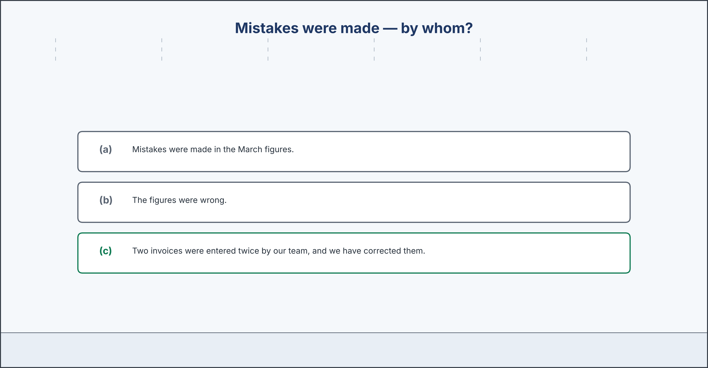
*A decision about naming who made an error.*

### Part 9: Mistakes Were Made — By Whom?
Before you read: when does leaving a name out become hiding?
> Noor has to write one line in the quarterly report about the duplicated invoices. The facts are not in dispute. Two supplier invoices were entered twice in March by a temporary assistant who had been in the office for six days and had not yet been shown the duplicate check. Daniel found the error in April, reversed both entries and told Teresa the same morning. Noor has three choices. She could write 'Mistakes were made in the March figures', which is grammatically perfect and tells the reader nothing. She could write 'A temporary assistant entered two invoices twice', which names a person who was badly trained rather than careless, in a document that will be read by the bank. Or she could write 'Two invoices were entered twice in March; the duplication was found and reversed in April, and the duplicate check is now part of the first-week training.' The third is the longest, and it is the only one that would survive a question. It also names the thing that actually failed, which was a procedure rather than a person, and it tells the reader what has changed since.
**Answer the questions. (0. is done.)**
0. What are the facts? — Two invoices were entered twice in March by a new temporary assistant.
1. Why was the assistant not really the cause?
2. What is wrong with the first choice?
3. What does the third choice name instead of a person?

### Part 9: Make the Decision
**Which line should Noor write — (a) 'Mistakes were made in the March figures,' (b) 'A temporary assistant entered two invoices twice,' or (c) 'Two invoices were entered twice in March; the duplication was found and reversed in April, and the duplicate check is now part of the first-week training'? Choose one and give your reasons.**
Answer frame: 'I think Noor should write sentence ___ , because ___ . The other choices ___ .'
**Model — read this first:**
> Model decision: I think Noor should write the third sentence. The first uses the passive to make the error ownerless, and any experienced reader will notice that nobody is in the sentence and wonder what else is missing. The second names a person in a document that goes to the bank, which is unfair and also inaccurate: the assistant did what an untrained person would do, so the failure was in the training, not in her. The third sentence uses the passive for the event, which is correct because the process failed, and then names what has been changed. It tells the reader the error was found, corrected and prevented, which is everything they need.
Phrase bank: two invoices were entered twice · the duplication was found and reversed · the check is now part of the training · the process failed, not the person.
My decision: ______ because ______ .

## Part 10 · Review and Can-Do
*[OP] Accounts track · review*
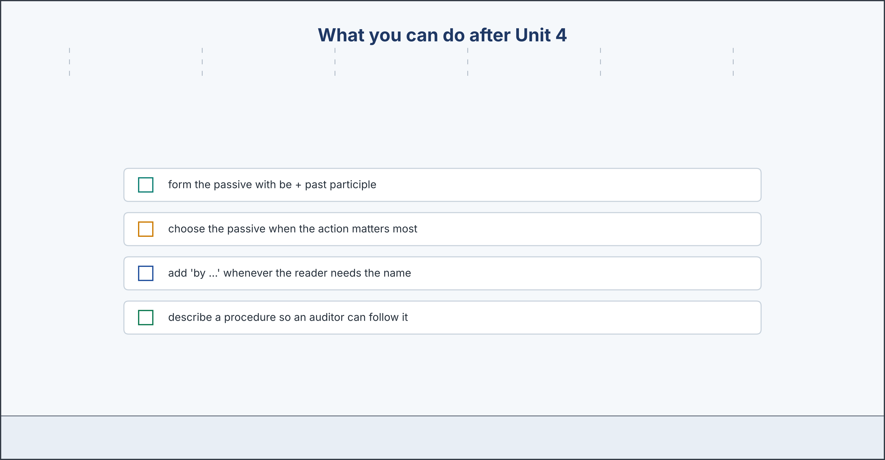
*What you can do after Unit 4.*

### Part 10: Spiral Review
**Complete with the correct passive form.**
**Word bank:** is entered | was approved | has been filed | will be checked
0. Every invoice is handled the same way. (example)
1. Every invoice ____________________ on the day it arrives.
2. The payment ____________________ by Mr Alvarez on Thursday.
3. The document ____________________ with its reference number.
4. The total ____________________ again before the quarter closes.

### Part 10: Can-Do

**Can-Do checklist**
- ☐ I can form the passive with be and the past participle
- ☐ I can choose the passive when the action or the process matters most
- ☐ I can add 'by …' whenever the reader needs the name
- ☐ I can describe a procedure so that an auditor can follow it

### Part 10: Unit 4 glossary

**Unit 4 glossary**
> the passive = be + the past participle, when the action comes first · past participle = the third form of a verb: entered, checked, approved · procedure = the fixed way a task is always done · audit trail = the line of records showing what was done, when, by whom and on what paper · approve = to say officially that something is correct · authorise = to give somebody the right to do something · reference = a number or code that lets you find a document again · supporting document = a paper that proves a figure, such as a receipt · reversal = an equal and opposite entry that undoes an earlier one · duplicate = a second copy of the same thing, entered by mistake · delivery note = the paper that comes with goods and lists them · evidence = facts that show something is true

# Unit 5: Value, Not Just Price
*Comparatives, superlatives and modifiers · B1.1–B1.2 · Blue Door Group · five countries, one ledger*

## Warm Up
*[OP] Accounts track · in-class starter*
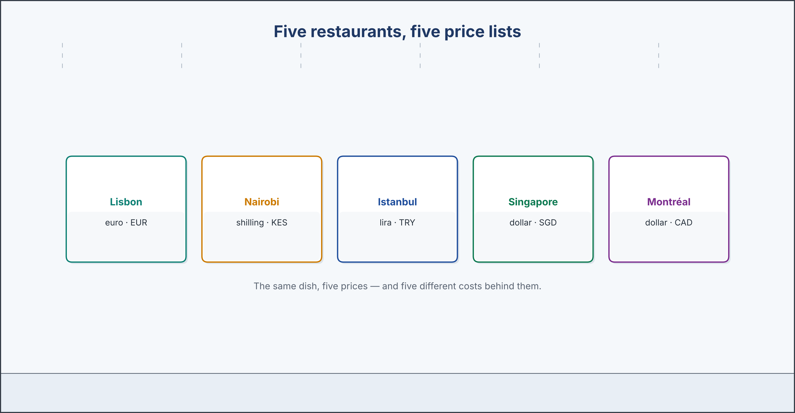
*Five restaurants, five price lists — and five different costs behind them.*

### Warm-up: Words About Price and Value
**Match the words with their meanings. One meaning is not needed. Write the letter.**
0. Price → the amount of money you pay for something. (example)

**Column A**
1. **Value** ____
2. **Quality** ____
3. **Waste** ____
4. **Supplier** ____
5. **Quote (n)** ____

**Column B**
a) what you get for what you pay
b) how good something is
c) what is thrown away and never used
d) a business that sells goods to another business
e) a written offer of a price
f) a bill from a guest

### Warm-up: Complete the Sentences
**Complete the sentences using the words in the word bank.**
**Word bank:** cheaper | value | waste | quote
0. Two suppliers sent their prices this week. (example)
1. Supplier B is fifteen per cent ____________________ than Supplier A.
2. Its quality is lower, so there is more ____________________ .
3. The cheapest price is not always the best ____________________ .
4. Can asked each supplier for a written ____________________ .

### Warm-up: Reading — The Cheapest Is Not the Cheapest
**Read the text and choose the correct answer.**
> Can had two quotes on his desk in Istanbul, and at first the decision looked easy. Supplier A wanted eight euros forty a kilo for its tomatoes. Supplier B wanted seven euros ten, which is far cheaper, and Supplier B had sent a friendly letter as well. Can almost signed. Then he did what Teresa had taught him and looked past the price. He asked both kitchens how much of each delivery they actually used. With Supplier A, the chefs threw away about four kilos in every hundred. With Supplier B, they threw away nineteen. When he divided the cost by the number of plates the kitchen could actually make, Supplier A worked out at one euro eighty-two a plate and Supplier B at one euro ninety-five. The cheaper supplier was more expensive. Can wrote both calculations on one page, sent it to Lisbon, and signed with Supplier A. He kept the letter in the file with the arithmetic stapled behind it, so that the next person to look would see why. 'Price is one number,' Teresa wrote back. 'Value is two numbers and a little arithmetic.' Can has had that sentence above his desk ever since.
0. Can had two quotes on his desk. (example)
**1. Which supplier had the lower price per kilo?**
- ○ A) Supplier A
- ○ B) Supplier B
- ○ C) Both were the same
- ○ D) Neither sent a price
**2. Why was the cheaper supplier more expensive in the end?**
- ○ A) It delivered late
- ○ B) Much more of its delivery was wasted
- ○ C) Its letter was unfriendly
- ○ D) It charged for delivery

## Part 1 · Vocabulary and Terminology
*[OP] Accounts track · pre-class input*
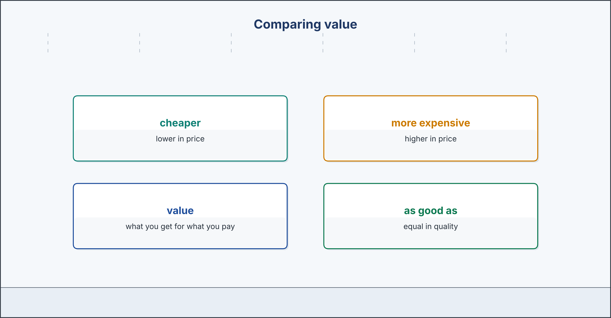
*Comparing value: cheaper, more expensive, value, as good as.*

### Part 1: Words for Comparing
**Match the words with their meanings. One meaning is not needed. (0. is done for you.)**
0. Cheaper → lower in price.

**Column A**
1. **More expensive** ____
2. **Value** ____
3. **Margin** ____
4. **Per unit** ____
5. **Discount** ____
6. **Far (adv)** ____
7. **Slightly** ____

**Column B**
a) higher in price
b) what you get for what you pay
c) what is left after the costs are taken away
d) for each single item, kilo or plate
e) an amount taken off the price
f) by a large amount
g) by a small amount
h) a plan for next year
**Gloss:** margin = what is left after the costs are taken away · per unit = for each single item, kilo or plate

### Part 1: Pronunciation
**🔊 Audio Track 5.1**
**Listen and practise these words. Say each word aloud and stress the loud syllable (CAPITALS).**
- expensive — **ex-PEN-sive**
- quality — **QUA-li-ty**
- supplier — **su-PPLI-er**
- comparison — **com-PA-ri-son**
- discount — **DIS-count**
- economy — **e-CO-no-my**

### Part 1: Comparing Forms — Match the Use
**Match each form with the way we use it. One use is not needed. Write the letter.**
0. cheap → the plain adjective, with no comparison. (example)

**Column A**
1. **cheaper than** ____
2. **the cheapest** ____
3. **as good as** ____
4. **not as good as** ____
5. **far cheaper than** ____

**Column B**
a) comparing two things
b) comparing three or more, and naming the top one
c) saying two things are equal
d) saying one is below the other
e) making a comparison much stronger
f) saying something is happening now
**Gloss:** comparative = -er or more, with 'than' · superlative = the -est or the most, for three or more

### Part 1: Price and Value — Multiple Choice
**Read and choose the correct answer.**
0. 'Value' means what you get for what you pay. (example)
**1. Which is a comparative?**
- ○ A) the cheapest
- ○ B) cheaper than
- ○ C) as cheap as
- ○ D) cheap
**2. What does 'per unit' mean?**
- ○ A) In total
- ○ B) For each single item
- ○ C) Before tax
- ○ D) After delivery
**3. What is a 'margin'?**
- ○ A) The price on the menu
- ○ B) What is left after the costs
- ○ C) The number of guests
- ○ D) A discount

### Part 1: Vocabulary Fill-in
**Complete the sentences with the correct word or phrase.**
**Word bank:** far | slightly | as good as | per unit
0. Two quotes arrived this week. (example)
1. Supplier B is ____________________ cheaper than Supplier A — by fifteen per cent.
2. Supplier C is only ____________________ more expensive than Supplier A.
3. The quality of B is not ____________________ the quality of A.
4. We always compare the cost ____________________ , not the total.

### Part 1: Write Two Sentences (short)
**Write one sentence comparing two things you know, and one naming the best of three.**
**Plan (make notes, then write):** ______ is ______ than ______ . Of the three, ______ is the ______ .
Then swap your two sentences with a partner, and check together that the comparative and the superlative are formed correctly.

## Part 2 · Grammar — Comparatives, Superlatives and Modifiers
*[OP] Accounts track · grammar focus*
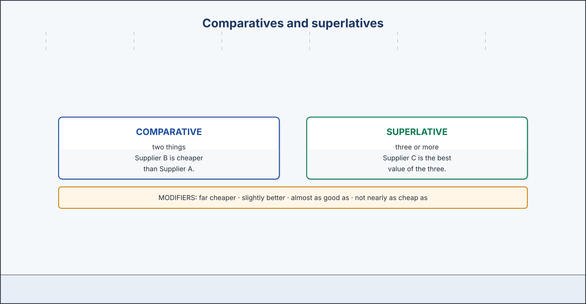
*Comparatives and superlatives, and the modifiers that make them exact.*

### Part 2: Notice
> Look carefully at how we compare. With short adjectives we add '-er' and 'than': cheaper than, higher than, later than. With longer adjectives we use 'more' and 'than': more expensive than, more reliable than. For three or more things we use the superlative: the cheapest, the most expensive, and we usually say which group we mean — the cheapest of the three, the best in the region. A few forms are irregular and must be learned: good, better, the best; bad, worse, the worst; far, further, the furthest. Then there are the modifiers, which are what turn a comparison into a measurement. 'Cheaper' tells a reader very little. 'Fifteen per cent cheaper', 'far cheaper', 'slightly cheaper', 'almost as cheap as' and 'not nearly as cheap as' all tell them something they can use.
**Look at your teacher's copy. Which comparisons are measured, and which are only opinions? Find one superlative and say which group it compares.**

### Part 2: Grammar Focus Box

| | Form | Use |
|---|---|---|
| comparative | Supplier B is cheaper than Supplier A. | comparing two things |
| superlative | Supplier C is the best value of the three. | three or more, with the group named |
| as … as | B is not as good as A. | equal, or not equal |
| modifiers | far cheaper · slightly higher · 15% cheaper | how big the difference is |
**Remember:** Use '-er … than' for short adjectives and 'more … than' for long ones; use 'the -est' or 'the most' for three or more, and say which group. A comparison without a measure is only an opinion.
**Watch out!** Watch out: never double the comparative — say 'cheaper' or 'more expensive', not 'more cheaper'.
**Gloss:** modifier = a word that makes a comparison stronger or weaker · irregular = not following the usual rule

### Part 2: Controlled Practice — Comparative or Superlative?
**Complete each sentence with the correct form of the adjective.**
0. Supplier B is cheaper (cheap) than Supplier A. (example)
1. Supplier C is ____________________ (expensive) than Supplier A.
2. Of the three, Supplier C gives ____________________ (good) value per plate.
3. The waste from Supplier B is ____________________ (bad) than we expected.
4. Lisbon is ____________________ (busy) branch of the five in summer.

### Part 2: Modifiers and as … as
**Complete each sentence with the correct form.**
1. B is ______ (far / cheap) than A, but the quality is lower.
2. C is only ______ (slight / expensive) than A.
3. The quality of B is not ______ (good) as the quality of A.

### Part 2: Correct the Sentence
**Each sentence has one mistake. Write it correctly.**
1. Supplier B is more cheaper than Supplier A.
2. Of the three, Supplier C is the better value.
3. The quality of B is not so good than the quality of A.

### Part 2: Freer Practice
**Talk with a partner. Compare two things you both know — two shops, two routes to work, two suppliers. Measure the difference.**
______ is ______ than ______ , by about ______ .
Of the three, ______ is the ______ , because ______ .

### Part 2: Grammar Review
**Choose the correct answer.**
**1. Supplier B is ______ than Supplier A.**
- ○ A) more cheap
- ○ B) cheaper
- ○ C) cheapest
- ○ D) the cheaper
**2. Of the five branches, Lisbon is ______ in summer.**
- ○ A) busier
- ○ B) more busy
- ○ C) the busiest
- ○ D) as busy

## Part 3 · Listening and Dialogue
*[OP] Accounts track · listening*
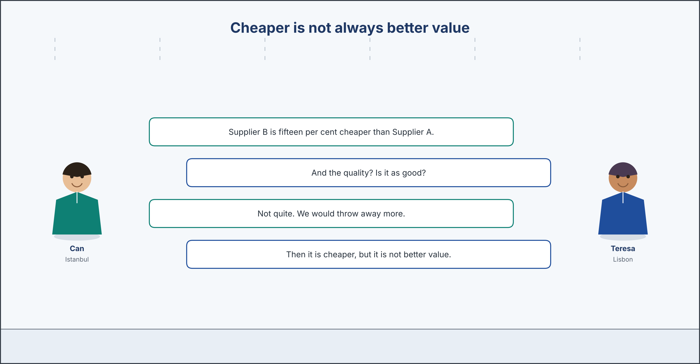
*Cheaper is not always better value.*

### Part 3: Teresa Explains Price and Value
**🔊 Audio Track 5.2**
Before you listen: what is the difference between a price and a cost per plate?
> Teresa: There is one lesson in this unit, and if you learn it you will save the group more money than I do. A price is what a supplier asks. A cost is what the dish actually costs you when it reaches the guest. They are not the same number, and the distance between them is called waste. If a supplier is fifteen per cent cheaper per kilo, but you throw away a fifth of every box, then the cheaper supplier has quietly become the more expensive one. So always compare the cost per plate, not the price per kilo, and say which you are comparing. And when you compare, measure. 'Cheaper' is an opinion. 'Fifteen per cent cheaper per kilo, but four cents more per plate' is a fact, and your manager can act on a fact. Use the modifiers too: far cheaper, slightly higher, almost as good as. They cost you one word and they carry the whole size of the difference.
**While you listen: write True (T) or False (F). (0. is done.)**
0. A price and a cost per plate are not the same number. — T
1. Waste is the distance between the price and the real cost. ____
2. A cheaper price per kilo always means a cheaper cost per plate. ____
3. 'Cheaper' on its own is a measurement. ____
4. Modifiers carry the size of a difference. ____
Useful phrases: the price per kilo · the cost per plate · fifteen per cent cheaper · almost as good as.

### Part 3: Comparing Two Suppliers
**🔊 Audio Track 5.3**
Before you listen: which questions should you ask before choosing the cheaper quote?
> Can: I have both quotes. Supplier B is fifteen per cent cheaper than Supplier A per kilo. Teresa: And the quality? Is it as good? Can: Not quite. The chefs say they throw away about nineteen kilos in a hundred, against four with Supplier A. Teresa: Then do the arithmetic. What is the cost per plate? Can: One euro ninety-five with B, and one euro eighty-two with A. Teresa: So B is cheaper per kilo and more expensive per plate. Can: Yes. And there is a third quote. Supplier C is slightly more expensive than A per kilo, but the waste is only three per cent, so it comes out at one euro seventy-nine. Teresa: Then C is the best value of the three, and you can prove it in one line. Write the line, not the feeling.
**While you listen: answer the questions. (0. is done.)**
0. How much cheaper is Supplier B per kilo? — Fifteen per cent.
1. How much does each kitchen throw away with B, and with A?
2. What is the cost per plate for A, B and C?
3. Which supplier is the best value, and how can Can prove it?
Useful phrases: fifteen per cent cheaper per kilo · the cost per plate is… · the best value of the three.

### Part 3: Five Branches, Five Price Lists
**🔊 Audio Track 5.4**
Before you listen: why can the same dish cost different amounts in different countries?
> Daniel: Teresa, a guest in Nairobi asked me why the same dish costs less here than in Lisbon. What should I have said? Teresa: The truth, which is more interesting than people expect. The dish is not the same price because the costs behind it are not the same. Rent is far higher in Lisbon. Wages are different in every country. The tomatoes travel further to one kitchen than to another. Daniel: So the menu price follows the cost? Teresa: It follows the cost, the local market and the tax. Singapore has GST where Lisbon has VAT, and the rates are not the same either. Daniel: Then comparing the two menu prices directly tells you nothing. Teresa: It tells you almost nothing. Compare the margins instead, and then the two restaurants can be compared honestly. Daniel: I shall tell the guest the short version. Teresa: Tell her the margin version. She will be impressed.
**While you listen: match each thing with how it differs between branches. One item is not needed. (0. is done.) Write the letter.**
0. The dish → costs a different amount in each country.

**Column A**
1. **Rent** ____
2. **Wages** ____
3. **Tax** ____
4. **The honest comparison** ____

**Column B**
a) is far higher in Lisbon than in Nairobi
b) are different in every country
c) is GST in Singapore and VAT in Lisbon
d) is the margin, not the menu price
e) is the same in all five countries

## Part 4 · Speaking
*[OP] Accounts track · speaking*
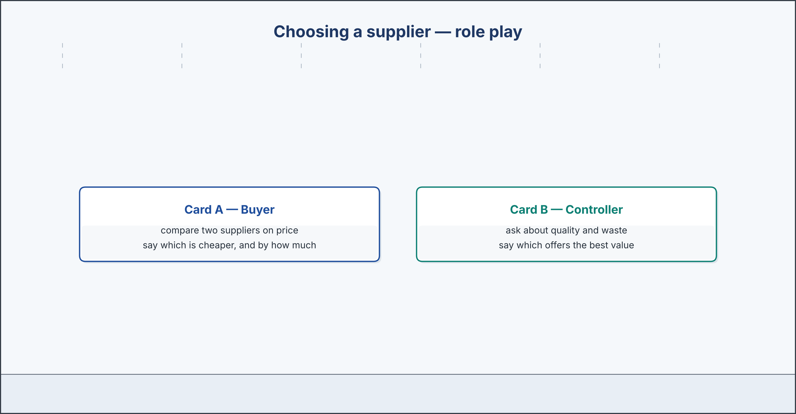
*Role play: choosing a supplier (Card A and Card B).*

### Part 4: Talking About Value
**Work with a partner. Ask and answer these questions. Use comparatives and superlatives.**
Which is better value where you live: cooking at home or eating out? Measure the difference.
Think of two shops you both use. Which is cheaper, and which is better value?
What is the most expensive mistake a buyer can make?
Why is the cheapest quote not always the one to accept?
Useful language: far cheaper than… · slightly more expensive than… · not as good as… · the best value of the three.

### Part 4: Choosing a Supplier — Role Play
**Work in pairs. Read the model, then use the cards.**
Model: A: Supplier B is fifteen per cent cheaper than A. — B: And the waste? — A: Nineteen per cent, against four. — B: Then B is cheaper per kilo and more expensive per plate. Which is the best value of the three?
Useful language: cheaper per kilo · more expensive per plate · the waste is… · the best value of the three.
Card A — Buyer: compare two suppliers on price · say which is cheaper, and by how much.
Card B — Controller: ask about quality and waste · say which offers the best value, and why.
Your turn: run the dialogue, then change roles.

### Part 4: Mini-Presentation
**Prepare a short talk (about one minute). Compare three options and recommend one. Measure every comparison you make.**
**Plan (make notes, then write):** Option A is… Option B is ______ per cent… Of the three, C is the… , because…

## Part 5 · Extended Reading
*[OP] Accounts track · extended reading*
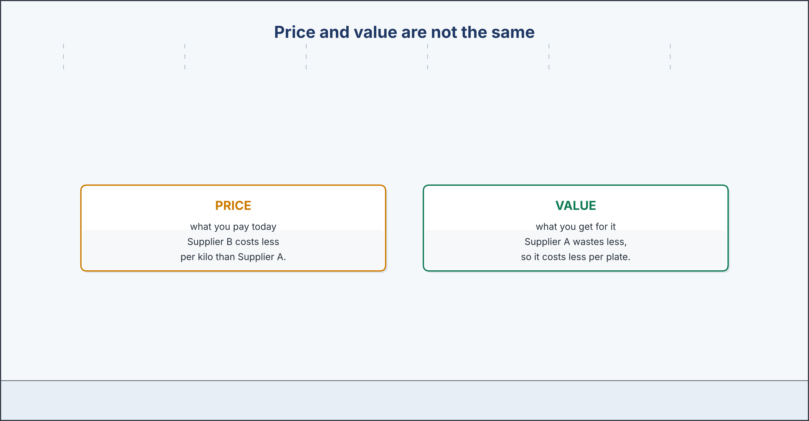
*Price and value are not the same number.*

### Part 5: What a Buyer Actually Compares
**Read the text and choose the correct answer.**
> Every buyer learns the same lesson, usually by making the same mistake first. A quote arrives with a price on it, the price is lower than the one you are paying now, and the decision seems to have been made for you. But a price is only the first of four numbers, and the other three decide whether the saving is real. The second number is waste: how much of each delivery reaches a plate, and how much reaches a bin. The third is reliability: a supplier who is cheaper but late twice a month forces a kitchen to buy at local shop prices to fill the gap, and those emergency purchases are the most expensive food a restaurant ever buys. The fourth is the payment term, because a cheaper supplier who wants paying in seven days is not cheaper than a dearer one who waits sixty, when the business is short of cash. In a group that buys in five currencies there is a fifth number as well, since a quote that is cheaper in lira this month may not be cheaper in euro next month. A buyer who compares all of them, and writes the comparison down with its measurements, will be contradicted far less often than one who compares only the first.
0. A price is only the first of several numbers. (example)
**1. What is the second number a buyer must compare?**
- ○ A) The delivery date
- ○ B) Waste
- ○ C) The supplier's letter
- ○ D) The menu price
**2. Why is an unreliable supplier expensive?**
- ○ A) The kitchen buys at local shop prices to fill gaps
- ○ B) The invoices are longer
- ○ C) The quality is better
- ○ D) The orders are smaller
**3. What is the fifth number in a group that buys in five currencies?**
- ○ A) The number of branches
- ○ B) The exchange rate
- ○ C) The tax rate
- ○ D) The number of guests

### Part 5: Vocabulary in Context
**Match each word from the text with its meaning. One meaning is not needed. (0. is done.) Write the letter.**
0. quote → a written offer of a price. (example)

**Column A**
1. **reliability** ____
2. **payment term** ____
3. **emergency (adj)** ____
4. **dearer** ____
5. **contradicted** ____

**Column B**
a) how often a supplier does what it promised
b) how long you have before you must pay
c) needed suddenly, and usually at a bad price
d) more expensive
e) told by somebody that you are wrong
f) a period of three months
**Gloss:** payment term = how long you have before you must pay · reliability = how often a supplier does what it promised

### Part 5: How to Write a Comparison Nobody Argues With
**Read about writing comparisons. Then mark each sentence True (T) or False (F).**
> A comparison that survives a meeting has four parts. It names the options, so nobody wonders what was left out. It gives both numbers, because a reader who is told only that something is cheaper cannot check anything. It measures the difference in a way the reader already understands — per cent, per kilo, per plate, per month — and it uses the same measure for every option. And it states the judgement in one sentence at the end, so that the reader knows what the writer actually recommends. Two habits spoil a comparison. The first is the single direction: 'B is cheaper' is an argument, while 'B is fifteen per cent cheaper per kilo and four cents more per plate' is a fact. The second is the moving measure, where one option is compared per kilo and the next per plate, which hides the answer inside the arithmetic. Write the table first and the sentence afterwards. If the table is honest, the sentence writes itself; if the sentence came first, the table is usually built to agree with it, and a reader can feel the difference even when they cannot explain it.
0. A good comparison names the options. → T (example)
1. A comparison should give both numbers, not one. ____
2. Different options may be measured in different ways. ____
3. The judgement belongs in one sentence at the end. ____
4. 'B is cheaper' on its own is a fact. ____

## Part 6 · Writing
*[OP] Accounts track · writing*
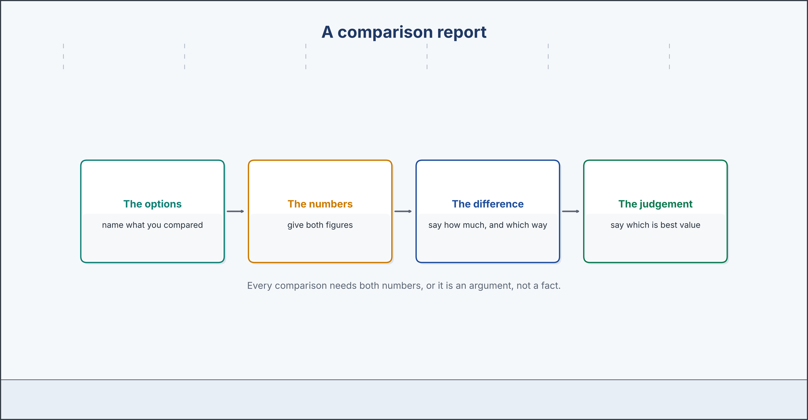
*A comparison report: the options, the numbers, the difference, the judgement.*

### Part 6: Comparing Two Suppliers (70–130 words)
**Write a short comparison of two suppliers. Give both numbers and measure the difference.**
**Model — read this first:**
> We asked two suppliers to quote for tomatoes. Supplier A quoted eight euros forty a kilo; Supplier B quoted seven euros ten, which is fifteen per cent cheaper. The difference in waste is larger than the difference in price. The kitchens use ninety-six kilos in every hundred from Supplier A, and only eighty-one from Supplier B. Measured per plate, which is the only measure that reaches the guest, Supplier A costs one euro eighty-two and Supplier B one euro ninety-five. Supplier B is therefore cheaper per kilo and seven per cent more expensive per plate. I recommend Supplier A.
**Plan (make notes, then write):** Supplier A quoted… Supplier B quoted… , which is ______ per cent… Measured per plate… I recommend…
**Check before you finish:** ☐ both numbers given?  ☐ the difference measured?  ☐ 70–130 words?

### Part 6: The Best of Three (70–130 words)
**Compare three options and recommend one. Use superlatives, and name the group you are comparing.**
**Model — read this first:**
> Of the three quotes we received, Supplier C offers the best value, although it does not offer the lowest price. Supplier B is the cheapest per kilo at seven euros ten, but it is also the worst for waste, at nineteen per cent. Supplier A is slightly dearer per kilo and far better in the kitchen. Supplier C is only forty cents a kilo more expensive than A, and its waste is the lowest of the three at three per cent, which brings it to one euro seventy-nine a plate. That is the lowest cost per plate of the three, and it is the number the guest eventually pays for.
**Check before you finish:** ☐ superlatives used correctly?  ☐ the group named?  ☐ 70–130 words?

### Part 6: Explaining a Price Difference (70–120 words)
**Explain to a guest or a colleague why the same dish costs different amounts in two countries. Use comparatives.**
**Model — read this first:**
> The same dish costs less in Nairobi than in Lisbon, and the reason is not the recipe. Rent in the Lisbon street is far higher than in Nairobi, and it is paid every month whether the room is full or empty. Wages are different in each country, and so is the tax: Singapore charges GST where Lisbon charges VAT, at different rates. The tomatoes themselves travel further to one kitchen than to the other. The menu price follows all of those costs. If you want to compare the two restaurants honestly, compare the margins, not the prices.
**Plan (make notes, then write):** The dish costs ______ in ______ than in ______ . Rent is… Wages are… Tax is… So the price follows…
**Check before you finish:** ☐ comparatives used correctly?  ☐ the real reason given?  ☐ 70–120 words?

### Part 6: A Recommendation (70–120 words)
**Write a short recommendation to a manager. Measure every comparison you make.**
**Model — read this first:**
> I recommend that we move our tomato order to Supplier C from the first of next month. C is forty cents a kilo dearer than our current supplier, which is about five per cent, but its waste is three per cent against our present four, and its deliveries have been on time in eleven weeks out of twelve. Measured per plate, C costs one euro seventy-nine against our one euro eighty-two. The saving is small, at three cents a plate, but we serve nine hundred plates a week, and the reliability is worth more than the money.
**Check before you finish:** ☐ every comparison measured?  ☐ a clear recommendation?  ☐ 70–120 words?

## Part 7 · Restaurant-Accounting Track
*[RA] Restaurant track · pricing the menu*

*Four numbers behind one line on a menu.*

### 7A: Phrase Bank — Pricing a Dish
**Match each term with what it means. One meaning is not needed. (0. is done.) Write the letter.**
0. Portion → the amount of food served to one guest. (example)

**Column A**
1. **Food cost** ____
2. **Waste** ____
3. **Margin** ____
4. **Menu price** ____
5. **Mark-up** ____

**Column B**
a) what the ingredients of one dish cost
b) what is thrown away and never served
c) what is left after the costs are taken away
d) what the guest pays for the dish
e) how much is added to the cost to reach the price
f) a written offer from a supplier

### 7B: Four Numbers Behind One Line
**🔊 Audio Track 5.5**
Before you listen: how does a restaurant decide what to charge for a dish?
> Clara: Every month somebody asks me why a dish costs what it costs. What do I say? Teresa: Give them the four numbers. The first is the food cost: what the ingredients of one portion cost us. The second is waste, because we buy more than we serve. Clara: And the third? Teresa: The third is everything that is not food — the rent, the wages, the electricity — spread across the plates we expect to sell. The fourth is the margin we need to stay open. Clara: And the menu price is all four added together? Teresa: All four, rounded to a number that looks sensible on a menu. Clara: Our tomato dish is cheaper than the same dish in Lisbon. Teresa: It is, and it should be. The rent behind it is far lower. The dish is not cheaper; the city is.
**Answer the questions. (0. is done.)**
0. What is the first number? — The food cost: what the ingredients of one portion cost.
1. Why is waste the second number?
2. What does the third number include?
3. Why is the same dish cheaper in Nairobi than in Lisbon?

### 7C: Controlled Practice — Building the Menu Price
**Put the steps of pricing a dish in order. Number them 1–5. (0. is done.)**
0. Work out the food cost of one portion. — 1
___ Add the waste, because we buy more than we serve.
___ Add a share of the rent, wages and electricity.
___ Add the margin the restaurant needs.
___ Round the total to a sensible menu price.

### 7D: Role-Play — Why Does It Cost That?
**In pairs. One is a guest or a new waiter; one is the restaurant manager. Use the model and cards.**
Model: Waiter: Why is this dish more expensive than the same one in Nairobi? — Manager: The food cost is almost the same, but the rent here is far higher, and the tax is different. The dish is not dearer; the city is.
Card A — Waiter: ask why a dish costs what it costs · ask why it is cheaper in another branch.
Card B — Manager: give the four numbers · compare the two cities, and measure the difference.

### 7E: Restaurant Writing (70–130 words)
**You are the restaurant manager. Write a short note to your team explaining how a menu price is built.**
**Model — read this first:**
> When a guest asks why a dish costs what it costs, give them the whole answer, because it is a good one. First, the ingredients of one portion cost us a known amount, and we check it every month. Second, we buy more than we serve, so a small part of every delivery is waste and has to be carried by the dishes we do sell. Third, the rent, the wages and the electricity are shared across the plates we expect to sell that month. Fourth, we add the margin that keeps the restaurant open. The price on the menu is all four, rounded sensibly.
**Check before you finish:** ☐ the four numbers given?  ☐ comparatives used where needed?  ☐ 70–130 words?

## Part 8 · Consolidation
*[OP] Accounts track · consolidation*

*Two suppliers compared, in the only measure that reaches the guest.*

### Part 8: Reading — The Quote That Looked Too Good
Before you read: why is a very low quote sometimes a warning rather than an opportunity?
> In March a new supplier wrote to all five branches at once, offering prices about a quarter below anything Blue Door was paying. Two branch managers wanted to sign immediately, which is exactly what the letter was designed to produce. Teresa asked for one week and three questions. How long had the supplier been trading? Could it name two restaurants of a similar size that it already delivered to? And would it hold the price for six months in writing? The answers came back slowly. The business was eleven months old, it could name one small café, and it would hold the price for six weeks. None of that proved the supplier was bad. It proved that the quote was not comparable with the others, because it was a different kind of offer: a short price from a young business that needed the volume. The group ordered from them for one branch only, for two months, and measured the waste every week. The waste was ordinary, the deliveries were late twice, and in May the price rose by eleven per cent. Blue Door had lost nothing and had learned the shape of the offer.
**Answer the questions. (0. is done.)**
0. What did the new supplier offer? — Prices about a quarter below what the group was paying.
1. What three questions did Teresa ask?
2. Why were the answers important, even though none of them proved the supplier was bad?
3. What did the group do instead of signing, and what happened?
**Gloss:** volume = the amount of business, measured in quantity · comparable = able to be compared fairly with something else

### Part 8: Vocabulary in Context
**Match each word with its meaning. One meaning is not needed. (0. is done.) Write the letter.**
0. opportunity → a good chance to do something. (example)

**Column A**
1. **volume** ____
2. **comparable** ____
3. **hold (a price)** ____
4. **trading** ____
5. **ordinary** ____

**Column B**
a) the amount of business, measured in quantity
b) able to be compared fairly with something else
c) to keep a price unchanged for an agreed period
d) buying and selling, as a business
e) usual; nothing unexpected
f) a written offer of a price

### Part 8: Discussion
**Talk with a partner. Use the frames and give reasons.**
Discussion frames: 'I think the most important question is…' · 'I agree, because…' · 'Yes, but…'
Why did Teresa want the price held in writing for six months?
Is a young business always a risk? Say why, or why not.
What would you measure during a two-month trial, and how often?

## Part 9 · Decision Task
*[OP] Accounts track · judgement*

*A decision between the cheapest price and the best value.*

### Part 9: The Cheapest, or the Best Value?
Before you read: when is it right to pay more?
> Can has three quotes and a decision to make before Friday. Supplier B is the cheapest per kilo at seven euros ten, which is fifteen per cent below Supplier A. Supplier A has served the group for four years, wastes four kilos in a hundred, and has never been late. Supplier C is forty cents a kilo dearer than A, wastes only three, and has delivered on time in eleven weeks out of twelve, but the group has used it for three months only. Measured per plate, the three come out at one euro ninety-five, one euro eighty-two, and one euro seventy-nine. The branch manager wants B, because the price list is what he sees every week. The head chef wants A, because he knows it. Can can recommend the cheapest price, the supplier everybody trusts, or the lowest cost per plate with the shortest record. Whatever he recommends, he will have to defend it in one line in front of three people who all have a different number in their heads.
**Answer the questions. (0. is done.)**
0. Which supplier is cheapest per kilo? — Supplier B, at seven euros ten.
1. What is the cost per plate for each of the three?
2. What does the branch manager want, and why?
3. What is the one weakness of Supplier C?

### Part 9: Make the Decision
**Which should Can recommend — (a) Supplier B, the cheapest price, (b) Supplier A, the supplier everybody trusts, or (c) Supplier C, the lowest cost per plate? Choose one and give your reasons.**
Answer frame: 'I think Can should recommend ___ , because ___ . The other choices ___ .'
**Model — read this first:**
> Model decision: I think Can should recommend Supplier C. The comparison has to be made in one measure, and the only measure that reaches the guest is the cost per plate. On that measure C is the lowest of the three, by three cents against A and sixteen against B. Supplier B is cheapest only on the number the branch manager happens to see each week, and its waste makes it the dearest in the kitchen. Supplier A is the safe answer, and it is three cents a plate more expensive, which over nine hundred plates a week is not nothing. C's record is short, so I would recommend it for one branch for three months, with the waste measured weekly, exactly as the group did in March.
Phrase bank: the only measure that reaches the guest · the lowest cost per plate · cheapest per kilo, dearest in the kitchen · for one branch, for three months.
My decision: ______ because ______ .

## Part 10 · Review and Can-Do
*[OP] Accounts track · review*

*What you can do after Unit 5.*

### Part 10: Spiral Review
**Complete with the correct comparative or superlative form.**
**Word bank:** cheaper | the best | worse | far
0. Two quotes arrived this week. (example)
1. Supplier B is ____________________ than Supplier A per kilo.
2. Of the three, Supplier C gives ____________________ value per plate.
3. The waste from Supplier B is ____________________ than we expected.
4. Rent in Lisbon is ____________________ higher than in Nairobi.

### Part 10: Can-Do

**Can-Do checklist**
- ☐ I can compare two things with comparatives
- ☐ I can say which is best with superlatives, and name the group
- ☐ I can use modifiers like far, slightly and almost as … as
- ☐ I can explain the difference between a price and a value

### Part 10: Unit 5 glossary

**Unit 5 glossary**
> comparative = the -er or 'more' form, used with 'than' · superlative = the -est or 'the most' form, for three or more · modifier = a word that makes a comparison stronger or weaker, such as far or slightly · value = what you get for what you pay · waste = what is thrown away and never served · margin = what is left after the costs are taken away · per unit = for each single item, kilo or plate · quote = a written offer of a price · payment term = how long you have before you must pay · reliability = how often a supplier does what it promised · mark-up = how much is added to the cost to reach the price · comparable = able to be compared fairly with something else

# Unit 6: Getting the Numbers Exactly Right
*Quantifiers, articles and precise numbers · B1.1–B1.2 · Blue Door Group · five countries, one ledger*

## Warm Up
*[OP] Accounts track · in-class starter*

*One figure, written five ways — and only one of them is right.*

### Warm-up: Words About Precision
**Match the words with their meanings. One meaning is not needed. Write the letter.**
0. Figure → a number in a report or an account. (example)

**Column A**
1. **Exactly** ____
2. **Approximately** ____
3. **Round (v)** ____
4. **Decimal** ____
5. **Separator** ____

**Column B**
a) with no difference at all
b) about; close but not exact
c) to make a number simpler by removing small amounts
d) the part of a number after the point
e) the mark that divides thousands, or whole from part
f) a bill from a supplier

### Warm-up: Complete the Sentences
**Complete the sentences using the words in the word bank.**
**Word bank:** exactly | approximately | rounded | decimal
0. Every figure must be readable in five countries. (example)
1. The sale was ____________________ 1,987.40 Singapore dollars.
2. In the summary we wrote ____________________ two thousand.
3. The figure was ____________________ to the nearest hundred.
4. Always write two places after the ____________________ point.

### Warm-up: Reading — The Figure That Changed Shape
**Read the text and choose the correct answer.**
> A sale of one thousand, nine hundred and eighty-seven Singapore dollars and forty cents left Mei's till on a Tuesday evening and reached four different documents by Friday. In the branch ledger it was written 1,987.40. In a summary for the kitchen it became 'about 2,000', which was helpful and true. In an email it was typed as 1.987,40, because the writer used the separators of her own country, and the reader in another country understood one euro ninety-nine. In a message to the owner it appeared simply as '2,000', with no 'about' at all. Three of those four versions were defensible, and one was not. Teresa spent twenty minutes that Friday explaining which was which, and nobody enjoyed the twenty minutes, least of all her. She has since written one line at the top of the group's reporting sheet: name the currency, keep two decimal places, use one separator style, and say the word 'about' whenever you have rounded. The line is in four languages and it takes nine seconds to read. Nobody in five countries has misread a figure since, which Teresa says is the cheapest improvement the group has ever made.
0. The sale was 1,987.40 Singapore dollars. (example)
**1. Why did the reader of the email misunderstand?**
- ○ A) The figure was wrong
- ○ B) The writer used a different separator style
- ○ C) The currency was missing
- ○ D) The email arrived late
**2. Which version was not defensible?**
- ○ A) 1,987.40
- ○ B) 'about 2,000'
- ○ C) '2,000' with no 'about'
- ○ D) the kitchen summary

## Part 1 · Vocabulary and Terminology
*[OP] Accounts track · pre-class input*

*Saying how much and how many: a few, a little, several, exactly.*

### Part 1: Words for Quantity
**Match the words with their meanings. One meaning is not needed. (0. is done for you.)**
0. A few → a small number of countable things.

**Column A**
1. **A little** ____
2. **Several** ____
3. **Plenty of** ____
4. **Hardly any** ____
5. **Countable** ____
6. **Uncountable** ____
7. **Rounding** ____

**Column B**
a) a small amount of something uncountable
b) more than a few, but not many
c) more than enough
d) almost none at all
e) able to be counted one by one: invoices, suppliers
f) not counted one by one: cash, revenue, information
g) making a number simpler by removing small amounts
h) a plan for next year
**Gloss:** countable = able to be counted one by one · uncountable = not counted one by one, such as cash or information

### Part 1: Pronunciation
**🔊 Audio Track 6.1**
**Listen and practise these words. Say each word aloud and stress the loud syllable (CAPITALS).**
- accurate — **A-ccu-rate**
- decimal — **DE-ci-mal**
- approximately — **a-PRO-xi-ma-tely**
- currency — **CU-rren-cy**
- material — **ma-TE-rial**
- precision — **pre-CI-sion**

### Part 1: Quantifiers — Match the Use
**Match each quantifier with the way we use it. One use is not needed. Write the letter.**
0. many → with countable things, usually in questions and negatives. (example)

**Column A**
1. **a few invoices** ____
2. **a little cash** ____
3. **several branches** ____
4. **much revenue** ____
5. **hardly any waste** ____

**Column B**
a) a small number of countable things
b) a small amount of an uncountable thing
c) more than a few countable things
d) a large amount of an uncountable thing
e) almost none at all
f) every one, without exception
**Gloss:** material = large enough to change a reader's decision · immaterial = too small to change anything

### Part 1: Precision — Multiple Choice
**Read and choose the correct answer.**
0. 'Approximately' means about, but not exactly. (example)
**1. Which word goes with an uncountable noun?**
- ○ A) a few
- ○ B) several
- ○ C) a little
- ○ D) many
**2. What does 'material' mean in accounting?**
- ○ A) Made of cloth
- ○ B) Large enough to change a decision
- ○ C) Written on paper
- ○ D) Paid in cash
**3. What should always go beside a figure?**
- ○ A) The writer's name
- ○ B) The currency
- ○ C) The time of day
- ○ D) The page number

### Part 1: Vocabulary Fill-in
**Complete the sentences with the correct word or phrase.**
**Word bank:** a few | a little | several | hardly any
0. Precision costs nothing and saves a great deal. (example)
1. ____________________ invoices are still unpaid — three, I think.
2. There is only ____________________ cash left in the Istanbul till.
3. ____________________ branches have already closed the month.
4. There was ____________________ waste in last week's delivery.

### Part 1: Write Two Sentences (short)
**Write one sentence with a countable quantifier and one with an uncountable quantifier, about your own work.**
**Plan (make notes, then write):** There are a few ______ . There is a little ______ .
Then swap your two sentences with a partner, and check together that each quantifier matches its noun.

## Part 2 · Grammar — Quantifiers, Articles and Numbers
*[OP] Accounts track · grammar focus*

*Countable and uncountable, and the articles that go with them.*

### Part 2: Notice
> Look carefully at two small things that decide whether a figure is understood. The first is the quantifier. Countable nouns take 'a few', 'several', 'many' and a number: a few invoices, several branches, three suppliers. Uncountable nouns take 'a little' and 'much': a little cash, much revenue, some information. 'Some' and 'plenty of' work with both. The second is the article. We use 'a' or 'an' the first time we mention something, and 'the' when both writer and reader already know which one we mean: 'A supplier wrote to us. The supplier offered a discount.' We use no article at all for a general plural: 'Suppliers often offer discounts.' In an accounts office these small words carry weight, because 'the invoice is unpaid' and 'an invoice is unpaid' send a reader to two different places.
**Look at your teacher's copy. Which nouns are countable, and which are uncountable? Find one 'a' and one 'the', and say why each was chosen.**

### Part 2: Grammar Focus Box

| | Form | Use |
|---|---|---|
| countable | a few invoices · several branches · three suppliers | things you can count one by one |
| uncountable | a little cash · much revenue · some information | things you cannot count one by one |
| a / an and the | A supplier wrote. The supplier offered a discount. | first mention, then the one we both know |
| no article | Suppliers often offer discounts. | a general plural, not particular ones |
**Remember:** Match the quantifier to the noun: 'a few' and 'many' with countable things, 'a little' and 'much' with uncountable ones. Use 'a' for a first mention, 'the' when the reader already knows which one, and no article for a general plural.
**Watch out!** Watch out: say 'a little cash' and 'a few invoices' — never 'a few cash' or 'a little invoices'.
**Gloss:** first mention = the first time something appears in a text · general plural = all of a kind, not particular ones

### Part 2: Controlled Practice — Which Quantifier?
**Complete each sentence with the correct quantifier.**
0. There are a few (a few / a little) invoices still unpaid. (example)
1. There is only ____________________ (a few / a little) cash in the till.
2. ____________________ (Several / Much) branches have closed the month.
3. We do not have ____________________ (many / much) information yet.
4. ____________________ (Hardly any / Hardly some) waste was recorded.

### Part 2: Articles
**Complete each sentence with a, an, the, or no article (–).**
1. ______ supplier wrote to us last week. ______ supplier offered a discount.
2. ______ suppliers often offer discounts in March.
3. Please send me ______ invoice you mentioned on ______ telephone.

### Part 2: Correct the Sentence
**Each sentence has one mistake. Write it correctly.**
1. There are a little invoices still unpaid.
2. We do not have many information about the delivery.
3. We received a invoice from the new supplier.

### Part 2: Freer Practice
**Talk with a partner. Describe what there is a lot of, and a little of, in your work this week.**
There are several ______ , but only a few ______ .
There is plenty of ______ , and hardly any ______ .

### Part 2: Grammar Review
**Choose the correct answer.**
**1. There is only ______ cash left in the till.**
- ○ A) a few
- ○ B) several
- ○ C) a little
- ○ D) many
**2. ______ supplier wrote to us. ______ supplier offered a discount.**
- ○ A) The … A
- ○ B) A … The
- ○ C) A … A
- ○ D) The … The

## Part 3 · Listening and Dialogue
*[OP] Accounts track · listening*

*Reading a figure aloud, digit by digit, across two currencies.*

### Part 3: Teresa Explains Precision
**🔊 Audio Track 6.2**
Before you listen: why does a figure need a currency beside it?
> Teresa: A number on its own is not information. It becomes information when you add four things to it, and we add all four every time. First, the currency, because 1,987.40 means nothing until somebody knows whether it is dollars, lira or euro. Second, the decimal places: two, always, even when the second is a zero, because a figure that ends in a single digit invites somebody to add one. Third, the separator style, which in this group is a comma for thousands and a point for decimals, in every country, whatever people use at home. Fourth, the word 'about' whenever you have rounded. 'About two thousand' is honest and useful. 'Two thousand' is a different claim, and if the real figure was 1,987.40, it is not quite true. These four habits cost you nothing and they have saved us a great deal of time, because nobody has to telephone another country to ask what a number means.
**While you listen: write True (T) or False (F). (0. is done.)**
0. A number on its own is not information. — T
1. The currency must be written beside the figure. ____
2. One decimal place is enough. ____
3. The group uses one separator style in every country. ____
4. 'Two thousand' and 'about two thousand' are the same claim. ____
Useful phrases: name the currency · two decimal places · one separator style · say 'about' when you round.

### Part 3: Read Me the Figure Again
**🔊 Audio Track 6.3**
Before you listen: how do you read a long figure aloud so that nobody mishears it?
> Teresa: Mei, read me the Tuesday figure again, slowly. Mei: One, nine, eight, seven, point four zero. Singapore dollars. Teresa: Thank you. Digit by digit is the only safe way on a telephone. Mei: Should I give you the euro figure as well? Teresa: Give me both, and give me the rate you used. Mei: At this month's rate, that is one thousand, three hundred and sixty-one euros and eleven cents. The rate was 0.6849. Teresa: And is that the rate on the day of the sale, or today's? Mei: The day of the sale. We always use the rate of the day, and I wrote it in the line. Teresa: Perfect. If anybody asks next March why the figure is what it is, that one number will answer them.
**While you listen: answer the questions. (0. is done.)**
0. How does Mei read the figure? — Digit by digit, and then the currency.
1. Why is digit by digit the safe way on a telephone?
2. What three things does Teresa want with the figure?
3. Which rate does the group use, and where is it written?
Useful phrases: one, nine, eight, seven, point four zero · at this month's rate · the rate of the day.

### Part 3: How Much, and How Many?
**🔊 Audio Track 6.4**
Before you listen: when is a difference too small to matter?
> Daniel: Teresa, I have a few questions about the quarter. Teresa: How many is a few? Daniel: Three. The first is the rounding. We have hardly any differences this time — two cents in Nairobi and one in Singapore. Teresa: Then record them and move on. They are immaterial. Daniel: The second is information. We do not have much information about the Montréal opening costs yet. Teresa: Then say so, in those words, rather than guessing. The third? Daniel: Several invoices are still unpaid in Istanbul. Teresa: How many, and how much? Daniel: Eleven invoices, about forty thousand lira in total. Teresa: Now that is a real answer. 'Several' tells me to worry; 'eleven, about forty thousand lira' tells me whether I should.
**While you listen: match each quantity with what it describes. One item is not needed. (0. is done.) Write the letter.**
0. Three → the number of questions Daniel has.

**Column A**
1. **hardly any** ____
2. **not much** ____
3. **several** ____
4. **eleven, about forty thousand lira** ____

**Column B**
a) the rounding differences this quarter
b) the information about the Montréal costs
c) the unpaid invoices, before Teresa asks
d) the unpaid invoices, after Teresa asks
e) the number of branches in the group

## Part 4 · Speaking
*[OP] Accounts track · speaking*

*Role play: confirming a figure on a call (Card A and Card B).*

### Part 4: Talking About Numbers
**Work with a partner. Ask and answer these questions. Use quantifiers and exact figures.**
How do you read a long number aloud so that nobody mishears it?
How much cash do you usually carry, and how many cards?
When is it right to round a figure, and when is it not?
Why does a group that works in five currencies need one separator style?
Useful language: digit by digit · about two thousand · exactly 1,987.40 · at the rate of the day.

### Part 4: Confirming a Figure — Role Play
**Work in pairs. Read the model, then use the cards.**
Model: A: Read me the figure again, slowly. — B: One, nine, eight, seven, point four zero. Singapore dollars. — A: And in euro? — B: One thousand, three hundred and sixty-one euros eleven, at the rate of the day.
Useful language: read it digit by digit · which currency? · at which rate? · let me read it back to you.
Card A — Head office: ask for the figure digit by digit · ask which currency and which rate.
Card B — Branch: read the figure back slowly · give the currency, the rate and the date.
Your turn: run the dialogue, then change roles.

### Part 4: Mini-Presentation
**Prepare a short talk (about one minute). Explain one figure from your own work: what it is, what it is in, how exact it is, and where it came from.**
**Plan (make notes, then write):** The figure is… It is in… It is exact to… It came from… I would round it only when…

## Part 5 · Extended Reading
*[OP] Accounts track · extended reading*

*One amount, five ways of writing it.*

### Part 5: The Honest Round Number
**Read the text and choose the correct answer.**
> Rounding is not dishonest. A summary that gives every figure to the cent is harder to read than one that does not, and a reader who wants the cents can always open the ledger. What makes rounding dishonest is silence. 'About two thousand' and '2,000' look similar on a page, but they make different promises: the first says that the writer has rounded and invites you to ask by how much, while the second says that the figure is two thousand. If the real number was 1,987.40, only one of those sentences is true. There is a second rule that matters even more in a group that reports from five countries. Round once, at the end, and never in the middle. If each of five branches rounds its own total to the nearest hundred before sending it, the group figure can be several hundred away from the sum of the real sales, and nobody will be able to say where the difference went. So the branches send the exact figure to the cent, the group adds them up, and only the final summary is rounded, with the word 'about' in front of it. Accountants call the small differences that remain immaterial, which does not mean invisible. They are recorded, explained in one line, and left where anybody can see them.
0. Rounding is not dishonest in itself. (example)
**1. What makes rounding dishonest?**
- ○ A) Doing it at all
- ○ B) Silence about having done it
- ○ C) Using a comma
- ○ D) Rounding to the cent
**2. Where should rounding happen in a group?**
- ○ A) In each branch, before sending
- ○ B) Once, at the end
- ○ C) Twice, to be safe
- ○ D) Never
**3. What does 'immaterial' mean here?**
- ○ A) Invisible
- ○ B) Too small to change a decision
- ○ C) Written on paper
- ○ D) Paid in cash

### Part 5: Vocabulary in Context
**Match each word from the text with its meaning. One meaning is not needed. (0. is done.) Write the letter.**
0. summary → a short version that gives the main points. (example)

**Column A**
1. **immaterial** ____
2. **silence** ____
3. **promise (n)** ____
4. **remain** ____
5. **to the cent** ____

**Column B**
a) too small to change a decision
b) saying nothing about something
c) what a sentence tells a reader to expect
d) to be left after everything else is taken away
e) exactly, with no rounding at all
f) a written offer of a price
**Gloss:** immaterial = too small to change a decision · to the cent = exactly, with no rounding at all

### Part 5: Four Habits That Prevent a Misread Figure
**Read about writing figures. Then mark each sentence True (T) or False (F).**
> Four habits stop almost every misread figure, and none of them takes longer than a second. The first is to name the currency every single time, even inside a branch where everybody knows it, because the document will eventually be read somewhere else. The second is to use two decimal places and one separator style everywhere, whatever people write at home, so that a figure means the same in Lisbon and Montréal. The third is to write the word 'about' whenever a figure has been rounded, and to give the exact figure in the line beneath if the reader may need it. The fourth is to read a figure back aloud, digit by digit, whenever it travels by telephone. A group that keeps these four habits spends almost no time arguing about what a number said, which leaves it free to argue about what the number means. That second argument is the useful one, and it is the only one an accountant is actually paid to have.
0. Four habits stop almost every misread figure. → T (example)
1. The currency can be left out inside a branch. ____
2. One separator style is used in every country. ____
3. 'About' is written whenever a figure has been rounded. ____
4. Figures are read back digit by digit on the telephone. ____

## Part 6 · Writing
*[OP] Accounts track · writing*

*Writing numbers so that nobody misreads them.*

### Part 6: A Note About a Figure (70–130 words)
**Write a short note explaining one figure to a colleague in another country. Give the currency, the exactness and the source.**
**Model — read this first:**
> The Tuesday sales figure for Singapore is 1,987.40 Singapore dollars, exactly as it left the till. Converted at the rate of the day, 0.6849, it is 1,361.11 euros. Both figures are in the branch line, together with the rate, so that anybody who looks at this in March will be able to see where the euro figure came from. In the kitchen summary I have written 'about two thousand dollars', because the chefs do not need the cents and the word 'about' tells them that I have rounded. The exact figure is never rounded in the ledger, only in the summary.
**Plan (make notes, then write):** The figure is… in… At the rate of… it is… In the summary I wrote… because…
**Check before you finish:** ☐ currency named?  ☐ the rate and its date given?  ☐ 70–130 words?

### Part 6: Explaining a Rounding Difference (70–130 words)
**Explain a small difference caused by rounding. Use quantifiers correctly.**
**Model — read this first:**
> There are three rounding differences in this quarter, and together they come to four cents. Two cents arose in Nairobi, where the sum of the daily lines is 29,114.02 euros and the reported figure is 29,114.00. One cent arose in Singapore in the opposite direction. Hardly any of this matters in a quarter of several million euros, and all of it is immaterial, but none of it has been hidden. Each difference is recorded on its own line with the branch, the amount and the reason. We round once, in the final summary, and never in the branches, which is why the differences are this small.
**Check before you finish:** ☐ quantifiers correct for countable and uncountable?  ☐ every difference recorded?  ☐ 70–130 words?

### Part 6: How Much and How Many (70–120 words)
**Describe the state of your work using quantifiers. Be exact wherever you can.**
**Model — read this first:**
> At the end of this week, several things are finished and a few are not. Four branches have closed the month, and only one has not. There are eleven invoices still unpaid in Istanbul, which is about forty thousand lira in total, and most of them are with one supplier. We have hardly any cash differences this week: two cents in all. We do not have much information about the Montréal opening costs yet, because the branch has been trading for five weeks. I would rather tell you how many and how much than say 'several' and leave you guessing.
**Plan (make notes, then write):** Several ______ are… A few ______ are… There are ______ invoices, about ______ in total. We have hardly any…
**Check before you finish:** ☐ quantifiers matched to their nouns?  ☐ exact numbers where possible?  ☐ 70–120 words?

### Part 6: A Rule for Writing Figures (70–120 words)
**Write a short rule for your team about writing figures. Use your own ideas.**
**Model — read this first:**
> Four rules, and then we never discuss it again. Name the currency beside every figure, even in your own office, because the sheet will be read somewhere else. Write two decimal places, always, and use a comma for thousands and a point for decimals, whatever you use at home. Write 'about' whenever you have rounded, and put the exact figure underneath if the reader may need it. Read every figure back, digit by digit, when it goes by telephone. None of this takes a second longer than being careless, and it has saved this office more hours than I can count.
**Check before you finish:** ☐ a clear rule for each habit?  ☐ the reason given?  ☐ 70–120 words?

## Part 7 · Restaurant-Accounting Track
*[RA] Restaurant track · giving exact change*

*Counting the change back: the last number a guest remembers.*

### 7A: Phrase Bank — At the Till
**Match each phrase with what it means. One meaning is not needed. (0. is done.) Write the letter.**
0. The bill comes to… → the total the guest must pay. (example)

**Column A**
1. **Out of fifty.** ____
2. **Your change is…** ____
3. **Let me count it back to you.** ____
4. **Would you like the receipt?** ____
5. **We are a little short.** ____

**Column B**
a) the note the guest has handed over
b) the money being returned to the guest
c) to say each coin and note aloud as you hand it over
d) asking whether the guest wants the printed record
e) the till has less in it than the system says
f) a written offer of a price

### 7B: The Last Number They Remember
**🔊 Audio Track 6.5**
Before you listen: why does a cashier count the change back aloud?
> Clara: Mei, you always count the change back aloud. Is that a Singapore habit? Mei: It is a cashier's habit, and I would teach it everywhere. The change is the last number a guest hears, so it is the one they remember. Clara: And if you simply hand it over? Mei: Then two people are trusting a silent calculation, and one of them is tired. Counting it back takes four seconds and it catches almost every mistake while the guest is still at the table. Clara: Does it ever embarrass anybody? Mei: Never. The guests like it. What they dislike is finding out at the door that they are three dollars short. Clara: And the till at the end of the night? Mei: Hardly any differences, and when there is one, it is usually a note that went into the wrong part of the drawer. We write it down, we do not argue with it, and we check the drawer first the next evening.
**Answer the questions. (0. is done.)**
0. Why does Mei count the change back? — The change is the last number a guest hears, so it is the one they remember.
1. What is wrong with handing the change over silently?
2. How long does counting it back take, and what does it catch?
3. What is the usual cause of a small till difference?

### 7C: Controlled Practice — Giving Change
**Put the steps in order. Number them 1–5. (0. is done.)**
0. Tell the guest the total: 'The bill comes to 87.40.' — 1
___ Say what they have given you: 'Out of a hundred.'
___ Count the change back aloud, coins first.
___ Offer the receipt.
___ Enter the payment in the system before the next table.

### 7D: Role-Play — At the Till
**In pairs. One is a guest; one is the cashier. Use the model and cards.**
Model: Cashier: The bill comes to eighty-seven forty. — Guest: Out of a hundred. — Cashier: Out of a hundred. Twelve sixty change: sixty cents, and that makes eighty-eight, and twelve makes a hundred. Would you like the receipt?
Card A — Guest: pay with a large note · ask for the receipt.
Card B — Cashier: say the total · say what you were given · count the change back aloud.

### 7E: Restaurant Writing (70–130 words)
**You are the restaurant manager. Write a short note for new cashiers about handling money exactly.**
**Model — read this first:**
> Three habits at the till, and your evenings will be quiet. First, say the total aloud and say what the guest has given you: 'Eighty-seven forty, out of a hundred.' Both of you then know where you are. Second, count the change back aloud, coins first, until you reach the note they gave you. It takes four seconds and catches almost every mistake while the guest is still sitting down. Third, enter the payment before you serve the next table, because a payment entered later is a payment somebody has to remember. If the drawer is short at midnight, write the amount down and tell me. We never argue with a difference; we find it.
**Check before you finish:** ☐ the three habits clear?  ☐ exact figures used?  ☐ 70–130 words?

## Part 8 · Consolidation
*[OP] Accounts track · consolidation*

*The rounding difference: recorded, explained, and left where anybody can see it.*

### Part 8: Reading — Two Cents in Nairobi
Before you read: can a difference be too small to write down?
> When Daniel closed the Nairobi month in April, the sum of his daily lines came to 29,114.02 euros and the figure the group system expected was 29,114.00. Two cents. He could have moved on, and nobody in five countries would ever have noticed. Instead he spent eleven minutes finding where the two cents came from, which turned out to be a single conversion rounded in the opposite direction on a Tuesday in March. Then he wrote one line in the file: 'Two cents, Nairobi, March conversion rounding, immaterial, not adjusted.' Noor asked him whether eleven minutes was a sensible price for two cents. Daniel said the eleven minutes had not been spent on the money. They had been spent on finding out whether the difference had a reason, because a difference with a reason is arithmetic and a difference without one is a question. The first can be left alone. The second grows. In May the same rounding produced three cents, and because the reason was already written down, it took him forty seconds. In June the group changed the conversion so that the rounding happened once instead of twice, and the difference disappeared altogether. Teresa later said that the whole improvement had begun with two cents and eleven minutes.
**Answer the questions. (0. is done.)**
0. What was the difference, and where? — Two cents, in the Nairobi month.
1. Where did the two cents come from?
2. What did Daniel say the eleven minutes had been spent on?
3. Why did the same difference take forty seconds in May?
**Gloss:** adjust = to change a figure in the records on purpose · conversion = changing an amount from one currency into another

### Part 8: Vocabulary in Context
**Match each word with its meaning. One meaning is not needed. (0. is done.) Write the letter.**
0. difference → the amount by which two figures do not agree. (example)

**Column A**
1. **adjust** ____
2. **conversion** ____
3. **reason** ____
4. **immaterial** ____
5. **notice (v)** ____

**Column B**
a) to change a figure in the records on purpose
b) changing an amount from one currency into another
c) why something happened
d) too small to change a decision
e) to see that something is there
f) a bill from a supplier

### Part 8: Discussion
**Talk with a partner. Use the frames and give reasons.**
Discussion frames: 'I think a difference matters when…' · 'I agree, because…' · 'Yes, but…'
Was eleven minutes a sensible price for two cents? Say why.
What is the difference between a difference with a reason and one without?
How small would a difference have to be before you stopped writing it down?

## Part 9 · Decision Task
*[OP] Accounts track · judgement*

*A decision between 'about two thousand' and the exact figure.*

### Part 9: About Two Thousand, or Exactly?
Before you read: who decides how exact a figure should be?
> Noor has to put the Singapore Tuesday figure into three different documents before the end of the day, and somebody has told her that consistency matters, so she wants to use the same words in all three. The exact figure is 1,987.40 Singapore dollars. The first document is the audited year-end schedule, which is read by the auditor and the bank, and which supports a number in the published accounts. The second is a one-page summary for the kitchens, which is pinned to a wall and read in thirty seconds by people with their hands full. The third is a message to Mr Alvarez, who asked how Tuesday went and is waiting on his telephone. Noor has three choices. She could write 'about 2,000' everywhere, which is friendly and consistent and wrong in one of the three. She could write '1,987.40' everywhere, which is right everywhere and unreadable in one of them. Or she could decide that consistency is about the method, not about the words, and write what each reader actually needs.
**Answer the questions. (0. is done.)**
0. What is the exact figure? — 1,987.40 Singapore dollars.
1. Who reads each of the three documents?
2. What is wrong with writing 'about 2,000' everywhere?
3. What does the third choice mean by 'consistency is about the method'?

### Part 9: Make the Decision
**Which should Noor do — (a) write 'about 2,000' in all three, (b) write '1,987.40' in all three, or (c) write the exact figure in the audited schedule and 'about 2,000' in the summary and the message? Choose one and give your reasons.**
Answer frame: 'I think Noor should choose ___ , because ___ . The other choices ___ .'
**Model — read this first:**
> Model decision: I think Noor should choose the third option. An audited schedule supports a published number, so it takes the exact figure to the cent, with the currency named: nothing else is defensible there. A summary on a kitchen wall is read in thirty seconds by people who need the size of the day, not its cents, so 'about two thousand dollars' is both honest and more useful, provided the word 'about' is there. The message to Mr Alvarez is the same case. What must stay the same in all three is the method: the same source, the same currency, the same rate, and the word 'about' wherever a figure has been rounded. Consistency means the reader can always get back to the exact number, not that every document uses identical words.
Phrase bank: exactly 1,987.40 · about two thousand · consistency is in the method · the reader can always get back to the exact figure.
My decision: ______ because ______ .

## Part 10 · Review and Can-Do
*[OP] Accounts track · review*

*What you can do after Unit 6.*

### Part 10: Spiral Review
**Complete with the correct quantifier or article.**
**Word bank:** a few | a little | several | the
0. Every figure needs a currency beside it. (example)
1. There are only ____________________ invoices still unpaid.
2. There is ____________________ cash left in the Istanbul till.
3. ____________________ branches have already closed the month.
4. A supplier wrote to us; ____________________ supplier offered a discount.

### Part 10: Can-Do

**Can-Do checklist**
- ☐ I can use a few, a little, several and much correctly
- ☐ I can use a, an, the and no article correctly
- ☐ I can say and write a figure in any currency so that nobody misreads it
- ☐ I can explain a rounding difference instead of hiding it

### Part 10: Unit 6 glossary

**Unit 6 glossary**
> countable = able to be counted one by one, such as invoices · uncountable = not counted one by one, such as cash or information · quantifier = a word that says how much or how many · article = a, an or the, before a noun · first mention = the first time something appears in a text · round (v) = to make a number simpler by removing small amounts · decimal place = a digit after the point · separator = the mark that divides thousands, or whole from part · material = large enough to change a reader's decision · immaterial = too small to change a decision · conversion = changing an amount from one currency into another · adjust = to change a figure in the records on purpose · to the cent = exactly, with no rounding at all

# Unit 7: Budgets and Forecasts
*Talking about the future · B1.1–B1.2 · Blue Door Group · five countries, one ledger*

## Warm Up
*[OP] Accounts track · in-class starter*

*Next year's budget, branch by branch.*

### Warm-up: Words About Planning Ahead
**Match the words with their meanings. One meaning is not needed. Write the letter.**
0. Plan (n) → what you intend to do, and when. (example)

**Column A**
1. **Budget** ____
2. **Forecast** ____
3. **Estimate (n)** ____
4. **Target** ____
5. **Assumption** ____

**Column B**
a) what you plan to earn and spend in a period
b) what you expect will actually happen
c) a careful guess at a number
d) the figure you are aiming at
e) something you have taken to be true, without proof
f) a bill from a supplier

### Warm-up: Complete the Sentences
**Complete the sentences using the words in the word bank.**
**Word bank:** budget | forecast | estimate | target
0. The group plans twelve months ahead. (example)
1. The ____________________ for next year is 4.7 million euros.
2. Our ____________________ is that sales will grow by twelve per cent.
3. Can gave a rough ____________________ of the opening costs.
4. Montréal has a ____________________ of nine hundred covers a week.

### Warm-up: Reading — The Meeting About Next Year
**Read the text and choose the correct answer.**
> Every October the five branch managers send their numbers to Lisbon, and every November Teresa puts them into one sheet and finds that the total is too optimistic. This year was no different. Added together, the branches expected revenue to grow by twenty-six per cent. 'They are not inventing anything,' Teresa told Mr Alvarez. 'Each of them is going to do what they say. The trouble is that all five are assuming a good year at the same time, and in nine years that has happened once.' So she does what she does every November. She takes each assumption out of the sheet and writes it on its own line: the Lisbon terrace will open in May, food costs will rise by about eight per cent, the Montréal restaurant will reach its first full quarter in March. Then she asks one question about each line. Is it a plan, or is it a hope? The budget that goes to the bank in December contains only the plans, and it grows by twelve per cent.
0. The branch managers send their numbers in October. (example)
**1. Why was the first total too optimistic?**
- ○ A) The managers were inventing figures
- ○ B) All five assumed a good year at the same time
- ○ C) The sheet was wrong
- ○ D) The bank asked for more
**2. What does Teresa do with each assumption?**
- ○ A) Deletes it
- ○ B) Writes it on its own line and questions it
- ○ C) Sends it to the branch
- ○ D) Doubles it

## Part 1 · Vocabulary and Terminology
*[OP] Accounts track · pre-class input*

*Planning ahead: forecast, budget, estimate, target.*

### Part 1: Words for the Future
**Match the words with their meanings. One meaning is not needed. (0. is done for you.)**
0. Budget → what you plan to earn and spend in a period.

**Column A**
1. **Forecast** ____
2. **Assumption** ____
3. **Variance** ____
4. **Cash flow** ____
5. **Seasonal** ____
6. **Revise (v)** ____
7. **Conservative** ____

**Column B**
a) what you expect will actually happen
b) something taken to be true, without proof
c) the difference between the plan and what happened
d) the movement of money into and out of a business
e) changing with the time of year
f) to change a figure after new information arrives
g) careful; deliberately not optimistic
h) a plan for next year
**Gloss:** variance = the difference between the plan and what actually happened · conservative = careful; deliberately not optimistic

### Part 1: Pronunciation
**🔊 Audio Track 7.1**
**Listen and practise these words. Say each word aloud and stress the loud syllable (CAPITALS).**
- forecast — **FORE-cast**
- assumption — **a-SUMP-tion**
- variance — **VA-ri-ance**
- seasonal — **SEA-so-nal**
- realistic — **re-a-LIS-tic**
- revision — **re-VI-sion**

### Part 1: Future Forms — Match the Use
**Match each form with the way we use it. One use is not needed. Write the letter.**
0. opens → a timetable, fixed by somebody else. (example)

**Column A**
1. **will rise** ____
2. **is going to rise** ____
3. **is opening** ____
4. **will probably rise** ____
5. **is due to open** ____

**Column B**
a) a prediction, or a decision made as you speak
b) a plan already made, or evidence you can see now
c) a fixed arrangement, with a date and people who know
d) a prediction you are not certain about
e) something arranged by a timetable or a contract
f) something that happened last year
**Gloss:** due to = arranged by a timetable or a contract · prediction = what you expect will happen

### Part 1: Budgets and Forecasts — Multiple Choice
**Read and choose the correct answer.**
0. A budget is a plan; a forecast is an expectation. (example)
**1. What is an 'assumption'?**
- ○ A) A finished figure
- ○ B) Something taken to be true without proof
- ○ C) A kind of invoice
- ○ D) A bank statement
**2. What is a 'variance'?**
- ○ A) The difference between the plan and what happened
- ○ B) A tax
- ○ C) A discount
- ○ D) A supplier
**3. Which word means 'deliberately not optimistic'?**
- ○ A) seasonal
- ○ B) conservative
- ○ C) material
- ○ D) approximate

### Part 1: Vocabulary Fill-in
**Complete the sentences with the correct word or phrase.**
**Word bank:** assumption | variance | cash flow | seasonal
0. Every forecast rests on something. (example)
1. The biggest ____________________ is that food costs will rise by eight per cent.
2. The ____________________ between the plan and the result was four per cent.
3. December is strong, so the ____________________ improves in January.
4. Restaurant revenue is ____________________ in every one of our cities.

### Part 1: Write Two Sentences (short)
**Write one sentence about a plan you have already made, and one prediction you are not certain about.**
**Plan (make notes, then write):** I am going to ______ next month. I think ______ will probably ______ .
Then swap your two sentences with a partner, and check together that a plan and a prediction are not written the same way.

## Part 2 · Grammar — Talking About the Future
*[OP] Accounts track · grammar focus*

*Will, going to and the present continuous.*

### Part 2: Notice
> Look carefully at three ways of talking about the future, because business English uses all three in the same paragraph. We use 'will' for a prediction and for a decision made at the moment of speaking: 'Costs will rise in June.' 'Fine — I will send you the figures tonight.' We use 'going to' for a plan already made, and for a prediction based on evidence you can see now: 'We are going to open a terrace in May.' 'Look at these quotes — prices are going to rise.' We use the present continuous for a fixed arrangement, with a date, a place and other people who know about it: 'We are presenting the budget on Thursday at ten.' A forecast usually takes 'will' or 'going to'; a budget meeting takes the present continuous, because somebody has already put it in a diary.
**Look at your teacher's copy. Which sentences are plans, which are predictions, and which are arrangements? Find one 'going to' that rests on evidence.**

### Part 2: Grammar Focus Box

| | Form | Use |
|---|---|---|
| will | Costs will rise in June. | a prediction, or a decision made now |
| going to | We are going to open a terrace. | a plan already made, or evidence you can see |
| present continuous | We are presenting the budget on Thursday. | a fixed arrangement, with a date |
| hedging | Costs will probably rise by about 8%. | how certain you are, and by how much |
**Remember:** Use 'will' for predictions and decisions made as you speak, 'going to' for plans already made and for evidence in front of you, and the present continuous for fixed arrangements. Say how certain you are.
**Watch out!** Watch out: do not use 'will' after 'if', 'when' or 'as soon as' — say 'when the figures arrive, we will revise it'.
**Gloss:** hedging = saying how certain you are · evidence = facts you can see now that point to what will happen

### Part 2: Controlled Practice — Will, Going To or Present Continuous?
**Complete each sentence with the best future form.**
0. We are presenting (present) the budget on Thursday at ten. (example)
1. We ____________________ (open) a terrace in Lisbon in May — the contract is signed.
2. I think food costs ____________________ (rise) by about eight per cent.
3. Look at these three quotes: prices ____________________ (go up).
4. The branch managers ____________________ (send) their numbers on 14 October.

### Part 2: Saying How Certain You Are
**Complete each sentence with the correct form.**
1. Revenue ______ (probably / grow) by about twelve per cent.
2. Montréal ______ (may / reach) its first full quarter in March.
3. When the October figures ______ (arrive), we ______ (revise) the forecast.

### Part 2: Correct the Sentence
**Each sentence has one mistake. Write it correctly.**
1. When the figures will arrive, we will revise the forecast.
2. We will open a terrace in May; the contract is already signed.
3. We are going to present the budget on Thursday at ten — it is in the diary.

### Part 2: Freer Practice
**Talk with a partner. Say one plan you have already made, one prediction, and one fixed arrangement.**
I am going to ______ , because ______ .
I think ______ will probably ______ . On ______ , I am ______ .

### Part 2: Grammar Review
**Choose the correct answer.**
**1. The contract is signed, so we ______ a terrace in May.**
- ○ A) will open
- ○ B) are going to open
- ○ C) open
- ○ D) would open
**2. When the October figures ______ , we will revise the forecast.**
- ○ A) will arrive
- ○ B) arrive
- ○ C) are arriving
- ○ D) arrived

## Part 3 · Listening and Dialogue
*[OP] Accounts track · listening*

*The budget meeting: an optimistic figure and a realistic one.*

### Part 3: Teresa Explains a Budget and a Forecast
**🔊 Audio Track 7.2**
Before you listen: what is the difference between a budget and a forecast?
> Teresa: People use these two words as though they meant the same thing, and they do not. A budget is a plan: it is what we intend to earn and spend, it is agreed once, and we measure ourselves against it all year. A forecast is an expectation: it is what we now think will actually happen, and we revise it whenever something changes. The budget stays still so that it can be a ruler. The forecast moves so that it can be useful. Both of them rest on assumptions, and the assumptions are the part that matters. If I write that revenue will grow by twelve per cent, that figure is worth nothing on its own. If I write that it will grow by twelve per cent because the Lisbon terrace is opening in May and because covers in Montréal are rising by four a week, then you can argue with me, and you should. The number is my opinion. The assumptions are what you can check.
**While you listen: write True (T) or False (F). (0. is done.)**
0. A budget is a plan; a forecast is an expectation. — T
1. The budget is revised whenever something changes. ____
2. The forecast moves so that it can stay useful. ____
3. A growth figure is worth little without its assumptions. ____
4. Assumptions are the part a reader can check. ____
Useful phrases: the budget is a plan · the forecast is what we now expect · it rests on three assumptions.

### Part 3: Is That Forecast Realistic?
**🔊 Audio Track 7.3**
Before you listen: how would you tell an owner that his figure is too high?
> Mr Alvarez: Sales are going to double next year. I can feel it. Teresa: They are going to grow. They are not going to double. Mr Alvarez: You always say that. Teresa: I always say it in November, and in March you always agree with me. Here is what I will put in the budget: twelve per cent. Mr Alvarez: Twelve? Teresa: Twelve, and I will show you how I reached it. The terrace is opening in May, which is worth about four. Montréal will have four full quarters instead of two, which is worth about six. Prices are rising by two. Mr Alvarez: And if the terrace is late? Teresa: Then I will revise it in June, and you will hear it from me before you hear it from the bank. Mr Alvarez: Twelve, then. Put it in writing.
**While you listen: answer the questions. (0. is done.)**
0. What does Mr Alvarez expect? — That sales are going to double next year.
1. What figure will Teresa put in the budget, and what are its three parts?
2. What will Teresa do if the terrace opens late?
3. Why does she say he always agrees with her in March?
Useful phrases: they are going to grow, not double · it is worth about four · I will revise it in June.

### Part 3: The Cash Plan for the Winter
**🔊 Audio Track 7.4**
Before you listen: why can a profitable restaurant still run out of cash?
> Daniel: Teresa, Montréal is going to be busy in December and very quiet in January. Teresa: It is, and that is the question I want you to answer before November ends. A restaurant can be profitable over a year and still be unable to pay its suppliers in a particular week. Daniel: Because the money comes in later than it goes out? Teresa: Exactly. December is comfortable, because the guests pay in the same month. But the January rent is due on the second, and January is the quietest week of the year. Daniel: So we are going to keep part of the December takings back. Teresa: We are going to hold six weeks of fixed costs in euro, in the group account, from the first of December. I am writing it into the plan this week. Daniel: And if January is better than we expect? Teresa: Then we will have a quiet, boring, unnecessary reserve, and I will be delighted.
**While you listen: match each month with what is planned. One item is not needed. (0. is done.) Write the letter.**
0. December → the busiest month in Montréal.

**Column A**
1. **January** ____
2. **the first of December** ____
3. **this week** ____
4. **six weeks of fixed costs** ____

**Column B**
a) the quietest month, with the rent due on the second
b) the day the reserve starts to be held back
c) when Teresa is writing the plan
d) the size of the reserve, held in euro
e) the month the terrace opens

## Part 4 · Speaking
*[OP] Accounts track · speaking*

*Role play: presenting a forecast (Card A and Card B).*

### Part 4: Talking About Next Year
**Work with a partner. Ask and answer these questions. Use all three future forms.**
What are you going to do differently next year, and why?
What do you think will happen to prices where you live?
What is already fixed in your diary for next month?
Why should a forecast always come with its assumptions?
Useful language: we are going to… · I think… will probably… · on Thursday we are… · it rests on three assumptions.

### Part 4: Presenting a Forecast — Role Play
**Work in pairs. Read the model, then use the cards.**
Model: A: What will revenue do next year? — B: It will grow by about twelve per cent. — A: On what? — B: Three assumptions: the terrace opens in May, Montréal has four full quarters, and prices rise by two per cent.
Useful language: it will grow by about… · it rests on… · if that changes, I will revise it in…
Card A — Owner: ask what the numbers will be next year · ask what could go wrong.
Card B — Controller: give a realistic forecast · say what it rests on, and when you will revise it.
Your turn: run the dialogue, then change roles.

### Part 4: Mini-Presentation
**Prepare a short talk (about one minute). Present a forecast for your work or your studies. Give the figure, the assumptions and the date you will revise it.**
**Plan (make notes, then write):** I expect… by about… This rests on… If… changes, I will revise it in…

## Part 5 · Extended Reading
*[OP] Accounts track · extended reading*

*An optimistic forecast and a realistic one, side by side.*

### Part 5: Why Forecasts Are Too High
**Read the text and choose the correct answer.**
> Forecasts in almost every business are too high, and the reason is not dishonesty. It is arithmetic done by hopeful people. Each manager builds a number from the things they can see, and the things they can see are their own plans: a terrace that is opening, a menu that is improving, a team that is finally complete. What they cannot see is the ordinary bad luck that arrives every year and is never in anybody's plan — a supplier that fails in February, a street that is closed for repairs in July, a quiet autumn that nobody predicted. When five managers in five countries each build an optimistic number, the group total is not five times as reliable; it is five times as optimistic. The remedy is not to argue about the total, which only makes people defend it. The remedy is to take the assumptions out of the sheet and write each one on its own line, with a number beside it and a date. Then the conversation changes. Instead of 'twenty-six per cent is too high', which is an opinion against an opinion, the meeting can ask whether the terrace really will open in May, and what happens to the figure if it opens in July. That question has an answer, and the answer is a smaller, better number that everybody in the room has agreed to.
0. Forecasts are usually too high. (example)
**1. Why are forecasts too high?**
- ○ A) Managers are dishonest
- ○ B) Managers can see their own plans but not ordinary bad luck
- ○ C) The arithmetic is wrong
- ○ D) The bank asks for it
**2. What happens when five optimistic numbers are added together?**
- ○ A) They become more reliable
- ○ B) They become five times as optimistic
- ○ C) They cancel each other out
- ○ D) They stay the same
**3. What is the remedy?**
- ○ A) Argue about the total
- ○ B) Write each assumption on its own line, with a number and a date
- ○ C) Halve every figure
- ○ D) Ask the bank

### Part 5: Vocabulary in Context
**Match each word from the text with its meaning. One meaning is not needed. (0. is done.) Write the letter.**
0. hopeful → expecting good things to happen. (example)

**Column A**
1. **reliable** ____
2. **remedy** ____
3. **ordinary** ____
4. **defend (v)** ____
5. **predicted** ____

**Column B**
a) able to be trusted, because it is usually right
b) a way of putting something right
c) usual; the kind of thing that happens often
d) to argue in support of something
e) said in advance that something would happen
f) a written offer of a price
**Gloss:** reliable = able to be trusted, because it is usually right · remedy = a way of putting something right

### Part 5: What a Good Forecast Note Contains
**Read about forecast notes. Then mark each sentence True (T) or False (F).**
> A forecast note is one page, and it has four parts. First comes the figure, with the period and the currency: revenue of 4.7 million euros for next year. Second come the assumptions, each on its own line, each with a number and a date, because these are the only parts a reader can argue with. Third comes the risk: what would change the figure, in which direction, and by roughly how much. Fourth comes the revision date, which is the promise that the writer will come back. A note without a revision date is not a forecast; it is a hope that has been typed. The best forecasters in a group are rarely the most accurate ones. They are the ones whose assumptions are written plainly enough that somebody else can see, early, which one has stopped being true. A forecast that is wrong for a reason you can name is worth more than one that is right by accident, because only the first teaches the office anything it can use next year.
0. A forecast note has four parts. → T (example)
1. Each assumption carries a number and a date. ____
2. The risk section says what could change the figure. ____
3. A revision date is optional. ____
4. The best forecasters are always the most accurate. ____

## Part 6 · Writing
*[OP] Accounts track · writing*

*Writing a forecast note: the figure, the basis, the risk, the review.*

### Part 6: A Forecast Note (70–130 words)
**Write a short forecast note. Give the figure, its assumptions, the risk and a revision date.**
**Model — read this first:**
> Forecast for next year: group revenue of 4.7 million euros, which is about twelve per cent above this year. The figure rests on three assumptions. The Lisbon terrace will open in May, which is worth about four per cent. Montréal will trade for four full quarters instead of two, which is worth about six. Menu prices will rise by two per cent in March. The main risk is the terrace: if the permission is late, the opening will move to July and the figure will fall by about two per cent. I will revise this forecast when the June figures arrive, and sooner if the permission is refused.
**Plan (make notes, then write):** The figure is… It rests on… The main risk is… I will revise it when…
**Check before you finish:** ☐ every assumption on its own line?  ☐ a revision date given?  ☐ 70–130 words?

### Part 6: A Budget Explanation (70–130 words)
**Explain a budget to somebody who did not build it. Use the future forms correctly.**
**Model — read this first:**
> This is the budget we are going to work to next year, and it will not change during the year, because it is our ruler. Revenue is set at 4.7 million euros and food cost at 1.6 million, a higher proportion than this year: we are assuming prices will rise faster than our menu. Staff costs are set eight per cent above this year, because we are opening the terrace and will need four more people from April. If we miss the budget, the variance will tell us exactly where.
**Check before you finish:** ☐ the three future forms used correctly?  ☐ the plan distinguished from the expectation?  ☐ 70–130 words?

### Part 6: What Could Go Wrong (70–120 words)
**Write about the risks in a plan. Say what would change, in which direction, and by how much.**
**Model — read this first:**
> Three things could move next year's figure, and all of them are visible now. If the terrace permission is refused, the May opening will move to July and revenue will fall by about two per cent. If food prices rise by twelve rather than eight per cent, the margin will fall by roughly one and a half points, and we will have to re-price the menu in the summer rather than in March. If the Montréal winter is as quiet as last year's, January cash will be tight, although the reserve will cover it. None of these is a reason to lower the budget today. All three are reasons to revise it in June.
**Plan (make notes, then write):** If ______ , then ______ will ______ by about ______ .
**Check before you finish:** ☐ each risk measured?  ☐ the direction given?  ☐ 70–120 words?

### Part 6: A Message About a Change (70–120 words)
**Write a short message telling a colleague that a plan has changed. Use the present continuous and will.**
**Model — read this first:**
> A short note about the terrace. The permission arrived yesterday, two weeks earlier than we expected, so we are opening on the twelfth of May rather than the first of June. The builders are starting on Monday and the furniture is arriving on the fourth. This means the May revenue will be about nine thousand euros higher than the budget, and the opening costs will fall into April instead of May. I am revising the forecast this week and I will send it on Friday. Nothing else in the plan changes. Please tell the kitchen that the first terrace service is on the twelfth.
**Check before you finish:** ☐ present continuous for the arrangements?  ☐ will for the results?  ☐ 70–120 words?

## Part 7 · Restaurant-Accounting Track
*[RA] Restaurant track · a realistic forecast*

*What the branch expects next quarter, evening by evening.*

### 7A: Phrase Bank — Forecasting a Restaurant
**Match each term with what it means. One meaning is not needed. (0. is done.) Write the letter.**
0. Covers → the number of guests served in a period. (example)

**Column A**
1. **Average spend** ____
2. **Peak** ____
3. **Quiet period** ____
4. **Booking** ____
5. **No-show** ____

**Column B**
a) what one guest pays, on average
b) the busiest time, when every table is used
c) a time of year when few guests come
d) a table reserved in advance
e) a guest who books a table and never arrives
f) a written offer of a price

### 7B: Counting Forwards, Not Backwards
**🔊 Audio Track 7.5**
Before you listen: how would you forecast next month's revenue for a restaurant?
> Clara: Teresa, how do I forecast a month? I usually look at last year and add something. Teresa: That is backwards, and it hides everything. Build it forwards from two numbers you already know. Clara: Covers and average spend? Teresa: Covers and average spend. How many guests will sit down, and what will each of them pay? Multiply, and you have a revenue figure you can defend line by line. Clara: December is easy — we are full every evening. Teresa: Then say so: twenty-six evenings at a hundred and forty-eight covers. January is the one that needs thought. Clara: About eighty-eight covers, I think, and the average spend falls as well. Teresa: Write both numbers down, and write why. When January comes, you will find out which of the two you were wrong about, and next year you will be wrong by less. Clara: And if I only wrote the revenue? Teresa: Then you would learn nothing at all.
**Answer the questions. (0. is done.)**
0. What does Clara usually do? — She looks at last year and adds something.
1. Which two numbers does Teresa build a forecast from?
2. What does Clara expect in December, and in January?
3. Why is it better to write both numbers rather than only the revenue?

### 7C: Controlled Practice — Building a Forecast
**Put the steps of building a monthly forecast in order. Number them 1–5. (0. is done.)**
0. Count the trading evenings in the month. — 1
___ Estimate the covers for an average evening.
___ Estimate the average spend per guest.
___ Multiply the three figures to reach the revenue.
___ Write down why each estimate is what it is.

### 7D: Role-Play — The Quarter Ahead
**In pairs. One is the controller; one is the restaurant manager. Use the model and cards.**
Model: Controller: What are you expecting for January? — Manager: About eighty-eight covers an evening, and the average spend will fall to thirty-one euros. — Controller: Why will it fall? — Manager: Fewer tables of four, and almost no wine at lunch.
Card A — Controller: ask what the branch expects next quarter · ask why each figure is what it is.
Card B — Manager: give covers and average spend for each month · say what you are going to change.

### 7E: Restaurant Writing (70–130 words)
**You are the restaurant manager. Write a short forecast for the coming quarter, with your reasons.**
**Model — read this first:**
> Forecast for the coming quarter. In October I am expecting about ninety-six covers an evening, which is close to last October. November will be slightly better, at about a hundred and four, because the conference season begins. December will be our strongest month: we are already taking bookings for twenty-two of the twenty-six evenings, and I expect about a hundred and forty-eight covers an evening. January will be the quietest, at about eighty-eight, and the average spend will fall as well, because there are fewer large tables and very little wine at lunch. I am going to close for two days in January to repaint the dining room.
**Check before you finish:** ☐ covers and average spend given?  ☐ reasons for each month?  ☐ 70–130 words?

## Part 8 · Consolidation
*[OP] Accounts track · consolidation*

*The budget table: revenue up twelve per cent, profit up one.*

### Part 8: Reading — The Year the Budget Was Right
Before you read: why might a budget that is exactly right be a worry rather than a comfort?
> Two years ago the group hit its budget almost exactly: revenue was within a tenth of a per cent of the figure Teresa had written the previous November. Mr Alvarez was delighted, and at the December meeting he said so twice. Teresa was less comfortable, and she explained why. Over a year, in five countries, with five currencies and a thousand suppliers, a result that lands exactly on the plan is not usually a sign of good forecasting. It is usually a sign that somebody has been managing the result instead of managing the business: holding an invoice back for a week, bringing a delivery forward, moving a repair into January. None of that is fraud, and all of it is corrosive, because once the figure matters more than the facts, the facts start to move. She asked for one thing: the list of invoices received in the last week of December and entered in January. There were four, all small, all explainable. She published the list anyway, with a short note saying why she had looked. The following year nobody held anything back, the group missed the budget by two per cent, and Teresa called it the healthiest result in nine years.
**Answer the questions. (0. is done.)**
0. What happened two years ago? — The group hit its budget almost exactly.
1. Why was Teresa less comfortable than Mr Alvarez?
2. What did she ask for, and what did she find?
3. Why did she call the following year's result the healthiest in nine years?
**Gloss:** corrosive = slowly damaging, without being obvious · fraud = deliberately making a record false in order to gain

### Part 8: Vocabulary in Context
**Match each word with its meaning. One meaning is not needed. (0. is done.) Write the letter.**
0. budget → what you plan to earn and spend in a period. (example)

**Column A**
1. **corrosive** ____
2. **explainable** ____
3. **publish (v)** ____
4. **hold back** ____
5. **healthy** ____

**Column B**
a) slowly damaging, without being obvious
b) able to be accounted for with a reason
c) to make something available for others to read
d) to delay something on purpose
e) in good condition; working as it should
f) a period of three months

### Part 8: Discussion
**Talk with a partner. Use the frames and give reasons.**
Discussion frames: 'I think a budget is useful when…' · 'I agree, because…' · 'Yes, but…'
Why can hitting a budget exactly be a warning sign?
Is delaying an invoice by a week the same as falsifying a record? Say why.
What would you measure to see whether a team was managing the business or the figure?

## Part 9 · Decision Task
*[OP] Accounts track · judgement*

*A decision between the forecast that pleases and the forecast that holds.*

### Part 9: Which Forecast Goes to the Bank?
Before you read: what does a bank actually want from a forecast?
> The group needs a loan for the Montréal kitchen, and the bank has asked for a three-year forecast by Friday. Teresa has three versions on her desk. The first is the one the branch managers sent in October, which shows revenue growing by twenty-six per cent next year; it is the most attractive document and it would almost certainly get the loan. The second is a very cautious version she wrote in an hour, showing growth of four per cent, which would probably not get the loan and would be easy to beat. The third is the budget the board has actually approved: twelve per cent, with the three assumptions named, the risks measured and a revision date in June. Mr Alvarez has pointed out, reasonably, that the bank will compare the group with other applicants, and that twenty-six per cent is what other applicants will be showing. Teresa has pointed out, equally reasonably, that the bank will still be reading these pages in three years' time, and that the group will have to explain every one of them.
**Answer the questions. (0. is done.)**
0. What has the bank asked for? — A three-year forecast, by Friday.
1. What are the three versions, and what growth does each show?
2. What is Mr Alvarez's argument?
3. What is Teresa's argument?

### Part 9: Make the Decision
**Which forecast should go to the bank — (a) the optimistic twenty-six per cent, (b) the cautious four per cent, or (c) the approved twelve per cent, with its assumptions and risks? Choose one and give your reasons.**
Answer frame: 'I think the group should send ___ , because ___ . The other choices ___ .'
**Model — read this first:**
> Model decision: I think the group should send the third version. The first would win the loan and then lose the relationship, because for three years the group would be explaining why it was behind a figure it never believed. The second is dishonest in the other direction: a number chosen to be beaten is not a forecast, and a bank that notices will trust nothing else in the file. The third is the only one the group has agreed to, and the only one that can be defended line by line. If twelve per cent is not enough for this bank, the answer is a different bank, not a different number.
Phrase bank: it would win the loan and lose the relationship · a number chosen to be beaten · defended line by line · a different bank, not a different number.
My decision: ______ because ______ .

## Part 10 · Review and Can-Do
*[OP] Accounts track · review*

*What you can do after Unit 7.*

### Part 10: Spiral Review
**Complete with the correct future form.**
**Word bank:** are going to open | will rise | are presenting | arrive
0. The group plans twelve months ahead. (example)
1. The contract is signed, so we ____________________ a terrace in May.
2. I think food costs ____________________ by about eight per cent.
3. We ____________________ the budget on Thursday at ten.
4. When the October figures ____________________ , we will revise the forecast.

### Part 10: Can-Do

**Can-Do checklist**
- ☐ I can use will, going to and the present continuous for the future
- ☐ I can present a budget and a forecast, and say which is which
- ☐ I can name the assumptions a forecast rests on
- ☐ I can describe what could change a figure, and by how much

### Part 10: Unit 7 glossary

**Unit 7 glossary**
> budget = what you plan to earn and spend in a period · forecast = what you expect will actually happen · estimate = a careful guess at a number · target = the figure you are aiming at · assumption = something taken to be true, without proof · variance = the difference between the plan and what happened · cash flow = the movement of money into and out of a business · seasonal = changing with the time of year · conservative = careful; deliberately not optimistic · revise = to change a figure after new information arrives · covers = the number of guests served in a period · average spend = what one guest pays, on average · hedging = saying how certain you are

# Unit 8: What We Must, Must Not and Might
*Modals of obligation, permission and deduction · B1.1–B1.2 · Blue Door Group · five countries, one ledger*

## Warm Up
*[OP] Accounts track · in-class starter · INTEGRITY FOCUS*

*Four small words that decide what a business may do.*

### Warm-up: Words About Rules
**Match the words with their meanings. One meaning is not needed. Write the letter.**
0. Rule → something you are required to do, or not to do. (example)

**Column A**
1. **Obligation** ____
2. **Permission** ____
3. **Prohibition** ____
4. **Deadline** ____
5. **Confidential** ____

**Column B**
a) something you are required to do
b) being allowed to do something
c) being forbidden to do something
d) the time by which something must be done
e) private; not to be shared outside
f) a bill from a supplier

### Warm-up: Complete the Sentences
**Complete the sentences using the words in the word bank.**
**Word bank:** must | must not | don't have to | might
0. Every branch follows the rules of its own country. (example)
1. We ____________________ charge VAT on every invoice in Lisbon.
2. We ____________________ share a guest's personal data without consent.
3. In Lisbon we ____________________ file a return every month; it is quarterly.
4. The rate ____________________ change next year — nobody is certain yet.

### Warm-up: Reading — Five Countries, Five Rule Books
**Read the text and choose the correct answer.**
> When Noor joined the group office, she assumed that a rule was a rule. Then she spent a morning with the compliance file and found five of almost everything. In Lisbon, the VAT return must be filed every quarter; in Nairobi, the equivalent return must be filed every month. In Istanbul, an invoice must be issued electronically through a government system, and a paper invoice is not valid at all. Singapore does not charge VAT; it charges GST, at a different rate and with different rules about what is included. Montréal has two taxes at once, one federal and one provincial. 'None of this is difficult,' Teresa told her, 'but all of it is specific. The danger is never that somebody breaks a rule they know about. It is that somebody applies the rule they learned at home to a country where it does not exist.' That is why the compliance sheet is on the wall of every branch office, and why the first question in this group is always: which country are we in?
0. Noor assumed that a rule was a rule. (example)
**1. How often must the VAT return be filed in Nairobi?**
- ○ A) Every quarter
- ○ B) Every month
- ○ C) Every year
- ○ D) Never
**2. What is the danger Teresa describes?**
- ○ A) Breaking a known rule
- ○ B) Applying a home-country rule where it does not exist
- ○ C) Filing too early
- ○ D) Charging too little

## Part 1 · Vocabulary and Terminology
*[OP] Accounts track · pre-class input*

*The words of the rules: obligation, permission, prohibition, deduction.*

### Part 1: Words for Rules
**Match the words with their meanings. One meaning is not needed. (0. is done for you.)**
0. Obligation → something you are required to do.

**Column A**
1. **Compliance** ____
2. **Consent** ____
3. **Deduction** ____
4. **Policy** ____
5. **Breach (n)** ____
6. **Exempt** ____
7. **Penalty** ____

**Column B**
a) doing what the law and the rules require
b) permission that a person gives, freely and knowingly
c) a conclusion you reach from the evidence
d) a rule a business sets for itself
e) a case where a rule has been broken
f) not required to do something that others must do
g) a fine or punishment for breaking a rule
h) a plan for next year
**Gloss:** compliance = doing what the law and the rules require · exempt = not required to do something that others must do

### Part 1: Pronunciation
**🔊 Audio Track 8.1**
**Listen and practise these words. Say each word aloud and stress the loud syllable (CAPITALS).**
- obligation — **o-bli-GA-tion**
- compliance — **com-PLI-ance**
- confidential — **con-fi-DEN-tial**
- permission — **per-MI-ssion**
- deduction — **de-DUC-tion**
- authority — **au-THO-ri-ty**

### Part 1: Modals — Match the Use
**Match each modal with the way we use it. One use is not needed. Write the letter.**
0. can → ability, or informal permission. (example)

**Column A**
1. **must** ____
2. **must not** ____
3. **don't have to** ____
4. **should** ____
5. **might** ____

**Column B**
a) an obligation: there is no choice
b) a prohibition: it is forbidden
c) no obligation: it is not necessary
d) advice: it is the better course
e) possibility: it may or may not be so
f) a finished action in the past
**Gloss:** modal = a verb such as must, may or should, used before another verb · deduction = a conclusion from the evidence

### Part 1: Rules and Possibility — Multiple Choice
**Read and choose the correct answer.**
0. 'Must not' means it is forbidden. (example)
**1. Which means 'it is not necessary'?**
- ○ A) must not
- ○ B) don't have to
- ○ C) must
- ○ D) should not
**2. What is a 'breach'?**
- ○ A) A kind of invoice
- ○ B) A case where a rule has been broken
- ○ C) A tax rate
- ○ D) A supplier
**3. Which modal expresses a deduction from evidence?**
- ○ A) must not
- ○ B) don't have to
- ○ C) might
- ○ D) shall

### Part 1: Vocabulary Fill-in
**Complete the sentences with the correct word or phrase.**
**Word bank:** compliance | consent | policy | exempt
0. Every branch keeps a compliance sheet. (example)
1. We may not use a guest's data without their ____________________ .
2. Our own ____________________ is stricter than the law in two countries.
3. Small suppliers are ____________________ from the electronic system.
4. The group pays for a ____________________ review every two years.

### Part 1: Write Two Sentences (short)
**Write one sentence about something you must do, and one about something you must not do.**
**Plan (make notes, then write):** At work or at school, I must ______ . I must not ______ .
Then swap your two sentences with a partner, and check together that 'must not' and 'don't have to' have not been confused.

## Part 2 · Grammar — Obligation, Permission and Deduction
*[OP] Accounts track · grammar focus*

*Must, must not, don't have to — and might, may, could.*

### Part 2: Notice
> Look carefully at these modal verbs, because two of them are opposites in a way that surprises almost every learner. 'Must' and 'have to' are obligations: there is no choice. 'We must charge VAT on every invoice.' 'Must not' is a prohibition: it is forbidden. 'We must not share personal data without consent.' But 'don't have to' is not a prohibition at all; it means there is no obligation. 'In Lisbon we don't have to file monthly' means we may if we wish, and we are not required to. 'Should' and 'ought to' give advice: the better course, but not the law. And 'might', 'may' and 'could' express possibility, including a deduction from evidence: 'The rate might change next year.' 'That invoice could be a duplicate.' In a group with five rule books, these distinctions are not grammar points; they are the difference between a compliant branch and a fine.
**Look at your teacher's copy. Which sentences are obligations, which are prohibitions, and which are only advice? Find one deduction.**

### Part 2: Grammar Focus Box

| | Form | Use |
|---|---|---|
| must / have to | We must charge VAT on every invoice. | an obligation: there is no choice |
| must not | We must not share data without consent. | a prohibition: it is forbidden |
| don't have to | We don't have to file monthly in Lisbon. | no obligation: it is not necessary |
| might / may / could | The rate might change next year. | possibility, or a deduction from evidence |
**Remember:** 'Must not' forbids; 'don't have to' simply removes the obligation. Use 'should' and 'ought to' for advice, and 'might', 'may' and 'could' for what is possible.
**Watch out!** Watch out: do not confuse 'must not' with 'don't have to' — 'you must not file monthly' and 'you don't have to file monthly' mean opposite things.
**Gloss:** prohibition = being forbidden to do something · deduction = a conclusion you reach from the evidence

### Part 2: Controlled Practice — Must, Must Not or Don't Have To?
**Complete each sentence with must, must not or don't have to.**
0. We must charge VAT on every invoice in Lisbon. (example)
1. In Nairobi, the return ____________________ be filed every month.
2. In Lisbon, we ____________________ file monthly; it is quarterly.
3. We ____________________ send a guest list to anybody outside the group.
4. In Istanbul, an invoice ____________________ be issued electronically.

### Part 2: Advice and Possibility
**Complete each sentence with should, might or may.**
1. The Singapore rate ______ change next year; nobody is certain.
2. We ______ check the compliance sheet before we answer a new supplier.
3. That invoice ______ be a duplicate — the amount is identical.

### Part 2: Correct the Sentence
**Each sentence has one mistake. Write it correctly.**
1. In Lisbon we must not file monthly; the rule is quarterly.
2. We must to charge VAT on every invoice.
3. The rate might to change next year.

### Part 2: Freer Practice
**Talk with a partner. Say one thing you must do at work, one you must not do, and one you don't have to do.**
I must ______ , because ______ .
I must not ______ . I don't have to ______ , although I usually do.

### Part 2: Grammar Review
**Choose the correct answer.**
**1. In Lisbon the return is quarterly, so we ______ file monthly.**
- ○ A) must not
- ○ B) don't have to
- ○ C) must
- ○ D) should not
**2. The amount is identical, so that invoice ______ be a duplicate.**
- ○ A) must not
- ○ B) doesn't have to
- ○ C) could
- ○ D) should not

## Part 3 · Listening and Dialogue
*[OP] Accounts track · listening*

*Five countries, five rule books — and one question that comes first.*

### Part 3: Teresa Explains the Three Modals
**🔊 Audio Track 8.2**
Before you listen: what is the difference between 'must not' and 'don't have to'?
> Teresa: There are three modal verbs in this unit and one of them causes almost every mistake I see. 'Must' is an obligation. We must charge the tax, we must keep the records, we must offer the guest a receipt. There is no choice in any of those. 'Must not' is a prohibition. We must not share personal data without consent, and that is the same in all five countries, because our own policy is stricter than the weakest law we work under. Now the difficult one. 'Don't have to' sounds like a weaker version of 'must not', and it is actually the opposite. In Lisbon we don't have to file monthly, which means we are free not to, because the rule there is quarterly. If I told a new assistant that we must not file monthly, she would believe that filing monthly was forbidden, and she would be wrong. One is a locked door. The other is an open door you need not walk through.
**While you listen: write True (T) or False (F). (0. is done.)**
0. 'Must' expresses an obligation. — T
1. 'Must not' and 'don't have to' mean almost the same thing. ____
2. The group's own data policy is stricter than the weakest law it works under. ____
3. 'Don't have to' means there is no obligation. ____
4. Teresa compares 'must not' to a locked door. ____
Useful phrases: we must… · we must not… · we don't have to… · a locked door, and an open door.

### Part 3: Which Country Are We In?
**🔊 Audio Track 8.3**
Before you listen: why must a group ask which country a transaction belongs to?
> Noor: Teresa, a supplier has asked why we have not paid an invoice from Istanbul. Teresa: What does the invoice look like? Noor: It is a paper invoice, and it is signed. Teresa: Then it is not valid in Turkey. In Istanbul an invoice must be issued electronically through the government system, and a paper one does not exist in law, however carefully it is signed. Noor: So we must not pay it? Teresa: We must not pay it as it stands — but be careful with your words. We are not forbidden to pay the supplier; we are forbidden to accept that document. Ask them to issue the electronic invoice, and the payment will go the same day. Noor: And if they say that a paper invoice is enough in their other markets? Teresa: Then they may well be right about those markets. The first question in this group is always: which country are we in?
**While you listen: answer the questions. (0. is done.)**
0. What is wrong with the invoice? — It is a paper invoice; in Istanbul it must be issued electronically.
1. What exactly is forbidden, according to Teresa?
2. What should Noor ask the supplier to do?
3. What is the first question in this group?
Useful phrases: it must be issued electronically · we must not accept that document · which country are we in?

### Part 3: What Might Have Happened
**🔊 Audio Track 8.4**
Before you listen: how do you talk about a cause you are not yet sure of?
> Daniel: There is a difference of four hundred euros in the Nairobi bank line, and I do not know yet what it is. Teresa: Then tell me what it might be, and say that you are guessing. Daniel: It could be a bank charge that we have not booked. It might be a payment that left on the last day of the month and arrived on the first. Teresa: Both are likely. What else? Daniel: It may be a duplicate, although the amounts are not identical, so I think that is unlikely. Teresa: Good. Notice what you have done. You have not told me what it is; you have told me what it might be, and how likely each one is. That is a proper answer to an unfinished question. Daniel: And when I know? Teresa: Then you will tell me what it is, with no modal verb in the sentence at all.
**While you listen: match each possibility with how likely Daniel thinks it is. One item is not needed. (0. is done.) Write the letter.**
0. The difference → is four hundred euros in the Nairobi bank line.

**Column A**
1. **a bank charge not yet booked** ____
2. **a payment that crossed the month end** ____
3. **a duplicate** ____
4. **when he knows for certain** ____

**Column B**
a) likely
b) likely
c) unlikely, because the amounts differ
d) he will say what it is, with no modal verb
e) it was a fraud

## Part 4 · Speaking
*[OP] Accounts track · speaking*

*Role play: explaining a rule (Card A and Card B).*

### Part 4: Talking About Rules
**Work with a partner. Ask and answer these questions. Use must, must not, don't have to and might.**
What must you do in your job or your studies, every time, with no choice?
What must you never do?
What are you free not to do, although people often think it is required?
Why should a rule always come with its reason?
Useful language: we must… · we must not… · we don't have to… · it might… · the reason is…

### Part 4: Explaining a Rule — Role Play
**Work in pairs. Read the model, then use the cards.**
Model: A: Must I file a return every month? — B: In Nairobi, yes. In Lisbon you don't have to; it is quarterly. — A: And may I send the guest list to the marketing company? — B: No. We must not share personal data without consent.
Useful language: in this country you must… · here you don't have to… · we must not… , because…
Card A — New manager: ask what you must do · ask what you must not do.
Card B — Controller: explain one obligation · explain one prohibition, and give the reason.
Your turn: run the dialogue, then change roles.

### Part 4: Mini-Presentation
**Prepare a short talk (about one minute). Explain three rules that apply where you work or study: one obligation, one prohibition, and one thing people wrongly believe is required.**
**Plan (make notes, then write):** We must… We must not… , because… People often think we must… , but in fact we don't have to…

## Part 5 · Extended Reading
*[OP] Accounts track · extended reading*

*The same company, five rule books.*

### Part 5: One Company, Five Rule Books
**Read the text and choose the correct answer.**
> A group that trades in five countries does not have one set of rules with small local differences. It has five sets of rules that happen to overlap, and the overlap is smaller than most people expect. Tax is the obvious case. Lisbon charges VAT and files quarterly; Nairobi charges VAT and files monthly; Singapore charges GST, which is a different tax with different rules about what is included; Montréal charges two taxes at once, one federal and one provincial; and Istanbul requires every invoice to be issued electronically through a government system, so that a paper invoice is not a valid document at all. Data is the less obvious case, and the more dangerous one. What a business may do with a guest's name and telephone number is different in each of the five, and the penalties are different too. A group can deal with this in two ways. It can learn five sets of rules and apply each one in its own country, which is correct and slow. Or it can write one internal policy that meets the strictest of the five, apply it everywhere, and then check only the local additions. Blue Door does the second. It means the Lisbon office sometimes keeps a consent record that Portuguese law does not require, and nobody has ever regretted holding it.
0. The group does not have one set of rules. (example)
**1. What is required in Istanbul?**
- ○ A) Paper invoices only
- ○ B) Every invoice issued electronically
- ○ C) No invoices at all
- ○ D) Quarterly filing
**2. Which case does the text call the more dangerous one?**
- ○ A) Tax
- ○ B) Data
- ○ C) Wages
- ○ D) Rent
**3. What does Blue Door do?**
- ○ A) Learns five rule books and applies each locally
- ○ B) Writes one policy meeting the strictest, then checks local additions
- ○ C) Applies the Lisbon rules everywhere
- ○ D) Asks the auditor each time

### Part 5: Vocabulary in Context
**Match each word from the text with its meaning. One meaning is not needed. (0. is done.) Write the letter.**
0. overlap (n) → the part that two things have in common. (example)

**Column A**
1. **penalty** ____
2. **internal** ____
3. **strictest** ____
4. **valid** ____
5. **addition** ____

**Column B**
a) a fine or punishment for breaking a rule
b) inside the business; not for outsiders
c) allowing the fewest exceptions
d) accepted as correct in law
e) something extra, added to what is already there
f) a written offer of a price
**Gloss:** valid = accepted as correct in law · internal = inside the business, not for outsiders

### Part 5: Why a Policy Beats a Rule Book
**Read about internal policies. Then mark each sentence True (T) or False (F).**
> An internal policy is a rule a business sets for itself, and a good one is written to be remembered rather than consulted. 'We never share a guest's details outside the group without written consent' can be learned in one reading by a waiter on their first evening. The five legal texts behind it cannot. That is the whole argument for a single strict policy: a rule that is carried in people's heads is followed at eleven o'clock on a busy Friday, and a rule that lives in a file is not. The cost is that the group sometimes does more than one country requires. Lisbon keeps a consent record that Portuguese law does not demand, and Montréal keeps a record for longer than it must. Teresa calls that the cheapest insurance the group buys. The rule is also easier to explain to a guest, which matters more than it sounds: 'we are not allowed to' is a weak sentence, and 'we never do' is a strong one.
0. An internal policy is a rule a business sets for itself. → T (example)
1. A good policy is written to be remembered. ____
2. A single strict policy sometimes does more than the law requires. ____
3. Teresa thinks the extra cost is too high. ____
4. 'We never do' is a stronger sentence than 'we are not allowed to'. ____

## Part 6 · Writing
*[OP] Accounts track · writing*

*Writing a policy note: what, who, why and what if not.*

### Part 6: A Policy Note (70–130 words)
**Write a short policy note for a team. Say what must and must not be done, and why.**
**Model — read this first:**
> Guest data: group policy. We must not share a guest's name, telephone number or card details with anybody outside the group, in any country, without their written consent. This applies even where the local law is less strict, because one policy that everybody remembers is safer than five that nobody does. We must record consent in the booking system at the moment it is given, with the date. We don't have to ask again for a guest who has already given consent this year, although you may. If you are asked for guest details by anybody, including a supplier or an authority, say that you will refer the request, and tell your manager the same day.
**Plan (make notes, then write):** We must… We must not… , because… We don't have to… If you are asked…
**Check before you finish:** ☐ must, must not and don't have to used correctly?  ☐ the reason given?  ☐ 70–130 words?

### Part 6: Explaining a Local Rule (70–130 words)
**Explain one country's rule to a colleague in another country. Use modals of obligation.**
**Model — read this first:**
> A note about Istanbul invoices, because two branches have now made the same mistake. In Turkey an invoice must be issued electronically through the government system. A paper invoice, however carefully it is signed and stamped, is not a valid document, and we must not enter it or pay against it. This is not our policy; it is the law there, and the penalty falls on us as well as on the supplier. If a paper invoice arrives, do not refuse the supplier: ask them to issue the electronic version, and the payment will go on the same day. In Lisbon and Nairobi, by contrast, you don't have to insist on an electronic invoice at all.
**Check before you finish:** ☐ the obligation and the prohibition clear?  ☐ the contrast with another country?  ☐ 70–130 words?

### Part 6: What Might Have Happened (70–120 words)
**Describe a difference you have not yet explained. Use might, may and could, and say how likely each is.**
**Model — read this first:**
> There is a difference of four hundred euros in the Nairobi bank line, and I cannot yet say what it is. It could be a bank charge that we have not booked, which would be the ordinary explanation at a month end. It might be a payment that left on the last day of March and arrived on the first of April; two of these crossed the quarter last year. It may be a duplicate, although the amounts are not identical, so I think that is unlikely. I am checking the bank file this afternoon and I will tell you what it is, rather than what it might be, before Friday.
**Plan (make notes, then write):** It could be… It might be… It may be… , although…
**Check before you finish:** ☐ modals of possibility used?  ☐ each one weighed for likelihood?  ☐ 70–120 words?

### Part 6: Advice to a New Colleague (70–120 words)
**Write short advice for somebody starting in your job. Use should and ought to.**
**Model — read this first:**
> Three pieces of advice for your first month. You should read the compliance sheet for your own country before you read anything else, because almost every mistake in this office begins with a rule borrowed from somewhere it does not apply. You ought to ask which country a document belongs to before you ask anything else about it. And you should never be embarrassed to say that you do not know yet; in this office an honest 'I am checking' is worth far more than a confident answer that turns out to be from the wrong rule book. Nobody here has ever been in trouble for asking.
**Check before you finish:** ☐ should and ought to used for advice?  ☐ three clear pieces?  ☐ 70–120 words?

## Part 7 · Restaurant-Accounting Track
*[RA] Restaurant track · confidentiality · REDACTED DATA*

*What the floor team must, must not and may do with a guest's details.*

### 7A: Phrase Bank — Confidentiality on the Floor
**Match each phrase with what it means. One meaning is not needed. (0. is done.) Write the letter.**
0. Take a booking. → write down a guest's table reservation. (example)

**Column A**
1. **Record consent.** ____
2. **Redact a detail.** ____
3. **Refer a request.** ____
4. **Keep it in the system.** ____
5. **Shred the paper.** ____

**Column B**
a) note that the guest has agreed, with the date
b) hide part of a record before it is shown to anybody
c) pass a question to the person who may answer it
d) never copy guest details into a message or a notebook
e) destroy a paper record safely when it is no longer needed
f) order the ingredients from a supplier

### 7B: The Request That Sounded Reasonable
**🔊 Audio Track 8.5**
Before you listen: what should a waiter do if somebody asks for a guest's details?
> Clara: Teresa, something happened last night and I want to check I was right. A man came in and said he had dined on Tuesday and had left a coat. He asked for the name and telephone number of the guests at the next table, because he thought they had taken it. Teresa: And what did you say? Clara: I said I could not give him that, but that I would telephone them myself and ask. Teresa: That was exactly right, and I want every manager to hear it. We must not give one guest another guest's details, whatever the reason, and the reasons are often good ones. Clara: He was not pleased. Teresa: He was not pleased with the rule, which is different from being badly served. You offered him the only thing we may do: we contact them, and they decide. Clara: They had the coat. They brought it back this morning. Teresa: Then the rule worked, and so did you.
**Answer the questions. (0. is done.)**
0. What did the man ask for? — The name and telephone number of the guests at the next table.
1. What did Clara offer to do instead?
2. What must a restaurant never do, whatever the reason?
3. How did the story end?

### 7C: Controlled Practice — Must, Must Not, May
**Decide whether each action is required, forbidden or permitted. Write M (must), MN (must not) or MAY. (0. is done.)**
0. Record a guest's consent with the date. — M
___ Give one guest another guest's telephone number.
___ Telephone a guest yourself and pass on a message.
___ Copy a card number into a notebook.
___ Refer a difficult request to your manager the same day.

### 7D: Role-Play — A Reasonable-Sounding Request
**In pairs. One asks for a guest's details; one is the manager. Use the model and cards.**
Model: Visitor: Could you give me their telephone number? — Manager: I am afraid we never give out a guest's details. What I can do is telephone them myself and pass on your message.
Card A — Visitor: ask for another guest's name and number · give a good reason.
Card B — Manager: refuse politely, with 'we never…' · offer what you may do instead.

### 7E: Restaurant Writing (70–130 words)
**You are the restaurant manager. Write a short note for the floor team about guest details.**
**Model — read this first:**
> A short note about guest details, because we were asked twice last week. We must never give one guest another guest's name, telephone number or table. The reasons people give are often good, and that changes nothing: a lost coat, a forgotten jacket, an old friend. What we may do is take the message ourselves, telephone the guest, and let them decide whether to reply. You must not copy a card number anywhere, at any time, for any reason. If a request is difficult, or if the person is insistent, refer it to me the same evening. Nobody has ever been in trouble here for saying 'I will ask my manager'.
**Check before you finish:** ☐ must, must not and may used correctly?  ☐ an alternative offered?  ☐ 70–130 words?

## Part 8 · Consolidation
*[OP] Accounts track · consolidation*

*A compliance checklist: five countries, five calendars.*

### Part 8: Reading — The Deadline Nobody Owned
Before you read: why do shared responsibilities get missed more often than personal ones?
> The Montréal provincial return was filed four days late in February, and nobody had decided not to file it. The branch believed that Lisbon filed everything central; Lisbon believed that returns in the branch's own country were filed by the branch. Both beliefs were reasonable, and between them lay a return that belonged to nobody. The penalty was small, about three hundred Canadian dollars, and Teresa paid it without argument. Then she did the thing that mattered. She printed the compliance calendar for all five countries on one sheet, and beside every line she wrote a name — not a department, a name — and the date by which that person must file. Where a task needed two people, she wrote both names and which one must act first. The sheet is now reviewed on the first Monday of every month, and the names are read aloud, which takes four minutes and sounds faintly ridiculous. Nothing has been late since. 'A deadline without a name is a wish,' Teresa says. 'It costs nothing to add the name, and three hundred dollars to leave it out.'
**Answer the questions. (0. is done.)**
0. What happened in February? — The Montréal provincial return was filed four days late.
1. Why did each office believe the other was filing it?
2. What did Teresa write beside every line of the calendar?
3. What happens on the first Monday of every month?
**Gloss:** penalty = a fine or punishment for breaking a rule · central = done in one place for the whole group

### Part 8: Vocabulary in Context
**Match each word with its meaning. One meaning is not needed. (0. is done.) Write the letter.**
0. deadline → the time by which something must be done. (example)

**Column A**
1. **penalty** ____
2. **central** ____
3. **reasonable** ____
4. **review (v)** ____
5. **ridiculous** ____

**Column B**
a) a fine or punishment for breaking a rule
b) done in one place for the whole group
c) sensible; the kind of thing a fair person would think
d) to look at something again, to check it
e) silly, in a way that makes people smile
f) a period of three months

### Part 8: Discussion
**Talk with a partner. Use the frames and give reasons.**
Discussion frames: 'I think the rule should be…' · 'I agree, because…' · 'Yes, but…'
Why is 'a deadline without a name is a wish' a fair description?
Is reading names aloud for four minutes a month worth it? Say why.
What in your own work has no name against it, and who should own it?

## Part 9 · Decision Task
*[OP] Accounts track · judgement · REDACTED DATA*

*A decision about sharing confidential data.*

### Part 9: The Colleague Who Asked for the List
Before you read: when is a reasonable request still one you must refuse?
> A marketing manager in another part of the group has asked Noor for the Singapore guest list. She wants names, telephone numbers and the dates guests last dined, so that she can invite the most frequent of them to the opening of the Montréal restaurant. She works for Blue Door, the request is sensible, the invitation is a pleasant one, and she needs an answer today because the cards are being printed. Noor checks the policy and finds that it says exactly what Teresa says: guest details must not leave the system without the guest's written consent, and consent was recorded for bookings only. Noor has three choices. She could send the list, since the colleague works for the same group and the purpose is harmless. She could send a shortened version with the names removed, which feels like a compromise but would still be personal data, because a telephone number identifies a person. Or she could refuse the data, explain why in two sentences, and offer what she can actually do: the system itself can send an invitation to guests who have consented, without any list leaving it at all.
**Answer the questions. (0. is done.)**
0. What has the marketing manager asked for? — The Singapore guest list, with names, numbers and dates.
1. Why does the request seem reasonable?
2. Why is a list without names still personal data?
3. What can the system itself do instead?

### Part 9: Make the Decision
**What should Noor do — (a) send the list, (b) send it with the names removed, or (c) refuse the data, explain, and offer what the system can do? Choose one and give your reasons.**
Answer frame: 'I think Noor should choose ___ , because ___ . The other choices ___ .'
**Model — read this first:**
> Model decision: I think Noor should choose the third option. The policy is not ambiguous: guest details must not leave the system without consent, and consent here covers bookings only. The first choice breaks that, and the fact that the colleague works for the group does not change what the guest agreed to. The second choice looks careful and is not: a telephone number identifies a person on its own, so removing the names removes nothing that matters. The third refuses the data without refusing the colleague, which is the whole skill. She gets her invitations, the guests get their choice, and no list ever leaves the system. It also takes less time than the argument the first choice would eventually cause.
Phrase bank: we must not… without consent · a telephone number identifies a person · refuse the data, not the colleague · the system can send it without a list leaving.
My decision: ______ because ______ .

## Part 10 · Review and Can-Do
*[OP] Accounts track · review*

*What you can do after Unit 8.*

### Part 10: Spiral Review
**Complete with must, must not, don't have to or might.**
**Word bank:** must | must not | don't have to | might
0. Every branch follows the rules of its own country. (example)
1. In Nairobi, the return ____________________ be filed every month.
2. In Lisbon, we ____________________ file monthly; it is quarterly.
3. We ____________________ share guest data without consent.
4. The Singapore rate ____________________ change next year.

### Part 10: Can-Do

**Can-Do checklist**
- ☐ I can use must and have to for an obligation
- ☐ I can use must not for a prohibition, and don't have to for no obligation
- ☐ I can use might, may and could for possibility and deduction
- ☐ I can explain a rule, and the reason behind it

### Part 10: Unit 8 glossary

**Unit 8 glossary**
> obligation = something you are required to do · prohibition = being forbidden to do something · permission = being allowed to do something · deduction = a conclusion you reach from the evidence · compliance = doing what the law and the rules require · consent = permission a person gives, freely and knowingly · policy = a rule a business sets for itself · breach = a case where a rule has been broken · penalty = a fine or punishment for breaking a rule · exempt = not required to do something that others must do · valid = accepted as correct in law · redact = to hide part of a record before it is shown · confidential = private; not to be shared outside

# Unit 9: Closing the Month
*First conditional and time clauses · B1.1–B1.2 · Blue Door Group · five countries, one ledger*

## Warm Up
*[OP] Accounts track · in-class starter*

*The month-end close: five branches, five time zones, one deadline.*

### Warm-up: Words About the Close
**Match the words with their meanings. One meaning is not needed. Write the letter.**
0. Close (n) → the work of finishing a period's accounts. (example)

**Column A**
1. **Reconcile** ____
2. **Post (v)** ____
3. **Accrual** ____
4. **Cut-off** ____
5. **Sign off** ____

**Column B**
a) to make two records agree
b) to enter a figure into the ledger
c) a cost that belongs to this month but has not been invoiced
d) the moment after which a cost belongs to the next period
e) to approve the accounts as finished
f) a bill from a supplier

### Warm-up: Complete the Sentences
**Complete the sentences using the words in the word bank.**
**Word bank:** reconcile | post | accrual | cut-off
0. The group closes every month in four days. (example)
1. Each branch must ____________________ its journals by the end of day one.
2. On day two we ____________________ the bank against the ledger.
3. The electricity bill has not arrived, so we book an ____________________ .
4. The ____________________ is midnight on the last day of the month.

### Warm-up: Reading — Four Days, Five Countries
**Read the text and choose the correct answer.**
> The group closes its month in four working days, and the four days are the same every time. On day one each branch posts everything it has: sales, wages, supplier invoices, and an accrual for any cost that belongs to the month but has not yet been invoiced. On day two the branches reconcile their banks, so that the ledger and the statement agree to the cent. On day three the group converts every currency into euro at the rate of the last day, and the five sets of figures become one. On day four Teresa reviews the result and Mr Alvarez signs. The order never changes, because each step depends on the one before it: if the bank is not reconciled, converting the figures only produces a tidier version of the same mistake. Singapore finishes first and Montréal last, simply because of the clock. Nobody waits for anybody except where the work requires it, and the whole group knows, by the end of day one, whether the fourth day will be comfortable.
0. The group closes its month in four working days. (example)
**1. What happens on day two?**
- ○ A) The branches post their journals
- ○ B) The branches reconcile their banks
- ○ C) The group converts to euro
- ○ D) Mr Alvarez signs
**2. Why does the order never change?**
- ○ A) It is a tradition
- ○ B) Each step depends on the one before it
- ○ C) The bank requires it
- ○ D) It is faster alphabetically

## Part 1 · Vocabulary and Terminology
*[OP] Accounts track · pre-class input*

*The words of the close: close, reconcile, deadline, submit.*

### Part 1: Words for Closing a Period
**Match the words with their meanings. One meaning is not needed. (0. is done for you.)**
0. Close → to finish a period's accounts.

**Column A**
1. **Reconciliation** ____
2. **Journal** ____
3. **Accrual** ____
4. **Prepayment** ____
5. **Cut-off** ____
6. **Submit** ____
7. **Outstanding** ____

**Column B**
a) the work of making two records agree
b) an entry, or a group of entries, put into the ledger
c) a cost that belongs to this month but is not yet invoiced
d) a payment made now for something belonging to a later period
e) the moment after which a cost belongs to the next period
f) to send work in officially, by a deadline
g) not yet paid or not yet settled
h) a plan for next year
**Gloss:** accrual = a cost that belongs to this month but has not yet been invoiced · prepayment = a payment made now for a later period

### Part 1: Pronunciation
**🔊 Audio Track 9.1**
**Listen and practise these words. Say each word aloud and stress the loud syllable (CAPITALS).**
- reconcile — **RE-con-cile**
- accrual — **a-CRU-al**
- deadline — **DEAD-line**
- submit — **sub-MIT**
- outstanding — **out-STAN-ding**
- procedure — **pro-CE-dure**

### Part 1: If, When and Until — Match the Use
**Match each word with the way we use it. One use is not needed. Write the letter.**
0. because → the reason something happens. (example)

**Column A**
1. **if** ____
2. **when** ____
3. **as soon as** ____
4. **until** ____
5. **unless** ____

**Column B**
a) a real possibility: it may or may not happen
b) a time that is certain to come
c) the moment immediately after something happens
d) up to the point at which something happens
e) except in the case that something happens
f) something that happened last year
**Gloss:** unless = except if · as soon as = the moment immediately after

### Part 1: Closing the Month — Multiple Choice
**Read and choose the correct answer.**
0. The cut-off decides which month a cost belongs to. (example)
**1. What is an 'accrual'?**
- ○ A) A payment made early
- ○ B) A cost that belongs to this month but is not yet invoiced
- ○ C) A kind of bank charge
- ○ D) A discount
**2. What does 'outstanding' mean?**
- ○ A) Excellent
- ○ B) Not yet paid or settled
- ○ C) Rounded
- ○ D) Approved
**3. Which word means 'except if'?**
- ○ A) until
- ○ B) unless
- ○ C) as soon as
- ○ D) when

### Part 1: Vocabulary Fill-in
**Complete the sentences with the correct word or phrase.**
**Word bank:** reconciliation | accrual | cut-off | outstanding
0. The close has four fixed days. (example)
1. The bank ____________________ is finished on day two.
2. We book an ____________________ for the electricity we have used.
3. Nothing after the ____________________ belongs to this month.
4. Eleven invoices are still ____________________ in Istanbul.

### Part 1: Write Two Sentences (short)
**Write one sentence with 'if' about a real possibility, and one with 'when' about something certain.**
**Plan (make notes, then write):** If ______ , I will ______ . When ______ , I will ______ .
Then swap your two sentences with a partner, and check together that neither of them uses 'will' in the first half.

## Part 2 · Grammar — First Conditional and Time Clauses
*[OP] Accounts track · grammar focus*

*If, when, as soon as and until — and the tense that follows them.*

### Part 2: Notice
> Look carefully at these two patterns, because they are built the same way and mean different things. The first conditional describes a real possibility and its result: 'If Nairobi posts today, we will close on Friday.' The 'if' half uses the present simple, and the result half uses 'will'. The time clause describes something that is going to happen anyway, and says when: 'When the bank statement arrives, we will reconcile it.' 'As soon as it arrives, we will post it.' 'We will not close until every branch has posted.' Notice the rule that catches almost everybody: after 'if', 'when', 'as soon as', 'until', 'before' and 'after', English uses a present tense, even though the meaning is clearly future. 'When the figures will arrive' is wrong in every variety of English; 'when the figures arrive' is right in all of them.
**Look at your teacher's copy. Which sentences are real possibilities, and which are certainties with a time attached? Find one 'until' and one 'unless'.**

### Part 2: Grammar Focus Box

| | Form | Use |
|---|---|---|
| first conditional | If Nairobi posts today, we will close on Friday. | a real possibility, and its result |
| time clause | When the statement arrives, we will reconcile it. | something certain, with its time |
| until and unless | We will not close until all five have posted. | up to a point · except if |
| the tense rule | after if, when, as soon as, until: the present | never 'will' in the first half |
**Remember:** Use the first conditional for a real possibility and a time clause for something certain. After if, when, as soon as, until, before and after, use a present tense — never 'will'.
**Watch out!** Watch out: say 'as soon as the figures arrive' — never 'as soon as the figures will arrive'.
**Gloss:** time clause = a clause beginning with when, until, as soon as, before or after · real possibility = something that may or may not happen

### Part 2: Controlled Practice — If or When?
**Complete each sentence with if or when, and put the verb in the correct tense.**
0. If Nairobi posts (post) today, we will close on Friday. (example)
1. ____________________ the bank statement ____________________ (arrive), we will reconcile it.
2. ____________________ Istanbul ____________________ (be) late, the close will move to Monday.
3. ____________________ every branch ____________________ (post), the group will convert the figures.
4. ____________________ the rate ____________________ (change) before day three, we will use the new one.

### Part 2: Until, Unless and As Soon As
**Complete each sentence with the correct form.**
1. We will not close ______ every branch ______ (post) its journals.
2. ______ the statement ______ (arrive), I will send it to you.
3. We will not sign ______ the difference ______ (be) explained.

### Part 2: Correct the Sentence
**Each sentence has one mistake. Write it correctly.**
1. When the figures will arrive, we will reconcile them.
2. We will not close until every branch will post.
3. If Istanbul will be late, the close moves to Monday.

### Part 2: Freer Practice
**Talk with a partner. Say what will happen if your next deadline moves, and what you will do as soon as it is finished.**
If ______ , we will ______ .
As soon as ______ , I will ______ . I will not ______ until ______ .

### Part 2: Grammar Review
**Choose the correct answer.**
**1. If Nairobi ______ today, we will close on Friday.**
- ○ A) will post
- ○ B) posts
- ○ C) posted
- ○ D) is posting
**2. We will not close ______ every branch has posted.**
- ○ A) until
- ○ B) unless
- ○ C) as soon as
- ○ D) if

## Part 3 · Listening and Dialogue
*[OP] Accounts track · listening*

*The close checklist, step by step.*

### Part 3: Teresa Explains the Close
**🔊 Audio Track 9.2**
Before you listen: why must the steps of a close happen in a fixed order?
> Teresa: The close has four days and they never change places, because each one rests on the one before. On day one everything is posted. If a branch has a cost it has not been invoiced for, it books an accrual, because the month must carry its own costs even when the paper is late. On day two the banks are reconciled. If the bank and the ledger do not agree, we stop there: converting an unreconciled figure only gives you a tidier version of the same mistake. On day three the group converts every currency at the rate of the last day. On day four I review and Mr Alvarez signs. Now the two sentences I want you to learn. If a branch posts late, the close moves, and we tell everybody the same hour. And we do not sign until every difference has been explained — not corrected, necessarily, but explained. Those two sentences have saved this group more arguments than any system we have ever bought.
**While you listen: write True (T) or False (F). (0. is done.)**
0. The four days never change places. — T
1. An accrual is booked when a cost belongs to the month but the invoice is late. ____
2. The group converts the currencies before the banks are reconciled. ____
3. If a branch posts late, the close moves and everybody is told. ____
4. The accounts are signed as soon as every difference has been corrected. ____
Useful phrases: on day one, everything is posted · if a branch posts late… · we do not sign until…

### Part 3: If You Post Today, We Close on Friday
**🔊 Audio Track 9.3**
Before you listen: what does a branch need to know about a deadline it might miss?
> Teresa: Daniel, if you post the Nairobi journals today, we will close on Friday. Daniel: And if the bank statement does not arrive? Teresa: Then we will close on Monday. We never close with a gap. Daniel: It usually comes on the second working day. Teresa: Then it will probably come in time. But tell me as soon as you know, not as soon as you are sure — those are two different days. Daniel: Understood. I will send the journals this afternoon either way, and the bank line separately when the statement arrives. Teresa: That is exactly right, and it is why you are never the branch we are waiting for. Daniel: And if Istanbul is late again? Teresa: Then the same rule applies to them as to you, and I will say so in the same words. A deadline that bends for one branch is not a deadline.
**While you listen: answer the questions. (0. is done.)**
0. What will happen if Daniel posts today? — The group will close on Friday.
1. What will happen if the bank statement does not arrive?
2. What is the difference between 'as soon as you know' and 'as soon as you are sure'?
3. What does Teresa say about a deadline that bends for one branch?
Useful phrases: if you post today, we will close on Friday · we never close with a gap · tell me as soon as you know.

### Part 3: The Close Across Time Zones
**🔊 Audio Track 9.4**
Before you listen: how do you set one deadline for five countries?
> Mei: Teresa, when you say 'end of day one', whose day do you mean? Teresa: That is the right question, and we answer it on the sheet. Every deadline is written twice: the local hour and the Lisbon hour. Mei: So Singapore at eighteen hundred is Lisbon at eleven. Teresa: Exactly, and Montréal at seventeen hundred is Lisbon at twenty-two. If we only wrote 'end of day', Singapore would finish eleven hours before Montréal started, and somebody would always be wrong. Mei: And the order? Teresa: The order follows the clock, not the size of the branch. You finish first because your day ends first, and nobody thinks that means Singapore is more important than Montréal. Mei: What happens when a public holiday falls on day two in one country? Teresa: Then that branch posts the day before, and the sheet says so. We decide that in the month before, not on the morning.
**While you listen: match each item with what it refers to. One item is not needed. (0. is done.) Write the letter.**
0. 'End of day one' → is written twice, in local and Lisbon time.

**Column A**
1. **Singapore, eighteen hundred** ____
2. **Montréal, seventeen hundred** ____
3. **the order of the close** ____
4. **a public holiday on day two** ____

**Column B**
a) is eleven in Lisbon
b) is twenty-two in Lisbon
c) follows the clock, not the size of the branch
d) means that branch posts the day before
e) means the close is cancelled

## Part 4 · Speaking
*[OP] Accounts track · speaking*

*Role play: agreeing the close (Card A and Card B).*

### Part 4: Talking About Deadlines
**Work with a partner. Ask and answer these questions. Use conditionals and time clauses.**
What will happen if your next deadline moves by two days?
What do you always do as soon as a piece of work is finished?
What will you not start until something else is complete?
Why should a deadline be written in two time zones?
Useful language: if… , we will… · as soon as… · we will not… until… · unless…

### Part 4: Agreeing the Close — Role Play
**Work in pairs. Read the model, then use the cards.**
Model: A: If you post today, we will close on Friday. — B: And if the statement is late? — A: Then we will close on Monday. We never close with a gap. — B: I will tell you as soon as I know.
Useful language: if you post today… · then we will… · we never close with a gap · as soon as I know.
Card A — Group: say what will happen if each branch posts on time · say what will happen if one is late.
Card B — Branch: ask what you must send, and by when · say when you will send it.
Your turn: run the dialogue, then change roles.

### Part 4: Mini-Presentation
**Prepare a short talk (about one minute). Describe a process you are responsible for. Say what happens if a step is late, and what you will not do until it is finished.**
**Plan (make notes, then write):** First we… If… , then… We will not… until… As soon as… , I…

## Part 5 · Extended Reading
*[OP] Accounts track · extended reading*

*The order of the close: post, reconcile, convert, review.*

### Part 5: Why the Order Matters
**Read the text and choose the correct answer.**
> A month-end close looks like a list of tasks and is really a chain of dependencies. Posting comes first because nothing else can be done to a figure that is not yet in the ledger. Reconciliation comes second because it is the only step that compares the group's own record with somebody else's: the bank's. That outside comparison is what turns a set of entries into evidence, and it is the reason an unreconciled month is worth so little, however neat it looks. Conversion comes third, and only third, because converting an unreconciled figure produces a tidier version of the same mistake, now in a second currency and twice as hard to find. Review comes last, when there is something worth reviewing. The chain also explains why a late branch delays everybody. In a single-country business a late ledger is a nuisance; in a group it is a stopped clock, because the conversion step needs all five sets of figures before it can begin at all. That is why the close calendar names a person for every line and writes every hour in two time zones, and why the group would rather move the whole close by one day, in public, than let one branch quietly slip behind the other four.
0. A close is a chain of dependencies. (example)
**1. Why does reconciliation come second?**
- ○ A) It is the quickest
- ○ B) It compares the group's record with the bank's
- ○ C) It is the most popular
- ○ D) The bank requires it
**2. What happens if an unreconciled figure is converted?**
- ○ A) It becomes correct
- ○ B) It becomes a tidier version of the same mistake
- ○ C) It disappears
- ○ D) It is rounded
**3. Why does a late branch delay everybody?**
- ○ A) The conversion step needs all five sets of figures
- ○ B) The auditor refuses to work
- ○ C) The bank closes
- ○ D) The rate changes

### Part 5: Vocabulary in Context
**Match each word from the text with its meaning. One meaning is not needed. (0. is done.) Write the letter.**
0. chain → a set of things connected one after another. (example)

**Column A**
1. **dependency** ____
2. **evidence** ____
3. **nuisance** ____
4. **slip behind** ____
5. **in public** ____

**Column B**
a) something that cannot happen until something else has
b) facts that show something is true
c) something annoying, but not serious
d) to fall quietly behind the others
e) openly, where everybody can see
f) a written offer of a price
**Gloss:** dependency = something that cannot happen until something else has · slip behind = to fall quietly behind the others

### Part 5: What a Close Checklist Contains
**Read about close checklists. Then mark each sentence True (T) or False (F).**
> A close checklist has one line for every task, and each line carries four things: what must be done, who must do it, by when in two time zones, and what depends on it. The fourth is the one most checklists leave out, and it is the one that saves the week. If a line says that the conversion cannot start until all five branches have posted, then a branch that is going to be late knows, before it is late, exactly whom it is holding up. A good checklist is also honest about the things that are not in anybody's control. The bank statement arrives when the bank sends it. A public holiday falls where it falls. These are written on the sheet in the month before, with the alternative plan beside them, so that nobody has to invent a solution at eight o'clock on the morning of day two. The checklist is read aloud at the start of every close, and it takes six minutes.
0. Each line carries four things. → T (example)
1. The fourth item is what depends on the task. ____
2. Most checklists already include dependencies. ____
3. Public holidays are written on the sheet in the month before. ____
4. The checklist is read aloud at the start of every close. ____

## Part 6 · Writing
*[OP] Accounts track · writing*

*A close plan: who, what, when, and what happens if a step is late.*

### Part 6: A Close Plan (70–130 words)
**Write a short close plan. Use the first conditional and time clauses.**
**Model — read this first:**
> Close plan for March. On day one, every branch posts its journals and books an accrual for any cost that is not yet invoiced. On day two, the banks are reconciled; we will not move to day three until all five reconciliations agree. On day three the group converts at the rate of the thirty-first. On day four I review and Mr Alvarez signs. If a branch cannot post on day one, it must tell me as soon as it knows, and the whole close will move by one day for everybody. We will not sign until every difference has been explained.
**Plan (make notes, then write):** On day one… On day two… If a branch… , then… We will not… until…
**Check before you finish:** ☐ first conditional used for a real possibility?  ☐ present tense after if, when and until?  ☐ 70–130 words?

### Part 6: A Message About a Late Step (70–130 words)
**Write a short message telling the group that a step will be late. Say what will happen next.**
**Model — read this first:**
> A short note about the Istanbul bank reconciliation. The statement has not arrived; the bank has confirmed that it will be sent tomorrow morning. If it arrives before ten o'clock Lisbon time, I will reconcile the same day and we will keep the Friday close. If it arrives later, we will close on Monday, and I will tell everybody by eleven so that nobody waits. Nothing else in Istanbul is outstanding: the journals were posted yesterday and the accrual for the electricity is booked. I am sorry to be the branch that is holding the others, and I will send one line as soon as I know.
**Check before you finish:** ☐ conditionals and time clauses correct?  ☐ the next step named?  ☐ 70–130 words?

### Part 6: Explaining a Difference at the Close (70–120 words)
**Explain a difference you have found during a close, and what you will do. Use time clauses.**
**Model — read this first:**
> There is a difference of four hundred euros in the Nairobi bank line. It is a payment that left on the thirty-first and arrived on the first, so it belongs to this month in our ledger and to next month at the bank. I will book it as outstanding and it will clear as soon as the April statement arrives. I will not adjust anything until I have seen it on that statement, because the difference is explained and nothing is missing. If it has not cleared by the tenth of April, I will telephone the bank and tell you the same day.
**Plan (make notes, then write):** The difference is… It is… I will not… until… If… , I will…
**Check before you finish:** ☐ present tense after until and as soon as?  ☐ a clear next step?  ☐ 70–120 words?

### Part 6: A Note on Accruals (70–120 words)
**Explain to a colleague why the month carries costs that have not been invoiced. Use your own ideas.**
**Model — read this first:**
> The electricity we used in March is a March cost, even though the bill will not arrive until the middle of April. If we waited for the paper, March would look cheaper than it was and April would look dearer, and neither month would be true. So we book an accrual: our best estimate of the cost, entered in March, and reversed when the real invoice arrives. If the invoice turns out to be higher, the difference falls in April and we can see exactly how good our estimate was. The rule is simple: the month carries its own costs, invoiced or not.
**Check before you finish:** ☐ the reason explained?  ☐ conditionals used correctly?  ☐ 70–120 words?

## Part 7 · Restaurant-Accounting Track
*[RA] Restaurant track · an honest close*

*An honest close: count, compare, explain, sign.*

### 7A: Phrase Bank — Closing the Till
**Match each step with what it means. One meaning is not needed. (0. is done.) Write the letter.**
0. Count the drawer. → count the cash in the till at the end of the night. (example)

**Column A**
1. **Compare with the system.** ____
2. **Record the difference.** ____
3. **Write the reason.** ____
4. **Sign the sheet.** ____
5. **Bank it the next morning.** ____

**Column B**
a) check the cash against what the till says was taken
b) write the amount by which the two do not agree
c) say what you believe caused the difference
d) put your name on the record, so it can be followed
e) take the money to the bank and keep the receipt
f) order the ingredients from a supplier

### 7B: A Clean Close Is Not a Perfect One
**🔊 Audio Track 9.5**
Before you listen: should a till that is two euros short be a problem?
> Clara: My new supervisor asked me what a good close looks like. I said 'no differences', and you made a face. Teresa: I did, and I am sorry. A close with no differences at all, every night, for a month, is not a sign of a careful team. It is a sign that somebody is making the drawer agree. Clara: By putting their own money in? Teresa: It happens, and it is kinder than it sounds and worse than it looks. If a supervisor quietly adds two euros, the record is false and the cause is never found. Clara: So what should the close look like? Teresa: Small differences, written down, with a reason beside each. If the drawer is two euros short, record two euros short. If you think a note went into the wrong part of the drawer, write that. As soon as a pattern appears, we will see it. Clara: And if there is no pattern? Teresa: Then it is the ordinary friction of handling money, and nobody will say a word.
**Answer the questions. (0. is done.)**
0. What did Clara say a good close looks like? — No differences at all.
1. Why is a month with no differences a warning sign?
2. What should a supervisor do if the drawer is two euros short?
3. What will the group see as soon as a pattern appears?

### 7C: Controlled Practice — Closing the Till
**Put the steps in order. Number them 1–5. (0. is done.)**
0. Count the cash in the drawer. — 1
___ Compare the cash with what the system says was taken.
___ Record any difference, with the amount.
___ Write the reason you believe caused it.
___ Sign the sheet and lock the takings in the safe.

### 7D: Role-Play — The Drawer Is Short
**In pairs. One is a supervisor; one is the restaurant manager. Use the model and cards.**
Model: Supervisor: The drawer is two euros short. — Manager: Then record two euros short, and write what you think happened. — Supervisor: Should I make it up? — Manager: Never. If you do, the cause is never found.
Card A — Supervisor: report a small difference · ask whether you should make it up.
Card B — Manager: say what must be recorded · explain what will happen if a pattern appears.

### 7E: Restaurant Writing (70–130 words)
**You are the restaurant manager. Write a short note for supervisors about closing the till honestly.**
**Model — read this first:**
> When you close a till, four things happen in the same order every night. Count the drawer. Compare it with what the system says was taken. Record any difference, in either direction. Write one line saying what you believe caused it. Then sign the sheet. If the drawer is short, write that it is short; if it is over, write that too. Never make a difference up out of your own pocket, however small it is and however kindly it is meant: the record becomes false and the cause is never found. If the same difference appears twice in a week, tell me as soon as you notice it.
**Check before you finish:** ☐ the four steps clear?  ☐ conditionals used correctly?  ☐ 70–130 words?

## Part 8 · Consolidation
*[OP] Accounts track · consolidation*

*The close calendar: every hour written twice.*

### Part 8: Reading — The Month That Closed on Monday
Before you read: is it better to close late and right, or on time and incomplete?
> In February the Istanbul bank statement did not arrive on day two. The branch had posted everything, the accrual was booked, and the only missing item was the outside evidence that the bank agreed with the ledger. Can telephoned Lisbon at nine in the morning, before anybody asked him, and said that he did not have it and did not know when he would. Teresa moved the whole close to Monday and told all five branches within the hour, in one message, with the new hours in two time zones. Nobody was pleased and nobody was surprised. On Monday the statement arrived, the reconciliation took forty minutes, and a difference of four hundred euros turned out to be a payment that had crossed the month end. The group signed on Monday afternoon. Afterwards Mr Alvarez asked whether they could not simply have closed on Friday and corrected it later. Teresa said they could have, once. The second time, somebody would have assumed it was allowed, and the third time nobody would have telephoned at nine in the morning at all. The cost of moving the close was one working day and four short conversations. The cost of the alternative would have been the thing that made the nine o'clock telephone call possible in the first place, and that is not something a group can buy back once it has gone.
**Answer the questions. (0. is done.)**
0. What was missing on day two? — The Istanbul bank statement.
1. What did Can do, and when?
2. What did the four hundred euro difference turn out to be?
3. Why did Teresa refuse to close on Friday and correct it later?
**Gloss:** outside evidence = proof that comes from somebody else, such as a bank · cross the month end = to leave in one month and arrive in the next

### Part 8: Vocabulary in Context
**Match each word with its meaning. One meaning is not needed. (0. is done.) Write the letter.**
0. statement → a record from the bank of money in and out. (example)

**Column A**
1. **outside evidence** ____
2. **assume** ____
3. **allowed** ____
4. **within the hour** ____
5. **cross the month end** ____

**Column B**
a) proof that comes from somebody else
b) to take something to be true without checking
c) permitted
d) in less than sixty minutes
e) to leave in one month and arrive in the next
f) a period of three months

### Part 8: Discussion
**Talk with a partner. Use the frames and give reasons.**
Discussion frames: 'I think it is better to…' · 'I agree, because…' · 'Yes, but…'
Was Teresa right to move the whole close for one branch? Say why.
Why did she say they could have closed on Friday 'once'?
What rule in your own work would change if it were broken once?

## Part 9 · Decision Task
*[OP] Accounts track · judgement*

*A decision about closing with an unexplained difference.*

### Part 9: Close With a Difference, or Hold?
Before you read: what does a signature on a set of accounts actually promise?
> It is day four, the bank is reconciled in four branches, and Singapore has a difference of eleven hundred euros that nobody has yet explained. Mei has checked the till records, the card machine and the three largest payments, and none of them accounts for it. The accounts are due with the bank on Friday morning, and Mr Alvarez is travelling on Thursday. Noor has three choices, and each of them is defended by somebody in the room. She could close on time and correct the difference next month, which is what the branch manager wants, because the amount is small against a quarter of several million. She could post an adjustment to make the two figures agree, which would take four minutes and is what nobody will admit to wanting. Or she could hold the close, tell the bank the accounts will be a working day late, and keep looking. The third choice costs the group a day and an awkward telephone call. The second costs nothing today and makes the record untrue. The first is somewhere in between, and it is the one that sounds most reasonable.
**Answer the questions. (0. is done.)**
0. What is unexplained? — A difference of eleven hundred euros in Singapore.
1. What has Mei already checked?
2. What does the branch manager want, and why?
3. What does the third choice cost?

### Part 9: Make the Decision
**What should Noor do — (a) close on time and correct it next month, (b) post an adjustment so the figures agree, or (c) hold the close, tell the bank, and keep looking? Choose one and give your reasons.**
Answer frame: 'I think Noor should choose ___ , because ___ . The other choices ___ .'
**Model — read this first:**
> Model decision: I think Noor should choose the third option. A signature on a set of accounts says that the figures have been checked, and an unexplained difference means they have not. The second choice is the only one that is actually dishonest: an adjustment with no reason behind it makes the record agree with itself and disagree with the world, which is exactly what an audit exists to find. The first choice sounds reasonable and is the dangerous one, because next month the difference will be a month old, the till records will have been overwritten, and nobody will find it. A working day is a cheap price for a signature that means something, and the bank will respect the telephone call.
Phrase bank: a signature says the figures have been checked · an adjustment with no reason · next month nobody will find it · a cheap price for a signature that means something.
My decision: ______ because ______ .

## Part 10 · Review and Can-Do
*[OP] Accounts track · review*

*What you can do after Unit 9.*

### Part 10: Spiral Review
**Complete with the first conditional or a time clause.**
**Word bank:** posts | will close | arrives | until
0. The group closes in four working days. (example)
1. If Nairobi ____________________ today, we will close on Friday.
2. If the statement is late, we ____________________ on Monday.
3. As soon as the statement ____________________ , I will reconcile it.
4. We will not sign ____________________ every difference has been explained.

### Part 10: Can-Do

**Can-Do checklist**
- ☐ I can use the first conditional for a real possibility and its result
- ☐ I can use when, as soon as and until with a present tense
- ☐ I can describe the steps of a month-end close, in order
- ☐ I can say what will happen if a deadline is missed

### Part 10: Unit 9 glossary

**Unit 9 glossary**
> close (n) = the work of finishing a period's accounts · reconcile = to make two records agree · post (v) = to enter a figure into the ledger · journal = an entry, or group of entries, put into the ledger · accrual = a cost that belongs to this month but is not yet invoiced · prepayment = a payment made now for a later period · cut-off = the moment after which a cost belongs to the next period · outstanding = not yet paid or settled · sign off = to approve the accounts as finished · first conditional = if + present, will + verb, for a real possibility · time clause = a clause with when, until, as soon as, before or after · dependency = something that cannot happen until something else has

# Unit 10: If We Were Bigger — Planning and Risk
*Second conditional and wish · End of Course · B1.1–B1.2 · Blue Door Group · five countries, one ledger*

## Warm Up
*[OP] Accounts track · in-class starter*

*Imagining, wishing, and advising.*

### Warm-up: Words About Growth and Risk
**Match the words with their meanings. One meaning is not needed. Write the letter.**
0. Growth → an increase in the size of a business. (example)

**Column A**
1. **Invest** ____
2. **Risk** ____
3. **Reserve (n)** ____
4. **Investor** ____
5. **Expand** ____

**Column B**
a) to put money in, hoping it will grow
b) the chance that something goes wrong
c) money kept back in case it is needed
d) a person or company that puts money into a business
e) to make a business larger
f) a bill from a supplier

### Warm-up: Complete the Sentences
**Complete the sentences using the words in the word bank.**
**Word bank:** invest | risk | reserve | expand
0. Mr Alvarez has been asked a difficult question. (example)
1. An investor would like to ____________________ in the group.
2. The money would let Blue Door ____________________ into two more cities.
3. The biggest ____________________ is growing faster than the cash allows.
4. We hold six weeks of fixed costs as a ____________________ .

### Warm-up: Reading — If We Were Bigger
**Read the text and choose the correct answer.**
> An investor wrote to Mr Alvarez in September, offering enough money to open two more restaurants. The letter has been on Teresa's desk for three weeks, and the conversation in the office has been the same every day since. If the group were bigger, it would buy better, because five restaurants order less than seven. If it were bigger, it would also be slower, because every decision would pass through more hands. Clara says that if she had a second kitchen she would run the terrace properly at last. Daniel wishes the group had more cash in January, every year, and says so every January. Can wishes the five tax calendars were one calendar. These are not idle sentences; they are the way a business thinks before it decides. Teresa writes each of them on the board in the same form: if this were true, that would follow. The board fills quickly, because everybody has a version, and most of the versions are reasonable. Then she rubs out the ones that are only wishes and asks the question that matters about the rest. Which of these would still be true in a bad year? That question has emptied the board twice already, and both times what remained was worth doing.
0. An investor wrote in September. (example)
**1. What would the group gain if it were bigger?**
- ○ A) Better buying
- ○ B) Faster decisions
- ○ C) Fewer branches
- ○ D) Lower rent
**2. What question does Teresa ask about each sentence?**
- ○ A) Who said it?
- ○ B) Which would still be true in a bad year?
- ○ C) How much does it cost?
- ○ D) When did it happen?

## Part 1 · Vocabulary and Terminology
*[OP] Accounts track · pre-class input*

*Imagining and planning: imagine, invest, risk, wish.*

### Part 1: Words for Imagining
**Match the words with their meanings. One meaning is not needed. (0. is done for you.)**
0. Imagine → to picture something that is not real.

**Column A**
1. **Scenario** ____
2. **Reserve (n)** ____
3. **Exposure** ____
4. **Return (n)** ____
5. **Dilute (v)** ____
6. **Prudent** ____
7. **Sustainable** ____

**Column B**
a) one possible version of the future
b) money kept back in case it is needed
c) how much a business could lose if something went wrong
d) what an investor earns on the money they put in
e) to make each existing share smaller by issuing more
f) careful and sensible with money
g) able to be continued without running out
h) a plan for next year
**Gloss:** exposure = how much a business could lose if something went wrong · prudent = careful and sensible with money

### Part 1: Pronunciation
**🔊 Audio Track 10.1**
**Listen and practise these words. Say each word aloud and stress the loud syllable (CAPITALS).**
- investor — **in-VES-tor**
- scenario — **sce-NA-rio**
- sustainable — **sus-TAI-na-ble**
- exposure — **ex-PO-sure**
- prudent — **PRU-dent**
- dilute — **di-LUTE**

### Part 1: Imagining — Match the Use
**Match each form with the way we use it. One use is not needed. Write the letter.**
0. If it rains, we will close the terrace. → a real possibility. (example)

**Column A**
1. **If we opened a sixth, we would need a loan.** ____
2. **I wish we had more cash.** ____
3. **If I were you, I would wait.** ____
4. **If we were bigger, we would buy better.** ____
5. **I wish the five calendars were one.** ____

**Column B**
a) an imaginary situation, and its imaginary result
b) a regret about the way things are now
c) advice, given from the other person's position
d) an imagined condition that is not true today
e) a wish about a situation you cannot change
f) something that happened last year
**Gloss:** second conditional = if + past, would + verb, for an imagined situation · wish + past = a regret about now

### Part 1: Growth and Risk — Multiple Choice
**Read and choose the correct answer.**
0. A scenario is one possible version of the future. (example)
**1. What does 'exposure' mean?**
- ○ A) How much you could lose
- ○ B) How much you earn
- ○ C) How many branches you have
- ○ D) How long you wait
**2. Which sentence is a regret about now?**
- ○ A) If we open a sixth, we will need a loan
- ○ B) I wish we had more cash
- ○ C) We opened in 2016
- ○ D) We are opening in May
**3. What does 'prudent' mean?**
- ○ A) Fast
- ○ B) Careful and sensible with money
- ○ C) Expensive
- ○ D) Optimistic

### Part 1: Vocabulary Fill-in
**Complete the sentences with the correct word or phrase.**
**Word bank:** scenario | exposure | return | sustainable
0. Growth has to be paid for. (example)
1. In the worst ____________________ , two branches lose a quarter of their covers.
2. Our ____________________ to one currency is larger than it looks.
3. The investor expects a ____________________ of about twelve per cent.
4. Growth is only ____________________ if the cash lasts through January.

### Part 1: Write Two Sentences (short)
**Write one imaginary sentence about your work, and one wish about now.**
**Plan (make notes, then write):** If I had ______ , I would ______ . I wish I ______ .
Then swap your two sentences with a partner, and check together that both use a past form with a present meaning.

## Part 2 · Grammar — Second Conditional and Wish
*[OP] Accounts track · grammar focus*

*The second conditional, and wish for a regret about now.*

### Part 2: Notice
> Look carefully at a pattern that looks like the past and means the present. The second conditional describes an imaginary situation now or in the future, and its imaginary result: 'If we opened a sixth restaurant, we would need a loan.' The 'if' half takes a past form, and the result half takes 'would'. Nothing in the sentence is about the past at all. We use the same pattern for 'wish', which expresses a regret about the way things are: 'I wish we had more cash' means we do not have it. 'I wish the five calendars were one' means they are five. With the verb 'to be', careful written English uses 'were' for all persons: 'if I were you', 'if it were cheaper'. That phrase, 'if I were you', is how English gives advice from inside the other person's position, and it is gentler than 'you should'.
**Look at your teacher's copy. Which sentences are imaginary, and which are real possibilities? Find one wish, and say what is actually true.**

### Part 2: Grammar Focus Box

| | Form | Use |
|---|---|---|
| second conditional | If we opened a sixth, we would need a loan. | imaginary now or in the future |
| wish + past | I wish we had more cash. | a regret: we do not have it |
| if I were you | If I were you, I would wait a year. | advice, from the other person's position |
| first vs second | If we open a sixth, we will need a loan. | real possibility vs imagined one |
**Remember:** The second conditional uses a past form with a present meaning: if + past, would + verb. 'Wish' works the same way. Use 'were' for all persons with the verb 'to be' in careful writing.
**Watch out!** Watch out: never use 'would' in the 'if' half — say 'if we opened', not 'if we would open'.
**Gloss:** imaginary = not real, but thought about · regret = a feeling that you wish something were different

### Part 2: Controlled Practice — The Second Conditional
**Complete each sentence with the second conditional.**
0. If we opened (open) a sixth restaurant, we would need (need) a loan. (example)
1. If the group ____________________ (be) bigger, it ____________________ (buy) better.
2. If Clara ____________________ (have) a second kitchen, she ____________________ (run) the terrace properly.
3. If we ____________________ (lose) a lease, we ____________________ (need) three months' rent.
4. If I ____________________ (be) you, I ____________________ (wait) a year.

### Part 2: Wish and Advice
**Complete each sentence with the correct form.**
1. I wish we ______ (have) more cash in January.
2. Can wishes the five tax calendars ______ (be) one calendar.
3. If I ______ (be) you, I ______ (ask) what the investor wants in return.

### Part 2: Correct the Sentence
**Each sentence has one mistake. Write it correctly.**
1. If we would open a sixth restaurant, we would need a loan.
2. I wish we have more cash in January.
3. If I was you, I would ask for the terms in writing.

### Part 2: Freer Practice
**Talk with a partner. Say what you would do if your business or your studies were twice as large, and one thing you wish were different now.**
If ______ were twice as large, I would ______ .
I wish ______ . If I were you, I would ______ .

### Part 2: Grammar Review
**Choose the correct answer.**
**1. If the group ______ bigger, it would buy better.**
- ○ A) is
- ○ B) were
- ○ C) will be
- ○ D) would be
**2. I wish we ______ more cash in January.**
- ○ A) have
- ○ B) had
- ○ C) will have
- ○ D) would have

## Part 3 · Listening and Dialogue
*[OP] Accounts track · listening*

*Dreaming of a sixth restaurant, and counting what it would cost.*

### Part 3: Teresa Explains Imaginary Situations
**🔊 Audio Track 10.2**
Before you listen: why does a business need a grammar for things that are not true?
> Teresa: This is the last piece of grammar in the course, and it is the one a finance office uses most in a planning meeting. The second conditional describes something that is not true, and what would follow if it were. If we opened a sixth restaurant, we would need a loan of about four hundred thousand euros. Nothing in that sentence has happened; it is a measurement of an idea. Notice the shape: a past form after 'if', and 'would' in the result. We use the same shape for regrets. I wish we had more cash in January means that we do not. I wish the five tax calendars were one means that they are five and will stay five. And there is one phrase I want you to take away from this whole course: if I were you. It is how English gives advice from inside somebody else's position, and it is far gentler than 'you should'. In a group with five countries and five ways of being right, gentler is usually faster.
**While you listen: write True (T) or False (F). (0. is done.)**
0. The second conditional describes something that is not true. — T
1. The 'if' half of a second conditional takes a past form. ____
2. 'I wish we had more cash' means that we have enough. ____
3. 'If I were you' gives advice from the other person's position. ____
4. The second conditional is about the past. ____
Useful phrases: if we opened… , we would need… · I wish we had… · if I were you, I would…

### Part 3: If We Opened a Sixth
**🔊 Audio Track 10.3**
Before you listen: what would a sixth restaurant actually cost a group of five?
> Clara: If we opened a sixth restaurant, where would you put it? Teresa: Somewhere we already know. If I were choosing, I would open a second one in a city where we have a kitchen already, rather than a first one in a city where we have nobody. Clara: Because of the cost? Teresa: Because of the people. The money is the easy part. If we opened in a new country, we would need a sixth tax calendar, a sixth bank, a sixth payroll and somebody who knows all three. Clara: And in a city we know? Teresa: Then the hardest part is a lease, and we have done leases before. Clara: I wish we had the cash to do both. Teresa: So do I, every January. But if we did both, we would be borrowing to pay for optimism, and I would rather borrow to pay for a kitchen.
**While you listen: answer the questions. (0. is done.)**
0. Where would Teresa open a sixth restaurant? — Somewhere the group already knows.
1. What four things would a new country require?
2. What is the hardest part in a city the group already knows?
3. What does Teresa say she would rather borrow for?
Useful phrases: if we opened… , we would need… · if I were choosing, I would… · I wish we had…

### Part 3: Everyone's Wish
**🔊 Audio Track 10.4**
Before you listen: what would each person in an accounts office wish for?
> Teresa: It is the last meeting of the year, so I am going to ask each of you for one wish. Daniel? Daniel: I wish we had more cash in January. Every year I say it, and every year you tell me that is what the reserve is for. Teresa: And every year you are still right to say it. Mei? Mei: I wish the card machines in all five branches were the same machine. If they were, I could train anybody in an hour. Teresa: Can? Can: I wish the five tax calendars were one calendar. If they were, I would sleep in February. Teresa: Clara? Clara: I wish the terrace had opened in May instead of July. Teresa: That one is a regret about the past, which is a different grammar and a longer conversation. Keep it for next year's course.
**While you listen: match each person with their wish. One wish is not needed. (0. is done.) Write the letter.**
0. Teresa → asks each person for one wish.

**Column A**
1. **Daniel** ____
2. **Mei** ____
3. **Can** ____
4. **Clara** ____

**Column B**
a) wishes the group had more cash in January
b) wishes the card machines were all the same
c) wishes the five tax calendars were one
d) wishes the terrace had opened in May
e) wishes the group were smaller

## Part 4 · Speaking
*[OP] Accounts track · speaking*

*Role play: the big idea (Card A and Card B).*

### Part 4: Imagining and Wishing
**Work with a partner. Ask and answer these questions. Use the second conditional and wish.**
If your business or your school were twice as large, what would change first?
What do you wish were different about the way you work now?
If you had six months and no other work, what would you build?
What advice would you give a friend who wanted to grow a business quickly?
Useful language: if we were bigger, we would… · I wish… · if I were you, I would… · the first thing that would change is…

### Part 4: The Big Idea — Role Play
**Work in pairs. Read the model, then use the cards.**
Model: A: If we opened a sixth restaurant, what would it cost? — B: About four hundred thousand, and a sixth tax calendar. — A: I wish we had the cash. — B: If I were you, I would open where we already have a kitchen.
Useful language: if we opened… , we would… · I wish we had… · if I were you, I would… · what would it cost?
Card A — Dreamer: say what you would do if the group were bigger · say what you wish you had now.
Card B — Controller: ask what it would cost · give advice with 'If I were you…'.
Your turn: run the dialogue, then change roles.

### Part 4: Mini-Presentation
**Prepare a short talk (about one minute). Describe one change you would make if you had the money and the time, what it would cost, and what could go wrong.**
**Plan (make notes, then write):** If I had… , I would… It would cost about… The risk would be… If I were advising somebody else, I would say…

## Part 5 · Extended Reading
*[OP] Accounts track · extended reading*

*Four things an accountant asks before a business grows.*

### Part 5: Growing a Business, Carefully
**Read the text and choose the correct answer.**
> Businesses rarely fail because they are unprofitable. They fail because they run out of cash while they are growing, which is a different and much crueller thing. A new restaurant costs its money at the beginning — the lease, the kitchen, the staff who must be paid for two months before a guest sits down — and it earns it back slowly over years. If a group opened two restaurants at once, it would pay both of those costs in the same quarter and earn neither of them back for two years. The profit and loss account might look respectable throughout; the bank account would not. That is why an accountant asks four questions before any expansion. Could we survive a bad quarter immediately after opening? How much of our cash would be committed, and for how long? Who would run it, and what would they stop doing? And what would we do if it did not work — could we close it, and what would that cost? None of these questions is about optimism, and none of them is an argument against growing. They are the difference between a business that grows because it chose to and one that grows until something stops it.
0. Businesses rarely fail because they are unprofitable. (example)
**1. Why do growing businesses fail?**
- ○ A) They are unprofitable
- ○ B) They run out of cash while growing
- ○ C) They are too careful
- ○ D) They have too many guests
**2. When does a new restaurant cost its money?**
- ○ A) At the beginning
- ○ B) At the end
- ○ C) Evenly over ten years
- ○ D) Only in its second year
**3. What is the fourth question?**
- ○ A) Who would run it?
- ○ B) What would we do if it did not work?
- ○ C) How much would we earn?
- ○ D) Where would it be?

### Part 5: Vocabulary in Context
**Match each word from the text with its meaning. One meaning is not needed. (0. is done.) Write the letter.**
0. expansion → making a business larger. (example)

**Column A**
1. **unprofitable** ____
2. **committed** ____
3. **respectable** ____
4. **survive** ____
5. **cruel** ____

**Column B**
a) not making a profit
b) promised to something, and not available for anything else
c) good enough to be shown to others without embarrassment
d) to continue to exist through a difficult period
e) causing pain without caring
f) a written offer of a price
**Gloss:** committed = promised to something, and not available for anything else · survive = to continue to exist through a difficult period

### Part 5: The Four Questions Before You Grow
**Read about planning growth. Then mark each sentence True (T) or False (F).**
> The four questions have a shape, and the shape is deliberate. The first is about the worst case, not the expected one, because a plan that only survives the expected case is not a plan. The second is about time as much as money: cash committed for three months is a different animal from cash committed for three years. The third is about people, and it is the one that is most often skipped, because every manager believes they can take on one more thing. The fourth asks how the business would get out, and it is the question that frightens people, since nobody wants to begin by describing the end. An honest answer to the fourth is often what makes the first three bearable. A group that knows it could close a branch for ninety thousand euros can take a risk that a group with no idea at all cannot. The number itself is rarely the point. What matters is that somebody has worked it out in advance, calmly, at a desk, rather than at speed in the week when it is needed.
0. The four questions have a deliberate shape. → T (example)
1. The first question is about the expected case. ____
2. The second question is about time as well as money. ____
3. The third question is the one most often skipped. ____
4. Knowing the cost of closing can make a risk easier to take. ____

## Part 6 · Writing
*[OP] Accounts track · writing*

*A proposal: the idea, the cost, the risk, the ask.*

### Part 6: If Our Business Were Bigger (70–140 words)
**Write about what you would do if your business or your team were larger. Use the second conditional.**
**Model — read this first:**
> If Blue Door had seven restaurants instead of five, three things would change. We would buy better, because our orders would be large enough for suppliers to quote properly, and I would expect two or three per cent on food cost. We would be slower, because every decision would pass through more hands, and the things that take an afternoon today would take a week. And we would need one more person in this office, probably in Lisbon, because five sets of books can be closed by four people and seven cannot. If I had to choose one of the three to prepare for now, I would choose the third, because people take longer to find than money.
**Plan (make notes, then write):** If we had… , we would… We would also… And we would need… If I had to choose…
**Check before you finish:** ☐ second conditional used throughout?  ☐ consequences measured?  ☐ 70–140 words?

### Part 6: Advice to a Colleague (70–130 words)
**Give advice to somebody planning something ambitious. Use 'If I were you'.**
**Model — read this first:**
> If I were you, I would not open both restaurants in the same year. You would be paying for two kitchens, two leases and two sets of staff in the same quarter, and you would be earning from neither of them for at least eighteen months. If I were you, I would open the first one where you already have a kitchen and a manager, so that the only new thing is the lease. I would keep six months of fixed costs in reserve, and I would not touch it, however good the first autumn looked. And if the first one worked, I would open the second a year later, with the money it had earned rather than the money you borrowed.
**Check before you finish:** ☐ 'if I were you' used correctly?  ☐ clear, measured advice?  ☐ 70–130 words?

### Part 6: My Wishes for the Year (70–120 words)
**Write about three things you wish were different now. Use 'wish' with a past form.**
**Model — read this first:**
> Three wishes for this office, none of them impossible. I wish we had more cash in January; the reserve covers it, but it is the one month when I count twice. I wish the five tax calendars were one calendar, or at least that two of them agreed with each other, because almost every late filing in nine years has come from a date that applied somewhere else. And I wish the card machines in all five branches were the same machine, so that anybody could be trained in an hour instead of a week. Two of those three are within our own control, which is a comfortable discovery.
**Plan (make notes, then write):** I wish we had… I wish ______ were… And I wish…
**Check before you finish:** ☐ 'wish' used with a past form?  ☐ what is actually true made clear?  ☐ 70–120 words?

### Part 6: A Message of Thanks (70–120 words)
**Write a short message thanking a team at the end of a difficult year. Use your own ideas.**
**Model — read this first:**
> Thank you, all five of you, for a year that was harder than the plan said it would be. We lost a payment system on a Friday evening and did not lose a single sale. We found two duplicated invoices and reversed them in the open, which is the part I am proudest of. We closed every month, once a working day late and honestly, and never once with a gap. If I had to choose one sentence for next year, it would be the one Can used in February: we do not sign until every difference has been explained. Keep that, and the rest will follow.
**Check before you finish:** ☐ a clear reason for the thanks?  ☐ one sentence worth keeping?  ☐ 70–120 words?

## Part 7 · Restaurant-Accounting Track
*[RA] Restaurant track · the five values · End of Course*

*Five values, one purpose: trust.*

### 7A: Phrase Bank — The Five Values
**Match each value with what it means. One meaning is not needed. (0. is done.) Write the letter.**
0. Do the right thing. → act honestly, even when it is hard. (example)

**Column A**
1. **Be accurate.** ____
2. **Be honest.** ____
3. **Keep good records.** ____
4. **Protect private data.** ____
5. **Comply with the law.** ____

**Column B**
a) make sure every number is exactly right
b) never hide a mistake or a difference
c) write everything down, so nothing is lost
d) keep confidential information safe
e) follow every rule, in every country
f) cook the food in the kitchen

### 7B: The Whole Course in One Idea
**🔊 Audio Track 10.5**
Before you listen: if you had to reduce a whole course to one word, what would it be?
> Clara: Teresa, this has been a long year. If you had to sum the whole of it up in one idea, what would it be? Teresa: That is easy. Everything we have learned comes back to one word: trust. If our records were not honest, nothing else would matter — not the forecasts, not the margins, not the five currencies. Clara: So all the rules serve that one idea? Teresa: All of them. We are accurate, so the numbers are right. We are honest, so we never hide a mistake. We keep good records, so nothing is lost and anybody can follow us. We protect confidential data, so people can tell us things. And we comply with the law in five countries, so the business is still here next year. Clara: Accuracy, honesty, records, confidentiality, compliance. Teresa: Five values, one purpose. If we kept only four of them, the fifth would find us out.
**Answer the questions. (0. is done.)**
0. What one word does Teresa choose? — Trust.
1. What would happen if the records were not honest?
2. What are the five values, in Clara's words?
3. What does Teresa say would happen if the group kept only four?

### 7C: Controlled Practice — The Five Values in Action
**Match each action to the value it serves. Write the value. (0. is done.)**
0. Mei counts the change back aloud. — accuracy
___ Daniel reverses a wrong entry instead of deleting it.
___ Can refuses to pay against a paper invoice in Istanbul.
___ Clara will not give one guest another guest's number.
___ Noor records a difference she cannot yet explain.

### 7D: Role-Play — One Idea
**In pairs. One asks; one answers. Use the model and cards.**
Model: A: If you had to keep only one of the five values, which would you keep? — B: Honesty. If I were accurate but not honest, the numbers would be right and the picture would still be false.
Card A — Interviewer: ask which value matters most · ask what would happen without it.
Card B — Accountant: choose one value · defend it with a second conditional.

### 7E: Restaurant Writing (70–130 words)
**You are the restaurant manager. Write a short note for your team about the five values on the floor.**
**Model — read this first:**
> These five words are on the office wall, and all five of them live on the floor as much as in the accounts. Be accurate: count the change back, every time. Be honest: if the drawer is short, write that it is short. Keep good records: a dish that is cancelled is still written down, with the reason. Protect private data: we never give one guest another guest's details, whatever the reason we are offered. Comply with the law: the rules here are not the rules in our other four cities, and ours are the ones that apply. If I had to keep one, I would keep the second, because the other four depend on it.
**Check before you finish:** ☐ all five values named?  ☐ a second conditional used?  ☐ 70–130 words?

## Part 8 · Consolidation
*[OP] Accounts track · consolidation*

*A risk table: what would happen, how likely, and what we would do.*

### Part 8: Reading — If I Were You
Before you read: why is advice easier to take when it begins 'if I were you'?
> In October a manager from another restaurant group telephoned Teresa for advice. He had been offered money to open four restaurants in two years, and he wanted to know what she would do. Teresa asked three questions and then gave one answer. Her questions were about cash, people and exit: how much would be committed and for how long, who would run the new kitchens and what would they stop doing, and what would it cost to close one if it failed. He had good answers to the first and none at all to the other two. 'If I were you,' she said, 'I would take the money and open one.' He said that an investor offering four would not be interested in one. 'Then if I were you, I would find out what the investor actually wants. If they want four restaurants, you are a tool. If they want a return, one good restaurant that works is a better argument for the second than any plan on paper.' He opened one in March. The second opened eighteen months later, out of the first one's own cash, and he telephoned her again to say so.
**Answer the questions. (0. is done.)**
0. What had the manager been offered? — Money to open four restaurants in two years.
1. What three questions did Teresa ask?
2. Which of them could he answer?
3. What happened in the end?
**Gloss:** exit = how a business would get out of something if it did not work · tool = somebody used to achieve another person's purpose

### Part 8: Vocabulary in Context
**Match each word with its meaning. One meaning is not needed. (0. is done.) Write the letter.**
0. advice → an opinion about what somebody should do. (example)

**Column A**
1. **exit** ____
2. **committed** ____
3. **interested** ____
4. **argument** ____
5. **on paper** ____

**Column B**
a) how a business would get out of something
b) promised to something, and not available for anything else
c) wanting to be involved, because it may be worth it
d) a reason that persuades somebody
e) written down, but not yet proved in practice
f) a period of three months

### Part 8: Discussion
**Talk with a partner. Use the frames and give reasons.**
Discussion frames: 'If I were them, I would…' · 'I agree, because…' · 'Yes, but…'
Why did Teresa ask about the exit before she gave any advice?
Was she right that one working restaurant is a better argument than a plan? Say why.
What would you ask somebody before advising them to grow quickly?

## Part 9 · Decision Task
*[OP] Accounts track · judgement · the capstone*

*The investor's condition.*

### Part 9: The Investor's Condition
Before you read: what should a business never agree to, whatever the money?
> The investor's offer is now in writing, and it is better than Mr Alvarez expected. The money would open two restaurants, the return expected is reasonable, and the investor has a good name in the industry. There is one condition. The investor would have the right to approve the figures before the group publishes them, and to ask for a change if they thought a figure would be read badly. The letter calls this 'alignment on external communications', and the investor's lawyer says it is ordinary. Teresa has read the clause four times. She agrees that the investor's concern is reasonable: nobody wants to find out from a published report that a branch is losing money. She also knows exactly what the clause would mean on a Thursday evening in February, when an unexplained difference is sitting in the Singapore ledger and somebody in another city would rather it were published next quarter. Mr Alvarez has asked her for one page by Monday. She has three choices, and all three are defensible to somebody.
**Answer the questions. (0. is done.)**
0. What would the money do? — It would open two more restaurants.
1. What is the one condition in the offer?
2. Why does Teresa agree the investor's concern is reasonable?
3. What does she imagine happening on a Thursday evening in February?

### Part 9: Make the Decision
**What should Teresa recommend — (a) accept, since the money would open two restaurants, (b) refuse the investment entirely, or (c) accept only if the figures remain the group's to publish, and say so in writing? Choose one and give your reasons.**
Answer frame: 'I think Teresa should recommend ___ , because ___ . The other choices ___ .'
**Model — read this first:**
> Model decision: I think Teresa should recommend the third. If the group accepted the clause as written, it would be agreeing that somebody outside the business could delay a figure they did not like, and everything this course has taught would become optional on the one evening it mattered. Refusing the investment entirely would be easier and would also throw away two restaurants for a clause that could probably be redrafted. The third choice keeps both: the investor sees every figure before publication and may comment on all of it, and the decision to publish stays with the board. If the investor wants the comment, they will agree. If they want the veto, the group has learned something very cheaply.
Phrase bank: if we accepted the clause, we would… · the investor may see and comment · the decision to publish stays with the board · we would have learned something cheaply.
My decision: ______ because ______ .

## Part 10 · Review and Can-Do
*[OP] Accounts track · review · END OF COURSE*

*What you can do after this course.*

### Part 10: Spiral Review
**Complete with the second conditional or wish.**
**Word bank:** were | would need | had | would buy
0. The group has five restaurants. (example)
1. If we opened a sixth, we ____________________ a loan.
2. If the group ____________________ bigger, it would buy better.
3. I wish we ____________________ more cash in January.
4. If our orders were larger, suppliers ____________________ quote properly.

### Part 10: End-of-Course Review
**Complete each sentence with the grammar of the unit named.**
0. Unit 1: Daniel records the Nairobi sales every morning. (present simple) (example)
1. Unit 2: While the team ______ (serve), the system failed. (past continuous)
2. Unit 3: We ______ (open) five restaurants since 2016. (present perfect)
3. Unit 4: The invoice ______ (enter) on the day it arrived. (past passive)
4. Unit 7: When the figures ______ (arrive), we will revise the forecast. (time clause)

### Part 10: The Five Values
**Read the five values once more, and write one sentence about the one you will use most.**
Be accurate. · Be honest. · Keep good records. · Protect private data. · Comply with the law.
The value I will use most is ______ , because ______ .

### Part 10: Can-Do

**Can-Do checklist**
- ☐ I can use the second conditional for an imaginary situation
- ☐ I can use wish with a past form for a regret about now
- ☐ I can give advice with 'If I were you…'
- ☐ I can weigh a plan, a cost and a risk in English

### Part 10: Unit 10 glossary

**Unit 10 glossary**
> second conditional = if + past, would + verb, for an imagined situation · wish + past = a regret about the way things are now · if I were you = advice given from the other person's position · invest = to put money in, hoping it will grow · investor = a person or company that puts money into a business · return = what an investor earns on the money they put in · risk = the chance that something goes wrong · exposure = how much a business could lose if something went wrong · reserve = money kept back in case it is needed · scenario = one possible version of the future · prudent = careful and sensible with money · sustainable = able to be continued without running out · exit = how a business would get out of something if it did not work
